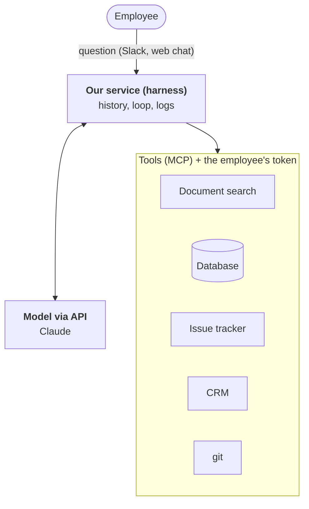

:::tldr
A company agent is not a model fine-tuned on the company's documents. It is an ordinary commercial model plus your own service around it: the service gives the model tools to search internal systems, knows who is asking, and lets through only the data that person may see. This part covers the architecture; the following parts build it layer by layer.
:::

## The problem

Picture an ordinary day at a hundred-person company. A manager asks what payment terms the contract with a client had. A developer wants to know why the payment service went down yesterday and whether it has happened before. A director asks for October sales by region.

The answers exist somewhere: the contract is in the wiki or on a shared drive, the incident history is in the issue tracker and the on-call chat, the numbers are in the database. Finding them means knowing where to look, having access and spending half an hour. Or asking a colleague who knows, and taking half an hour of theirs.

We want an agent you can ask in plain language and get an answer with links to the sources. And the developer must not see salaries, and the intern must not see a contract they have no access to.

::news{topic="agents"}

## Why not a regular chat bot

The first idea is to give everyone ChatGPT or Claude. That is useful, but it does not solve this problem.

- **The model does not know your data.** It was trained on the internet, and your client contract never got there. You can paste documents into the chat by hand, but then the employee has already done all the searching.
- **Data changes every day.** Even if the model knew everything at training time, its knowledge would be stale a week later.
- **Permissions.** Not everyone in a company sees everything. A bot that knows everything and answers everyone is a leak waiting to happen.

## Why not fine-tuning

The second idea is to take an open model and fine-tune it on the company's documents. For this task it is the wrong road.

- Fine-tuning is bad at adding facts. The model picks up style and general patterns, but mixes up and invents the specific numbers from a contract.
- Knowledge freezes at training time. Every new document means another training run.
- Permissions cannot be enforced: whatever went into the weights is available to anyone who asks the right question.
- It cannot cite a source, and in business an answer without a source is not trusted.

A different approach works: the model knows nothing in advance but knows how to search. When a question comes in, it decides where to look, calls tools, reads what it finds and answers with links. The data stays where it lives, is always fresh, and permissions are checked on every access.

## What the agent is made of

**The model.** Commercial, over an API. It understands the question, picks tools and writes the answer. We do not train it and can swap it easily. We use Claude here, but the architecture is not tied to a provider.

**The harness, our service.** The heart of the system and most of the code we will write. It keeps the conversation history, runs the agent loop (the model asks for a tool, the service calls it and sends back the result), caps the number of steps and the spend, and logs every action.

**Tools over MCP.** Each internal system is connected through its own MCP server: wiki search, read-only database queries, the issue tracker, the CRM. MCP is an open protocol, so you can take ready-made servers for popular systems and write small ones for your own. The agent does not care how many there are: it sees a list of tools with descriptions.

**Document search.** The wiki, contracts and policies are text, and they need good search. This is the one place where we copy data to our side: we build a search index. Next to every chunk of text we store who may see it.

**Identity and permissions.** The employee signs in through the company SSO. The agent gets their token and calls systems on their behalf, not under a service account with access to everything. If a person cannot open a wiki page, the agent cannot see it either. This is the most important part of the whole design.

**The interface.** A bot in the team chat and a simple web chat. It is a thin layer; everything interesting happens in the service.

## The principles we will stick to

1. **Buy the model, feed knowledge through tools.** No fine-tuning.
2. **Data stays where it lives.** The agent calls systems at question time. Only the search index is copied, and it carries permissions.
3. **The agent acts on behalf of a person.** It sees what the person asking sees, and no more.
4. **Read-only by default.** Any change to data goes through explicit human confirmation.
5. **Every answer cites its sources.** The employee must be able to check.
6. **Log everything.** Who asked what, which tools were called, what they returned. Without this you can neither debug the agent nor pass a security review.

## What happens to data at the model provider

A commercial model over an API means that questions and the document fragments found for them go to the provider. Your security team will ask about this first, and it is worth having the answer ready. By default the commercial APIs of the major providers do not train models on customer requests, but read the retention and processing terms in the contract. If data must not leave a region, the models are available through clouds such as Amazon Bedrock or Google Vertex AI, where you choose the region. We will come back to this in the [production part](/blog/agent-prod/#where-the-model-runs).

## The plan

The order of the parts follows the order in which it makes sense to build such a system: every layer works on its own and becomes the foundation for the next.

1. **Concept.** This part.
2. **[Talking to a model](/blog/agent-first-call/).** API key, SDK, streaming, history.
3. **[The agent loop and tools](/blog/agent-loop/).** The harness, tool calls, confirming dangerous actions.
4. **[MCP](/blog/agent-mcp/).** Moving tools into separate servers and writing our own server for the database.
5. **[Company knowledge](/blog/agent-search/).** Indexing documents and teaching the agent to search them.
6. **[Permissions](/blog/agent-auth/).** SSO, OAuth and an agent that acts on behalf of an employee.
7. **[Context and money](/blog/agent-cost/).** Caching, compacting history, limits.
8. **[The interface](/blog/agent-interface/).** A chat bot and a web chat.
9. **[Production](/blog/agent-prod/).** Deploying inside the perimeter, audit, quality checks and prompt-injection defence.

The next two parts look like a teaching agent that works with files. That is deliberate: the loop is easier to see on a simple example, and from part 4 the same code starts calling the company's systems.
