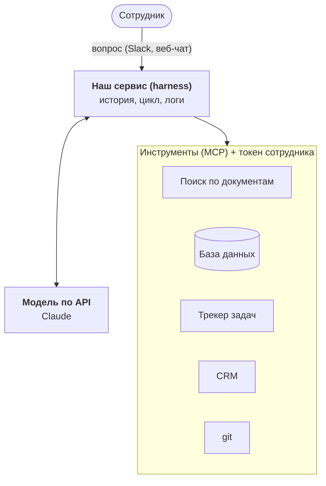

:::tldr
Корпоративный агент это не модель, которую дообучили на документах компании. Это обычная коммерческая модель плюс ваш сервис вокруг неё: он даёт модели инструменты для поиска по внутренним системам, знает, кто задаёт вопрос, и пропускает только те данные, которые этому человеку можно видеть. В этой части разбираем архитектуру, в следующих пишем её по слоям.
:::

## Задача

Представьте обычный день в компании на сотню человек. Менеджер спрашивает, какие условия оплаты были в договоре с клиентом. Разработчик хочет понять, почему вчера упал сервис оплаты и чинили ли такое раньше. Руководитель просит цифры продаж за октябрь по регионам.

Ответы где-то есть: договор лежит в вики или на диске, история инцидента в трекере задач и в чате дежурных, цифры в базе данных. Чтобы их найти, нужно знать, где искать, иметь доступ и потратить полчаса. Или спросить коллегу, который знает, и отнять полчаса у него.

Мы хотим агента, которому можно задать такой вопрос обычным языком и получить ответ со ссылками на источники. Причём разработчик не должен увидеть зарплаты, а стажёр условия договора, к которому у него нет доступа.

::news{topic="agents"}

## Почему не обычный чат-бот

Первая мысль: дать сотрудникам ChatGPT или Claude. Это полезно, но задачу не решает.

- **Модель не знает ваших данных.** Она обучена на интернете, а ваш договор с клиентом в интернет не попадал. Можно вставлять документы в чат руками, но тогда сотрудник уже сделал всю работу по поиску.
- **Данные меняются каждый день.** Даже если бы модель знала всё на момент обучения, через неделю знания устарели бы.
- **Права доступа.** В компании не все видят всё. Чат-бот, который знает всё и отвечает всем, это утечка, которая ждёт своего часа.

## Почему не дообучение

Вторая мысль: взять открытую модель и дообучить на документах компании. Для этой задачи это плохой путь.

- Дообучение плохо добавляет факты. Модель запоминает стиль и общие закономерности, а конкретные цифры из договора путает и выдумывает.
- Знания застывают на момент обучения. Каждый новый документ требует нового цикла.
- Права доступа невозможно соблюсти: всё, что попало в веса, доступно любому, кто задаст правильный вопрос.
- Нельзя показать источник ответа, а без источника ответу в бизнесе не верят.

Работает другой подход: модель ничего не знает заранее, но умеет искать. Когда приходит вопрос, она сама решает, куда сходить, вызывает инструменты, читает найденное и отвечает со ссылками. Данные остаются там, где лежат, всегда свежие, а права проверяются при каждом обращении.

## Из чего состоит агент

**Модель.** Коммерческая, по API. Она отвечает за понимание вопроса, выбор инструментов и формулировку ответа. Мы её не обучаем и легко можем заменить. Здесь используем Claude, но архитектура не привязана к провайдеру.

**Harness, наш сервис.** Сердце системы и основная часть кода, который мы напишем. Он ведёт историю разговора, крутит агентный цикл (модель просит инструмент, сервис его вызывает, возвращает результат), ограничивает число шагов и расходы, пишет журнал всех действий.

**Инструменты через MCP.** Каждая внутренняя система подключается отдельным MCP-сервером: поиск по вики, запросы к базе только на чтение, трекер задач, CRM. MCP это открытый протокол, поэтому можно взять готовые серверы для популярных систем, а для своих написать небольшие собственные. Агенту неважно, сколько их: он видит список инструментов с описаниями.

**Поиск по документам.** Вики, договоры, регламенты лежат текстом, и по ним нужен хороший поиск. Это единственное место, где мы копируем данные к себе: строим поисковый индекс. Вместе с каждым куском текста храним, кому он доступен.

**Личность и права.** Сотрудник входит через корпоративный SSO. Агент получает его токен и ходит в системы от его имени, а не под служебной учёткой с доступом ко всему. Если у человека нет доступа к документу в вики, агент его тоже не увидит. Это самая важная часть всей конструкции.

**Интерфейс.** Бот в рабочем мессенджере и простой веб-чат. Это тонкий слой: всё интересное происходит в сервисе.

## Принципы, которых будем держаться

1. **Модель покупаем, знания подаём через инструменты.** Никакого дообучения.
2. **Данные остаются на месте.** Агент ходит в системы в момент вопроса. Копируем только поисковый индекс, и вместе с правами.
3. **Агент действует от имени человека.** Видит то же, что видит спрашивающий, и не больше.
4. **По умолчанию только чтение.** Любое изменение данных проходит через явное подтверждение человеком.
5. **Каждый ответ со ссылками на источники.** Сотрудник должен иметь возможность проверить.
6. **Всё записываем.** Кто что спросил, какие инструменты вызывались, что вернули. Без этого невозможно ни отладить агента, ни пройти проверку безопасности.

## Что с данными у провайдера модели

Коммерческая модель по API означает, что текст вопросов и найденные фрагменты документов уходят провайдеру. Это первое, о чём спросит служба безопасности, и ответ стоит подготовить заранее. По умолчанию коммерческие API крупных провайдеров не обучают модели на запросах клиентов, но условия хранения и обработки нужно прочитать в договоре. Если данные не должны покидать определённый регион, модели доступны через облака, например Amazon Bedrock или Google Vertex AI, с выбором региона. Вернёмся к этому в [части про прод](/blog/ru/agent-prod/#где-работает-модель).

## План цикла

Порядок частей повторяет порядок, в котором такую систему разумно строить: каждый слой работает сам по себе и становится фундаментом для следующего.

1. **Концепция.** Эта часть.
2. **[Первый разговор с моделью](/blog/ru/agent-first-call/).** API-ключ, SDK, стриминг, история.
3. **[Агентный цикл и инструменты](/blog/ru/agent-loop/).** Harness, вызов инструментов, подтверждение опасных действий.
4. **[MCP](/blog/ru/agent-mcp/).** Выносим инструменты в отдельные серверы и пишем свой сервер для базы данных.
5. **[Знания компании](/blog/ru/agent-search/).** Индексируем документы и учим агента искать по ним.
6. **[Права доступа](/blog/ru/agent-auth/).** SSO, OAuth и агент, который действует от имени сотрудника.
7. **[Контекст и деньги](/blog/ru/agent-cost/).** Кэширование, сжатие истории, лимиты.
8. **[Интерфейс](/blog/ru/agent-interface/).** Бот в мессенджере и веб-чат.
9. **[В прод](/blog/ru/agent-prod/).** Деплой внутри периметра, аудит, проверки качества и защита от промпт-инъекций.

Следующие две части пока выглядят как учебный агент для работы с файлами. Это нарочно: на простом примере проще увидеть, как устроен цикл, а с четвёртой части тот же код начнёт ходить в системы компании.
