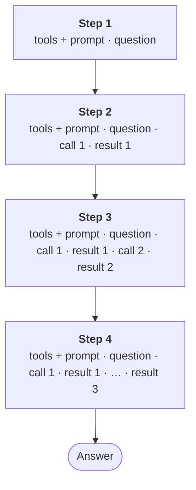

:::tldr
The model API remembers nothing, so every step of the agent loop resends the system prompt, the tool descriptions and the whole history. Without caching, a ten-question conversation costs about 7 dollars; with caching, about 1. The order of work: first record the `usage` of every response, then turn on prompt caching, trim tool results, let the API shrink long histories (clearing old results and compaction), and set a daily limit per employee.
:::

In the [previous part](/blog/agent-auth/) the agent learned to work with the employee's permissions. Now it is ready for the whole company to use, and the first thing to understand is what that will cost. The API bill is made of tokens, and most of those tokens do not go where you would expect.

## Where the money goes

The model API does not store the conversation. Every request carries everything the model needs to know: tool descriptions, the system prompt and the whole history, including the results of earlier calls. In the agent loop from [part 3](/blog/agent-loop/), one question means several requests in a row, each longer than the one before:



The result of the first call is paid for on the second step, on the third, on the fourth and beyond, on every step of every later question in the conversation. Input grows with each step, and the total paid for a conversation grows roughly with the square of its length.

Claude Opus 5.5 prices at the time of writing, in dollars per million tokens:

| | Price | Multiplier |
|---|---|---|
| Input | 4 | 1 |
| Output (including the model's thinking) | 20 | 5 |
| 5-minute cache write | 5 | 1.25 |
| Cache read | 0.2 | 0.05 |

Let's price a typical conversation. Tools and prompt take 1500 tokens. For each question the agent makes three tool calls: each call with its thinking is 400 output tokens, each result is 2000 tokens, the final answer is 600 tokens.

| | Input | Output | Total |
|---|---|---|---|
| One question, no cache | 0.082 | 0.036 | 0.12 dollars |
| One question, with cache | 0.046 | 0.036 | 0.08 dollars |
| Ten questions in a row, no cache | 6.48 | 0.36 | 6.84 dollars |
| Ten questions in a row, with cache | 0.70 | 0.36 | 1.07 dollars |

Output is expensive per token, but in a long conversation you pay for input: by the tenth question every step sends almost 80 thousand tokens of history. So almost everything in this part is about input.

## Measure first

Every API response has a `usage` field: how many tokens went to input, how many to output, how many were written to the cache and how many were read from it. We record this for every step together with the employee's login. Without such a log every optimisation is blind, and in a month accounting will ask which department spent how much.

The cost of a step comes from four `usage` fields and four prices:

```ts
const PRICE = { input: 4, output: 20, cacheWrite: 5, cacheRead: 0.2 }; // dollars per million tokens

const usd =
  (u.input_tokens * PRICE.input +
    u.output_tokens * PRICE.output +
    (u.cache_creation_input_tokens ?? 0) * PRICE.cacheWrite +
    (u.cache_read_input_tokens ?? 0) * PRICE.cacheRead) / 1_000_000;
```

`usage.ts` writes this to an SQLite table (time, login, the four numbers and the total) and can tell with one query how much an employee has spent today.

A detail about `iterations`: when the API compacts history itself (more on that below), the compaction tokens do not appear in the top-level `usage` fields but sit in a separate entry in `usage.iterations`. Count only the top-level fields and your spend will come out too low, so `usage.ts` sums the `iterations` entries when they are present.

The calculation in code is for limits and internal reports. The exact amount billed is in the provider's console, and it is worth reconciling your log against it once a month.

## Prompt caching

The cache works on a prefix. If the beginning of a request matches, byte for byte, something sent recently, the API does not process it again but reads it from the cache twenty times cheaper. A request is assembled in the order "tools, system prompt, messages", and the cache matches from the start up to the first difference.

An agent is close to ideal for caching: tools and prompt do not change, and history only grows at the end. We need two `cache_control` markers:

```ts
const system = [
  { type: "text", text: "You are an assistant for company employees. ...", cache_control: { type: "ephemeral" } },
];

client.beta.messages.stream({
  model: "claude-opus-5-5",
  cache_control: { type: "ephemeral" }, // automatic marker at the end of the history
  system,
  tools: toolDefs, // sorted by name
  messages,
});
```

The first marker, at the end of the system prompt, pins the most stable part: tools and prompt. The second, at the request level, is placed automatically on the last block of the history and moves with every step, so each next step reads everything before it from the cache and writes only what is new.

The cache lives for five minutes from the last access, and every read extends it. While the employee is talking to the agent, the cache stays warm. If they went to lunch, the next question writes the history to the cache again. There is a one-hour cache (`ttl: "1h"`), but writing to it costs twice the input price, and it pays off only if gaps between questions are usually between five minutes and an hour.

A cache write costs a quarter more than ordinary input, so caching pays only if what was written is read later. A piece read zero times cost 25% more; a piece read at least once is already cheaper than without the cache. In the agent loop almost everything is read many times, so caching is always on. A prefix shorter than 512 tokens is not cached at all, with no error: just zeros in `cache_read_input_tokens`.

What silently breaks the cache:

- **Date and time in the system prompt.** "Today is November 4, 14:32" changes the prefix every minute. If the model needs the date, pass it to the day, or in the user's message.
- **Tool order.** We collect tools from several MCP servers, and the order of their responses can change. Hence the sort by name.
- **Editing history after the fact.** Delete an old message or adjust a tool result, and everything after the edit no longer matches. More on this below.

The check is simple: in the `usage.ts` log, from the second step on `cache_read` should be large and growing and `cache_write` small. If `cache_write` on every step is roughly the size of the whole conversation, something in the prefix changes between requests.

## Keep junk out of the context

The cheapest token is the one that never entered the history. Every tool result will be paid for on every later step of the conversation, so we limit it right where it appears.

In [part 4](/blog/agent-mcp/) the database server already returns at most 200 rows. Let's add a general safeguard to `mcp.ts` for any server, including third-party ones:

```ts
const MAX_RESULT_CHARS = 20_000; // roughly 5-7 thousand tokens

// inside each tool's run()
if (result.isError) throw new Error(text);
// The result goes into the history and is paid for on every later step
if (text.length > MAX_RESULT_CHARS) {
  return `${text.slice(0, MAX_RESULT_CHARS)}\n…truncated: ${text.length} characters. Narrow the query.`;
}
return text;
```

The hint at the end matters: the model sees there is more data and rewrites the query more precisely instead of answering from a fragment.

One more line in the system prompt noticeably shrinks database results:

```text
Request only the rows and columns you need from the database: aggregate in SQL, not in your answer.
```

Without it the model sometimes selects every deal of the year to add them up in its head. With it, it writes `SELECT region, SUM(amount) ... GROUP BY region` and gets five rows instead of a thousand.

Tool descriptions are part of every request too. The token counting endpoint, which is free, shows how much they weigh:

```ts
const { input_tokens } = await client.messages.countTokens({
  model: "claude-opus-5-5",
  system,
  tools,
  messages: [{ role: "user", content: "hi" }],
});
```

With four tools this does not matter. Once you connect a dozen off-the-shelf MCP servers with 20 tools each, descriptions easily take tens of thousands of tokens. Then it is worth splitting tools by employee role, or turning on tool search, where the model loads descriptions as it needs them.

## Long conversations: let the API shrink them

Even with caching, a thirty-question conversation grows to hundreds of thousands of tokens. Claude Opus 5.5 has a million-token context window, but the window is not the only issue: long context costs more and distracts the model with old results it no longer needs.

The first instinct is to delete old tool results from the history yourself. Don't. First, editing the middle of the history resets the cache for everything after the edit. Second, on Claude Opus 5.5 the model's thinking is tied to the history it appeared in: the API checks that everything before a thinking block is unchanged. For accounts created after August 31, 2026, editing history while sending old thinking back returns a 400 error. The rule is simple: only append to the history.

The API itself can shrink the history, and that does not count as an edit: the check compares the conversation as we sent it. Two strategies:

```ts
// How to shrink a long conversation. Both strategies run on the API side,
// and we keep simply appending to the history
const contextManagement: Anthropic.Beta.BetaContextManagementConfig = {
  edits: [
    {
      // Old tool results are replaced with a placeholder; the calls themselves stay
      type: "clear_tool_uses_20250919",
      trigger: { type: "input_tokens", value: 60_000 },
      keep: { type: "tool_uses", value: 6 },
      clear_at_least: { type: "input_tokens", value: 20_000 },
    },
    {
      // If the conversation still grows too big, early turns are folded into a summary
      type: "compact_20260112",
      trigger: { type: "input_tokens", value: 150_000 },
    },
  ],
};

const stream = client.beta.messages.stream({
  // ...
  betas: ["context-management-2025-06-27", "compact-2026-01-12"],
  context_management: contextManagement,
});
```

**Clearing tool results.** When input passes 60 thousand tokens, the API replaces old call results with a placeholder and keeps the six most recent. The calls stay visible: the model knows it asked for October sales, and if the numbers are needed again, it calls the tool again. Clearing resets the cache from the first edited point, so `clear_at_least` requires removing at least 20 thousand tokens at once: small clearings on every step would cost more than they save.

**Compaction.** If the conversation reaches 150 thousand tokens, the API asks the model to summarise everything earlier and from then on works with the summary instead of the early turns. The summary arrives in the response as a separate `compaction` block, so the whole `reply.content` must be appended to the history, not just the text:

```ts
// The whole content: it may contain a compaction block, and without it the compaction is lost
messages.push({ role: "assistant", content: reply.content });
```

We have done this since [part 3](/blog/agent-loop/), so nothing needs to change.

Both strategies are still in beta, so requests go through `client.beta.messages` with headers in `betas`. The types also come from `Anthropic.Beta`.

## Limits

An agent with access to the company database can go into a long loop: the model rewrites a query, gets an error, tries again. You need safeguards at several levels.

- **Steps per question.** `MAX_STEPS = 30` has been in the loop since [part 3](/blog/agent-loop/).
- **Output per step.** `max_tokens` limits the length of a single response including thinking.
- **Thinking depth.** `output_config.effort` controls how much the model thinks. On Claude Opus 5.5 the default is `medium`, which is enough for reference questions. Use `high` for analytics that ties several sources together and `low` for simple lookups. Thinking is billed as output, at 20 dollars per million tokens.
- **Money per employee per day.** Checked before every step, not only at the start of a question, otherwise one long question can go far past the limit.

The loop from part 3 gains a check before every request and a log entry after the reply:

```ts
if (spentToday(me.sub) >= DAILY_LIMIT_USD) {
  console.log(`\n[daily limit of ${DAILY_LIMIT_USD} dollars reached, see you tomorrow]`);
  return;
}
// ... the model request ...
record(me.sub, tally(reply.usage));
```

The loop also adds up the cost and the share of input served from cache across all steps of a question and prints them after the answer.

Five dollars a day by default is generous: at about ten cents a question, an employee hits the limit after fifty questions. The limit is not there to save money on people but so that a prompt bug or a looping agent cannot burn the monthly budget overnight. Individual limits for people and departments fit nicely in the same database, next to the log.

## Running it

The servers from [part 6](/blog/agent-auth/) start the same way. The agent now prints what each question cost:

```text
> how much did I close in October?

🔧 db__describe_schema {}
🔧 db__query {"sql":"SELECT stage, SUM(amount) FROM deals WHERE closed_at >= '2026-10-01' GROUP BY stage"}

In October you won one deal for 2.4 million (Severstal-Service).
Source: the deals table.
[0.061 dollars, 48% of input from cache, 0.06 today]

> and the lost ones, all time?

🔧 db__query {"sql":"SELECT client, amount, closed_at FROM deals WHERE stage = 'lost'"}

One: Baikal Tour for 0.6 million, closed on September 3. Source: the deals table.
[0.024 dollars, 91% of input from cache, 0.09 today]
```

The second question in the conversation is almost three times cheaper than the first: the history is already cached. A monthly report by department is one SQL query against `usage.db`.

The order of magnitude for a hundred-person company: if everyone asks ten questions a day at 8-10 cents each, that is about two thousand dollars a month. This is a rough estimate; the real figure depends on conversation length and how much data the tools return. A week of the `usage` log will show the real one.

## What else lowers the bill

- **Batch processing.** Anything that does not need an immediate answer (a nightly incident summary, labelling documents at indexing time) can go through the Message Batches API at half price.
- **A smaller model for housekeeping.** Titling a conversation or classifying a question can be done by Claude Haiku 5.5, which is dozens of times cheaper than the main model. Answering employees from company data is better left to the main model: a mistake there costs more than the cents saved.
- **Do not change the model or parameters mid-conversation.** The cache is tied to the model, and changing `effort` in the request settings resets the history cache.

## Next

The agent counts money, handles long conversations and stays within limits. For now it lives in a terminal and takes the employee's token from an environment variable. The [next part](/blog/agent-interface/) gives it an interface: a bot in the team chat and a web chat with company SSO sign-in, streamed answers and conversation history.
