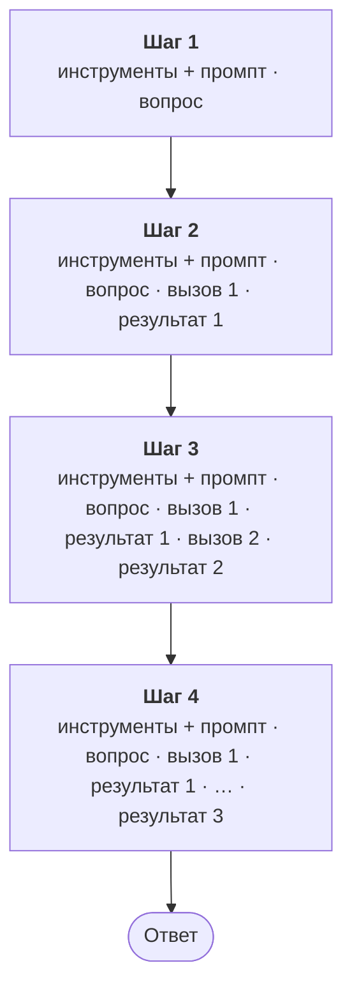

:::tldr
API модели ничего не помнит, поэтому каждый шаг агентного цикла заново отправляет системный промпт, описания инструментов и всю историю. Без кэша разговор из десяти вопросов стоит около 7 долларов, с кэшем около 1. Порядок действий: сначала записывать `usage` каждого ответа, затем включить кэширование промптов, обрезать результаты инструментов, отдать сжатие длинной истории API (очистка старых результатов и compaction) и поставить дневной лимит на сотрудника.
:::

В [прошлой части](/blog/ru/agent-auth/) агент научился работать с правами сотрудника. Теперь он готов к тому, чтобы им пользовалась вся компания, и первым делом стоит понять, сколько это будет стоить. Счёт за API складывается из токенов, и большая часть этих токенов уходит не туда, куда кажется.

## Куда уходят деньги

API модели не хранит разговор. Каждый запрос несёт всё, что модель должна знать: описания инструментов, системный промпт и всю историю, включая результаты прошлых вызовов. В агентном цикле из [части 3](/blog/ru/agent-loop/) один вопрос это несколько запросов подряд, и каждый следующий длиннее предыдущего:



Результат первого вызова оплачивается на втором шаге, на третьем, на четвёртом и дальше, на каждом шаге каждого следующего вопроса в этом разговоре. Вход растёт с каждым шагом, а суммарная оплата за разговор растёт примерно как квадрат его длины.

Цены Claude Opus 5.5 на момент написания, в долларах за миллион токенов:

| | Цена | Множитель |
|---|---|---|
| Вход | 4 | 1 |
| Выход (включая размышления модели) | 20 | 5 |
| Запись в кэш на 5 минут | 5 | 1,25 |
| Чтение из кэша | 0,2 | 0,05 |

Посчитаем типичный разговор. Инструменты и промпт занимают 1500 токенов. На каждый вопрос агент делает три вызова инструментов: каждый вызов с размышлениями это 400 токенов выхода, каждый результат 2000 токенов, финальный ответ 600 токенов.

| | Вход | Выход | Итого |
|---|---|---|---|
| Один вопрос, без кэша | 0,082 | 0,036 | 0,12 доллара |
| Один вопрос, с кэшем | 0,046 | 0,036 | 0,08 доллара |
| Десять вопросов подряд, без кэша | 6,48 | 0,36 | 6,84 доллара |
| Десять вопросов подряд, с кэшем | 0,70 | 0,36 | 1,07 доллара |

Выход стоит дорого за токен, но в длинном разговоре платят за вход: к десятому вопросу каждый шаг отправляет почти 80 тысяч токенов истории. Поэтому почти всё в этой части про вход.

::news{topic="cost llm-api"}

## Сначала измерить

Каждый ответ API содержит поле `usage`: сколько токенов ушло на вход, сколько на выход, сколько записано в кэш и сколько прочитано из него. Записываем это для каждого шага вместе с логином сотрудника. Без такого журнала любая оптимизация вслепую, а через месяц бухгалтерия спросит, какой отдел сколько потратил.

Цена шага считается из четырёх полей `usage` и четырёх цен:

```ts
const PRICE = { input: 4, output: 20, cacheWrite: 5, cacheRead: 0.2 }; // доллары за миллион токенов

const usd =
  (u.input_tokens * PRICE.input +
    u.output_tokens * PRICE.output +
    (u.cache_creation_input_tokens ?? 0) * PRICE.cacheWrite +
    (u.cache_read_input_tokens ?? 0) * PRICE.cacheRead) / 1_000_000;
```

`usage.ts` пишет это в таблицу SQLite (время, логин, четыре числа и сумма) и умеет одним запросом посчитать, сколько сотрудник потратил сегодня.

Деталь про `iterations`: когда API сам сжимает историю (об этом ниже), токены на сжатие не попадают в верхние поля `usage`, а лежат отдельной записью в `usage.iterations`. Если считать только верхние поля, расходы получатся заниженными, поэтому `usage.ts` складывает записи из `iterations`, когда они есть.

Расчёт в коде нужен для лимитов и отчётов внутри компании. Точную сумму к оплате показывает консоль провайдера, и раз в месяц стоит сверять с ней свой журнал.

## Кэширование промптов

Кэш работает по префиксу. Если начало запроса побайтно совпадает с тем, что уже было отправлено недавно, API не обрабатывает его заново, а читает из кэша в двадцать раз дешевле. Запрос собирается в порядке «инструменты, системный промпт, сообщения», и кэш совпадает с начала до первого отличия.

Агент для кэша почти идеален: инструменты и промпт не меняются, а история только растёт в конец. Нужно поставить две метки `cache_control`:

```ts
const system = [
  { type: "text", text: "Ты ассистент сотрудников компании. ...", cache_control: { type: "ephemeral" } },
];

client.beta.messages.stream({
  model: "claude-opus-5-5",
  cache_control: { type: "ephemeral" }, // автоматическая метка в конце истории
  system,
  tools: toolDefs, // отсортированы по имени
  messages,
});
```

Первая метка в конце системного промпта закрепляет самую стабильную часть: инструменты и промпт. Вторая, на уровне всего запроса, автоматически ставится на последний блок истории и сдвигается с каждым шагом, так что каждый следующий шаг читает из кэша всё, что было до него, и записывает только новое.

Кэш живёт пять минут с последнего обращения, и каждое чтение продлевает его. Пока сотрудник разговаривает с агентом, кэш тёплый. Если он ушёл на обед, следующий вопрос заново запишет историю в кэш. Есть кэш на час (`ttl: "1h"`), но запись в него стоит вдвое дороже входа, и окупается он, только если паузы между вопросами обычно от пяти минут до часа.

Запись в кэш стоит на четверть дороже обычного входа, поэтому кэш выгоден, только если записанное потом читают. Кусок, который прочитали ноль раз, обошёлся на 25% дороже, а прочитанный хотя бы раз уже дешевле, чем без кэша. В агентном цикле почти всё читается много раз, поэтому кэш включаем всегда. Префикс короче 512 токенов не кэшируется вовсе, без ошибки: просто нули в `cache_read_input_tokens`.

Что незаметно ломает кэш:

- **Дата и время в системном промпте.** «Сегодня 4 ноября, 14:32» меняет префикс каждую минуту. Если модели нужна дата, передавайте её с точностью до дня или в сообщении пользователя.
- **Порядок инструментов.** Мы собираем их из нескольких MCP-серверов, и порядок ответов может меняться. Отсюда сортировка по имени.
- **Правка истории задним числом.** Удалили старое сообщение или поправили результат инструмента, и всё после места правки перестаёт совпадать. Про это подробнее ниже.

Проверка простая: в журнале из `usage.ts` начиная со второго шага `cache_read` должен быть большим и расти, а `cache_write` маленьким. Если `cache_write` на каждом шаге примерно равен размеру всего разговора, что-то в префиксе меняется между запросами.

## Не пускать лишнее в контекст

Самый дешёвый токен тот, который не попал в историю. Любой результат инструмента будет оплачиваться на каждом следующем шаге разговора, поэтому ограничиваем его прямо там, где он появляется.

В [части 4](/blog/ru/agent-mcp/) сервер базы уже отдаёт не больше 200 строк. Добавим общий предохранитель в `mcp.ts` для любых серверов, включая чужие:

```ts
const MAX_RESULT_CHARS = 20_000; // примерно 5–7 тысяч токенов

// внутри run() у каждого инструмента
if (result.isError) throw new Error(text);
// Результат попадёт в историю и будет оплачиваться на каждом следующем шаге
if (text.length > MAX_RESULT_CHARS) {
  return `${text.slice(0, MAX_RESULT_CHARS)}\n…обрезано: ${text.length} символов. Уточни запрос.`;
}
return text;
```

Подсказка в конце важна: модель видит, что данных больше, и сама переписывает запрос точнее, вместо того чтобы отвечать по обрывку.

Ещё одна строка в системный промпт заметно сокращает результаты запросов к базе:

```text
Запрашивай из базы только нужные строки и колонки: агрегируй в SQL, а не в ответе.
```

Без неё модель иногда выбирает все сделки за год, чтобы сложить их в уме. С ней пишет `SELECT region, SUM(amount) ... GROUP BY region` и получает пять строк вместо тысячи.

Описания инструментов тоже входят в каждый запрос. Посмотреть, сколько они весят, можно эндпоинтом подсчёта токенов, он бесплатный:

```ts
const { input_tokens } = await client.messages.countTokens({
  model: "claude-opus-5-5",
  system,
  tools,
  messages: [{ role: "user", content: "привет" }],
});
```

С четырьмя инструментами это неважно. Когда подключите десяток готовых MCP-серверов по 20 инструментов в каждом, описания легко займут десятки тысяч токенов. Тогда инструменты стоит разделить по ролям сотрудников или включить поиск инструментов, при котором модель подгружает описания по мере надобности.

## Длинные разговоры: пусть сжимает API

Даже с кэшем разговор из тридцати вопросов растёт до сотен тысяч токенов. Окно контекста у Claude Opus 5.5 миллион токенов, но дело не только в окне: длинный контекст дороже и отвлекает модель старыми результатами, которые уже не нужны.

Первое желание: удалять из истории старые результаты инструментов самим. Не надо. Во-первых, правка середины истории сбрасывает кэш со всего, что после неё. Во-вторых, у Claude Opus 5.5 размышления модели привязаны к истории, в которой они появились: API проверяет, что всё сказанное до блока размышлений не изменилось. У аккаунтов, созданных после 31 августа 2026 года, правка истории с обратной отправкой старых размышлений возвращает ошибку 400. Правило простое: историю только дописываем в конец.

Ужимать историю умеет сам API, и это не считается правкой: проверка сравнивает разговор в том виде, в каком его отправили мы. Две стратегии:

```ts
// Как ужимать длинный разговор. Обе стратегии работают на стороне API,
// а мы продолжаем просто дописывать историю в конец
const contextManagement: Anthropic.Beta.BetaContextManagementConfig = {
  edits: [
    {
      // Старые результаты инструментов заменяются заглушкой, сами вызовы остаются
      type: "clear_tool_uses_20250919",
      trigger: { type: "input_tokens", value: 60_000 },
      keep: { type: "tool_uses", value: 6 },
      clear_at_least: { type: "input_tokens", value: 20_000 },
    },
    {
      // Если разговор всё равно разросся, ранние ходы сворачиваются в краткое изложение
      type: "compact_20260112",
      trigger: { type: "input_tokens", value: 150_000 },
    },
  ],
};

const stream = client.beta.messages.stream({
  // ...
  betas: ["context-management-2025-06-27", "compact-2026-01-12"],
  context_management: contextManagement,
});
```

**Очистка результатов инструментов.** Когда вход переваливает за 60 тысяч токенов, API заменяет старые результаты вызовов заглушкой и оставляет шесть последних. Вызовы остаются видны: модель знает, что запрашивала продажи за октябрь, и если цифры снова понадобятся, вызовет инструмент ещё раз. Очистка сбрасывает кэш с места первой правки, поэтому `clear_at_least` требует убрать сразу не меньше 20 тысяч токенов: мелкие очистки на каждом шаге стоили бы дороже, чем экономили.

**Сжатие истории (compaction).** Если разговор дорос до 150 тысяч токенов, API просит модель кратко изложить всё, что было раньше, и дальше работает с этим изложением вместо ранних ходов. Изложение приходит в ответе отдельным блоком `compaction`, поэтому в историю нужно дописывать весь `reply.content`, а не только текст:

```ts
// Весь content целиком: в нём может быть блок compaction, без него сжатие потеряется
messages.push({ role: "assistant", content: reply.content });
```

Мы так и делали с [части 3](/blog/ru/agent-loop/), так что менять ничего не нужно.

Обе стратегии пока в бета-версии, поэтому запросы идут через `client.beta.messages` с заголовками в `betas`. Типы тоже берутся из `Anthropic.Beta`.

## Лимиты

Агент, которому доступна база компании, может уйти в долгий цикл: модель переписывает запрос, получает ошибку, пробует снова. Нужны предохранители на нескольких уровнях.

- **Шаги на вопрос.** `MAX_STEPS = 30` уже стоит в цикле с [части 3](/blog/ru/agent-loop/).
- **Выход на шаг.** `max_tokens` ограничивает длину одного ответа вместе с размышлениями.
- **Глубина размышлений.** `output_config.effort` управляет тем, сколько модель думает. У Claude Opus 5.5 по умолчанию `medium`, и для справочных вопросов этого хватает. `high` стоит включать для аналитики, где нужно связать несколько источников, `low` для простых поисков. Размышления оплачиваются как выход, по 20 долларов за миллион токенов.
- **Деньги на сотрудника в день.** Проверяем перед каждым шагом, а не только в начале вопроса, иначе один длинный вопрос может уйти далеко за лимит.

В цикле из части 3 перед каждым запросом добавляется проверка, а после ответа запись в журнал:

```ts
if (spentToday(me.sub) >= DAILY_LIMIT_USD) {
  console.log(`\n[дневной лимит ${DAILY_LIMIT_USD} долларов исчерпан, продолжим завтра]`);
  return;
}
// ... запрос к модели ...
record(me.sub, tally(reply.usage));
```

Заодно цикл суммирует стоимость и долю входа из кэша по всем шагам вопроса и печатает их после ответа.

Пять долларов в день по умолчанию это с запасом: при цене вопроса около десяти центов сотрудник упрётся в лимит после пятидесяти вопросов. Лимит нужен не чтобы экономить на людях, а чтобы ошибка в промпте или зациклившийся агент не сжёг месячный бюджет за ночь. Индивидуальные лимиты для людей и отделов удобно хранить в той же базе, рядом с журналом.

## Запускаем

Серверы из [части 6](/blog/ru/agent-auth/) запускаются так же. Агент теперь после каждого ответа печатает, сколько стоил вопрос:

```text
> на сколько я закрыл сделок в октябре?

🔧 db__describe_schema {}
🔧 db__query {"sql":"SELECT stage, SUM(amount) FROM deals WHERE closed_at >= '2026-10-01' GROUP BY stage"}

В октябре вы выиграли одну сделку на 2,4 млн (Северсталь-Сервис).
Источник: таблица deals.
[0.061 доллара, из кэша 48% входа, за сегодня 0.06]

> а проигранные за всё время?

🔧 db__query {"sql":"SELECT client, amount, closed_at FROM deals WHERE stage = 'lost'"}

Одна: Байкал Тур на 0,6 млн, закрыта 3 сентября. Источник: таблица deals.
[0.024 доллара, из кэша 91% входа, за сегодня 0.09]
```

Второй вопрос в разговоре дешевле первого почти втрое: история уже в кэше. Отчёт по отделам за месяц это один SQL-запрос к `usage.db`.

Порядок цен для компании на сто человек: если каждый задаёт десять вопросов в день по 8–10 центов, получается около двух тысяч долларов в месяц. Это грубая оценка, реальная цифра зависит от длины разговоров и того, сколько данных возвращают инструменты. Через неделю работы журнал `usage` покажет настоящую.

## Что ещё снижает счёт

- **Пакетная обработка.** То, что не требует ответа сразу (ночное резюме инцидентов, разметка документов при индексации), можно отправлять через Message Batches API за половину цены.
- **Модель поменьше для служебных задач.** Придумать заголовок разговору или классифицировать вопрос может Claude Haiku 5.5, который дешевле основной модели в десятки раз. Отвечать сотрудникам по данным компании лучше основной моделью: ошибка там стоит дороже сэкономленных центов.
- **Не менять модель и параметры посреди разговора.** Кэш привязан к модели, а смена `effort` в настройках запроса сбрасывает кэш истории.

## Что дальше

Агент считает деньги, помнит длинные разговоры и не уходит за лимиты. Пока он живёт в терминале и берёт токен сотрудника из переменной окружения. В [следующей части](/blog/ru/agent-interface/) сделаем ему интерфейс: бота в рабочем мессенджере и веб-чат с входом через корпоративный SSO, стримингом ответа и историей разговоров.
