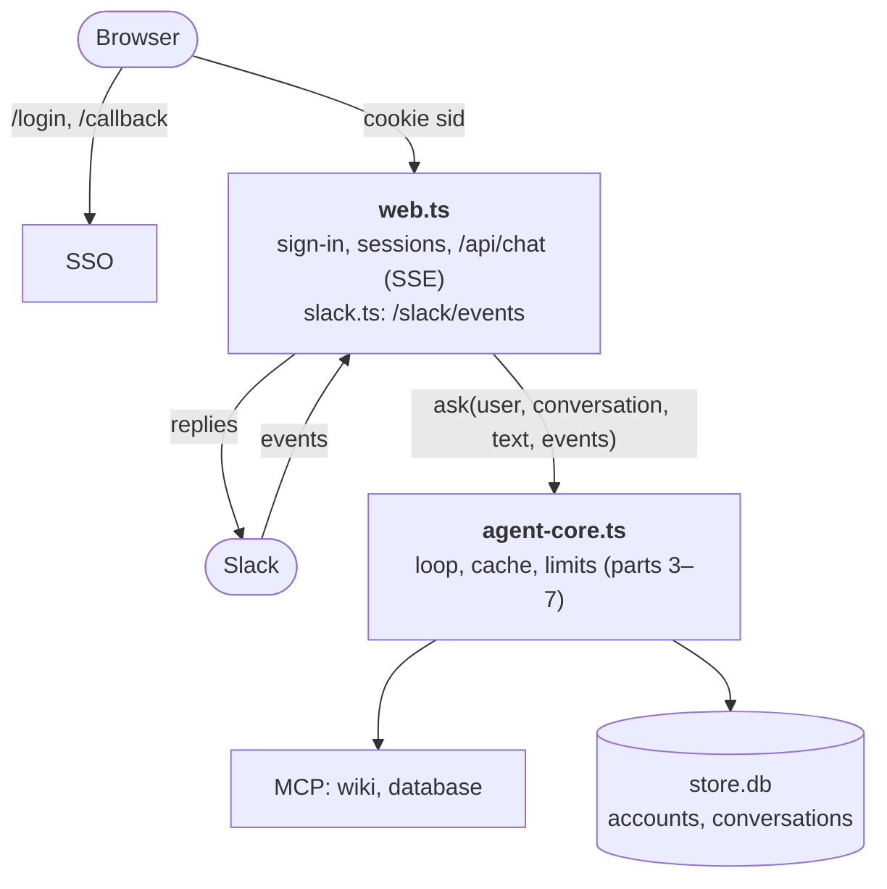

:::tldr
The agent core moves into a module that knows nothing about the interface and reports progress through three callbacks. The web chat: SSO sign-in with authorization code and PKCE, the refresh token encrypted in the database, the answer streamed to the browser over SSE, and conversation history stored as is and append-only. The Slack bot: checks the signature of every request, links a Slack account to an SSO account only when the emails match, and answers only in direct messages, because the answer is built on the asker's permissions.
:::

In earlier parts the agent lived in a terminal and took the employee's token from an environment variable. Employees will not work like that. In this part we build two entry points: a web chat and a bot in the team chat. A thin layer, as promised in the [concept](/blog/agent-concept/), but with a few places where it is easy to get security wrong.

## What the interface needs

- **Know who is asking.** Sign-in through the company SSO, after which the agent works with that person's token, as in [part 6](/blog/agent-auth/).
- **Not lose access in the middle of the day.** An access token lives for an hour; an employee works for eight. You need a refresh token, and it must be stored carefully.
- **Show the answer as it is written.** An answer with three tool calls can take half a minute. A blank screen all that time looks like a hang.
- **Remember conversations.** Close the tab, open it tomorrow, carry on.
- **Ask for confirmation** of dangerous actions from [part 3](/blog/agent-loop/), now with a button instead of the terminal.

::news{topic="agents"}

## The design



## The core, separate from the interface

The loop from [part 7](/blog/agent-cost/) printed to the console and asked for confirmation through `readline`. Now it has two consumers, so everything about output goes into three callbacks:

```ts
// agent-core.ts
import Anthropic from "@anthropic-ai/sdk";
import { connectMcp } from "./mcp";
import { userToken } from "./oidc";
import { type Conversation, type User, saveConversation } from "./store";
import { DAILY_LIMIT_USD, record, spentToday, tally } from "./usage";

type Message = Anthropic.Beta.BetaMessageParam;

// Where the agent reports progress. The web chat and the bot implement it their own way
export type Events = {
  text: (delta: string) => void;
  tool: (name: string, input: unknown) => void;
  confirm: (name: string, input: unknown) => Promise<boolean>;
};
```

`createAgent(user, token)` assembles what `agent.ts` did in the previous part: it connects MCP servers with the employee's token, fixes the tool order, sets the cache markers and counts the money. The `turn(messages, events)` function is the loop from part 7, with `process.stdout.write` replaced by `events.text`, the tool-call printout by `events.tool`, and the terminal question by `await events.confirm(...)`. Around it sits `ask(user, conversation, text, events)`: it takes the employee's agent from a cache (or creates it), locks the conversation for the duration of the turn, appends the question and answer to the history, saves it, and on failure cuts off everything this turn appended.


Three decisions here are worth explaining.

**An agent per employee, not per request.** Connecting to MCP servers costs several requests, and there is no reason to do it for every question. The token is passed as a function rather than a string: the access token refreshes every hour, and connections must pick up the fresh one.

**One turn at a time.** If an employee sends a second question while the agent is answering the first, both turns would append to the same history and it would get scrambled. A simple lock on the conversation id rules that out.

**Rollback on failure.** If something fails mid-turn, the history may be left with a tool call that has no result, and the next API request would return an error. So on failure we cut off everything this turn appended. This is not a history edit in the sense of [part 7](/blog/agent-cost/): only the tail is removed, and the beginning of the conversation does not change.

## Signing in through SSO

For a web application with a server, the standard way to sign in is the OAuth authorization code flow with PKCE:

1. The employee opens `/login`. The server generates a random `state` and `verifier`, remembers them and sends the browser to the provider's sign-in page, putting `state` and a hash of `verifier` into the URL.
2. The employee signs in the way they sign in to any company system: password, second factor. The provider sends the browser back to our `/callback` with a one-time code and the same `state`.
3. The server checks that `state` matches the one issued to this browser and exchanges the code for tokens, attaching the original `verifier`. The provider checks it against the hash from step one.

`state` protects against forged sign-ins: without it an attacker could slip an employee a link with the attacker's own code, and the employee would end up working in someone else's account. PKCE protects the code: even an intercepted code is useless without the `verifier`, which never left our server.

The teaching provider from part 6 has learned this. It gains registered clients, a sign-in page and two new kinds of exchange in `/token`: a code for tokens with a PKCE check, and a refresh token for a new token pair.


The refresh token here is single-use: every refresh issues a new one and revokes the old. In Keycloak and Okta this is turned on with the rotation setting, and it is worth turning on. A stolen refresh token then works only until the first refresh. If the thief refreshes first, the real owner's next refresh fails and they are sent back to the sign-in page, which gets noticed.

The client side of sign-in lives in `oidc.ts`. Starting a sign-in is two random values and a redirect:

```ts
const state = base64url(crypto.getRandomValues(new Uint8Array(16)));
const verifier = base64url(crypto.getRandomValues(new Uint8Array(32)));
const challenge = base64url(await crypto.subtle.digest("SHA-256", new TextEncoder().encode(verifier)));

const url = new URL(`${ISSUER}/authorize`);
url.search = new URLSearchParams({
  response_type: "code", client_id: CLIENT_ID, redirect_uri: REDIRECT_URI,
  scope: "openid profile email offline_access",
  state, code_challenge: challenge, code_challenge_method: "S256",
}).toString();
```

The server remembers `state` and `verifier` for this browser. On `/callback` it exchanges the code for tokens with a `/token` request carrying `grant_type: "authorization_code"` and the same `verifier`, saves the refresh token to the database and keeps the access token in memory. When the access token is about to expire, the `userToken` function gets a new one with the refresh token.

The subtlest part is `userToken`. If two requests see at the same moment that the token is expiring and both go to refresh it, the first gets a new refresh token, the second arrives with the old, already revoked one, and the employee is logged out. So there is a single refresh per user, and the rest wait for its result.

In a real provider the web application is registered as a confidential client with a secret, and the secret is added to requests to `/token`. The `offline_access` scope is needed for the provider to issue a refresh token at all.

## Where to keep tokens and conversations

Two tables are enough:

```sql
CREATE TABLE users (
  login TEXT PRIMARY KEY, name TEXT, email TEXT,
  refresh_token TEXT,  -- encrypted with AES-GCM, key from the environment
  slack_id TEXT UNIQUE
);
CREATE TABLE conversations (
  id TEXT PRIMARY KEY, login TEXT NOT NULL, title TEXT,
  messages TEXT NOT NULL,  -- the API history as is, append-only
  updated_at TEXT DEFAULT CURRENT_TIMESTAMP
);
```

**The refresh token is encrypted.** It gives access to the employee's data for weeks ahead, and sooner or later the database file ends up in a backup, on a developer's laptop or in a support ticket. The key lives in an environment variable, separate from the database. To generate one: `openssl rand -base64 32`.

**The conversation is stored as is.** The `messages` column holds exactly the array that goes to the API, with all tool calls, thinking blocks and `compaction` blocks. If you stored only the text of questions and answers, you could not continue the conversation tomorrow: the model would not see what it had already found. The human sees a digest of this array through `transcript`.

**The login is in every conversation query.** `loadConversation(id, login)` looks up by both fields. Without that, any employee who learned the id of someone else's conversation could read it, and it contains answers built on someone else's permissions.

## The web server

The `Bun.serve` server returns the page, handles `/login`, `/callback` and `/logout`, and has a few API routes: the conversation list, one conversation, a question and a confirmation answer. Only the question is interesting: its response is an event stream, and the core's callbacks simply write into it.

```ts
const send = (event: string, data: unknown) =>
  controller.enqueue(encoder.encode(`event: ${event}\ndata: ${JSON.stringify(data)}\n\n`));

const ping = setInterval(() => send("ping", {}), 15_000);
const result = await ask(user, conv, text, {
  text: (delta) => send("text", delta),
  tool: (name, input) => send("tool", { name, input }),
  confirm: (name, input) => waitForButton(user, name, input), // a confirm event and up to two minutes of waiting
});
send("done", result);
```

What matters for security here:

- **The session cookie** is `HttpOnly` (a script on the page cannot read it), `SameSite=Lax` (it is not sent with requests started by another site) and `Secure` over HTTPS. The cookie holds only a random id; everything else is on the server.
- **JSON only in POST.** An HTML form on another site cannot send `application/json`, so a question cannot be forged on an employee's behalf through a form.
- **Someone else's conversation returns 404**, not 403, for the same reason as the wiki in part 6: we do not confirm that the conversation exists.

And a few details about streaming:

- **SSE over POST.** The classic `EventSource` only does GET, and it is more convenient to send the question in the request body. So the response is a plain `text/event-stream`, and the browser reads it with `fetch` and a `ReadableStream`.
- **Pings.** While the model is thinking or waiting for a tool, there is no data. Bun closes a connection after 10 seconds of silence by default, and so do proxies along the way. An empty event every 15 seconds keeps the connection alive, and `idleTimeout` is raised to a minute.
- **A closed tab does not lose the answer.** If the browser disconnects, `send` simply stops writing, while the turn runs to the end and is saved. The employee opens the conversation and sees the answer.
- **Confirmation of a dangerous call** arrives in the browser as a `confirm` event, and the employee's answer goes back as a separate request to `/api/confirm`. The turn waits meanwhile, but for no more than two minutes.

## The page

The whole page is one HTML file with no build step. The important part of the script is reading the event stream:

```js
const res = await fetch("/api/ask", { method: "POST", headers: { "content-type": "application/json" }, body });
const reader = res.body.pipeThrough(new TextDecoderStream()).getReader();
let buffer = "";
for (;;) {
  const { value, done } = await reader.read();
  if (done) break;
  buffer += value;
  const events = buffer.split("\n\n");
  buffer = events.pop();
  for (const raw of events) handle(raw); // text appends to answer.textContent, tool and confirm draw badges
}
```

One rule matters more than the rest: the model's answer is inserted with `textContent`, never `innerHTML`. The agent reads documents that anyone could have written and retells them. If a document contains `` and the page inserts the answer as HTML, the script runs in the employee's session. If you want nice Markdown, render it with a library and pass the result through a sanitizer such as DOMPurify.

## The Slack bot

First the Slack app: create an app on api.slack.com, and under Event Subscriptions set the URL `https://agent.company.com/slack/events` and the `message.im` and `app_mention` events. Bot scopes: `chat:write`, `im:history`, `app_mentions:read`, `users:read`, `users:read.email`. From the settings you will need the Bot Token and the Signing Secret.

The core of `slack.ts` is the signature check:

```ts
function verify(req: Request, raw: string) {
  const ts = req.headers.get("x-slack-request-timestamp") ?? "";
  const signature = req.headers.get("x-slack-signature") ?? "";
  if (Math.abs(Date.now() / 1000 - Number(ts)) > 300) return false;
  const expected = `v0=${createHmac("sha256", SIGNING_SECRET).update(`v0:${ts}:${raw}`).digest("hex")}`;
  return expected.length === signature.length && timingSafeEqual(Buffer.from(expected), Buffer.from(signature));
}
```

The rest is the event handler: check the signature, reply at once, find the employee by Slack id and pass the question to the same core the web chat uses.

**The signature.** The `/slack/events` URL is open to the internet, and without a check anyone could send an event saying "user U1 is asking about salaries". Slack signs every request with the app secret, and the timestamp prevents replaying an old signed request.

**Three seconds.** Slack waits three seconds for a response to an event, then retries it. The agent's answer takes longer, so we reply `ok` at once and start the work without `await`. Retries with the `x-slack-retry-num` header are skipped, otherwise the agent would answer one question twice.

**Who is writing.** Slack reports the user's Slack id, but the agent needs an SSO account with a token. On the first message the bot sends a sign-in link, and after sign-in we remember the binding. The link is single-use and lives for ten minutes.

There is a trap here. Without the email check, an attacker could message the bot themselves, get a link for binding their own Slack account, and forward it to a colleague saying "check out this new portal". The colleague signs in through SSO, and the attacker's Slack account ends up bound to the colleague's account, with all of its permissions. So after sign-in we compare the email from SSO with the email on the Slack profile and bind only if they match.

**Direct messages only.** The answer is built on the permissions of whoever asked. If the HR director asks about salaries in a public channel, everyone sees the answer. So to a mention in a channel the bot replies with a message visible only to the asker, asking them to write in a DM. A thread in the DM is one conversation: as long as you reply in the same thread, the agent remembers the context.

**Streaming by editing.** The bot immediately writes "Thinking…" and then edits that message as the answer arrives. Slack has rate limits on API calls, and an edit per text fragment would hit them quickly, so the accumulated text is sent every second and a half. Slack also has dedicated methods for streaming AI app replies: `chat.startStream`, `chat.appendStream` and `chat.stopStream`. Editing a message works in any workspace and shows the idea without extra dependencies. If your app is set up as a Slack AI assistant, the streaming methods give smoother output.

**No confirmations.** Slack buttons need a separate interactivity handler. To keep things simple, dangerous tools are always declined from the bot, and the model says the action is available in the web chat. All the tools from our parts only read, so nothing changes for them.

Almost all of this is the same for Mattermost, Microsoft Teams and other messengers: verify the signature, respond to the event quickly, bind the account with a check, answer only in direct messages.

## Running it

```bash
export TOKEN_KEY=$(openssl rand -base64 32)
export SLACK_BOT_TOKEN=xoxb-... SLACK_SIGNING_SECRET=...
export PUBLIC_URL=http://localhost:8080

bun idp.ts            # teaching SSO, :4000
bun wiki-server.ts    # :3001
bun db-server.ts      # :3002
bun web.ts            # web chat and Slack webhook, :8080
```

Open `http://localhost:8080`, get redirected to the sign-in page, pick an employee and land in the chat. For Slack to reach a local machine you need a tunnel (ngrok, cloudflared) or a test environment.

We checked the whole chain with stubs for the model and Slack:

- Igor signs in, asks about deals and sees only his two. RLS from part 6 works through the web exactly as it did in the terminal.
- A second question in the same conversation continues the history.
- Without a cookie the API returns 401, a form POST returns 415, and Olga requesting Igor's conversation by id gets 404.
- A Slack signature with the wrong secret gives 401. The first message from an unknown user leads to a sign-in link. After sign-in the account is bound, and reusing the same link binds nothing. A Slack user with a different email is not bound.
- After a server restart the bot answers Igor without a new sign-in: the access token is obtained again from the refresh token in the database.

## Before production

- **Sessions and locks in memory.** This works while there is a single server instance. For several instances, sessions, pending confirmations and conversation locks move to Redis or the database.
- **A rate limit per employee.** The daily money limit from part 7 is there, but it is worth limiting questions per minute too, so a script with a stolen cookie cannot flood the queue.
- **Formatting.** The model writes Markdown, while Slack has its own mrkdwn syntax: links and bold are written differently. A simple converter of a few regular expressions solves most of it. Long answers should be split into several messages.
- **Offboarding.** When an employee leaves, their account is disabled in SSO, and the next token refresh fails. But the access token lives for up to an hour. If you need faster, delete the refresh token and sessions on an event from the employee directory.

## Next

The agent has an interface and can be used. [One part remains](/blog/agent-prod/): taking it to production. Deploying inside the company perimeter, building a proper audit log, checking answer quality with a set of questions and reference answers, and defending against prompt injection in the documents the agent reads.
