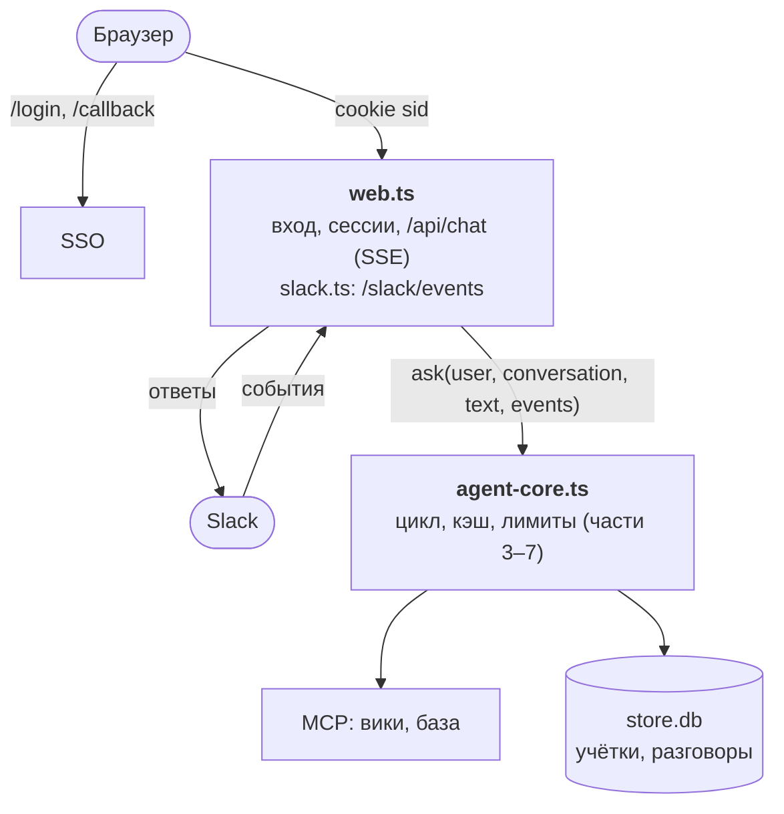

:::tldr
Ядро агента выносим в модуль, который ничего не знает об интерфейсе и сообщает о ходе работы через три колбэка. Веб-чат: вход через SSO по authorization code с PKCE, refresh token зашифрован в базе, ответ стримится в браузер через SSE, история разговоров хранится как есть и только дописывается. Бот в Slack: проверяет подпись каждого запроса, привязывает аккаунт Slack к учётке SSO только при совпадении почты и отвечает только в личных сообщениях, потому что ответ строится на правах спросившего.
:::

В прошлых частях агент жил в терминале и брал токен сотрудника из переменной окружения. Сотрудники так работать не будут. В этой части сделаем два входа: веб-чат и бота в рабочем мессенджере. Тонкий слой, как обещали в [концепции](/blog/ru/agent-concept/), но с несколькими местами, где легко ошибиться с безопасностью.

## Что нужно от интерфейса

- **Знать, кто спрашивает.** Вход через корпоративный SSO, дальше агент работает с токеном этого человека, как в [части 6](/blog/ru/agent-auth/).
- **Не терять доступ посреди дня.** Access token живёт час, сотрудник работает восемь. Нужен refresh token, и хранить его надо аккуратно.
- **Показывать ответ по мере написания.** Ответ с тремя вызовами инструментов может идти полминуты. Пустой экран всё это время выглядит как зависание.
- **Помнить разговоры.** Закрыл вкладку, открыл завтра, продолжил.
- **Спрашивать подтверждение** опасных действий из [части 3](/blog/ru/agent-loop/), теперь через кнопку, а не через терминал.

## Схема



## Ядро отдельно от интерфейса

Цикл из [части 7](/blog/ru/agent-cost/) печатал в консоль и спрашивал подтверждение через `readline`. Теперь у него два потребителя, поэтому всё, что касается вывода, уходит в три колбэка:

```ts
// agent-core.ts
import Anthropic from "@anthropic-ai/sdk";
import { connectMcp } from "./mcp";
import { userToken } from "./oidc";
import { type Conversation, type User, saveConversation } from "./store";
import { DAILY_LIMIT_USD, record, spentToday, tally } from "./usage";

type Message = Anthropic.Beta.BetaMessageParam;

// Куда агент сообщает о ходе работы. Веб-чат и бот реализуют это по-своему
export type Events = {
  text: (delta: string) => void;
  tool: (name: string, input: unknown) => void;
  confirm: (name: string, input: unknown) => Promise<boolean>;
};
```

`createAgent(user, token)` собирает то же, что `agent.ts` в прошлой части: подключает MCP-серверы с токеном сотрудника, фиксирует порядок инструментов, ставит метки кэша, считает деньги. Функция `turn(messages, events)` это цикл из части 7, где `process.stdout.write` заменён на `events.text`, вывод вызова инструмента на `events.tool`, а вопрос в терминале на `await events.confirm(...)`. Новый код вокруг него такой:

```ts
export type Agent = Awaited<ReturnType<typeof createAgent>>;

// Один агент на сотрудника: MCP-подключения дорого открывать на каждый вопрос
const agents = new Map<string, Promise<Agent>>();

export function agentFor(user: User, token: () => Promise<string>) {
  let agent = agents.get(user.login);
  if (!agent) {
    agent = createAgent(user, token);
    agent.catch(() => agents.delete(user.login));
    agents.set(user.login, agent);
  }
  return agent;
}

// Видимая человеку часть истории: вопросы и текст ответов, без служебных блоков
export function transcript(messages: Message[]) {
  const out: { role: "user" | "assistant"; text: string }[] = [];
  for (const m of messages) {
    if (m.role === "system" || !m.content) continue;
    if (typeof m.content === "string") {
      out.push({ role: m.role, text: m.content });
      continue;
    }
    const text = m.content
      .filter((b) => b.type === "text")
      .map((b) => (b as { text: string }).text)
      .join("");
    if (text) out.push({ role: m.role, text });
  }
  return out;
}

const running = new Set<string>();

// Вопрос в разговоре: один ход за раз, при сбое история откатывается к началу хода
export async function ask(user: User, conv: Conversation, text: string, events: Events) {
  if (running.has(conv.id)) return { usd: 0, note: "Агент ещё отвечает на предыдущий вопрос." };
  running.add(conv.id);
  const before = conv.messages.length;
  try {
    const agent = await agentFor(user, userToken(user));
    conv.messages.push({ role: "user", content: text });
    const result = await agent.turn(conv.messages, events);
    saveConversation(conv);
    return result;
  } catch (err) {
    // Недописанный ход (например, вызов инструмента без результата) сломал бы следующий запрос
    conv.messages.length = before;
    throw err;
  } finally {
    running.delete(conv.id);
  }
}
```

Три решения здесь стоит объяснить.

**Агент на сотрудника, а не на запрос.** Подключение к MCP-серверам стоит нескольких запросов, и открывать его на каждый вопрос незачем. Токен при этом передаётся функцией, а не строкой: access token обновляется раз в час, и подключения должны брать свежий.

**Один ход за раз.** Если сотрудник отправит второй вопрос, пока агент отвечает на первый, оба хода начнут дописывать одну историю, и она перемешается. Простая блокировка по id разговора это исключает.

**Откат при сбое.** Если что-то упало посреди хода, в истории может остаться вызов инструмента без результата, и следующий запрос к API вернёт ошибку. Поэтому при сбое отрезаем всё, что дописал этот ход. Это не правка истории в смысле [части 7](/blog/ru/agent-cost/): отрезается только хвост, начало разговора не меняется.

## Вход через SSO

Для веб-приложения с сервером стандартный способ входа это OAuth authorization code flow с PKCE:

1. Сотрудник открывает `/login`. Сервер придумывает случайные `state` и `verifier`, запоминает их и отправляет браузер на страницу входа провайдера. В адрес кладёт `state` и хеш от `verifier`.
2. Сотрудник входит, как обычно входит в корпоративные системы: пароль, второй фактор. Провайдер возвращает браузер на наш `/callback` с одноразовым кодом и тем же `state`.
3. Сервер проверяет, что `state` совпадает с выданным этому браузеру, и меняет код на токены, прикладывая исходный `verifier`. Провайдер сверяет его с хешем из первого шага.

`state` защищает от подделки входа: без него злоумышленник мог бы подсунуть сотруднику ссылку со своим кодом, и тот работал бы в чужой учётке. PKCE защищает код: даже перехваченный код бесполезен без `verifier`, который не покидал наш сервер.

Учебный провайдер из части 6 научился этому. Добавились зарегистрированные клиенты, страница входа и два новых вида обмена в `/token`:

```ts
// idp.ts, новое
// Зарегистрированные клиенты и куда им можно возвращать пользователя
const CLIENTS: Record<string, string[]> = {
  "company-agent": ["http://localhost:8080/callback"],
};

type Code = { user: string; clientId: string; redirectUri: string; challenge: string; expires: number };
const codes = new Map<string, Code>();
const refreshTokens = new Map<string, { user: string; expires: number }>();

async function sha256url(text: string) {
  const hash = await crypto.subtle.digest("SHA-256", new TextEncoder().encode(text));
  return Buffer.from(hash).toString("base64url");
}

async function sessionTokens(user: string) {
  const refresh = crypto.randomUUID();
  refreshTokens.set(refresh, { user, expires: Date.now() + 30 * 24 * 3600_000 });
  return Response.json({
    access_token: await issue(user, "company-agent", "1h"),
    refresh_token: refresh,
    token_type: "Bearer",
    expires_in: 3600,
  });
}

// внутри fetch():
    // Страница входа. Настоящий провайдер спросит пароль и второй фактор, мы даём выбрать сотрудника
    if (url.pathname === "/authorize" && req.method === "GET") {
      const p = url.searchParams;
      if (!CLIENTS[p.get("client_id") ?? ""]?.includes(p.get("redirect_uri") ?? "")) {
        return new Response("unknown client or redirect_uri", { status: 400 });
      }
      const hidden = ["client_id", "redirect_uri", "state", "code_challenge"]
        .map((k) => `<input type="hidden" name="${k}" value="${Bun.escapeHTML(p.get(k) ?? "")}">`)
        .join("");
      const buttons = Object.entries(USERS)
        .map(([id, u]) => `<button name="user" value="${id}">${Bun.escapeHTML(u.name)}</button>`)
        .join(" ");
      return new Response(`<form method="post">${hidden}<p>Войти как:</p>${buttons}</form>`, {
        headers: { "content-type": "text/html; charset=utf-8" },
      });
    }

    if (url.pathname === "/authorize" && req.method === "POST") {
      const f = await req.formData();
      const clientId = String(f.get("client_id"));
      const redirectUri = String(f.get("redirect_uri"));
      const user = String(f.get("user"));
      if (!CLIENTS[clientId]?.includes(redirectUri) || !USERS[user]) return fail("invalid_request");
      const code = crypto.randomUUID();
      codes.set(code, {
        user, clientId, redirectUri,
        challenge: String(f.get("code_challenge")),
        expires: Date.now() + 60_000,
      });
      const back = new URL(redirectUri);
      back.searchParams.set("code", code);
      back.searchParams.set("state", String(f.get("state")));
      return Response.redirect(back.toString(), 302);
    }

    if (url.pathname === "/token" && req.method === "POST") {
      const form = await req.formData();
      const grant = form.get("grant_type");

      // Код из редиректа меняем на токены. PKCE: код бесполезен без verifier,
      // который знает только сервер, начавший вход
      if (grant === "authorization_code") {
        const code = codes.get(String(form.get("code")));
        codes.delete(String(form.get("code")));
        if (!code || code.expires < Date.now()) return fail("invalid_grant");
        if (code.clientId !== form.get("client_id") || code.redirectUri !== form.get("redirect_uri")) {
          return fail("invalid_grant");
        }
        if ((await sha256url(String(form.get("code_verifier")))) !== code.challenge) return fail("invalid_grant");
        return sessionTokens(code.user);
      }

      // Refresh token одноразовый: при каждом обновлении выдаём новый, старый гасим
      if (grant === "refresh_token") {
        const old = String(form.get("refresh_token"));
        const entry = refreshTokens.get(old);
        refreshTokens.delete(old);
        if (!entry || entry.expires < Date.now()) return fail("invalid_grant");
        return sessionTokens(entry.user);
      }
      // ... token exchange как в части 6
```

Refresh token здесь одноразовый: при каждом обновлении провайдер выдаёт новый и гасит старый. В Keycloak и Okta это включается настройкой ротации, и её стоит включить. Украденный refresh token тогда работает только до первого обновления. Если вор обновится первым, у настоящего владельца следующее обновление не пройдёт и его выкинет на страницу входа, а это заметно.

Клиентская сторона входа:

```ts
// oidc.ts
import { decodeJwt } from "jose";
import { type User, refreshTokenOf, saveUser } from "./store";

const ISSUER = process.env.ISSUER ?? "http://localhost:4000";
const CLIENT_ID = "company-agent";
export const PUBLIC_URL = process.env.PUBLIC_URL ?? "http://localhost:8080";
const REDIRECT_URI = `${PUBLIC_URL}/callback`;

const base64url = (bytes: ArrayBuffer | Uint8Array) => Buffer.from(new Uint8Array(bytes)).toString("base64url");

// Начало входа: случайный state против подделки редиректа и PKCE verifier
export async function startLogin() {
  const state = base64url(crypto.getRandomValues(new Uint8Array(16)));
  const verifier = base64url(crypto.getRandomValues(new Uint8Array(32)));
  const challenge = base64url(await crypto.subtle.digest("SHA-256", new TextEncoder().encode(verifier)));
  const url = new URL(`${ISSUER}/authorize`);
  url.search = new URLSearchParams({
    response_type: "code",
    client_id: CLIENT_ID,
    redirect_uri: REDIRECT_URI,
    scope: "openid profile email offline_access",
    state,
    code_challenge: challenge,
    code_challenge_method: "S256",
  }).toString();
  return { url: url.toString(), state, verifier };
}

type Tokens = { access_token: string; refresh_token: string; expires_in: number };

async function tokenRequest(params: Record<string, string>) {
  const res = await fetch(`${ISSUER}/token`, { method: "POST", body: new URLSearchParams(params) });
  if (!res.ok) throw new Error(`SSO: ${res.status} ${await res.text()}`);
  return (await res.json()) as Tokens;
}

// Токены сотрудника живут в памяти, refresh token ещё и в базе.
// Access token обновляется сам за минуту до истечения
const sessions = new Map<string, { access: string; expires: number; pending?: Promise<string> }>();

function remember(user: string, t: Tokens) {
  sessions.set(user, { access: t.access_token, expires: Date.now() + t.expires_in * 1000 });
  return t.access_token;
}

export async function finishLogin(code: string, verifier: string): Promise<User> {
  const tokens = await tokenRequest({
    grant_type: "authorization_code",
    code,
    code_verifier: verifier,
    client_id: CLIENT_ID,
    redirect_uri: REDIRECT_URI,
  });
  const claims = decodeJwt(tokens.access_token) as { sub: string; name: string; email: string };
  const user = { login: claims.sub, name: claims.name, email: claims.email };
  await saveUser(user, tokens.refresh_token);
  remember(user.login, tokens);
  return user;
}

export function userToken(user: User) {
  return async () => {
    const s = sessions.get(user.login);
    if (s && s.expires > Date.now() + 60_000) return s.access;
    // Refresh token одноразовый: два параллельных обновления погасили бы друг друга
    if (s?.pending) return s.pending;
    const pending = (async () => {
      const refresh = await refreshTokenOf(user.login);
      if (!refresh) throw new Error("нужно заново войти через SSO");
      const tokens = await tokenRequest({ grant_type: "refresh_token", refresh_token: refresh, client_id: CLIENT_ID });
      await saveUser(user, tokens.refresh_token);
      return remember(user.login, tokens);
    })();
    sessions.set(user.login, { access: s?.access ?? "", expires: 0, pending });
    try {
      return await pending;
    } catch (err) {
      sessions.delete(user.login);
      throw err;
    }
  };
}
```

Самое тонкое место здесь `userToken`. Если два запроса одновременно увидят, что токен истекает, и оба пойдут его обновлять, первый получит новый refresh token, а второй придёт со старым, уже погашенным, и сотрудника выкинет. Поэтому обновление идёт одно на пользователя, остальные ждут его результата.

В настоящем провайдере веб-приложение регистрируется как confidential client с секретом, и секрет добавляется к запросам в `/token`. Scope `offline_access` нужен, чтобы провайдер вообще выдал refresh token.

## Где хранить токены и разговоры

```ts
// store.ts
import type Anthropic from "@anthropic-ai/sdk";
import { Database } from "bun:sqlite";

const db = new Database(process.env.STORE_DB ?? "store.db");
db.exec(`
  CREATE TABLE IF NOT EXISTS users (
    login TEXT PRIMARY KEY, name TEXT, email TEXT,
    refresh_token TEXT,           -- зашифрован, см. seal()
    slack_id TEXT UNIQUE
  );
  CREATE TABLE IF NOT EXISTS conversations (
    id TEXT PRIMARY KEY, login TEXT NOT NULL, title TEXT,
    messages TEXT NOT NULL,       -- история для API как есть, только дописывается
    updated_at TEXT DEFAULT CURRENT_TIMESTAMP
  );
`);

// Refresh token даёт доступ к данным сотрудника на недели вперёд,
// поэтому в базе он лежит зашифрованным ключом из окружения
const key = await crypto.subtle.importKey(
  "raw",
  Buffer.from(process.env.TOKEN_KEY ?? "", "base64"),
  "AES-GCM",
  false,
  ["encrypt", "decrypt"],
);

async function seal(text: string) {
  const iv = crypto.getRandomValues(new Uint8Array(12));
  const data = await crypto.subtle.encrypt({ name: "AES-GCM", iv }, key, new TextEncoder().encode(text));
  return `${Buffer.from(iv).toString("base64")}.${Buffer.from(data).toString("base64")}`;
}

async function open(sealed: string) {
  const [iv, data] = sealed.split(".").map((part) => Buffer.from(part, "base64"));
  return new TextDecoder().decode(await crypto.subtle.decrypt({ name: "AES-GCM", iv }, key, data));
}

export type User = { login: string; name: string; email: string };

export async function saveUser(user: User, refreshToken: string) {
  db.run(
    `INSERT INTO users (login, name, email, refresh_token) VALUES (?, ?, ?, ?)
     ON CONFLICT (login) DO UPDATE SET name = excluded.name, email = excluded.email,
       refresh_token = excluded.refresh_token`,
    [user.login, user.name, user.email, await seal(refreshToken)],
  );
}

export async function refreshTokenOf(login: string) {
  const row = db.query("SELECT refresh_token FROM users WHERE login = ?").get(login) as
    | { refresh_token: string | null }
    | null;
  return row?.refresh_token ? open(row.refresh_token) : null;
}

export function linkSlack(login: string, slackId: string) {
  db.run("UPDATE users SET slack_id = NULL WHERE slack_id = ?", [slackId]);
  db.run("UPDATE users SET slack_id = ? WHERE login = ?", [slackId, login]);
}

export function userBySlack(slackId: string) {
  return db.query("SELECT login, name, email FROM users WHERE slack_id = ?").get(slackId) as User | null;
}

export function getUser(login: string) {
  return db.query("SELECT login, name, email FROM users WHERE login = ?").get(login) as User | null;
}

export type Conversation = { id: string; login: string; title: string; messages: Anthropic.Beta.BetaMessageParam[] };

export function loadConversation(id: string, login: string): Conversation | null {
  // Логин в условии: чужой разговор по известному id не откроется
  const row = db.query("SELECT * FROM conversations WHERE id = ? AND login = ?").get(id, login) as
    | (Omit<Conversation, "messages"> & { messages: string })
    | null;
  return row ? { ...row, messages: JSON.parse(row.messages) } : null;
}

export function saveConversation(c: Conversation) {
  db.run(
    `INSERT INTO conversations (id, login, title, messages) VALUES (?, ?, ?, ?)
     ON CONFLICT (id) DO UPDATE SET messages = excluded.messages, updated_at = CURRENT_TIMESTAMP`,
    [c.id, c.login, c.title, JSON.stringify(c.messages)],
  );
}

export function listConversations(login: string) {
  return db
    .query("SELECT id, title, updated_at FROM conversations WHERE login = ? ORDER BY updated_at DESC LIMIT 50")
    .all(login) as { id: string; title: string; updated_at: string }[];
}
```

**Refresh token зашифрован.** Он даёт доступ к данным сотрудника на недели вперёд, а файл базы рано или поздно окажется в бэкапе, на ноутбуке разработчика или в тикете поддержки. Ключ лежит в переменной окружения, отдельно от базы. Сгенерировать его: `openssl rand -base64 32`.

**Разговор хранится как есть.** В колонке `messages` лежит ровно тот массив, который уходит в API, со всеми вызовами инструментов, блоками размышлений и блоками `compaction`. Если хранить только текст вопросов и ответов, продолжить разговор завтра не получится: модель не увидит, что она уже нашла. Человеку показываем выжимку из этого массива через `transcript`.

**Логин в каждом запросе к разговорам.** `loadConversation(id, login)` ищет по обоим полям. Без этого любой сотрудник, узнавший id чужого разговора, прочитал бы его, а в нём ответы, построенные на чужих правах.

## Веб-сервер

```ts
// web.ts
import { type Events, ask, transcript } from "./agent-core";
import { PUBLIC_URL, finishLogin, startLogin } from "./oidc";
import { handleSlack, slackEmail, takeLinkToken } from "./slack";
import { type User, getUser, linkSlack, listConversations, loadConversation } from "./store";

const SECURE = PUBLIC_URL.startsWith("https://") ? "; Secure" : "";
const SESSION_HOURS = 12;

// Сессии браузера: случайный id в cookie, логин на сервере
const sessions = new Map<string, { login: string; expires: number }>();
// Начатые входы: state из редиректа -> verifier и, если вход из Slack, кого привязать
const logins = new Map<string, { verifier: string; slackId?: string; expires: number }>();
// Ожидающие подтверждения опасных вызовов
const confirms = new Map<string, (ok: boolean) => void>();

function cookie(req: Request, name: string) {
  const match = req.headers.get("cookie")?.match(new RegExp(`(?:^|;\\s*)${name}=([^;]+)`));
  return match?.[1];
}

function currentUser(req: Request): User | null {
  const session = sessions.get(cookie(req, "sid") ?? "");
  if (!session || session.expires < Date.now()) return null;
  return getUser(session.login);
}

async function login(url: URL) {
  const slackId = takeLinkToken(url.searchParams.get("slack") ?? "");
  const { url: authorize, state, verifier } = await startLogin();
  logins.set(state, { verifier, slackId, expires: Date.now() + 10 * 60_000 });
  return new Response(null, {
    status: 302,
    headers: {
      location: authorize,
      "set-cookie": `oauth_state=${state}; HttpOnly; SameSite=Lax; Path=/; Max-Age=600${SECURE}`,
    },
  });
}

async function callback(req: Request, url: URL) {
  const state = url.searchParams.get("state") ?? "";
  const pending = logins.get(state);
  logins.delete(state);
  // state из адреса должен совпасть с тем, что мы положили в cookie этому браузеру
  if (!pending || pending.expires < Date.now() || cookie(req, "oauth_state") !== state) {
    return new Response("вход устарел, начните заново", { status: 400 });
  }
  const user = await finishLogin(url.searchParams.get("code") ?? "", pending.verifier);

  let note = "";
  if (pending.slackId) {
    // Привязываем Slack, только если почта в Slack совпадает с почтой в SSO.
    // Иначе чужая ссылка привязала бы ваш вход к чужому аккаунту в Slack
    const email = await slackEmail(pending.slackId).catch(() => undefined);
    if (email && email === user.email) linkSlack(user.login, pending.slackId);
    else note = "?slack=mismatch";
  }

  const sid = crypto.randomUUID();
  sessions.set(sid, { login: user.login, expires: Date.now() + SESSION_HOURS * 3600_000 });
  return new Response(null, {
    status: 302,
    headers: [
      ["location", `/${note}`],
      ["set-cookie", `sid=${sid}; HttpOnly; SameSite=Lax; Path=/; Max-Age=${SESSION_HOURS * 3600}${SECURE}`],
      ["set-cookie", "oauth_state=; Path=/; Max-Age=0"],
    ],
  });
}

function chat(req: Request, user: User, body: { conversationId?: string; text: string }) {
  const text = body.text?.trim();
  if (!text) return new Response("пустой вопрос", { status: 400 });
  const conv = body.conversationId
    ? loadConversation(body.conversationId, user.login)
    : { id: crypto.randomUUID(), login: user.login, title: text.slice(0, 60), messages: [] };
  if (!conv) return new Response("нет такого разговора", { status: 404 });

  const encoder = new TextEncoder();
  const stream = new ReadableStream({
    async start(controller) {
      let open = true;
      const send = (event: string, data: unknown) => {
        if (!open) return;
        try {
          controller.enqueue(encoder.encode(`event: ${event}\ndata: ${JSON.stringify(data)}\n\n`));
        } catch {
          open = false; // браузер закрыл вкладку, а ответ всё равно допишем и сохраним
        }
      };
      // Пока модель думает, данных нет. Комментарий раз в 15 секунд держит соединение
      const ping = setInterval(() => send("ping", {}), 15_000);

      const events: Events = {
        text: (delta) => send("text", delta),
        tool: (name, input) => send("tool", { name, input }),
        // Опасный вызов ждёт ответа человека две минуты, потом считается отклонённым
        confirm: (name, input) =>
          new Promise<boolean>((resolve) => {
            const id = crypto.randomUUID();
            const key = `${user.login}:${id}`;
            confirms.set(key, resolve);
            send("confirm", { id, name, input });
            setTimeout(() => {
              confirms.delete(key);
              resolve(false);
            }, 120_000);
          }),
      };

      send("conversation", { id: conv.id, title: conv.title });
      try {
        const result = await ask(user, conv, text, events);
        send("done", result);
      } catch (err) {
        console.error(err);
        send("error", "Не получилось ответить, попробуйте ещё раз.");
      } finally {
        clearInterval(ping);
        if (open) controller.close();
      }
    },
  });
  return new Response(stream, { headers: { "content-type": "text/event-stream", "cache-control": "no-cache" } });
}

Bun.serve({
  port: 8080,
  idleTimeout: 60, // секунд без данных до обрыва; пинги приходят чаще
  async fetch(req) {
    const url = new URL(req.url);
    const { pathname } = url;

    if (pathname === "/login") return login(url);
    if (pathname === "/callback") return callback(req, url);
    if (pathname === "/slack/events" && req.method === "POST") return handleSlack(req);

    const user = currentUser(req);
    if (!user) {
      return pathname.startsWith("/api/")
        ? new Response("unauthorized", { status: 401 })
        : new Response(null, { status: 302, headers: { location: "/login" } });
    }

    if (pathname === "/") return new Response(Bun.file("public/index.html"));
    if (pathname === "/logout" && req.method === "POST") {
      sessions.delete(cookie(req, "sid") ?? "");
      return new Response(null, { status: 303, headers: { location: "/login", "set-cookie": "sid=; Path=/; Max-Age=0" } });
    }
    if (pathname === "/api/me") return Response.json({ name: user.name });
    if (pathname === "/api/conversations") return Response.json(listConversations(user.login));
    if (pathname.startsWith("/api/conversations/")) {
      const conv = loadConversation(pathname.split("/").pop() ?? "", user.login);
      return conv ? Response.json(transcript(conv.messages)) : new Response("not found", { status: 404 });
    }
    // Только JSON: обычная форма с чужого сайта так не отправит, а cookie SameSite=Lax не уйдёт с чужого fetch
    if (req.method === "POST" && req.headers.get("content-type") !== "application/json") {
      return new Response("unsupported media type", { status: 415 });
    }
    if (pathname === "/api/chat" && req.method === "POST") return chat(req, user, await req.json());
    if (pathname === "/api/confirm" && req.method === "POST") {
      const { id, ok } = (await req.json()) as { id: string; ok: boolean };
      const key = `${user.login}:${id}`;
      confirms.get(key)?.(ok === true);
      confirms.delete(key);
      return new Response(null, { status: 204 });
    }
    return new Response("not found", { status: 404 });
  },
});
console.log(`веб-чат на ${PUBLIC_URL}`);
```

Что здесь важно для безопасности:

- **Cookie сессии** `HttpOnly` (скрипт на странице её не прочитает), `SameSite=Lax` (не уходит с запросами, которые начал чужой сайт) и `Secure` на HTTPS. В cookie только случайный id, всё остальное на сервере.
- **Только JSON в POST.** HTML-форма с чужого сайта не умеет отправлять `application/json`, поэтому подделать вопрос от имени сотрудника через форму нельзя.
- **Чужой разговор отвечает 404**, а не 403, по той же причине, что вики в части 6: не подтверждаем, что такой разговор существует.

И несколько деталей про стриминг:

- **SSE поверх POST.** Классический `EventSource` умеет только GET, а вопрос удобнее отправлять телом запроса. Поэтому ответ это обычный поток `text/event-stream`, а браузер читает его через `fetch` и `ReadableStream`.
- **Пинги.** Пока модель думает или ждёт инструмент, данных нет. Bun по умолчанию закрывает соединение после 10 секунд тишины, прокси по дороге тоже. Пустое событие раз в 15 секунд держит соединение, а `idleTimeout` поднят до минуты.
- **Закрытая вкладка не теряет ответ.** Если браузер отключился, `send` просто перестаёт писать, а ход доходит до конца и сохраняется. Сотрудник откроет разговор и увидит ответ.
- **Подтверждение опасного вызова** приходит в браузер событием `confirm`, а ответ сотрудника отдельным запросом в `/api/confirm`. Ход в это время ждёт, но не дольше двух минут.

## Страница

Вся страница это один HTML-файл без сборки. Стили опускаю, главное в скрипте:

```html
<script>
let conversationId = null;
const log = document.getElementById("log");

// Только textContent: ответ модели может содержать текст из документов,
// и вставлять его как HTML нельзя
function add(cls, text) {
  const div = document.createElement("div");
  div.className = `msg ${cls}`;
  div.textContent = text;
  log.append(div);
  log.scrollTop = log.scrollHeight;
  return div;
}

async function loadList() {
  const list = await (await fetch("/api/conversations")).json();
  const box = document.getElementById("list");
  box.replaceChildren(...list.map((c) => {
    const b = document.createElement("button");
    b.textContent = c.title;
    b.className = c.id === conversationId ? "active" : "";
    b.onclick = () => open(c.id);
    return b;
  }));
}

async function open(id) {
  conversationId = id;
  log.replaceChildren();
  for (const m of await (await fetch(`/api/conversations/${id}`)).json()) add(m.role, m.text);
  loadList();
}

document.getElementById("new").onclick = () => { conversationId = null; log.replaceChildren(); loadList(); };

document.getElementById("form").onsubmit = async (ev) => {
  ev.preventDefault();
  const input = document.getElementById("input");
  const text = input.value.trim();
  if (!text) return;
  input.value = "";
  add("user", text);
  let answer = null;

  const res = await fetch("/api/chat", {
    method: "POST",
    headers: { "content-type": "application/json" },
    body: JSON.stringify({ conversationId, text }),
  });
  if (!res.ok) return add("note", await res.text());

  // Читаем поток событий SSE из тела ответа
  const reader = res.body.pipeThrough(new TextDecoderStream()).getReader();
  let buffer = "";
  while (true) {
    const { value, done } = await reader.read();
    if (done) break;
    buffer += value;
    const chunks = buffer.split("\n\n");
    buffer = chunks.pop();
    for (const chunk of chunks) {
      const event = chunk.match(/^event: (.*)$/m)?.[1];
      const data = JSON.parse(chunk.match(/^data: (.*)$/m)?.[1] ?? "null");
      if (event === "conversation") conversationId = data.id;
      if (event === "text") (answer ??= add("assistant", "")).textContent += data;
      if (event === "tool") { add("tool", `🔧 ${data.name}`); answer = null; }
      if (event === "confirm") {
        const ok = confirm(`Агент хочет выполнить ${data.name}:\n${JSON.stringify(data.input, null, 2)}`);
        fetch("/api/confirm", { method: "POST", headers: { "content-type": "application/json" }, body: JSON.stringify({ id: data.id, ok }) });
      }
      if (event === "done" && data.note) add("note", data.note);
      if (event === "error") add("note", data);
    }
  }
  loadList();
};

if (new URLSearchParams(location.search).get("slack") === "mismatch") {
  add("note", "Не удалось привязать Slack: почта в Slack не совпадает с корпоративной.");
}
loadList();
</script>
```

Одно правило важнее остальных: ответ модели вставляется через `textContent`, никогда через `innerHTML`. Агент читает документы, которые мог написать кто угодно, и пересказывает их. Если документ содержит ``, а страница вставит ответ как HTML, скрипт выполнится в сессии сотрудника. Если хочется красивого Markdown, рендерите его библиотекой и пропускайте результат через санитайзер вроде DOMPurify.

## Бот в Slack

Сначала приложение в Slack: на api.slack.com создаётся приложение, в Event Subscriptions указывается адрес `https://agent.company.ru/slack/events` и события `message.im` и `app_mention`. Права бота: `chat:write`, `im:history`, `app_mentions:read`, `users:read`, `users:read.email`. Из настроек понадобятся Bot Token и Signing Secret.

```ts
// slack.ts
import { createHmac, timingSafeEqual } from "node:crypto";
import { ask } from "./agent-core";
import { PUBLIC_URL } from "./oidc";
import { loadConversation, userBySlack } from "./store";

const SLACK_API = process.env.SLACK_API ?? "https://slack.com/api";
const BOT_TOKEN = process.env.SLACK_BOT_TOKEN ?? "";
const SIGNING_SECRET = process.env.SLACK_SIGNING_SECRET ?? "";

async function slack(method: string, body: Record<string, unknown>) {
  const res = await fetch(`${SLACK_API}/${method}`, {
    method: "POST",
    headers: { authorization: `Bearer ${BOT_TOKEN}`, "content-type": "application/json; charset=utf-8" },
    body: JSON.stringify(body),
  });
  const data = (await res.json()) as { ok: boolean; error?: string; [key: string]: unknown };
  if (!data.ok) throw new Error(`Slack ${method}: ${data.error}`);
  return data;
}

// Запрос точно от Slack: подпись HMAC секретом приложения и свежая метка времени
function verify(req: Request, raw: string) {
  const ts = req.headers.get("x-slack-request-timestamp") ?? "";
  const signature = req.headers.get("x-slack-signature") ?? "";
  if (Math.abs(Date.now() / 1000 - Number(ts)) > 300) return false;
  const expected = `v0=${createHmac("sha256", SIGNING_SECRET).update(`v0:${ts}:${raw}`).digest("hex")}`;
  return expected.length === signature.length && timingSafeEqual(Buffer.from(expected), Buffer.from(signature));
}

// Одноразовые ссылки для привязки Slack к учётке SSO
const linkTokens = new Map<string, { slackId: string; expires: number }>();

export function takeLinkToken(token: string) {
  const entry = linkTokens.get(token);
  linkTokens.delete(token);
  return entry && entry.expires > Date.now() ? entry.slackId : undefined;
}

export async function slackEmail(slackId: string) {
  const data = await slack("users.info", { user: slackId });
  return (data.user as { profile: { email?: string } }).profile.email;
}

type SlackEvent = {
  type: string; channel: string; channel_type?: string; user: string;
  text: string; ts: string; thread_ts?: string; bot_id?: string; subtype?: string;
};

export async function handleSlack(req: Request) {
  const raw = await req.text();
  if (!verify(req, raw)) return new Response("bad signature", { status: 401 });
  const body = JSON.parse(raw);
  if (body.type === "url_verification") return Response.json({ challenge: body.challenge });
  // Slack повторяет событие, если не получил ответ за 3 секунды. Ответ мы уже готовим
  if (req.headers.get("x-slack-retry-num")) return new Response("ok");

  const e = body.event as SlackEvent | undefined;
  if (body.type === "event_callback" && e && !e.bot_id && !e.subtype) {
    if (e.type === "message" && e.channel_type === "im") answer(e).catch((err) => console.error(err));
    if (e.type === "app_mention") {
      // Ответ строится на правах спросившего, и в канале его увидели бы все
      slack("chat.postEphemeral", {
        channel: e.channel,
        user: e.user,
        text: "Я отвечаю только в личных сообщениях: ответ строится на ваших правах доступа, и в канале его увидели бы все.",
      }).catch((err) => console.error(err));
    }
  }
  return new Response("ok");
}

async function answer(e: SlackEvent) {
  const user = userBySlack(e.user);
  if (!user) {
    const token = crypto.randomUUID();
    linkTokens.set(token, { slackId: e.user, expires: Date.now() + 10 * 60_000 });
    await slack("chat.postMessage", {
      channel: e.channel,
      text: `Сначала войдите через корпоративный вход, чтобы я знал, какие данные вам можно показывать: ${PUBLIC_URL}/login?slack=${token}`,
    });
    return;
  }

  // Тред в Slack это разговор: история продолжается, пока отвечают в том же треде
  const threadTs = e.thread_ts ?? e.ts;
  const id = `slack:${e.channel}:${threadTs}`;
  const text = e.text.trim();
  const conv = loadConversation(id, user.login) ?? { id, login: user.login, title: text.slice(0, 60), messages: [] };

  const msg = await slack("chat.postMessage", { channel: e.channel, thread_ts: threadTs, text: "Думаю…" });
  const tools: string[] = [];
  let reply = "";
  let dirty = false;
  // Slack не любит частые правки сообщения: обновляем раз в полторы секунды
  const flush = async () => {
    if (!dirty) return;
    dirty = false;
    const shown = [tools.join("\n"), reply].filter(Boolean).join("\n\n");
    await slack("chat.update", { channel: e.channel, ts: msg.ts, text: shown || "Думаю…" });
  };
  const timer = setInterval(() => flush().catch((err) => console.error(err)), 1500);

  try {
    const result = await ask(user, conv, text, {
      text: (delta) => {
        reply += delta;
        dirty = true;
      },
      tool: (name) => {
        tools.push(`_🔧 ${name}_`);
        dirty = true;
      },
      // Кнопок подтверждения в боте нет: опасные действия только из веб-чата
      confirm: async () => false,
    });
    if (result.note) reply += `\n\n_${result.note}_`;
  } catch (err) {
    console.error(err);
    reply = "Не получилось ответить, попробуйте ещё раз.";
  } finally {
    clearInterval(timer);
    dirty = true;
    await flush();
  }
}
```

**Подпись.** Адрес `/slack/events` открыт в интернет, и без проверки любой мог бы прислать событие «пользователь U1 спрашивает про зарплаты». Slack подписывает каждый запрос секретом приложения, а метка времени не даёт повторить старый подписанный запрос.

**Три секунды.** Slack ждёт ответа на событие три секунды, потом повторяет его. Ответ агента занимает дольше, поэтому сразу отвечаем `ok`, а работу запускаем без `await`. Повторы с заголовком `x-slack-retry-num` пропускаем, иначе агент ответил бы на один вопрос дважды.

**Кто пишет.** Slack сообщает id пользователя в Slack, а агенту нужна учётка в SSO с токеном. При первом сообщении бот присылает ссылку на вход, и после входа мы запоминаем связку. Ссылка одноразовая и живёт десять минут.

Здесь есть ловушка. Без проверки почты злоумышленник мог бы написать боту сам, получить ссылку для привязки своего аккаунта Slack и переслать её коллеге с текстом «зайди, тут новый портал». Коллега входит через SSO, и аккаунт злоумышленника в Slack оказывается привязан к учётке коллеги, со всеми её правами. Поэтому после входа сверяем почту из SSO с почтой профиля в Slack и привязываем только при совпадении.

**Только личные сообщения.** Ответ строится на правах того, кто спросил. Если HR-директор спросит про оклады в общем канале, ответ увидят все. Поэтому на упоминание в канале бот отвечает невидимым для остальных сообщением с просьбой написать в личку. Тред в личке это один разговор: пока отвечаете в том же треде, агент помнит контекст.

**Стриминг через правку.** Бот сразу пишет «Думаю…», а потом правит это сообщение по мере ответа. У Slack есть лимиты на частоту вызовов, и правка на каждый фрагмент текста быстро в них упрётся, поэтому накопленный текст отправляется раз в полторы секунды.

**Без подтверждений.** Кнопки в Slack требуют отдельного обработчика интерактивности. Чтобы не усложнять, опасные инструменты из бота всегда отклоняются, а модель говорит, что это действие доступно в веб-чате. Все инструменты из наших частей только читают, так что для них ничего не меняется.

Почти всё это одинаково для Mattermost, Microsoft Teams и других мессенджеров: проверка подписи, быстрый ответ на событие, привязка учётки с проверкой, ответы только в личке.

## Запускаем

```bash
export TOKEN_KEY=$(openssl rand -base64 32)
export SLACK_BOT_TOKEN=xoxb-... SLACK_SIGNING_SECRET=...
export PUBLIC_URL=http://localhost:8080

bun idp.ts            # учебный SSO, :4000
bun wiki-server.ts    # :3001
bun db-server.ts      # :3002
bun web.ts            # веб-чат и вебхук Slack, :8080
```

Открываем `http://localhost:8080`, нас перебрасывает на страницу входа, выбираем сотрудника и попадаем в чат. Чтобы Slack достучался до локальной машины, нужен туннель (ngrok, cloudflared) или тестовый стенд.

Мы проверили всю цепочку на заглушках модели и Slack:

- Игорь входит, спрашивает про сделки и видит только свои две. RLS из части 6 работает через веб так же, как в терминале.
- Второй вопрос в том же разговоре продолжает историю.
- Без cookie API отвечает 401, POST формой 415, а Ольга, запросившая разговор Игоря по id, получает 404.
- Подпись Slack с неверным секретом даёт 401. Первое сообщение от незнакомого пользователя приводит к ссылке на вход. После входа аккаунт привязан, а повторное использование той же ссылки ничего не привязывает. Пользователь Slack с другой почтой не привязывается.
- После перезапуска сервера бот отвечает Игорю без нового входа: access token получен заново по refresh token из базы.

## Перед продакшеном

- **Сессии и блокировки в памяти.** Это работает, пока экземпляр сервера один. Для нескольких экземпляров сессии, ожидающие подтверждения и блокировки разговоров переезжают в Redis или в базу.
- **Лимит частоты на сотрудника.** Дневной лимит в деньгах из части 7 есть, но стоит ограничить и число вопросов в минуту, чтобы скрипт с чужим cookie не забил очередь.
- **Форматирование.** Модель пишет Markdown, а у Slack свой синтаксис mrkdwn: ссылки и жирный пишутся иначе. Простой конвертер на несколько регулярных выражений решает большую часть проблем. Длинные ответы стоит резать на несколько сообщений.
- **Выход.** Когда сотрудник увольняется, его учётку блокируют в SSO, и следующее обновление токена вернёт ошибку. Но access token проживёт до часа. Если нужно быстрее, удаляйте refresh token и сессии по событию из каталога сотрудников.

## Что дальше

У агента есть интерфейс, и им можно пользоваться. Осталась [последняя часть](/blog/ru/agent-prod/): вывести его в прод. Развернуть внутри периметра компании, собрать полноценный журнал аудита, проверять качество ответов набором вопросов с эталонами и защититься от промпт-инъекций в документах, которые агент читает.
