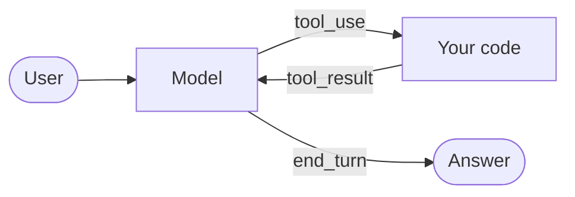

:::tldr
An agent is a chat where the model can ask you to call a function. We describe tools with a JSON schema, the model replies with a `tool_use` block, we run the function and send back a `tool_result`. The loop runs until the model says it is done. About 150 lines get us an agent that reads a project, edits files and runs the tests.
:::

This is part 3 of the company agent series. In [the previous part](/blog/agent-first-call/) we wrote a terminal chat. Now we teach the model to act.

## How a model calls a function

The model never runs code itself. It only asks: "call `read_file` with `src/main.ts`". Your program does the work, and only the work you allowed.

The exchange looks like this. The request carries a list of tools, each with a name, a description and a JSON schema for its arguments:

```json
{
  "name": "read_file",
  "description": "Read a whole text file.",
  "input_schema": {
    "type": "object",
    "properties": { "path": { "type": "string" } },
    "required": ["path"]
  }
}
```

If the model decides to use a tool, the reply comes back with `stop_reason: "tool_use"` and a block like this in `content`:

```json
{ "type": "tool_use", "id": "toolu_01A...", "name": "read_file", "input": { "path": "src/main.ts" } }
```

You run the function and send the next request, appending the model's reply and a user message with the result:

```json
{ "type": "tool_result", "tool_use_id": "toolu_01A...", "content": "import ..." }
```

The model reads the result and decides what comes next: another tool or an answer. That is the agent loop. Every coding agent, from Claude Code to Cursor, is built on top of it.



::news{topic="agents"}

## Step 1. Tools

The agent gets four tools: list a folder, read a file, write a file and run a command. The last two are dangerous, so the agent asks before using them.

We check the model's arguments with [zod](https://zod.dev). The model almost always sends valid JSON, but "almost" is not enough for code that writes files.

```bash
bun add zod
```

Each tool in `tools.ts` is four things: a description for the model, a zod schema for the arguments, a "dangerous" flag and a `run` function. Here is `read_file` in full; the other three follow the same shape:

```ts
read_file: {
  definition: {
    name: "read_file",
    description: "Read a whole text file.",
    input_schema: {
      type: "object",
      properties: { path: { type: "string" } },
      required: ["path"],
    },
  },
  schema: z.object({ path: z.string() }),
  dangerous: false,
  run: async ({ path }) => (await readFile(safePath(path), "utf8")).slice(0, 50_000),
},
```

`list_files` reads a directory with `readdir`, `write_file` writes a file and is marked dangerous, and `run_command` runs `bash -c` through `Bun.spawn` in the working folder and returns the exit code, stdout and stderr. The one function worth showing separately is `safePath`:

```ts
function safePath(p: string): string {
  const full = path.resolve(ROOT, p);
  if (full !== ROOT && !full.startsWith(ROOT + path.sep)) {
    throw new Error(`path ${p} is outside the working folder`);
  }
  return full;
}
```

A few choices here matter.

- **`safePath`** keeps the agent inside the working folder. The path comes from the model, so it is untrusted input: the model may be wrong, or text in a file it read may have misled it.
- **Tool descriptions are prompts.** The model picks a tool by its `description`, so write them as you would for a colleague: what it does, what it returns, what its limits are.
- **Output is truncated.** Every character of a result stays in the history and is paid for on every later request. A 30,000-line `npm install` log can eat the whole budget.
- **Commands time out.** The model will happily start `bun run dev`, which never exits.

## Step 2. The loop

The loop in `agent.ts` is short. Send the history together with the tool list, append the reply to the history, and while the model asks for tools, run them and go again:

```ts
for (let step = 0; step < MAX_STEPS; step++) {
  const reply = await client.messages
    .stream({ model: "claude-opus-5-5", max_tokens: 32000, system, tools: definitions, messages })
    .finalMessage();
  messages.push({ role: "assistant", content: reply.content });

  if (reply.stop_reason !== "tool_use") return; // the agent's turn is over

  const calls = reply.content.filter((b) => b.type === "tool_use");
  const results = [];
  for (const call of calls) results.push(await runTool(call));
  messages.push({ role: "user", content: results }); // all results in one message
}
```

`runTool` makes four checks in order: the tool exists, the arguments pass the zod schema, the user answered "y" for a dangerous tool, and the function didn't throw. If any of them fails, the model gets a `tool_result` with `is_error: true` and the error text. Outside the loop is the plain chat from the previous part: read a line, append it to `messages`, run the agent's turn.

```bash
bun agent.ts ~/code/some-project
```

Give it a task in a small project: "find where the order total is computed and add a test for an empty cart". It looks at the structure, reads the files it needs, writes a test, asks permission to save the file and run the tests, and if they fail it reads the error and fixes it.

## Walkthrough

**The loop runs on `stop_reason`.** While the model answers `tool_use`, we run the tools and send the next request. Any other reason means the agent's turn is over and we can ask the user again.

**The model's whole reply goes into history.** `content` holds the `tool_use` blocks, and each `tool_result` refers to its `tool_use_id`. Keep only the text and the API rejects the next request.

**All results go in one message.** The model can ask for several tools at once, say three files to read. Send every result in a single `user` message. Split them across messages and the model gradually stops calling tools in parallel.

**An error is a result too.** Bad arguments, a missing file, a refusal from the user: all of it goes back to the model as a `tool_result` with `is_error: true`. Do not throw, and do not skip the call. The model reads the error and tries another way, which is one of the things it is best at.

**A refusal does not stop the agent.** Answer "n" to `rm -rf` and the model gets "the user declined this call", and will most likely ask how you want to proceed.

**`MAX_STEPS` protects your wallet.** An agent can loop: fix one test, break another, fix that, break the first. Thirty steps cover ordinary tasks; beyond that, ask a human.

:::warning
Confirming `run_command` protects against accidents, not inattention. Do not run the agent in a folder with secrets, and do not turn on auto-approve until it runs in a container. Isolation is covered in the production part.
:::

## How this differs from Claude Code

In essence it does not: Claude Code, Cursor and the other coding agents work the same way. The difference is in details that pile up over years: editing a file by fragment instead of rewriting it, code search, compacting history when it no longer fits, subagents for parallel work, hooks and permissions. We will add some of that in later parts.

The bigger takeaway is this: an agent is not magic inside the model, it is a few dozen lines of your code around it. That means you can understand, debug and change how it behaves.

## Next

The tools are hard-coded in the agent for now. In [the next part](/blog/agent-mcp/) we connect **MCP**, the protocol that lets an agent get tools from external servers. Through it the agent reaches the company's internal systems: the database, the wiki, the issue tracker. We will write our own MCP server for the database.
