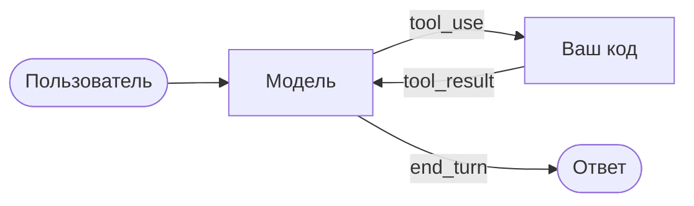

:::tldr
Агент это чат, в котором модель может попросить вызвать функцию. Мы описываем инструменты JSON-схемой, модель отвечает блоком `tool_use`, мы выполняем функцию и возвращаем `tool_result`. Цикл крутится, пока модель не скажет, что закончила. Около 150 строк, и у нас агент, который читает проект, правит файлы и запускает тесты.
:::

Это третья часть цикла про корпоративного агента. В [прошлой части](/blog/ru/agent-first-call/) мы написали чат в терминале. Теперь научим модель действовать.

## Как модель вызывает функцию

Модель не выполняет код сама. Она только просит: «вызови `read_file` с аргументом `src/main.ts`». Выполняет ваша программа, и только то, что вы разрешили.

Обмен выглядит так. В запросе вы передаёте список инструментов, каждый с названием, описанием и JSON-схемой аргументов:

```json
{
  "name": "read_file",
  "description": "Прочитать текстовый файл целиком.",
  "input_schema": {
    "type": "object",
    "properties": { "path": { "type": "string" } },
    "required": ["path"]
  }
}
```

Если модель решила воспользоваться инструментом, ответ придёт с `stop_reason: "tool_use"`, а в `content` будет блок:

```json
{ "type": "tool_use", "id": "toolu_01A...", "name": "read_file", "input": { "path": "src/main.ts" } }
```

Вы выполняете функцию и отправляете следующий запрос, добавив в историю ответ модели и сообщение пользователя с результатом:

```json
{ "type": "tool_result", "tool_use_id": "toolu_01A...", "content": "import ..." }
```

Модель читает результат и решает, что дальше: вызвать ещё инструмент или ответить. Это и есть агентный цикл. Всё остальное в агентах, от Claude Code до Cursor, надстройки над этой петлёй.



## Шаг 1. Инструменты

Дадим агенту четыре инструмента: посмотреть папку, прочитать файл, записать файл и выполнить команду. Последние два опасные, поэтому перед ними агент будет спрашивать разрешения.

Аргументы от модели проверяем через [zod](https://zod.dev): модель почти всегда присылает правильный JSON, но «почти» в коде, который пишет файлы, недостаточно.

```bash
bun add zod
```

Каждый инструмент в `tools.ts` это четыре вещи: описание для модели, zod-схема аргументов, флаг «опасный» и функция `run`. Вот `read_file` целиком, остальные три устроены так же:

```ts
read_file: {
  definition: {
    name: "read_file",
    description: "Прочитать текстовый файл целиком.",
    input_schema: {
      type: "object",
      properties: { path: { type: "string" } },
      required: ["path"],
    },
  },
  schema: z.object({ path: z.string() }),
  dangerous: false,
  run: async ({ path }) => (await readFile(safePath(path), "utf8")).slice(0, 50_000),
},
```

`list_files` читает папку через `readdir`, `write_file` пишет файл и помечен опасным, `run_command` запускает `bash -c` через `Bun.spawn` в рабочей папке и возвращает код выхода, stdout и stderr. Единственная функция, которую стоит показать отдельно, это `safePath`:

```ts
function safePath(p: string): string {
  const full = path.resolve(ROOT, p);
  if (full !== ROOT && !full.startsWith(ROOT + path.sep)) {
    throw new Error(`путь ${p} вне рабочей папки`);
  }
  return full;
}
```

Несколько решений, которые здесь важны.

- **`safePath`** не даёт выйти за рабочую папку. Путь приходит от модели, а значит, это недоверенный ввод: модель могла ошибиться или её мог сбить текст из прочитанного файла.
- **Описания инструментов это промпт.** Модель выбирает инструмент по `description`, поэтому пишите их так, будто объясняете коллеге: что делает, что возвращает, какие ограничения.
- **Вывод обрезается.** Каждый символ результата уходит в историю и оплачивается во всех следующих запросах. `npm install` на 30 тысяч строк легко съест весь бюджет.
- **У команд есть таймаут.** Модель запросто запустит `bun run dev`, который никогда не завершится.

## Шаг 2. Цикл

Сам цикл в `agent.ts` короткий. Отправляем историю вместе со списком инструментов, кладём ответ в историю и, пока модель просит инструменты, выполняем их и повторяем:

```ts
for (let step = 0; step < MAX_STEPS; step++) {
  const reply = await client.messages
    .stream({ model: "claude-opus-5-5", max_tokens: 32000, system, tools: definitions, messages })
    .finalMessage();
  messages.push({ role: "assistant", content: reply.content });

  if (reply.stop_reason !== "tool_use") return; // ход агента закончен

  const calls = reply.content.filter((b) => b.type === "tool_use");
  const results = [];
  for (const call of calls) results.push(await runTool(call));
  messages.push({ role: "user", content: results }); // все результаты одним сообщением
}
```

`runTool` делает четыре проверки по порядку: инструмент существует, аргументы проходят zod-схему, для опасного инструмента пользователь ответил «y», функция не бросила исключение. Если что-то из этого не так, модель получает `tool_result` с `is_error: true` и текстом ошибки. Снаружи цикла обычный чат из прошлой части: читаем строку, кладём в `messages`, запускаем ход агента.

```bash
bun agent.ts ~/code/some-project
```

Попросите его что-нибудь сделать в небольшом проекте: «найди, где считается итоговая сумма, и добавь тест на пустую корзину». Он сам посмотрит структуру, прочитает нужные файлы, напишет тест, попросит разрешения записать файл и запустить тесты, а если тесты упадут, прочитает ошибку и исправит.

## Разбор

**Цикл крутится по `stop_reason`.** Пока модель отвечает `tool_use`, мы выполняем инструменты и отправляем следующий запрос. Любая другая причина означает, что ход агента закончен и можно снова спрашивать пользователя.

**Ответ модели кладём в историю целиком.** В `content` лежат блоки `tool_use`, и каждый `tool_result` ссылается на свой `tool_use_id`. Если сохранить только текст, API вернёт ошибку.

**Все результаты одним сообщением.** Модель может попросить несколько инструментов за раз, например прочитать три файла. Все результаты отправляем в одном сообщении `user`. Если разбить их на несколько сообщений, модель со временем перестанет вызывать инструменты параллельно.

**Ошибка это тоже результат.** Неверные аргументы, несуществующий файл, отказ пользователя: всё возвращается модели как `tool_result` с `is_error: true`. Не бросайте исключение и не пропускайте вызов. Модель прочитает ошибку и попробует иначе, это одно из главных её умений.

**Отказ пользователя не останавливает агента.** Если вы ответили «n» на `rm -rf`, модель получит «пользователь отклонил вызов» и, скорее всего, спросит, как действовать дальше.

**`MAX_STEPS` защищает кошелёк.** Агент может зациклиться: чинит тест, ломает другой, чинит его, ломает первый. Тридцати шагов хватает на обычные задачи, а дальше лучше спросить человека.

:::warning
`run_command` с подтверждением спасает от случайностей, но не от невнимательности. Не запускайте агента в папке с секретами и не включайте автоподтверждение, пока не запустите его в контейнере. Об изоляции поговорим в части про прод.
:::

## Чем это отличается от Claude Code

По сути ничем: Claude Code, Cursor и прочие агенты для кода устроены так же. Разница в деталях, которые копятся годами: инструмент правки файла по фрагменту вместо перезаписи целиком, поиск по коду, сжатие истории, когда она перестаёт помещаться, субагенты для параллельной работы, хуки и права доступа. Часть этого мы добавим в следующих частях.

Важный вывод другой: агент это не магия внутри модели, а несколько десятков строк вашего кода вокруг неё. Значит, его поведение можно понять, отладить и изменить.

## Что дальше

Сейчас инструменты зашиты в код агента. В [следующей части](/blog/ru/agent-mcp/) подключим **MCP**: протокол, через который агент получает инструменты от внешних серверов. Через него агент дотянется до внутренних систем компании: базы данных, вики, трекера задач. Напишем свой MCP-сервер для базы.
