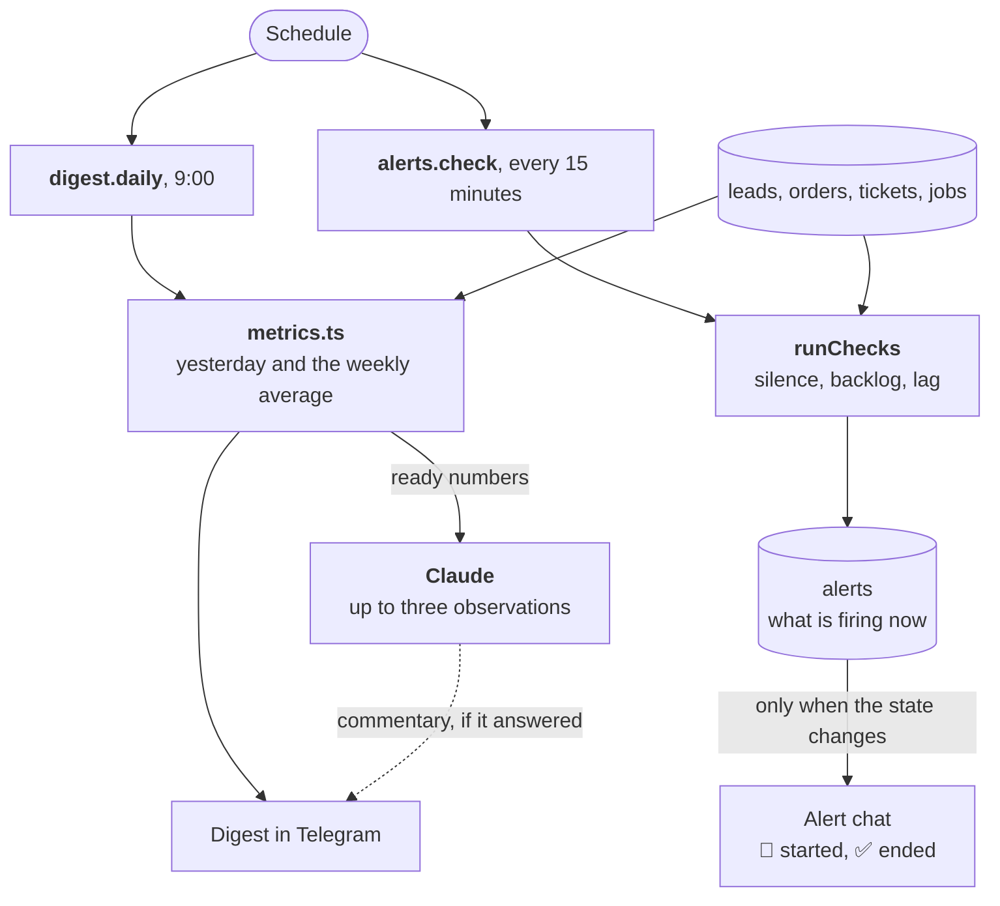

:::tldr
At 9 a.m. the bot sends a digest of yesterday: leads, payments, support, each number with the weekly average and an arrow if it differs by more than 30%. SQL computes every number; Claude only adds up to three observations worth noticing. Every 15 minutes the system checks whether leads or payments have gone quiet, whether the support queue is piling up and whether the worker is falling behind. A problem produces one message when it starts and one when it ends.
:::

This is the seventh part of the series on commercial automations and the last of the "Replacing …" parts. In the [previous part](/blog/automations-support/) we built support. The database now holds leads, payments and tickets, and every morning we can get a picture of the business out of them without asking anyone to put it together.

## What exactly we are replacing

In a small company the analyst is usually the owner, opening the CRM, the payment dashboard and the inbox every morning, or an employee who builds a spreadsheet once a week. The report is stale by the time it's done, and trouble gets noticed when a client calls to complain.

| A person used to | Now the system |
|---|---|
| gather yesterday's numbers from three places | a digest in Telegram at 9:00 |
| compare with a normal week | the 7-day average and ▲ ▼ arrows |
| skim leads and tickets to see what people write about | up to three observations from Claude |
| notice that the website form broke | an alert "no leads for 10 hours, though usually there would be 20" |
| notice that support is falling behind | an alert when five tickets wait over 4 hours |
| realize the problem is over | a "✅ back to normal" message with the duration |

## The main rule: SQL does the numbers

A language model is good at noticing patterns in text and bad at counting. Give it raw leads and ask "how many came in yesterday", and it will almost always answer correctly, but "almost always" isn't good enough for a report. So the split is strict:

- **SQL computes every number**, and code prints it, not the model;
- **the model gets ready-made numbers** plus short summaries of leads and tickets that it wrote itself in the sales and support parts, and answers only "what's worth noticing here";
- **the model may not compute new numbers**, and its text goes in a separate block below the numbers;
- **if the model is unavailable, the digest still goes out**, just without the commentary.

## How it works



## Step 1. The alerts table and indexes

```sql
-- migrations/006_alerts.sql
-- Alerts that are firing right now. A row appears when a problem starts and
-- disappears when it ends, so each problem gives exactly two messages.
create table alerts (
  name text primary key,
  text text not null,
  since timestamptz not null default now()
);

-- The digest and the alerts filter by these columns every day
create index leads_created on leads (created_at);
create index orders_paid on orders (paid_at) where paid_at is not null;
create index tickets_created on tickets (created_at);
create index tickets_answered on tickets (answered_at) where answered_at is not null;
```

The `alerts` table holds the alerts that are firing right now. The indexes are needed because the digest and the checks filter leads, payments and tickets by time every day. With thousands of rows you won't see a difference, but in a year every report would read whole tables without them.

## Step 2. Metrics

```ts
// src/metrics.ts
import { sql } from "./db";

/** One day of the business in numbers. Every number comes from SQL, never from the model. */
export interface DayStats {
  leads: number;
  hot: number;
  spam: number;
  untaken: number;
  takeMinutes: number | null;
  invoiced: number;
  invoicedSum: number;
  paid: number;
  paidSum: number;
  tickets: number;
  answered: number;
  answerMinutes: number | null;
  draftsUsed: number;
  failedJobs: number;
}

/** Midnight in the server's time zone (TZ in compose.yml), `daysAgo` days back. */
export function startOfDay(now: Date, daysAgo = 0) {
  const day = new Date(now);
  day.setHours(0, 0, 0, 0);
  day.setDate(day.getDate() - daysAgo);
  return day;
}

export async function dayStats(from: Date, to: Date): Promise<DayStats> {
  const [leads] = await sql`
    select
      count(*)::int as leads,
      count(*) filter (where qualification->>'temperature' = 'hot'
                         and status <> 'spam'
                         and (qualification->>'spam')::boolean is not true)::int as hot,
      count(*) filter (where status = 'spam' or (qualification->>'spam')::boolean)::int as spam,
      count(*) filter (where status = 'new' and (qualification->>'spam')::boolean is not true)::int as untaken,
      percentile_cont(0.5) within group (
        order by extract(epoch from taken_at - created_at) / 60
      ) filter (where status = 'taken') as take_minutes
    from leads where created_at >= ${from} and created_at < ${to}
  `;
  const [invoiced] = await sql`
    select count(*)::int as n, coalesce(sum(amount), 0)::bigint as sum
    from orders where created_at >= ${from} and created_at < ${to}
  `;
  const [paid] = await sql`
    select count(*)::int as n, coalesce(sum(amount), 0)::bigint as sum
    from orders where paid_at >= ${from} and paid_at < ${to}
  `;
  const [tickets] = await sql`
    select count(*)::int as n from tickets where created_at >= ${from} and created_at < ${to}
  `;
  const [answers] = await sql`
    select
      count(*)::int as n,
      count(*) filter (where draft_used)::int as drafts,
      percentile_cont(0.5) within group (
        order by extract(epoch from answered_at - created_at) / 60
      ) as minutes
    from tickets where answered_at >= ${from} and answered_at < ${to}
  `;
  const [jobs] = await sql`
    select count(*)::int as n from jobs
    where status = 'failed' and finished_at >= ${from} and finished_at < ${to}
  `;
  const minutes = (value: number | null) => (value === null ? null : Math.round(Number(value)));
  return {
    leads: leads.leads,
    hot: leads.hot,
    spam: leads.spam,
    untaken: leads.untaken,
    takeMinutes: minutes(leads.take_minutes),
    invoiced: invoiced.n,
    invoicedSum: Number(invoiced.sum),
    paid: paid.n,
    paidSum: Number(paid.sum),
    tickets: tickets.n,
    answered: answers.n,
    answerMinutes: minutes(answers.minutes),
    draftsUsed: answers.drafts,
    failedJobs: jobs.n,
  };
}

/** Yesterday, and the average day over the 7 days before it. */
export async function yesterdayVsWeek(now = new Date()) {
  const yesterday = await dayStats(startOfDay(now, 1), startOfDay(now, 0));
  const week: DayStats[] = [];
  for (let i = 2; i <= 8; i++) {
    week.push(await dayStats(startOfDay(now, i), startOfDay(now, i - 1)));
  }
  const average = {} as Record<keyof DayStats, number>;
  for (const key of Object.keys(yesterday) as (keyof DayStats)[]) {
    average[key] = week.reduce((total, day) => total + (day[key] ?? 0), 0) / week.length;
  }
  return { from: startOfDay(now, 1), to: startOfDay(now, 0), yesterday, average };
}

/** What is true right now, not per day: debts and the support queue. */
export async function currentState() {
  const [overdue] = await sql`
    select count(*)::int as n, coalesce(sum(amount), 0)::bigint as sum from orders
    where status = 'pending' and created_at < now() - interval '14 days'
  `;
  const [open] = await sql`select count(*)::int as n from tickets where status = 'new'`;
  return { overdue: overdue.n, overdueSum: Number(overdue.sum), openTickets: open.n };
}
```

A few decisions worth explaining.

**The median, not the mean.** "A lead was taken in 47 minutes on average" may mean everyone took leads within five minutes and one evening lead was taken the next morning. The median ignores such an outlier and shows what usually happens. In Postgres it's `percentile_cont(0.5) within group (order by ...)`.

**Day boundaries in the server's time zone.** "Yesterday" starts at midnight Moscow time, not UTC. The app's time zone was set in `compose.yml` back in the second part (`TZ: Europe/Moscow`), and `startOfDay` computes midnight in it. The boundaries go into SQL as parameters, so the database's time zone doesn't matter.

**A 7-day average, not the day before.** Comparing yesterday with the day before is pointless: a Monday almost always differs from a Sunday. A week smooths out weekdays and random spikes.

**The current state separately.** Debts older than 14 days and open tickets aren't events of a day but what exists right now. `currentState` computes them.

## Step 3. The digest

```ts
// src/digest.ts
import { askJson } from "./claude";
import { config } from "./config";
import { sql } from "./db";
import { currentState, type DayStats, yesterdayVsWeek } from "./metrics";
import { money } from "./orders";
import { html, tg } from "./telegram";

/** ▲ or ▼ when a number is more than 30% away from the weekly average. */
export function trend(value: number, average: number) {
  if (average < 1 && value < 1) {
    return "";
  }
  const change = (value - average) / Math.max(average, 1);
  if (change > 0.3) {
    return " ▲";
  }
  if (change < -0.3) {
    return " ▼";
  }
  return "";
}

const avg = (value: number) => (Number.isInteger(value) ? String(value) : value.toFixed(1));

export function renderDigest(
  day: Date,
  y: DayStats,
  a: Record<keyof DayStats, number>,
  now: { overdue: number; overdueSum: number; openTickets: number },
  highlights: string[]
) {
  const date = day.toLocaleDateString("en-GB", { weekday: "short", day: "numeric", month: "short" });
  const lines = [
    `<b>📊 Yesterday, ${date}</b>`,
    "",
    `<b>Leads:</b> ${y.leads} (avg ${avg(a.leads)})${trend(y.leads, a.leads)} · 🔥 ${y.hot} · spam ${y.spam}`,
    `taken in a median of ${y.takeMinutes ?? "–"} min · not taken: ${y.untaken}`,
    `<b>Payments:</b> ${y.paid} for ${money(y.paidSum)} (avg ${money(Math.round(a.paidSum))})${trend(y.paidSum, a.paidSum)}`,
    `invoiced: ${y.invoiced} for ${money(y.invoicedSum)} · overdue over 14 days: ${now.overdue} for ${money(now.overdueSum)}`,
    `<b>Support:</b> ${y.tickets} tickets (avg ${avg(a.tickets)})${trend(y.tickets, a.tickets)} · answered ${y.answered}, median ${y.answerMinutes ?? "–"} min`,
    `drafts sent as is: ${y.draftsUsed} of ${y.answered} · open now: ${now.openTickets}`,
  ];
  if (y.failedJobs > 0) {
    lines.push(`<b>Failed jobs:</b> ${y.failedJobs}`);
  }
  if (highlights.length > 0) {
    lines.push("", "<b>What stands out:</b>", ...highlights.map((h) => `• ${html(h)}`));
  }
  return lines.join("\n");
}

const SCHEMA = {
  type: "object",
  properties: {
    highlights: { type: "array", items: { type: "string" }, maxItems: 3 },
  },
  required: ["highlights"],
  additionalProperties: false,
};

const SYSTEM = `You help the owner of a small web studio read the morning digest.
You get yesterday's numbers, the average day of the previous week, and short
summaries of yesterday's leads and support tickets.
Name up to three things worth the owner's attention: a change against the week,
a pattern in what clients ask for, a risk. Each one sentence.
Use only the numbers given; never calculate new ones. If nothing stands out,
return an empty list. Write in English.`;

/** What clients wrote about yesterday, in the model's own summaries from parts 4 and 6. */
async function yesterdaySummaries(from: Date, to: Date) {
  const leads = await sql`
    select qualification->>'summary' as s from leads
    where created_at >= ${from} and created_at < ${to} and qualification is not null
      and (qualification->>'spam')::boolean is not true
  `;
  const tickets = await sql`
    select triage->>'category' as c, triage->>'summary' as s from tickets
    where created_at >= ${from} and created_at < ${to} and triage is not null
  `;
  return [
    ...leads.map((l: any) => `lead: ${l.s}`),
    ...tickets.map((t: any) => `ticket (${t.c}): ${t.s}`),
  ].join("\n");
}

export async function sendDigest(now = new Date()) {
  const { from, to, yesterday, average } = await yesterdayVsWeek(now);
  const state = await currentState();
  let highlights: string[] = [];
  try {
    const summaries = await yesterdaySummaries(from, to);
    const answer = await askJson<{ highlights: string[] }>({
      task: "digest",
      system: SYSTEM,
      content:
        `<numbers>\n${JSON.stringify({ yesterday, weekAverage: average, now: state })}\n</numbers>\n\n` +
        `<summaries>\n${summaries || "none"}\n</summaries>`,
      schema: SCHEMA,
      effort: "low",
    });
    highlights = answer.highlights.slice(0, 3);
  } catch (error) {
    // The numbers matter more than the commentary: send the digest without it
    console.error("digest commentary failed", error);
  }
  await tg("sendMessage", {
    chat_id: config.digestChatId,
    text: renderDigest(from, yesterday, average, state, highlights),
    parse_mode: "HTML",
  });
}
```

Things to note:

- **An arrow only above 30%.** Otherwise every line gets an arrow every day, and people stop noticing them. `Math.max(average, 1)` prevents division by zero when something didn't happen at all during the week.
- **The model gets only aggregates and summaries.** No names, phones or emails: they aren't needed for an observation like "three hot leads about online stores before New Year". Spam stays out of the summaries.
- **A model error doesn't take the digest down.** The commentary is wrapped in `try`, and on any error the digest goes out without it. If the Telegram send itself fails, the queue retries the whole job, which is safe: the message hasn't gone out yet.
- **`effort: "low"`.** Finding three notable things in a couple dozen lines is easy for the model.

Here's what the digest looks like in the chat:

```text
📊 Yesterday, Tue 3 Nov

Leads: 12 (avg 8.4) ▲ · 🔥 3 · spam 2
taken in a median of 6 min · not taken: 1
Payments: 5 for 75 000 ₽ (avg 52 000 ₽) ▲
invoiced: 7 for 98 000 ₽ · overdue over 14 days: 2 for 30 000 ₽
Support: 9 tickets (avg 6.1) ▲ · answered 8, median 42 min
drafts sent as is: 6 of 8 · open now: 1

What stands out:
• Three of the hot leads ask for an online store before the New Year sales.
• Payments are up by almost half against the week.
```

## Step 4. Alerts

The digest answers "how did yesterday go". Alerts answer a different question: "is something broken right now". The nastiest breakages are silent. The website form stopped submitting after a layout change, the payment webhook address changed, and there are no errors anywhere. There are just no leads.

```ts
// src/alerts.ts
import { sql } from "./db";
import { alert } from "./telegram";

export interface Check {
  name: string;
  firing: boolean;
  text: string;
}

/**
 * "We would normally have had 5 of these by now, and there are none."
 * The usual rate is the average over the last 14 days. Silence is suspicious
 * when the number we would expect since the last one reaches `expected`.
 */
export function silence(
  name: string,
  what: string,
  rows: { last: Date | null; per_hour: number },
  expected = 5
): Check {
  if (!rows.last) {
    return { name, firing: false, text: "" };
  }
  const hours = (Date.now() - rows.last.getTime()) / 3_600_000;
  const usual = Number(rows.per_hour) * hours;
  return {
    name,
    firing: usual >= expected,
    text: `No ${what} for ${Math.round(hours)} h, though usually there would be about ${Math.round(usual)} by now`,
  };
}

/** Everything we watch. Each check looks at the data as it is right now. */
export async function runChecks(): Promise<Check[]> {
  const [leads] = await sql`
    select max(created_at) as last,
           count(*) filter (where created_at > now() - interval '14 days') / (14 * 24.0) as per_hour
    from leads
  `;
  const [payments] = await sql`
    select max(paid_at) as last,
           count(*) filter (where paid_at > now() - interval '14 days') / (14 * 24.0) as per_hour
    from orders
  `;
  const [support] = await sql`
    select count(*)::int as n from tickets
    where status = 'new' and created_at < now() - interval '4 hours'
  `;
  const [queue] = await sql`
    select count(*)::int as n from jobs
    where status = 'pending' and run_at < now() - interval '10 minutes'
  `;
  return [
    silence("leads.silence", "leads", leads),
    silence("payments.silence", "payments", payments),
    {
      name: "support.backlog",
      firing: support.n >= 5,
      text: `${support.n} tickets have waited for an answer over 4 hours`,
    },
    {
      name: "queue.lag",
      firing: queue.n > 0,
      text: `${queue.n} jobs are overdue by more than 10 minutes: the worker is not keeping up`,
    },
  ];
}

/**
 * An alert is a state, not a message: one message when a problem starts and
 * one when it ends, however often the checks run in between.
 */
export async function evaluate(checks: Check[]) {
  for (const check of checks) {
    if (check.firing) {
      const [started] = await sql`
        insert into alerts (name, text) values (${check.name}, ${check.text})
        on conflict (name) do nothing
        returning name
      `;
      if (started) {
        await alert(`🚨 ${check.text}`);
      }
    } else {
      const [ended] = await sql`delete from alerts where name = ${check.name} returning since, text`;
      if (ended) {
        const minutes = Math.round((Date.now() - ended.since.getTime()) / 60_000);
        await alert(`✅ Back to normal after ${minutes} min: ${ended.text}`);
      }
    }
  }
}
```

**The silence rule.** Take the average number of leads per hour over the last two weeks and multiply it by the hours since the last one. That gives how many leads "should have" arrived. If it's five or more and not a single one came, it's almost certainly a breakage rather than chance: with five expected, the chance of getting none by accident is under one percent. The same rule works for payments.

The rule has a weak spot: the average covers all hours, nights and weekends included. If almost all your leads arrive on weekday afternoons, the alert may fire for nothing on Monday morning after a quiet weekend. Then raise the `expected` threshold or average over working hours only.

**An alert is a state, not a message.** Checks run every 15 minutes, and if each one sent a message, a breakage would produce 30 identical messages overnight, and the alert chat would get muted. So a firing alert is written to the `alerts` table, and a message goes out only when the row appears or disappears. `insert ... on conflict do nothing returning` and `delete ... returning` make this safe even if a check accidentally runs twice.

**What we check:**

- silence in leads and payments;
- five or more tickets waiting over 4 hours for an answer: support can't keep up;
- jobs in the queue overdue by more than 10 minutes: the worker can't keep up.

What these checks won't catch: if the worker dies completely, nobody runs them, since the worker runs them itself. That needs an outside watcher, which we'll cover in the operations part.

## Step 5. Hooking into the schedule

The handlers are short; all the logic already lives in the modules:

```ts
// src/handlers.ts
import { evaluate, runChecks } from "./alerts";
import { sendDigest } from "./digest";

export const handlers: Record<string, Handler> = {
  // ...

  // Every morning: yesterday in numbers, with the model's commentary
  "digest.daily": () => sendDigest(),

  // Every 15 minutes: is anything unusually quiet or stuck
  "alerts.check": async () => {
    await evaluate(await runChecks());
  },
};
```

```ts
// src/schedule.ts
import { enqueue } from "./queue";

export type Schedule =
  | { kind: string; everyMinutes: number }
  | { kind: string; dailyAt: string }; // "09:00" in the server's TZ

export const schedules: Schedule[] = [
  { kind: "heartbeat", everyMinutes: 60 },
  { kind: "invoices.remind", dailyAt: "10:00" },
  { kind: "payments.reconcile", everyMinutes: 60 },
  { kind: "digest.daily", dailyAt: "09:00" },
  { kind: "alerts.check", everyMinutes: 15 },
];

const pad = (n: number) => String(n).padStart(2, "0");

/**
 * The current run slot of a schedule, or null if it is not due yet.
 * The slot becomes the job key, so each slot runs once no matter how many
 * workers check it or how often.
 */
export function slot(schedule: Schedule, now: Date): string | null {
  if ("everyMinutes" in schedule) {
    const ms = schedule.everyMinutes * 60_000;
    return new Date(Math.floor(now.getTime() / ms) * ms).toISOString();
  }
  const [hours, minutes] = schedule.dailyAt.split(":").map(Number);
  if (now.getHours() * 60 + now.getMinutes() < hours * 60 + minutes) {
    return null;
  }
  return `${now.getFullYear()}-${pad(now.getMonth() + 1)}-${pad(now.getDate())}`;
}

export async function enqueueDue(now = new Date()) {
  for (const schedule of schedules) {
    const current = slot(schedule, now);
    if (current) {
      await enqueue({ kind: schedule.kind, key: `${schedule.kind}:${current}` });
    }
  }
}
```

The slot keys from the core part guarantee the digest goes out once a day, however many workers are running.

## Step 6. Tests

We check that metrics count only events inside the day, that arrows appear only for a noticeable change, that the digest goes out both with the commentary and without it when the model returns an error, and that the silence alert arrives once at the start and once at the end. The Claude stub from the previous part learned to return an error.

```ts
// test/analytics.test.ts
import { beforeEach, expect, test } from "bun:test";
import { evaluate, runChecks } from "../src/alerts";
import { config } from "../src/config";
import { sql } from "../src/db";
import { sendDigest, trend } from "../src/digest";
import { dayStats, startOfDay } from "../src/metrics";
import { calls, claude, reset } from "./stubs";

const HOUR = 60 * 60 * 1000;
const now = new Date();
const yesterday = (hour: number, minute = 0) =>
  new Date(startOfDay(now, 1).getTime() + hour * HOUR + minute * 60_000);
const messages = (chat: string) =>
  calls.filter((c) => c.method === "sendMessage" && String(c.body.chat_id) === chat);

beforeEach(async () => {
  reset();
  await sql`truncate leads, tickets, accesses, orders, jobs, alerts restart identity cascade`;
});

async function seedYesterday() {
  await sql`
    insert into leads (id, name, contact, message, status, qualification, created_at, taken_at) values
      ('a', 'A', 'a@x.io', '', 'taken', ${{ temperature: "hot", spam: false, summary: "Store by December" }},
       ${yesterday(10)}, ${yesterday(10, 8)}),
      ('b', 'B', 'b@x.io', '', 'spam', ${{ temperature: "cold", spam: true, summary: "SEO offer" }},
       ${yesterday(11)}, null),
      ('c', 'C', 'c@x.io', '', 'new', null, ${now}, null)
  `;
  await sql`
    insert into orders (id, email, description, amount, status, created_at, paid_at) values
      ('o1', 'a@x.io', 'Site', 1500000, 'paid', ${yesterday(-30)}, ${yesterday(12)}),
      ('o2', 'b@x.io', 'Fix', 500000, 'pending', ${yesterday(13)}, null)
  `;
  await sql`
    insert into tickets (source_id, channel, customer, message, status, draft_used, triage, created_at, answered_at)
    values ('t1', 'email', 'a@x.io', 'Hi', 'answered', true,
            ${{ category: "question", summary: "Asks about hosting" }}, ${yesterday(9)}, ${yesterday(9, 40)})
  `;
}

test("day stats count only what happened inside the day", async () => {
  await seedYesterday();
  const stats = await dayStats(startOfDay(now, 1), startOfDay(now, 0));
  expect(stats).toEqual({
    leads: 2,
    hot: 1,
    spam: 1,
    untaken: 0,
    takeMinutes: 8,
    invoiced: 1,
    invoicedSum: 500000,
    paid: 1,
    paidSum: 1500000,
    tickets: 1,
    answered: 1,
    answerMinutes: 40,
    draftsUsed: 1,
    failedJobs: 0,
  });
});

test("the trend arrow shows only changes over 30%", () => {
  expect(trend(14, 10)).toBe(" ▲");
  expect(trend(12, 10)).toBe("");
  expect(trend(6, 10)).toBe(" ▼");
  expect(trend(0, 0)).toBe("");
  expect(trend(2, 0)).toBe(" ▲");
});

test("the digest carries the model's highlights, and goes out without them if the model fails", async () => {
  await seedYesterday();
  claude.answer = { highlights: ["Twice as many leads as usual"] };
  await sendDigest(now);
  const first = messages(config.digestChatId).at(-1)!.body.text;
  expect(first).toContain("<b>Leads:</b> 2 (avg 0) ▲");
  expect(first).toContain("Twice as many leads as usual");

  const request = calls.find((c) => c.api === "claude")!.body;
  expect(request.messages[0].content).toContain('"weekAverage"');
  expect(request.messages[0].content).toContain("lead: Store by December");
  expect(request.messages[0].content).not.toContain("SEO offer"); // spam stays out

  claude.status = 400;
  await sendDigest(now);
  const second = messages(config.digestChatId).at(-1)!.body.text;
  expect(second).toContain("<b>Payments:</b> 1");
  expect(second).not.toContain("What stands out");
});

test("a silence alert fires once and resolves once", async () => {
  // Two leads an hour for two weeks, then nothing for the last 10 hours
  await sql`
    insert into leads (id, name, contact, message, created_at)
    select 'old' || g, 'X', 'x@x.io', '', now() - interval '10 hours' - g * interval '30 minutes'
    from generate_series(0, 14 * 48 - 21) as g
  `;
  await evaluate(await runChecks());
  await evaluate(await runChecks());
  const alerts = () => messages(config.alertChatId).map((c) => c.body.text);
  expect(alerts()).toHaveLength(1);
  expect(alerts()[0]).toStartWith("🚨 No leads for 10 h");

  await sql`insert into leads (id, name, contact, message) values ('fresh', 'Y', 'y@x.io', '')`;
  await evaluate(await runChecks());
  await evaluate(await runChecks());
  expect(alerts()).toHaveLength(2);
  expect(alerts()[1]).toStartWith("✅ Back to normal");
});

test("overdue jobs raise the queue lag alert", async () => {
  await sql`insert into jobs (kind, run_at) values ('x', now() - interval '20 minutes')`;
  const checks = await runChecks();
  expect(checks.find((c) => c.name === "queue.lag")!.firing).toBe(true);
  expect(checks.find((c) => c.name === "payments.silence")!.firing).toBe(false);
});
```

```text
 30 pass
 0 fail
```

In CI the `Tests` step gets `DIGEST_CHAT_ID: "-400"`.

## Step 7. Launch

1. Decide where the digest goes: the team chat or the owner's private chat. For a private chat, send the bot `/start` and get the chat id the same way as for the alert chat.
2. Append `DIGEST_CHAT_ID=...` to `.env` on the server.
3. Push the code: the `006_alerts.sql` migration runs during the deploy.
4. The first digest arrives the next morning at 9:00. The averages become meaningful after a week, and the silence checks start working once there is some history.

## Checking it

| What we did | What happened |
|---|---|
| Yesterday: two leads (one hot, one spam), a payment, a ticket | metrics: 2 leads, 🔥 1, spam 1, median take 8 min, 15,000 ₽ paid, median answer 40 min |
| A digest with an empty previous week | "Leads: 2 (avg 0) ▲" and the model's observation |
| What went to the model | the numbers and "lead: Store by December", no spam lead |
| The model answered 400 | the digest went out without the "What stands out" block |
| Two weeks of two leads an hour, then 10 hours of silence | one "🚨 No leads for 10 h…" alert over two checks in a row |
| A new lead arrived | one "✅ Back to normal after … min" over two checks |
| A job overdue by 20 minutes | `queue.lag` fires |

## What we have

- Every morning the picture of yesterday arrives by itself, compared with a normal week.
- All the numbers are exact, because SQL computes them. The model only suggests where to look.
- Silent breakages like a dead form show up within hours, not a week later.
- Alerts don't spam: one message when a problem starts and one when it ends.
- The digest doesn't depend on the model and goes out even when the API is down.

That completes the "Replacing …" parts. Sales, payments, support and analytics run by themselves, and people make the decisions. One part is left, "Operations": how to watch the system itself, back it up off the server, keep secrets and what it all costs.
