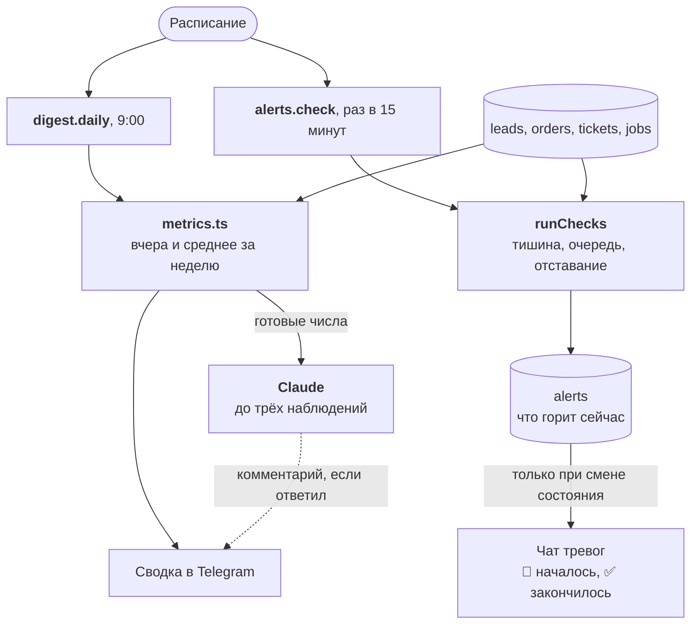

:::tldr
В 9 утра бот присылает сводку за вчера: заявки, оплаты, поддержка, у каждой цифры среднее за неделю и стрелка, если отличие больше 30%. Все цифры считает SQL, а Claude только дописывает до трёх наблюдений, что стоит заметить. Раз в 15 минут система проверяет, не затихли ли заявки и оплаты, не копится ли очередь в поддержке и не отстаёт ли воркер. О проблеме приходит одно сообщение, когда она началась, и одно, когда закончилась.
:::

Это седьмая часть цикла про коммерческие автоматизации и последняя из серии «Заменяем …». В [прошлой части](/blog/ru/automations-support/) мы собрали поддержку. Теперь в базе лежат заявки, оплаты и обращения, и из них можно каждое утро получать картину бизнеса, никого не прося её собрать. В статье только ключевые фрагменты кода, полный код серии с тестами лежит в [репозитории](https://github.com/balkhaev/balkhaev.com/tree/main/examples/automations).

## Что именно мы заменяем

Аналитик в небольшой компании это обычно сам владелец, который по утрам открывает CRM, личный кабинет платёжки и почту, или сотрудник, который раз в неделю собирает табличку. Сводка устаревает, пока её собирают, а неприятности замечают, когда клиент уже позвонил с жалобой.

| Раньше делал человек | Теперь делает система |
|---|---|
| собрать вчерашние цифры из трёх мест | сводка в Telegram в 9:00 |
| сравнить с обычной неделей | среднее за 7 дней и стрелки ▲ ▼ |
| пролистать заявки и обращения, понять, о чём пишут | до трёх наблюдений от Claude |
| заметить, что форма на сайте сломалась | тревога «нет заявок 10 часов, хотя обычно было бы 20» |
| заметить, что поддержка не успевает | тревога, когда пять обращений ждут больше 4 часов |
| понять, что проблема ушла | сообщение «✅ всё в норме» с длительностью |

::news{topic="automation"}

## Главное правило: цифры считает SQL

Языковая модель хорошо замечает закономерности в тексте и плохо считает. Если отдать ей сырые заявки и попросить «посчитай, сколько их вчера», она почти всегда ответит правильно, но «почти всегда» для отчёта недостаточно. Поэтому разделение строгое:

- **все числа считает SQL**, и выводит их код, а не модель;
- **модель получает готовые числа** и краткие пересказы заявок и обращений, которые она сама написала в частях про продажи и поддержку, и отвечает только на вопрос «что тут стоит заметить»;
- **модели запрещено считать новые числа**, а её текст идёт отдельным блоком под цифрами;
- **если модель недоступна, сводка всё равно уходит**, просто без комментария.

## Как это устроено



## Шаг 1. Таблица тревог и индексы

Миграция создаёт таблицу горящих тревог и индексы по времени: `leads (created_at)`, `orders (paid_at)`, `tickets (created_at)` и `tickets (answered_at)`.

```sql
-- migrations/006_alerts.sql: тревоги, которые горят прямо сейчас
create table alerts (
  name text primary key,
  text text not null,
  since timestamptz not null default now()
);
```

Таблица `alerts` хранит тревоги, которые горят прямо сейчас. Индексы нужны, потому что сводка и проверки каждый день фильтруют заявки, оплаты и обращения по времени. Пока строк тысячи, разницы не видно, но через год без индексов каждый отчёт будет читать таблицы целиком.

## Шаг 2. Метрики

Модуль `metrics.ts` считает один день бизнеса функцией `dayStats(from, to)`: заявки (всего, горячие, спам, не взятые, медиана времени до взятия), выставленные и оплаченные счета с суммами, обращения, ответы с медианой времени ответа и долей черновиков без правок, упавшие задачи. Каждая группа это один SQL-запрос, например заявки:

```sql
-- Заявки за день: сколько, сколько горячих и за сколько их брали (медиана)
select
  count(*)::int as leads,
  count(*) filter (where qualification->>'temperature' = 'hot')::int as hot,
  percentile_cont(0.5) within group (
    order by extract(epoch from taken_at - created_at) / 60
  ) filter (where status = 'taken') as take_minutes
from leads where created_at >= ${from} and created_at < ${to}
```

Несколько решений, которые стоит объяснить.

**Медиана, а не среднее.** «Заявку взяли в среднем за 47 минут» может значить, что все брали за пять минут, а одну вечернюю взяли утром. Медиана такой выброс не замечает и показывает, как обычно бывает на самом деле. В Postgres это `percentile_cont(0.5) within group (order by ...)`.

**Границы дня в часовом поясе сервера.** «Вчера» начинается в полночь по Москве, а не по UTC. Часовой пояс приложения задан в `compose.yml` ещё во второй части (`TZ: Europe/Moscow`), и `startOfDay` считает полночь по нему. Сами границы уходят в SQL параметрами, поэтому часовой пояс базы ни на что не влияет.

**Среднее за 7 дней, а не за вчера.** Сравнивать вчера с позавчера бессмысленно: понедельник почти всегда отличается от воскресенья. Неделя сглаживает дни недели и случайные всплески.

**Текущее состояние отдельно.** Долги старше 14 дней и открытые обращения это не события за день, а то, что есть прямо сейчас. Их считает `currentState`. А `yesterdayVsWeek` вызывает `dayStats` для вчера и для каждого из семи дней до него и усредняет.

## Шаг 3. Сводка

Сводку собирает `digest.ts`. Функция `trend` ставит ▲ или ▼, если вчерашнее число отличается от среднего за неделю больше чем на 30%. `renderDigest` раскладывает числа по трём строкам: заявки, оплаты, поддержка. Для комментария модель получает JSON с числами и пересказы вчерашних заявок и обращений, которые она сама написала в прошлых частях, и возвращает по схеме массив из не более чем трёх строк. Весь её промпт:

```ts
const SYSTEM = `Ты помогаешь владельцу небольшой веб-студии читать утреннюю сводку.
Ты получаешь вчерашние цифры, средний день прошлой недели и краткие пересказы
вчерашних заявок и обращений в поддержку.
Назови до трёх вещей, на которые владельцу стоит обратить внимание: изменение
относительно недели, закономерность в запросах клиентов, риск. Каждую одним предложением.
Используй только данные числа и никогда не вычисляй новые. Если ничего
не выделяется, верни пустой список. Пиши по-русски.`;
```

На что обратить внимание:

- **Стрелка только при отличии больше 30%.** Иначе стрелки будут у каждой строки каждый день, и их перестанут замечать. `Math.max(average, 1)` защищает от деления на ноль, когда за неделю чего-то не было вовсе.
- **Модели уходят только агрегаты и пересказы.** Никаких имён, телефонов и email: для наблюдения «три горячие заявки про интернет-магазины к Новому году» они не нужны. Спам в пересказы не попадает.
- **Ошибка модели не роняет сводку.** Комментарий обёрнут в `try`, и при любой ошибке сводка уходит без него. Если упадёт сама отправка в Telegram, очередь повторит задачу целиком, и это безопасно: сообщение ещё не ушло.
- **`effort: "low"`.** Найти три заметные вещи в паре десятков строк модели несложно.

Вот как выглядит сводка в чате:

```text
📊 Вчера, вт, 3 нояб.

Заявки: 12 (в среднем 8.4) ▲ · 🔥 3 · спам 2
взяли за 6 мин (медиана) · не взяты: 1
Оплаты: 5 на 75 000 ₽ (в среднем 52 000 ₽) ▲
выставлено: 7 на 98 000 ₽ · долги старше 14 дней: 2 на 30 000 ₽
Поддержка: 9 обращений (в среднем 6.1) ▲ · отвечено 8, медиана 42 мин
черновики без правок: 6 из 8 · открыто сейчас: 1

Что заметно:
• Три горячие заявки про интернет-магазин к новогодним распродажам.
• Оплат почти в полтора раза больше обычного.
```

## Шаг 4. Тревоги

Сводка отвечает на вопрос «как прошёл вчерашний день». Тревоги отвечают на другой: «не сломалось ли что-то прямо сейчас». Самые неприятные поломки тихие. Форма на сайте перестала отправляться после правки вёрстки, вебхук платёжки сменил адрес, и никаких ошибок нигде нет. Просто заявок нет.

В `alerts.ts` каждая проверка возвращает имя, флаг «горит» и текст. `runChecks` собирает четыре проверки из четырёх коротких запросов, а `evaluate` превращает их в сообщения:

```ts
// evaluate: одно сообщение, когда проблема началась, и одно, когда закончилась
if (check.firing) {
  const [started] = await sql`
    insert into alerts (name, text) values (${check.name}, ${check.text})
    on conflict (name) do nothing
    returning name
  `;
  if (started) await alert(`🚨 ${check.text}`);
} else {
  const [ended] = await sql`delete from alerts where name = ${check.name} returning since, text`;
  if (ended) await alert(`✅ Снова в норме: ${ended.text}`);
}
```

**Правило тишины.** Берём, сколько в среднем приходит заявок в час за последние две недели, и умножаем на число часов с последней. Получаем, сколько заявок «должно было» прийти. Если это пять или больше, а не пришло ни одной, это уже почти наверняка поломка, а не случайность: при пяти ожидаемых шанс случайно не получить ни одной меньше процента. То же правило работает для оплат.

У правила есть слабое место: среднее считается по всем часам подряд, включая ночи и выходные. Если почти все заявки у вас приходят в будни днём, в понедельник утром после тихих выходных тревога может сработать зря. Тогда поднимите порог `expected` или считайте среднее только по рабочим часам.

**Тревога это состояние, а не сообщение.** Проверки идут каждые 15 минут, и если слать сообщение при каждой, за ночь поломки придёт 30 одинаковых, и чат тревог замьютят. Поэтому горящая тревога записывается в таблицу `alerts`. Сообщение уходит, только когда строка появилась или исчезла. `insert ... on conflict do nothing returning` и `delete ... returning` делают это безопасным, даже если проверка случайно запустится дважды.

**Что проверяем:**

- тишина по заявкам и оплатам;
- пять и больше обращений ждут ответа дольше 4 часов: поддержка не справляется;
- задачи в очереди просрочены больше чем на 10 минут: воркер не успевает.

Чего эти проверки не поймают: если воркер упал совсем, проверять будет некому, потому что они сами выполняются воркером. Для этого нужен внешний наблюдатель, о нём в [части про эксплуатацию](/blog/ru/automations-ops/).

## Шаг 5. Подключаем к расписанию

Обработчики короткие, вся логика уже в модулях: `digest.daily` вызывает `sendDigest()`, а `alerts.check` вызывает `evaluate(await runChecks())`. В расписание добавляются две строки: `{ kind: "digest.daily", dailyAt: "09:00" }` и `{ kind: "alerts.check", everyMinutes: 15 }`. Ключи слотов из части про ядро гарантируют, что сводка уйдёт один раз в день, сколько бы воркеров ни работало.

## Шаг 6. Тесты

Проверяем, что метрики считают только события внутри дня, что стрелки появляются только при заметном отличии, что сводка уходит и с комментарием, и без него, если модель ответила ошибкой, и что тревога о тишине приходит один раз в начале и один раз в конце. Заглушка Claude из прошлой части научилась отвечать ошибкой. Для тишины тест вставляет две недели заявок по две в час, затем десять часов ничего, и дважды подряд прогоняет проверки: тревога должна прийти одна, а после новой заявки одно «✅ Снова в норме».

В CI в шаг `Tests` добавляется `DIGEST_CHAT_ID: "-400"`.

## Шаг 7. Запуск

1. Решите, куда приходит сводка: в общий чат команды или лично владельцу. Для личных сообщений напишите боту `/start` и возьмите id чата так же, как для чата тревог.
2. Допишите в `.env` на сервере `DIGEST_CHAT_ID=...`.
3. Запушьте код: миграция `006_alerts.sql` применится при деплое.
4. Первая сводка придёт на следующее утро в 9:00. Средние станут осмысленными через неделю, а тишина по заявкам и оплатам начнёт проверяться, когда накопится история.

## Проверка

| Что сделали | Что произошло |
|---|---|
| Вчера две заявки (одна горячая, одна спам), оплата, обращение | метрики: 2 заявки, 🔥 1, спам 1, медиана взятия 8 мин, оплачено 15 000 ₽, медиана ответа 40 мин |
| Сводка при пустой прошлой неделе | «Заявки: 2 (в среднем 0) ▲» и наблюдение модели |
| Что ушло в модель | числа и «lead: Store by December», заявки со спамом там нет |
| Модель ответила 400 | сводка ушла без блока «Что заметно» |
| Две недели по две заявки в час, затем 10 часов тишины | одна тревога «🚨 Нет заявок уже 10 ч…» за две проверки подряд |
| Пришла новая заявка | одно «✅ Снова в норме через … мин» за две проверки |
| Задача просрочена на 20 минут | горит `queue.lag` |

## Что получилось

- Каждое утро картина вчерашнего дня приходит сама, со сравнением с обычной неделей.
- Все цифры точные, потому что их считает SQL. Модель только подсказывает, на что посмотреть.
- Тихие поломки вроде отвалившейся формы видны через несколько часов, а не через неделю.
- Тревоги не спамят: одно сообщение в начале проблемы и одно в конце.
- Сводка не зависит от модели и уходит, даже если API недоступен.

На этом серия «Заменяем …» закончена. Продажи, оплаты, поддержка и аналитика работают сами, а человек принимает решения. Осталась последняя часть, [«Эксплуатация»](/blog/ru/automations-ops/): как следить за самой системой, делать бэкапы за пределы сервера, хранить секреты и сколько всё это стоит.
