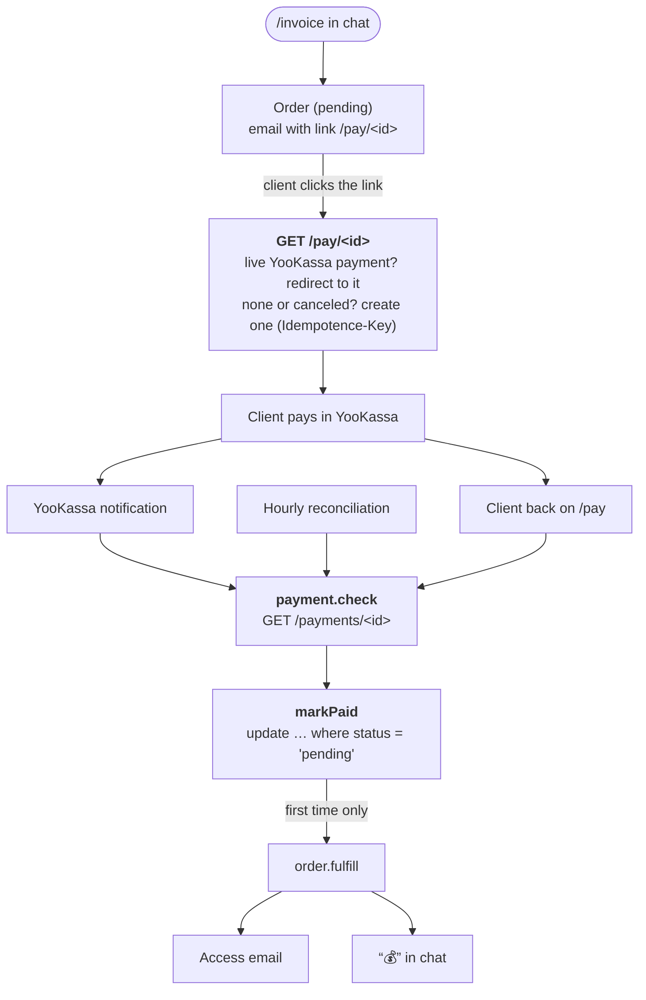

:::tldr
A manager types `/invoice anna@example.com 15000 Landing page` in the chat, and the client gets an email with a pay link. The link points at our service, which sends the client to a live YooKassa payment. When a payment notification arrives, we don't take its word for it: we ask YooKassa ourselves, mark the order paid exactly once, grant access and post "💰" to the chat. Every hour we reconcile unpaid orders with YooKassa, and clients who owe get reminders on days 3, 7 and 14 that stop as soon as they pay.
:::

This is the fifth part of the series on commercial automations and the second of the "Replacing …" parts. In the [previous part](/blog/automations-sales/) we took lead sorting off the salesperson's plate. Now the deal is done, and the work with money begins.

## What exactly we are replacing

This is not accounting in the sense of taxes and reports. It's the routine around payments that in a small company usually falls on the accountant, the office manager or the salesperson themselves:

| A person used to | Now the system |
|---|---|
| issue an invoice and send it to the client | one command in the chat, the email goes out by itself |
| check the payment dashboard to see if the money arrived | a YooKassa notification plus an hourly reconciliation |
| grant access and send a "payment received" email | right after payment, at night and at weekends too |
| tell the team | "💰 Paid 15,000 ₽" in the chat |
| remember unpaid invoices and write to the client | reminders on days 3, 7 and 14 |
| figure out who needs a call | a chat message after the last reminder |

Refunds, disputes and anything else that needs a decision stay with a person. The system only reports them.

:::note
The example uses YooKassa, the most common payment provider in Russia. Outside Russia the same design works with Stripe: the differences are covered in the notes below.
:::

::news{topic="automation"}

## Why money needs a different approach

In the sales part we accepted a rare duplicate: if the CRM created a lead and the worker died, a second lead appears and a manager merges it. That won't do for money. Granting access twice is a loss, a "payment received" email without a payment is a scandal, and an unrecorded payment is a client who paid and got nothing.

So there are three rules here:

1. **The payment provider is the source of truth about a payment, not the notification.** A notification is only a reason to ask it.
2. **An order becomes paid in one place and with one conditional SQL statement.** However many times and from wherever the confirmation comes, the move from "pending" to "paid" happens once.
3. **Every external action is a separate job with a key.** Grant access, email the client, tell the team. If one fails, the others are not repeated.

## How it works



## Step 1. The tables

```sql
-- migrations/004_orders.sql
create table orders (
  id text primary key,
  email text not null,
  description text not null,
  amount integer not null check (amount > 0), -- in kopecks: no floats for money
  status text not null default 'pending'
    check (status in ('pending', 'paid')),
  payment_id text,
  paid_payment_id text,
  created_by text,
  reminders int not null default 0,
  created_at timestamptz not null default now(),
  paid_at timestamptz
);

create index orders_pending on orders (created_at) where status = 'pending';

create table accesses (
  order_id text primary key references orders (id),
  token text not null unique,
  created_at timestamptz not null default now()
);
```

The amount is stored in kopecks as an integer. Money is never stored as a float: in JavaScript `0.1 + 0.2` is `0.30000000000000004`, and sooner or later such an error shows up in a reconciliation.

`payment_id` is the current YooKassa payment the client can pay. `paid_payment_id` is the payment that actually paid the order. They differ when the client opened the link, didn't pay, came back a week later from a reminder and got a new payment.

Access lives in its own table with the order as the primary key: the database simply won't let a second access for the same order exist.

## Step 2. YooKassa

Register a shop with [YooKassa](https://yookassa.ru) and take the `shopId` and secret key from its settings. There is a test shop with test cards: start with it.

```ts
// src/yookassa.ts
import { config } from "./config";
import { check } from "./errors";

export interface Payment {
  id: string;
  status: "pending" | "waiting_for_capture" | "succeeded" | "canceled";
  amount: { value: string; currency: string };
  confirmation?: { confirmation_url?: string };
  metadata?: { order_id?: string };
}

const auth = `Basic ${btoa(`${config.yookassaShopId}:${config.yookassaSecretKey}`)}`;

/** Kopecks to the "15000.00" string the API expects. */
export const rubles = (kopecks: number) => (kopecks / 100).toFixed(2);

/** The payment as YooKassa sees it, or undefined if there is no such payment. */
export async function getPayment(id: string): Promise<Payment | undefined> {
  const response = await fetch(`${config.yookassaApi}/payments/${encodeURIComponent(id)}`, {
    headers: { authorization: auth },
    signal: AbortSignal.timeout(15_000),
  });
  if (response.status === 404) {
    return undefined;
  }
  await check(response, "yookassa get payment");
  return response.json();
}

/**
 * Creates a payment. The Idempotence-Key makes a repeated request with the
 * same key return the same payment instead of creating a second one.
 */
export async function createPayment(params: {
  idempotenceKey: string;
  orderId: string;
  amount: number;
  description: string;
  returnUrl: string;
}): Promise<Payment> {
  const response = await fetch(`${config.yookassaApi}/payments`, {
    method: "POST",
    headers: {
      authorization: auth,
      "content-type": "application/json",
      "idempotence-key": params.idempotenceKey,
    },
    body: JSON.stringify({
      amount: { value: rubles(params.amount), currency: "RUB" },
      capture: true,
      confirmation: { type: "redirect", return_url: params.returnUrl },
      description: params.description.slice(0, 128),
      metadata: { order_id: params.orderId },
    }),
    signal: AbortSignal.timeout(15_000),
  });
  await check(response, "yookassa create payment");
  return response.json();
}
```

Two important things.

**Idempotence-Key.** YooKassa requires this header on every request that creates something. If a request with the same key arrives again, it doesn't create a second payment but returns the first one. That's exactly what retries need: the network drops after YooKassa created the payment, we repeat the request with the same key and get the same payment.

**A 404 is not an error.** If there is no payment with that id, `getPayment` returns `undefined`. Below you'll see why: it lets us calmly discard forged notifications.

:::note
If the shop sends fiscal receipts through YooKassa, the payment creation request gets a `receipt` object with the client's email and the receipt items. The fields and VAT codes depend on your tax regime: take them from the YooKassa documentation and check them in the test shop.
:::

## Step 3. Orders and a link that never expires

```ts
// src/orders.ts
import { config } from "./config";
import { sql } from "./db";
import { enqueue } from "./queue";
import { alert } from "./telegram";
import { createPayment, getPayment, type Payment } from "./yookassa";

export interface Order {
  id: string;
  email: string;
  description: string;
  amount: number;
  status: "pending" | "paid";
  payment_id: string | null;
  paid_payment_id: string | null;
  reminders: number;
  created_at: Date;
}

export async function getOrder(id: string): Promise<Order | undefined> {
  const [order] = await sql`select * from orders where id = ${id}`;
  return order;
}

export const payLink = (order: { id: string }) => `${config.publicUrl}/pay/${order.id}`;

/** "15 000 ₽" for messages. */
export const money = (kopecks: number) =>
  `${(kopecks / 100).toLocaleString("ru-RU")} ₽`;

/** `/invoice anna@example.com 15000 Landing page` from the managers' chat. */
export function parseInvoice(text: string) {
  const match = /^\/invoice(?:@\w+)?\s+(\S+@\S+)\s+(\d+(?:[.,]\d{1,2})?)\s+(.+)$/s.exec(
    text.trim()
  );
  if (!match) {
    return undefined;
  }
  const amount = Math.round(Number(match[2].replace(",", ".")) * 100);
  return { email: match[1], amount, description: match[3].trim() };
}

/** `id` comes from the caller so that a retried job creates the same order. */
export async function createOrder(input: {
  id: string;
  email: string;
  amount: number;
  description: string;
  createdBy: string;
}) {
  const { id } = input;
  await sql`
    insert into orders (id, email, amount, description, created_by)
    values (${id}, ${input.email}, ${input.amount}, ${input.description}, ${input.createdBy})
    on conflict (id) do nothing
  `;
  await enqueue({ kind: "order.invoice", payload: { id }, key: `order.invoice:${id}` });
  return id;
}

/**
 * The link in every email. It never expires: on each click we find a live
 * payment or create a new one, so a reminder sent two weeks later still works.
 */
export async function payRedirect(id: string): Promise<string | undefined> {
  const order = await getOrder(id);
  if (!order) {
    return undefined;
  }
  const thanks = `${config.publicUrl}/paid`;
  if (order.status === "paid") {
    return thanks;
  }
  if (order.payment_id) {
    const payment = await getPayment(order.payment_id);
    if (payment?.status === "succeeded") {
      await markPaid(order.id, payment); // the webhook hasn't arrived yet
      return thanks;
    }
    if (payment?.status === "pending" && payment.confirmation?.confirmation_url) {
      return payment.confirmation.confirmation_url;
    }
  }
  // No payment yet, or the previous one was canceled. Two clicks at once
  // compute the same key, so YooKassa returns the same payment to both.
  const payment = await createPayment({
    idempotenceKey: `${order.id}:${order.payment_id ?? "first"}`,
    orderId: order.id,
    amount: order.amount,
    description: order.description,
    returnUrl: thanks,
  });
  await sql`update orders set payment_id = ${payment.id} where id = ${order.id}`;
  return payment.confirmation!.confirmation_url!;
}

/**
 * The only place an order becomes paid. "where status = 'pending'" makes it
 * happen once, however many webhooks, reconciliations and clicks report it.
 */
export async function markPaid(orderId: string, payment: Payment) {
  const order = await getOrder(orderId);
  if (!order) {
    await alert(`Payment ${payment.id} for an unknown order ${orderId}`);
    return;
  }
  if (Math.round(Number(payment.amount.value) * 100) !== order.amount) {
    await alert(`Payment ${payment.id}: amount ${payment.amount.value} does not match order ${orderId}`);
    return;
  }
  const [won] = await sql`
    update orders set status = 'paid', paid_at = now(), paid_payment_id = ${payment.id}
    where id = ${orderId} and status = 'pending'
    returning id
  `;
  if (won) {
    await enqueue({ kind: "order.fulfill", payload: { id: orderId }, key: `order.fulfill:${orderId}` });
  } else if (order.paid_payment_id !== payment.id) {
    // Paid twice with two different payments: a person decides on the refund
    await alert(`Order ${orderId} was paid twice: ${order.paid_payment_id} and ${payment.id}. Refund one.`);
  }
}
```

Three ideas here.

**The link in the email points to us, not to YooKassa.** A direct payment link pasted into an email may stop working after a few days, since unpaid payments get canceled. Our `/pay/<id>` link finds a live payment or creates a new one on every click. So a reminder two weeks later works just like the first email.

**The new payment's key depends on the previous one.** `<order>:first` for the first, `<order>:<canceled id>` for the next. If the client clicks the link twice in a row, both requests compute the same key and YooKassa returns the same payment. After a cancellation the key differs, and a new payment is created.

**`markPaid` is the only place where an order becomes paid.** First it checks that the payment amount matches the order. Then `update ... where status = 'pending' returning id`: Postgres guarantees only the first statement gets the row back. That one schedules the fulfilment. Every later confirmation of the same payment does nothing. And if an order is paid by two different payments (the client opened two tabs and paid in both), the system doesn't refund on its own but posts to the alert chat: a refund is a person's decision.

The link is served by a new route:

```ts
// src/pay.ts
import { payRedirect } from "./orders";

/** GET /pay/:id, the link from invoices and reminders. */
export async function pay(req: Request & { params: { id: string } }) {
  try {
    const url = await payRedirect(req.params.id);
    if (!url) {
      return new Response("Invoice not found", { status: 404 });
    }
    return Response.redirect(url, 303);
  } catch (error) {
    // YooKassa is down or slow: ask the client to retry, the order is safe
    console.error("pay link failed", error);
    return new Response("Payment is temporarily unavailable, please try again in a minute", {
      status: 503,
    });
  }
}
```

If YooKassa is unavailable, the client sees "try again in a minute", and the order stays in the database. Nothing is lost.

## Step 4. Notifications without a signature

In the core part we promised to come back to payment providers that don't sign their notifications. YooKassa is one: its notifications carry no HMAC. You could check sender IP addresses against the list in the documentation, but there is a simpler and more reliable way: **don't trust the notification at all**. We take only the payment id from it and ask YooKassa what is really going on with that payment.

```ts
// src/sources.ts
// YooKassa notifications are not signed. We take only the payment id
// and ask the API about the payment itself, so a forgery changes nothing.
yookassa: {
  verify: () => true,
  dedupKey: (body) => {
    const note = JSON.parse(body);
    return `${note.event}:${note.object.id}`;
  },
  route: (body) => {
    const note = JSON.parse(body);
    if (typeof note.object?.id !== "string") {
      return [];
    }
    return [{ kind: "payment.check", payload: { paymentId: note.object.id } }];
  },
},
```

A forged "payment pay-123 succeeded" notification leads to a request to YooKassa, which answers 404 or with the honest status. An attacker can't forge YooKassa's answer: we make that request over HTTPS with our own key.

In the YooKassa dashboard, under HTTP notifications, set the address `https://auto.example.com/hooks/yookassa` and the events `payment.succeeded` and `payment.canceled`.

:::note
Stripe and many other providers sign their webhooks: there you verify the signature as in the core part instead. Even with a signature it pays to re-check important events with an API request: that way you survive both a lost and a late notification. With Stripe the "link that never expires" is a Checkout Session created on each click of `/pay/<id>`, and its idempotency key works the same way.
:::

## Step 5. Email

Emails to clients need a transactional email service. Sending mail from your own server is a bad idea: it will almost certainly land in spam. The example uses [Resend](https://resend.com), but any service with an HTTP API works: Postmark, Amazon SES and others. Only one function changes.

```ts
// src/email.ts
import { config } from "./config";
import { check } from "./errors";

export async function sendEmail(to: string, subject: string, text: string) {
  const response = await fetch(`${config.emailApi}/emails`, {
    method: "POST",
    headers: {
      authorization: `Bearer ${config.emailApiKey}`,
      "content-type": "application/json",
    },
    body: JSON.stringify({ from: config.emailFrom, to, subject, text }),
    signal: AbortSignal.timeout(15_000),
  });
  await check(response, "email");
}
```

Verify the sender domain in the service (SPF and DKIM records in DNS), or your emails will go to spam.

## Step 6. The handlers

All the payment logic in its own file:

```ts
// src/billing.ts
import { config } from "./config";
import { sql } from "./db";
import { sendEmail } from "./email";
import {
  createOrder,
  getOrder,
  markPaid,
  money,
  parseInvoice,
  payLink,
} from "./orders";
import { enqueue, type Job } from "./queue";
import { sendMessage } from "./telegram";
import { getPayment } from "./yookassa";

type Handler = (payload: any, job: Job) => Promise<void>;

const DAY = 24 * 60 * 60 * 1000;
const REMIND_AFTER_DAYS = [3, 7, 14];

/** `/invoice email amount description`, only from the managers' chat. */
export async function invoiceCommand(message: any) {
  if (String(message.chat.id) !== String(config.leadsChatId)) {
    return;
  }
  const input = parseInvoice(message.text);
  if (!input) {
    await sendMessage(message.chat.id, "Usage: /invoice client@example.com 15000 What it is for");
    return;
  }
  const who = message.from.username ? `@${message.from.username}` : message.from.first_name;
  // The id comes from the message, so a retried job doesn't create a second order
  const id = await createOrder({
    ...input,
    id: `tg-${message.chat.id}-${message.message_id}`,
    createdBy: who,
  });
  await sendMessage(
    message.chat.id,
    `Invoice for ${money(input.amount)} sent to ${input.email}.\nPayment link: ${payLink({ id })}`
  );
}

export const billingHandlers: Record<string, Handler> = {
  "order.invoice": async ({ id }) => {
    const order = await getOrder(id);
    if (!order || order.status !== "pending") {
      return;
    }
    await sendEmail(
      order.email,
      `Invoice: ${order.description}`,
      `Hello!\n\nHere is your invoice for "${order.description}", ${money(order.amount)}.\n` +
        `Pay by card here: ${payLink(order)}\n\nThe link does not expire.`
    );
  },

  // From a notification or reconciliation: ask YooKassa what really happened
  "payment.check": async ({ paymentId }) => {
    const payment = await getPayment(paymentId);
    if (!payment) {
      console.warn(`payment ${paymentId} does not exist`); // a forged notification
      return;
    }
    if (payment.status === "succeeded" && payment.metadata?.order_id) {
      await markPaid(payment.metadata.order_id, payment);
    }
    // canceled: nothing to do, the /pay link creates a new payment on the next click
  },

  // Paid: grant access once, then tell the client and the team
  "order.fulfill": async ({ id }) => {
    const token = crypto.randomUUID();
    await sql`
      insert into accesses (order_id, token) values (${id}, ${token})
      on conflict (order_id) do nothing
    `;
    await enqueue({ kind: "order.access_email", payload: { id }, key: `order.access_email:${id}` });
    await enqueue({ kind: "order.paid_notice", payload: { id }, key: `order.paid_notice:${id}` });
  },

  "order.access_email": async ({ id }) => {
    const order = await getOrder(id);
    const [access] = await sql`select token from accesses where order_id = ${id}`;
    await sendEmail(
      order!.email,
      `Payment received: ${order!.description}`,
      `Thank you! We have received ${money(order!.amount)}.\n` +
        `Your access: ${config.accessUrl}${access.token}`
    );
  },

  "order.paid_notice": async ({ id }) => {
    const order = await getOrder(id);
    await sendMessage(
      config.leadsChatId,
      `💰 Paid ${money(order!.amount)}: ${order!.description} (${order!.email})`
    );
  },

  // Every morning: who should get a reminder today
  "invoices.remind": async () => {
    const orders = await sql`
      select id, reminders, created_at from orders where status = 'pending'
    `;
    for (const order of orders) {
      const step = order.reminders;
      const age = Date.now() - new Date(order.created_at).getTime();
      if (step < REMIND_AFTER_DAYS.length && age >= REMIND_AFTER_DAYS[step] * DAY) {
        const n = step + 1;
        await enqueue({
          kind: "order.remind",
          payload: { id: order.id, n },
          key: `order.remind:${order.id}:${n}`,
        });
      }
    }
  },

  "order.remind": async ({ id, n }) => {
    const order = await getOrder(id);
    if (!order || order.status !== "pending") {
      return; // paid in the meantime: the chain stops by itself
    }
    await sendEmail(
      order.email,
      `Reminder: invoice for ${order.description}`,
      `Hello! A gentle reminder about the invoice for "${order.description}", ` +
        `${money(order.amount)}.\nPay here: ${payLink(order)}\n\n` +
        "If you have already paid or something is wrong, just reply to this email."
    );
    await sql`update orders set reminders = greatest(reminders, ${n}) where id = ${id}`;
    if (n === REMIND_AFTER_DAYS.length) {
      await sendMessage(
        config.leadsChatId,
        `📞 ${order.email} has not paid "${order.description}" for ${REMIND_AFTER_DAYS.at(-1)} days. Worth a call.`
      );
    }
  },

  // Every hour: catch payments whose notification never arrived
  "payments.reconcile": async () => {
    const orders = await sql`
      select payment_id from orders
      where status = 'pending' and payment_id is not null
        and created_at > now() - interval '30 days'
    `;
    for (const order of orders) {
      await enqueue({ kind: "payment.check", payload: { paymentId: order.payment_id } });
    }
  },
};
```

Plug them into the common handler list and teach the bot the `/invoice` command:

```ts
// src/handlers.ts
import { billingHandlers, invoiceCommand } from "./billing";

export const handlers: Record<string, Handler> = {
  // ... lead handlers from the previous part

  "telegram.message": async (message) => {
    if (message.text === "/ping") {
      await sendMessage(message.chat.id, "pong");
    }
    if (message.text.startsWith("/invoice")) {
      await invoiceCommand(message);
    }
  },

  ...billingHandlers,
};
```

Things to note:

- **Only the managers' chat issues invoices.** The bot silently ignores the command from any other chat. Whoever is in that chat can issue invoices, so keep an eye on the group's members.
- **The order id comes from the message id.** If the `telegram.message` job fails after creating the order and runs again, no second order appears.
- **`order.fulfill` only grants access and schedules two jobs.** The client email and the chat message run separately. If the email service is down, the email keeps retrying while the chat message has already gone out, and nobody grants access twice.
- **Reminders never need cancelling.** Each one checks the order status when it is sent, and the morning job only picks unpaid orders. The client paid, and the chain stopped by itself.
- **A reminder's key contains its number.** If the morning job runs twice in a day, no second email goes out.

## Step 7. Reconciliation and the schedule

A notification may not arrive: YooKassa sent it while we were deploying, or it got lost on the way. YooKassa retries notifications, but relying on that alone won't do. Every hour `payments.reconcile` goes through unpaid orders from the last 30 days that have a payment and checks each one through the same `payment.check`. In the worst case the client gets access an hour later, not never.

Add two jobs to the schedule from the core part:

```ts
// src/schedule.ts
import { enqueue } from "./queue";

export type Schedule =
  | { kind: string; everyMinutes: number }
  | { kind: string; dailyAt: string }; // "09:00" in the server's TZ

export const schedules: Schedule[] = [
  { kind: "heartbeat", everyMinutes: 60 },
  { kind: "invoices.remind", dailyAt: "10:00" },
  { kind: "payments.reconcile", everyMinutes: 60 },
];

const pad = (n: number) => String(n).padStart(2, "0");

/**
 * The current run slot of a schedule, or null if it is not due yet.
 * The slot becomes the job key, so each slot runs once no matter how many
 * workers check it or how often.
 */
export function slot(schedule: Schedule, now: Date): string | null {
  if ("everyMinutes" in schedule) {
    const ms = schedule.everyMinutes * 60_000;
    return new Date(Math.floor(now.getTime() / ms) * ms).toISOString();
  }
  const [hours, minutes] = schedule.dailyAt.split(":").map(Number);
  if (now.getHours() * 60 + now.getMinutes() < hours * 60 + minutes) {
    return null;
  }
  return `${now.getFullYear()}-${pad(now.getMonth() + 1)}-${pad(now.getDate())}`;
}

export async function enqueueDue(now = new Date()) {
  for (const schedule of schedules) {
    const current = slot(schedule, now);
    if (current) {
      await enqueue({ kind: schedule.kind, key: `${schedule.kind}:${current}` });
    }
  }
}
```

## Step 8. Tests

Tests matter most for payments. We check that confirming one payment many times grants access once, that a double payment raises an alert, that a payment with the wrong amount doesn't count, that the link reuses a live payment, and that reminders follow the schedule and stop after payment.

The external API stubs moved into a shared `test/stubs.ts`: the YooKassa stub, like the real thing, remembers payments by Idempotence-Key. The tests themselves:

```ts
// test/billing.test.ts
import { beforeEach, expect, test } from "bun:test";
import { config } from "../src/config";
import { sql } from "../src/db";
import { handlers } from "../src/handlers";
import { markPaid, parseInvoice, payRedirect } from "../src/orders";
import type { Job } from "../src/queue";
import { calls, payments, reset } from "./stubs";

const job = {} as Job;
const DAY = 24 * 60 * 60 * 1000;
const sent = (api: string) => calls.filter((c) => c.api === api);

async function invoice(messageId = 1, text = "/invoice anna@example.com 15000 Landing page") {
  await handlers["telegram.message"](
    { message_id: messageId, chat: { id: Number(config.leadsChatId) }, from: { username: "ivan" }, text },
    job
  );
  return `tg-${config.leadsChatId}-${messageId}`;
}

beforeEach(async () => {
  reset();
  await sql`truncate accesses, orders, jobs restart identity cascade`;
});

test("the invoice command is parsed in rubles and kopecks", () => {
  expect(parseInvoice("/invoice a@b.co 15000 Site")).toEqual({
    email: "a@b.co",
    amount: 1_500_000,
    description: "Site",
  });
  expect(parseInvoice("/invoice@MyBot a@b.co 99,90 Fix")?.amount).toBe(9990);
  expect(parseInvoice("/invoice nonsense")).toBeUndefined();
});

test("a retried command creates one order, and only the managers' chat may invoice", async () => {
  await invoice(1);
  await invoice(1);
  await handlers["telegram.message"](
    { message_id: 2, chat: { id: 555 }, from: { username: "x" }, text: "/invoice a@b.co 1 X" },
    job
  );
  const orders = await sql`select id, amount, status from orders`;
  expect(orders).toEqual([{ id: `tg-${config.leadsChatId}-1`, amount: 1_500_000, status: "pending" }]);
});

test("the pay link reuses a live payment and replaces a canceled one", async () => {
  const id = await invoice();
  const first = await payRedirect(id);
  expect(await payRedirect(id)).toBe(first); // same payment on a second click
  expect(sent("yookassa").filter((c) => c.method === "payments")).toHaveLength(1);

  payments.get("pay-1").status = "canceled";
  const second = await payRedirect(id);
  expect(second).not.toBe(first);
  const [order] = await sql`select payment_id from orders where id = ${id}`;
  expect(order.payment_id).toBe("pay-2");
});

test("a payment confirmed many times fulfils the order once", async () => {
  const id = await invoice();
  await payRedirect(id);
  payments.get("pay-1").status = "succeeded";

  // A webhook, its redelivery and a reconciliation all report the same payment
  await handlers["payment.check"]({ paymentId: "pay-1" }, job);
  await handlers["payment.check"]({ paymentId: "pay-1" }, job);
  await handlers["payment.check"]({ paymentId: "pay-1" }, job);

  const fulfil = await sql`select count(*)::int as n from jobs where kind = 'order.fulfill'`;
  expect(fulfil[0].n).toBe(1);
  await handlers["order.fulfill"]({ id }, job);
  await handlers["order.fulfill"]({ id }, job);
  const [{ n }] = await sql`select count(*)::int as n from accesses`;
  expect(n).toBe(1);
});

test("a second, different payment for a paid order raises an alert", async () => {
  const id = await invoice();
  const payment = (pid: string) => ({
    id: pid,
    status: "succeeded" as const,
    amount: { value: "15000.00", currency: "RUB" },
    metadata: { order_id: id },
  });
  await markPaid(id, payment("pay-a"));
  await markPaid(id, payment("pay-b"));
  const alerts = sent("telegram").filter((c) => String(c.body.text).includes("paid twice"));
  expect(alerts).toHaveLength(1);
});

test("a payment with the wrong amount does not mark the order paid", async () => {
  const id = await invoice();
  await markPaid(id, {
    id: "pay-x",
    status: "succeeded",
    amount: { value: "1.00", currency: "RUB" },
    metadata: { order_id: id },
  });
  const [order] = await sql`select status from orders where id = ${id}`;
  expect(order.status).toBe("pending");
});

test("reminders go out on days 3, 7 and 14 and stop after payment", async () => {
  const id = await invoice();
  const age = async (days: number) => {
    await sql`update orders set created_at = ${new Date(Date.now() - days * DAY)} where id = ${id}`;
    await handlers["invoices.remind"]({}, job);
    const due = await sql`select payload from jobs where kind = 'order.remind' and status = 'pending'`;
    for (const { payload } of due) {
      await handlers["order.remind"](payload, job);
      await sql`update jobs set status = 'done' where kind = 'order.remind'`;
    }
  };
  await age(1);
  await age(3);
  await age(3); // the same day again: no second reminder
  await age(8);
  expect(sent("email").filter((c) => c.body.subject.startsWith("Reminder"))).toHaveLength(2);

  await sql`update orders set status = 'paid' where id = ${id}`;
  await age(15);
  expect(sent("email").filter((c) => c.body.subject.startsWith("Reminder"))).toHaveLength(2);
});
```

```text
 19 pass
 0 fail
```

In CI add the stub addresses to the `Tests` step: `YOOKASSA_API: http://localhost:3996/v3`, `EMAIL_API: http://localhost:3995` and test values for the other new variables.

## Step 9. Launch

1. Append to `.env` on the server:

```bash
YOOKASSA_SHOP_ID=123456
YOOKASSA_SECRET_KEY=test_...   # the test shop's key first
PUBLIC_URL=https://auto.example.com
ACCESS_URL=https://example.com/access/
EMAIL_API_KEY=re_...
EMAIL_FROM=Studio <hello@example.com>
```

2. Push the code: the `004_orders.sql` migration runs during the deploy.
3. Set the notification address `https://auto.example.com/hooks/yookassa` in YooKassa.
4. Invoice yourself for 1 ruble, pay with a test card and check that the access email and the chat message arrived.
5. Switch the keys to the live shop.

## Checking it

A run over HTTP with YooKassa, email and Telegram stubbed:

| What we did | What happened |
|---|---|
| `/invoice anna@example.com 15000 Studio landing page` in the managers' chat | order created, "Invoice for 15,000 ₽ sent" in the chat, an email with the link to the client |
| Opened `/pay/<id>` | a YooKassa payment for "15000.00" created, redirect to the payment page |
| Opened the link again | redirect to the same payment, no new one created |
| Opened `/pay/nope` | 404 |
| A `payment.succeeded` notification arrived, then its redelivery | the first processed, the second dropped as a duplicate |
| A forged notification for payment `forged` | YooKassa answered 404, the order untouched |
| After payment | order `paid`, one access email, one "💰 Paid 15,000 ₽" in the chat |
| Opened the link after payment | redirect to the "Thank you" page |
| Tests: three confirmations of one payment | access granted once |
| Tests: an order paid by two payments | a "paid twice, refund one" alert |
| Tests: a 1 ruble payment instead of 15,000 | the order stays unpaid, an alert |
| Tests: days 1, 3, 3, 8, payment, day 15 | reminders on days 3 and 8, none after payment |

## What we have

- An invoice takes one command, and the client gets the email within seconds.
- The pay link always works, even from a reminder two weeks later.
- A payment counts exactly once, however many confirmations arrive, and only with the right amount.
- A notification can't fake a payment: we check each one with YooKassa.
- A lost notification is picked up by the hourly reconciliation.
- Clients who owe get reminders, and when it's time to call, the chat hears about it.

Next is ["Replacing support"](/blog/automations-support/): we sort incoming emails and messages, draft answers to common questions from a knowledge base and leave the last word to a person.
