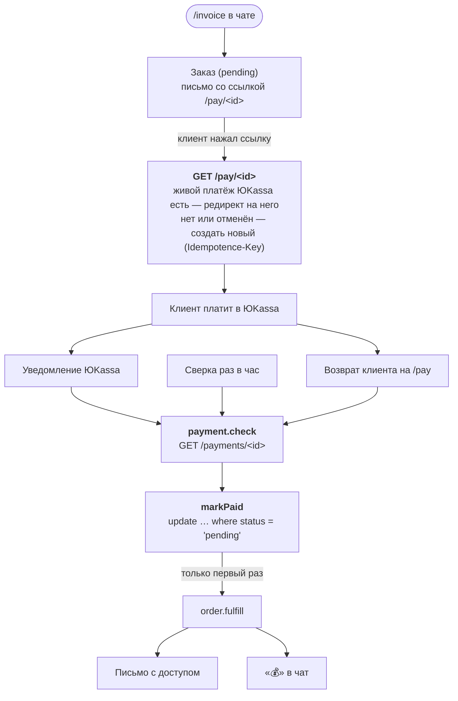

:::tldr
Менеджер пишет в чат `/invoice anna@example.com 15000 Лендинг`, клиент получает письмо со ссылкой на оплату. Ссылка ведёт в наш сервис, а он отправляет клиента на живой платёж ЮKassa. Когда приходит уведомление об оплате, мы не верим ему на слово, а спрашиваем ЮKassa сами, переводим заказ в «оплачен» ровно один раз, выдаём доступ и пишем в чат «💰». Раз в час сверяем неоплаченные заказы с ЮKassa, а должникам на 3, 7 и 14 день уходят напоминания, которые прекращаются, как только клиент заплатил.
:::

Это пятая часть цикла про коммерческие автоматизации и вторая из серии «Заменяем …». В [прошлой части](/blog/ru/automations-sales/) мы забрали у продажника разбор заявок. Теперь сделка состоялась, и начинается работа с деньгами.

## Что именно мы заменяем

Речь не о бухгалтерии в смысле налогов и отчётности, а о рутине вокруг оплат, которую в небольшой компании обычно делает бухгалтер, офис-менеджер или сам продажник:

| Раньше делал человек | Теперь делает система |
|---|---|
| выставить счёт и отправить клиенту | одна команда в чате, письмо уходит само |
| проверить в личном кабинете, пришли ли деньги | уведомление от ЮKassa и сверка раз в час |
| выдать доступ, отправить письмо «оплата получена» | сразу после оплаты, ночью и в выходные тоже |
| сообщить команде | «💰 Оплачено 15 000 ₽» в чате |
| вспомнить про неоплаченные счета и написать клиенту | напоминания на 3, 7 и 14 день |
| понять, кому пора позвонить | сообщение в чат после последнего напоминания |

Возвраты, споры и всё, где нужно решение, остаются человеку. Система о них только сообщает.

## Почему с деньгами нужно иначе

В части про продажи мы смирились с редким дублем: если CRM создала лид, а воркер упал, появится второй лид, и менеджер его объединит. С деньгами так нельзя. Двойная выдача доступа это потеря, двойное письмо «оплата получена» без оплаты это скандал, а неучтённая оплата это клиент, который заплатил и ничего не получил.

Поэтому здесь три правила:

1. **Источник правды о платеже это платёжная система, а не уведомление.** Уведомление только повод спросить её.
2. **Заказ становится оплаченным в одном месте и одним условным SQL-запросом.** Сколько бы раз и откуда ни пришло подтверждение, переход из «ждёт» в «оплачен» случится один раз.
3. **Каждое внешнее действие это отдельная задача с ключом.** Выдать доступ, написать клиенту, сообщить команде. Если одно упало, остальные не повторяются.

## Как это устроено



## Шаг 1. Таблицы

```sql
-- migrations/004_orders.sql
create table orders (
  id text primary key,
  email text not null,
  description text not null,
  amount integer not null check (amount > 0), -- в копейках: никаких дробных чисел для денег
  status text not null default 'pending'
    check (status in ('pending', 'paid')),
  payment_id text,
  paid_payment_id text,
  created_by text,
  reminders int not null default 0,
  created_at timestamptz not null default now(),
  paid_at timestamptz
);

create index orders_pending on orders (created_at) where status = 'pending';

create table accesses (
  order_id text primary key references orders (id),
  token text not null unique,
  created_at timestamptz not null default now()
);
```

Сумма хранится в копейках целым числом. Деньги никогда не хранят во float: `0.1 + 0.2` в JavaScript это `0.30000000000000004`, и рано или поздно такая ошибка всплывёт в сверке.

`payment_id` это текущий платёж в ЮKassa, по которому клиент может заплатить. `paid_payment_id` это платёж, который действительно оплатил заказ. Они различаются, если клиент открыл ссылку, не заплатил, а через неделю пришёл по напоминанию и получил новый платёж.

Доступы вынесены в отдельную таблицу с первичным ключом по заказу: второй доступ на тот же заказ база просто не даст создать.

## Шаг 2. ЮKassa

Регистрируем магазин в [ЮKassa](https://yookassa.ru), в настройках берём `shopId` и секретный ключ. Для тестов есть тестовый магазин с тестовыми картами, начинайте с него.

```ts
// src/yookassa.ts
import { config } from "./config";
import { check } from "./errors";

export interface Payment {
  id: string;
  status: "pending" | "waiting_for_capture" | "succeeded" | "canceled";
  amount: { value: string; currency: string };
  confirmation?: { confirmation_url?: string };
  metadata?: { order_id?: string };
}

const auth = `Basic ${btoa(`${config.yookassaShopId}:${config.yookassaSecretKey}`)}`;

/** Копейки в строку "15000.00", которую ждёт API. */
export const rubles = (kopecks: number) => (kopecks / 100).toFixed(2);

/** Платёж, каким его видит ЮKassa, или undefined, если такого платежа нет. */
export async function getPayment(id: string): Promise<Payment | undefined> {
  const response = await fetch(`${config.yookassaApi}/payments/${encodeURIComponent(id)}`, {
    headers: { authorization: auth },
    signal: AbortSignal.timeout(15_000),
  });
  if (response.status === 404) {
    return undefined;
  }
  await check(response, "yookassa get payment");
  return response.json();
}

/**
 * Создаёт платёж. Благодаря Idempotence-Key повторный запрос с тем же ключом
 * вернёт тот же платёж, а не создаст второй.
 */
export async function createPayment(params: {
  idempotenceKey: string;
  orderId: string;
  amount: number;
  description: string;
  returnUrl: string;
}): Promise<Payment> {
  const response = await fetch(`${config.yookassaApi}/payments`, {
    method: "POST",
    headers: {
      authorization: auth,
      "content-type": "application/json",
      "idempotence-key": params.idempotenceKey,
    },
    body: JSON.stringify({
      amount: { value: rubles(params.amount), currency: "RUB" },
      capture: true,
      confirmation: { type: "redirect", return_url: params.returnUrl },
      description: params.description.slice(0, 128),
      metadata: { order_id: params.orderId },
    }),
    signal: AbortSignal.timeout(15_000),
  });
  await check(response, "yookassa create payment");
  return response.json();
}
```

Две важные вещи.

**Idempotence-Key.** ЮKassa требует этот заголовок на каждом создающем запросе. Если запрос с тем же ключом пришёл повторно, она не создаёт второй платёж, а возвращает первый. Это ровно то, что нужно при повторах: сеть оборвалась после того, как ЮKassa создала платёж, мы повторяем запрос с тем же ключом и получаем тот же платёж.

**404 это не ошибка.** Если платежа с таким id нет, `getPayment` возвращает `undefined`. Ниже станет понятно, зачем: так мы спокойно отбрасываем поддельные уведомления.

:::note
Если у магазина подключены чеки по 54-ФЗ через ЮKassa, в запрос создания платежа добавляется объект `receipt` с email клиента и позициями чека. Набор полей и коды НДС зависят от вашей системы налогообложения: возьмите их из документации ЮKassa и проверьте в тестовом магазине.
:::

## Шаг 3. Заказы и ссылка, которая не протухает

```ts
// src/orders.ts
import { config } from "./config";
import { sql } from "./db";
import { enqueue } from "./queue";
import { alert } from "./telegram";
import { createPayment, getPayment, type Payment } from "./yookassa";

export interface Order {
  id: string;
  email: string;
  description: string;
  amount: number;
  status: "pending" | "paid";
  payment_id: string | null;
  paid_payment_id: string | null;
  reminders: number;
  created_at: Date;
}

export async function getOrder(id: string): Promise<Order | undefined> {
  const [order] = await sql`select * from orders where id = ${id}`;
  return order;
}

export const payLink = (order: { id: string }) => `${config.publicUrl}/pay/${order.id}`;

/** "15 000 ₽" для сообщений. */
export const money = (kopecks: number) =>
  `${(kopecks / 100).toLocaleString("ru-RU")} ₽`;

/** `/invoice anna@example.com 15000 Лендинг` из чата менеджеров. */
export function parseInvoice(text: string) {
  const match = /^\/invoice(?:@\w+)?\s+(\S+@\S+)\s+(\d+(?:[.,]\d{1,2})?)\s+(.+)$/s.exec(
    text.trim()
  );
  if (!match) {
    return undefined;
  }
  const amount = Math.round(Number(match[2].replace(",", ".")) * 100);
  return { email: match[1], amount, description: match[3].trim() };
}

/** `id` передаёт вызывающий код, чтобы повтор задачи создал тот же заказ. */
export async function createOrder(input: {
  id: string;
  email: string;
  amount: number;
  description: string;
  createdBy: string;
}) {
  const { id } = input;
  await sql`
    insert into orders (id, email, amount, description, created_by)
    values (${id}, ${input.email}, ${input.amount}, ${input.description}, ${input.createdBy})
    on conflict (id) do nothing
  `;
  await enqueue({ kind: "order.invoice", payload: { id }, key: `order.invoice:${id}` });
  return id;
}

/**
 * Ссылка из каждого письма. Она не протухает: при каждом клике мы находим
 * живой платёж или создаём новый, так что напоминание через две недели работает.
 */
export async function payRedirect(id: string): Promise<string | undefined> {
  const order = await getOrder(id);
  if (!order) {
    return undefined;
  }
  const thanks = `${config.publicUrl}/paid`;
  if (order.status === "paid") {
    return thanks;
  }
  if (order.payment_id) {
    const payment = await getPayment(order.payment_id);
    if (payment?.status === "succeeded") {
      await markPaid(order.id, payment); // вебхук ещё не дошёл
      return thanks;
    }
    if (payment?.status === "pending" && payment.confirmation?.confirmation_url) {
      return payment.confirmation.confirmation_url;
    }
  }
  // Платежа ещё нет или прошлый отменён. Два одновременных клика вычислят
  // один и тот же ключ, и ЮKassa вернёт обоим один платёж.
  const payment = await createPayment({
    idempotenceKey: `${order.id}:${order.payment_id ?? "first"}`,
    orderId: order.id,
    amount: order.amount,
    description: order.description,
    returnUrl: thanks,
  });
  await sql`update orders set payment_id = ${payment.id} where id = ${order.id}`;
  return payment.confirmation!.confirmation_url!;
}

/**
 * Единственное место, где заказ становится оплаченным. "where status = 'pending'"
 * делает это один раз, сколько бы вебхуков, сверок и кликов об этом ни сообщили.
 */
export async function markPaid(orderId: string, payment: Payment) {
  const order = await getOrder(orderId);
  if (!order) {
    await alert(`Платёж ${payment.id} для неизвестного заказа ${orderId}`);
    return;
  }
  if (Math.round(Number(payment.amount.value) * 100) !== order.amount) {
    await alert(`Платёж ${payment.id}: сумма ${payment.amount.value} не совпадает с заказом ${orderId}`);
    return;
  }
  const [won] = await sql`
    update orders set status = 'paid', paid_at = now(), paid_payment_id = ${payment.id}
    where id = ${orderId} and status = 'pending'
    returning id
  `;
  if (won) {
    await enqueue({ kind: "order.fulfill", payload: { id: orderId }, key: `order.fulfill:${orderId}` });
  } else if (order.paid_payment_id !== payment.id) {
    // Оплачено дважды разными платежами: о возврате решает человек
    await alert(`Заказ ${orderId} оплачен дважды: ${order.paid_payment_id} и ${payment.id}. Верните один платёж.`);
  }
}
```

Здесь три идеи.

**Ссылка в письме ведёт к нам, а не в ЮKassa.** Если вставить в письмо прямую ссылку на платёж, через несколько дней она может перестать работать: неоплаченные платежи отменяются. Наша ссылка `/pay/<id>` при каждом нажатии находит живой платёж или создаёт новый. Поэтому напоминание через две недели работает так же, как первое письмо.

**Ключ нового платежа зависит от предыдущего.** `<заказ>:first` для первого, `<заказ>:<id отменённого>` для следующего. Если клиент нажал ссылку дважды подряд, оба запроса вычислят одинаковый ключ, и ЮKassa вернёт один и тот же платёж. А после отмены ключ другой, и создаётся новый.

**`markPaid` единственное место, где заказ становится оплаченным.** Перед этим проверяем, что сумма платежа совпадает с суммой заказа. Затем `update ... where status = 'pending' returning id`: Postgres гарантирует, что строку вернёт только первый запрос. Он и ставит задачу выдачи. Все последующие подтверждения того же платежа ничего не делают. А если заказ оплачен двумя разными платежами (клиент открыл две вкладки и заплатил в обеих), система не возвращает деньги сама, а пишет в чат тревог: возврат это решение человека.

Ссылка обслуживается новым маршрутом:

```ts
// src/pay.ts
import { payRedirect } from "./orders";

/** GET /pay/:id, ссылка из счетов и напоминаний. */
export async function pay(req: Request & { params: { id: string } }) {
  try {
    const url = await payRedirect(req.params.id);
    if (!url) {
      return new Response("Счёт не найден", { status: 404 });
    }
    return Response.redirect(url, 303);
  } catch (error) {
    // ЮKassa лежит или тормозит: просим клиента повторить, заказ никуда не денется
    console.error("pay link failed", error);
    return new Response("Оплата временно недоступна, попробуйте через минуту", {
      status: 503,
    });
  }
}
```

Если ЮKassa недоступна, клиент видит «попробуйте через минуту», а заказ остаётся в базе. Ничего не теряется.

## Шаг 4. Уведомления без подписи

В части про ядро мы обещали вернуться к платёжкам, которые не подписывают уведомления. ЮKassa как раз такая: в уведомлении нет HMAC. Можно проверять IP-адреса отправителя по списку из документации, но есть способ надёжнее и проще: **не верить уведомлению вообще**. Из него мы берём только id платежа и спрашиваем ЮKassa, что с этим платежом на самом деле.

```ts
// src/sources.ts
// Уведомления ЮKassa не подписаны. Берём из них только id платежа
// и спрашиваем API о самом платеже, поэтому подделка ничего не изменит.
yookassa: {
  verify: () => true,
  dedupKey: (body) => {
    const note = JSON.parse(body);
    return `${note.event}:${note.object.id}`;
  },
  route: (body) => {
    const note = JSON.parse(body);
    if (typeof note.object?.id !== "string") {
      return [];
    }
    return [{ kind: "payment.check", payload: { paymentId: note.object.id } }];
  },
},
```

Поддельное уведомление «платёж pay-123 оплачен» приведёт к запросу в ЮKassa, которая ответит 404 или честным статусом. Подделать ответ ЮKassa злоумышленник не может: запрос к ней идёт с нашим ключом по HTTPS.

В личном кабинете ЮKassa в разделе HTTP-уведомлений указываем адрес `https://auto.example.com/hooks/yookassa` и события `payment.succeeded` и `payment.canceled`.

:::note
У Stripe и многих зарубежных платёжек уведомления подписаны: там вместо этого источника пишется проверка подписи по схеме из части про ядро. Но и с подписью полезно перепроверять важные события запросом к API: так переживается и потерянное, и запоздавшее уведомление.
:::

## Шаг 5. Почта

Для писем клиентам нужен сервис транзакционной почты. Отправлять письма с собственного сервера плохая идея: они почти наверняка попадут в спам. В примере [Resend](https://resend.com), но подойдёт любой сервис с HTTP API: Postmark, Unisender, Amazon SES. Меняется одна функция.

```ts
// src/email.ts
import { config } from "./config";
import { check } from "./errors";

export async function sendEmail(to: string, subject: string, text: string) {
  const response = await fetch(`${config.emailApi}/emails`, {
    method: "POST",
    headers: {
      authorization: `Bearer ${config.emailApiKey}`,
      "content-type": "application/json",
    },
    body: JSON.stringify({ from: config.emailFrom, to, subject, text }),
    signal: AbortSignal.timeout(15_000),
  });
  await check(response, "email");
}
```

Домен отправителя нужно подтвердить в сервисе (записи SPF и DKIM в DNS), иначе письма будут уходить в спам.

## Шаг 6. Обработчики

Вся логика оплат в отдельном файле:

```ts
// src/billing.ts
import { config } from "./config";
import { sql } from "./db";
import { sendEmail } from "./email";
import {
  createOrder,
  getOrder,
  markPaid,
  money,
  parseInvoice,
  payLink,
} from "./orders";
import { enqueue, type Job } from "./queue";
import { sendMessage } from "./telegram";
import { getPayment } from "./yookassa";

type Handler = (payload: any, job: Job) => Promise<void>;

const DAY = 24 * 60 * 60 * 1000;
const REMIND_AFTER_DAYS = [3, 7, 14];

/** `/invoice email сумма описание`, только из чата менеджеров. */
export async function invoiceCommand(message: any) {
  if (String(message.chat.id) !== String(config.leadsChatId)) {
    return;
  }
  const input = parseInvoice(message.text);
  if (!input) {
    await sendMessage(message.chat.id, "Формат: /invoice client@example.com 15000 За что счёт");
    return;
  }
  const who = message.from.username ? `@${message.from.username}` : message.from.first_name;
  // Id берётся из сообщения, поэтому повтор задачи не создаст второй заказ
  const id = await createOrder({
    ...input,
    id: `tg-${message.chat.id}-${message.message_id}`,
    createdBy: who,
  });
  await sendMessage(
    message.chat.id,
    `Счёт на ${money(input.amount)} отправлен на ${input.email}.\nСсылка на оплату: ${payLink({ id })}`
  );
}

export const billingHandlers: Record<string, Handler> = {
  "order.invoice": async ({ id }) => {
    const order = await getOrder(id);
    if (!order || order.status !== "pending") {
      return;
    }
    await sendEmail(
      order.email,
      `Счёт: ${order.description}`,
      `Здравствуйте!\n\nВыставляем счёт за «${order.description}» на ${money(order.amount)}.\n` +
        `Оплатить картой: ${payLink(order)}\n\nСсылка бессрочная.`
    );
  },

  // Из уведомления или сверки: спрашиваем ЮKassa, что произошло на самом деле
  "payment.check": async ({ paymentId }) => {
    const payment = await getPayment(paymentId);
    if (!payment) {
      console.warn(`payment ${paymentId} does not exist`); // поддельное уведомление
      return;
    }
    if (payment.status === "succeeded" && payment.metadata?.order_id) {
      await markPaid(payment.metadata.order_id, payment);
    }
    // canceled: делать нечего, ссылка /pay создаст новый платёж при следующем клике
  },

  // Оплачено: выдаём доступ один раз, потом сообщаем клиенту и команде
  "order.fulfill": async ({ id }) => {
    const token = crypto.randomUUID();
    await sql`
      insert into accesses (order_id, token) values (${id}, ${token})
      on conflict (order_id) do nothing
    `;
    await enqueue({ kind: "order.access_email", payload: { id }, key: `order.access_email:${id}` });
    await enqueue({ kind: "order.paid_notice", payload: { id }, key: `order.paid_notice:${id}` });
  },

  "order.access_email": async ({ id }) => {
    const order = await getOrder(id);
    const [access] = await sql`select token from accesses where order_id = ${id}`;
    await sendEmail(
      order!.email,
      `Оплата получена: ${order!.description}`,
      `Спасибо! Мы получили ${money(order!.amount)}.\n` +
        `Ваш доступ: ${config.accessUrl}${access.token}`
    );
  },

  "order.paid_notice": async ({ id }) => {
    const order = await getOrder(id);
    await sendMessage(
      config.leadsChatId,
      `💰 Оплачено ${money(order!.amount)}: ${order!.description} (${order!.email})`
    );
  },

  // Каждое утро: кому сегодня напомнить
  "invoices.remind": async () => {
    const orders = await sql`
      select id, reminders, created_at from orders where status = 'pending'
    `;
    for (const order of orders) {
      const step = order.reminders;
      const age = Date.now() - new Date(order.created_at).getTime();
      if (step < REMIND_AFTER_DAYS.length && age >= REMIND_AFTER_DAYS[step] * DAY) {
        const n = step + 1;
        await enqueue({
          kind: "order.remind",
          payload: { id: order.id, n },
          key: `order.remind:${order.id}:${n}`,
        });
      }
    }
  },

  "order.remind": async ({ id, n }) => {
    const order = await getOrder(id);
    if (!order || order.status !== "pending") {
      return; // уже оплатили: цепочка останавливается сама
    }
    await sendEmail(
      order.email,
      `Напоминание: счёт за ${order.description}`,
      `Здравствуйте! Напоминаем о счёте за «${order.description}» ` +
        `на ${money(order.amount)}.\nОплатить: ${payLink(order)}\n\n` +
        "Если вы уже оплатили или что-то не так, просто ответьте на это письмо."
    );
    await sql`update orders set reminders = greatest(reminders, ${n}) where id = ${id}`;
    if (n === REMIND_AFTER_DAYS.length) {
      await sendMessage(
        config.leadsChatId,
        `📞 ${order.email} не оплачивает «${order.description}» уже ${REMIND_AFTER_DAYS.at(-1)} дней. Стоит позвонить.`
      );
    }
  },

  // Каждый час: ловим платежи, уведомление о которых не дошло
  "payments.reconcile": async () => {
    const orders = await sql`
      select payment_id from orders
      where status = 'pending' and payment_id is not null
        and created_at > now() - interval '30 days'
    `;
    for (const order of orders) {
      await enqueue({ kind: "payment.check", payload: { paymentId: order.payment_id } });
    }
  },
};
```

Подключаем их в общий список обработчиков и учим команду `/invoice`:

```ts
// src/handlers.ts
import { billingHandlers, invoiceCommand } from "./billing";

export const handlers: Record<string, Handler> = {
  // ... обработчики лидов из прошлой части

  "telegram.message": async (message) => {
    if (message.text === "/ping") {
      await sendMessage(message.chat.id, "pong");
    }
    if (message.text.startsWith("/invoice")) {
      await invoiceCommand(message);
    }
  },

  ...billingHandlers,
};
```

На что обратить внимание:

- **Счета выставляет только чат менеджеров.** Команду из любого другого чата бот молча игнорирует. Кто состоит в чате, тот и может выставлять счета, поэтому следите за составом группы.
- **id заказа берётся из id сообщения.** Если задача `telegram.message` упадёт после создания заказа и повторится, второй заказ не появится.
- **`order.fulfill` только выдаёт доступ и ставит две задачи.** Письмо клиенту и сообщение в чат выполняются отдельно. Если почтовый сервис лежит, письмо будет повторяться, а сообщение в чат уже ушло, и доступ никто не выдаст повторно.
- **Напоминания не нужно отменять.** Каждое проверяет статус заказа в момент отправки, а утренняя задача выбирает только неоплаченные заказы. Заплатил клиент, и цепочка остановилась сама.
- **Ключ напоминания содержит его номер.** Если утренняя задача выполнится дважды за день, второе письмо не уйдёт.

## Шаг 7. Сверка и расписание

Уведомление может не дойти: ЮKassa его отправила, а у нас в этот момент шёл деплой, или оно потерялось по дороге. ЮKassa повторяет уведомления, но полагаться только на это нельзя. Раз в час `payments.reconcile` проходит по неоплаченным заказам последних 30 дней с платежом и проверяет каждый через тот же `payment.check`. В худшем случае клиент получит доступ через час, а не никогда.

В расписание из части про ядро добавляем две задачи:

```ts
// src/schedule.ts
import { enqueue } from "./queue";

export type Schedule =
  | { kind: string; everyMinutes: number }
  | { kind: string; dailyAt: string }; // "09:00" в часовом поясе сервера

export const schedules: Schedule[] = [
  { kind: "heartbeat", everyMinutes: 60 },
  { kind: "invoices.remind", dailyAt: "10:00" },
  { kind: "payments.reconcile", everyMinutes: 60 },
];

const pad = (n: number) => String(n).padStart(2, "0");

/**
 * Текущий слот расписания или null, если время ещё не пришло.
 * Слот становится ключом задачи, поэтому каждый слот выполняется один раз,
 * сколько бы воркеров его ни проверяли и как бы часто.
 */
export function slot(schedule: Schedule, now: Date): string | null {
  if ("everyMinutes" in schedule) {
    const ms = schedule.everyMinutes * 60_000;
    return new Date(Math.floor(now.getTime() / ms) * ms).toISOString();
  }
  const [hours, minutes] = schedule.dailyAt.split(":").map(Number);
  if (now.getHours() * 60 + now.getMinutes() < hours * 60 + minutes) {
    return null;
  }
  return `${now.getFullYear()}-${pad(now.getMonth() + 1)}-${pad(now.getDate())}`;
}

export async function enqueueDue(now = new Date()) {
  for (const schedule of schedules) {
    const current = slot(schedule, now);
    if (current) {
      await enqueue({ kind: schedule.kind, key: `${schedule.kind}:${current}` });
    }
  }
}
```

## Шаг 8. Тесты

Для оплат тесты особенно важны: проверяем, что многократное подтверждение одного платежа выдаёт доступ один раз, что двойная оплата вызывает тревогу, что платёж с чужой суммой не засчитывается, что ссылка переиспользует живой платёж и что напоминания уходят по графику и прекращаются после оплаты.

Заглушки внешних API вынесены в общий файл `test/stubs.ts`: заглушка ЮKassa, как настоящая, запоминает платежи по Idempotence-Key. Сами тесты:

```ts
// test/billing.test.ts
import { beforeEach, expect, test } from "bun:test";
import { config } from "../src/config";
import { sql } from "../src/db";
import { handlers } from "../src/handlers";
import { markPaid, parseInvoice, payRedirect } from "../src/orders";
import type { Job } from "../src/queue";
import { calls, payments, reset } from "./stubs";

const job = {} as Job;
const DAY = 24 * 60 * 60 * 1000;
const sent = (api: string) => calls.filter((c) => c.api === api);

async function invoice(messageId = 1, text = "/invoice anna@example.com 15000 Лендинг") {
  await handlers["telegram.message"](
    { message_id: messageId, chat: { id: Number(config.leadsChatId) }, from: { username: "ivan" }, text },
    job
  );
  return `tg-${config.leadsChatId}-${messageId}`;
}

beforeEach(async () => {
  reset();
  await sql`truncate accesses, orders, jobs restart identity cascade`;
});

test("the invoice command is parsed in rubles and kopecks", () => {
  expect(parseInvoice("/invoice a@b.co 15000 Сайт")).toEqual({
    email: "a@b.co",
    amount: 1_500_000,
    description: "Сайт",
  });
  expect(parseInvoice("/invoice@MyBot a@b.co 99,90 Fix")?.amount).toBe(9990);
  expect(parseInvoice("/invoice nonsense")).toBeUndefined();
});

test("a retried command creates one order, and only the managers' chat may invoice", async () => {
  await invoice(1);
  await invoice(1);
  await handlers["telegram.message"](
    { message_id: 2, chat: { id: 555 }, from: { username: "x" }, text: "/invoice a@b.co 1 X" },
    job
  );
  const orders = await sql`select id, amount, status from orders`;
  expect(orders).toEqual([{ id: `tg-${config.leadsChatId}-1`, amount: 1_500_000, status: "pending" }]);
});

test("the pay link reuses a live payment and replaces a canceled one", async () => {
  const id = await invoice();
  const first = await payRedirect(id);
  expect(await payRedirect(id)).toBe(first); // второй клик получает тот же платёж
  expect(sent("yookassa").filter((c) => c.method === "payments")).toHaveLength(1);

  payments.get("pay-1").status = "canceled";
  const second = await payRedirect(id);
  expect(second).not.toBe(first);
  const [order] = await sql`select payment_id from orders where id = ${id}`;
  expect(order.payment_id).toBe("pay-2");
});

test("a payment confirmed many times fulfils the order once", async () => {
  const id = await invoice();
  await payRedirect(id);
  payments.get("pay-1").status = "succeeded";

  // Вебхук, его повтор и сверка сообщают об одном и том же платеже
  await handlers["payment.check"]({ paymentId: "pay-1" }, job);
  await handlers["payment.check"]({ paymentId: "pay-1" }, job);
  await handlers["payment.check"]({ paymentId: "pay-1" }, job);

  const fulfil = await sql`select count(*)::int as n from jobs where kind = 'order.fulfill'`;
  expect(fulfil[0].n).toBe(1);
  await handlers["order.fulfill"]({ id }, job);
  await handlers["order.fulfill"]({ id }, job);
  const [{ n }] = await sql`select count(*)::int as n from accesses`;
  expect(n).toBe(1);
});

test("a second, different payment for a paid order raises an alert", async () => {
  const id = await invoice();
  const payment = (pid: string) => ({
    id: pid,
    status: "succeeded" as const,
    amount: { value: "15000.00", currency: "RUB" },
    metadata: { order_id: id },
  });
  await markPaid(id, payment("pay-a"));
  await markPaid(id, payment("pay-b"));
  const alerts = sent("telegram").filter((c) => String(c.body.text).includes("оплачен дважды"));
  expect(alerts).toHaveLength(1);
});

test("a payment with the wrong amount does not mark the order paid", async () => {
  const id = await invoice();
  await markPaid(id, {
    id: "pay-x",
    status: "succeeded",
    amount: { value: "1.00", currency: "RUB" },
    metadata: { order_id: id },
  });
  const [order] = await sql`select status from orders where id = ${id}`;
  expect(order.status).toBe("pending");
});

test("reminders go out on days 3, 7 and 14 and stop after payment", async () => {
  const id = await invoice();
  const age = async (days: number) => {
    await sql`update orders set created_at = ${new Date(Date.now() - days * DAY)} where id = ${id}`;
    await handlers["invoices.remind"]({}, job);
    const due = await sql`select payload from jobs where kind = 'order.remind' and status = 'pending'`;
    for (const { payload } of due) {
      await handlers["order.remind"](payload, job);
      await sql`update jobs set status = 'done' where kind = 'order.remind'`;
    }
  };
  await age(1);
  await age(3);
  await age(3); // снова тот же день: второго напоминания нет
  await age(8);
  expect(sent("email").filter((c) => c.body.subject.startsWith("Напоминание"))).toHaveLength(2);

  await sql`update orders set status = 'paid' where id = ${id}`;
  await age(15);
  expect(sent("email").filter((c) => c.body.subject.startsWith("Напоминание"))).toHaveLength(2);
});
```

```text
 19 pass
 0 fail
```

В CI добавляем в шаг `Tests` адреса заглушек: `YOOKASSA_API: http://localhost:3996/v3`, `EMAIL_API: http://localhost:3995` и тестовые значения остальных новых переменных.

## Шаг 9. Запуск

1. Допишите на сервере в `.env`:

```bash
YOOKASSA_SHOP_ID=123456
YOOKASSA_SECRET_KEY=test_...   # сначала ключ тестового магазина
PUBLIC_URL=https://auto.example.com
ACCESS_URL=https://example.com/access/
EMAIL_API_KEY=re_...
EMAIL_FROM=Студия <hello@example.com>
```

2. Запушьте код: миграция `004_orders.sql` применится при деплое.
3. В ЮKassa укажите адрес уведомлений `https://auto.example.com/hooks/yookassa`.
4. Выставьте себе счёт на 1 рубль, оплатите тестовой картой и проверьте, что пришло письмо с доступом и сообщение в чат.
5. Переключите ключи на боевой магазин.

## Проверка

Прогон через HTTP с заглушками ЮKassa, почты и Telegram:

| Что сделали | Что произошло |
|---|---|
| `/invoice anna@example.com 15000 Лендинг для студии` в чате менеджеров | заказ создан, в чат «Счёт на 15 000 ₽ отправлен», клиенту письмо со ссылкой |
| Открыли `/pay/<id>` | создан платёж в ЮKassa с суммой «15000.00», редирект на страницу оплаты |
| Открыли ссылку ещё раз | редирект на тот же платёж, новый не создан |
| Открыли `/pay/nope` | 404 |
| Пришло уведомление `payment.succeeded`, а затем его повтор | первое обработано, второе отсечено как дубль |
| Пришло поддельное уведомление про платёж `forged` | ЮKassa ответила 404, заказ не тронут |
| После оплаты | заказ `paid`, одно письмо с доступом, одно «💰 Оплачено 15 000 ₽» в чате |
| Открыли ссылку после оплаты | редирект на страницу «Спасибо» |
| Тесты: три подтверждения одного платежа | одна выдача доступа |
| Тесты: заказ оплачен двумя платежами | тревога «оплачен дважды, верните один» |
| Тесты: платёж на 1 рубль вместо 15 000 | заказ остаётся неоплаченным, тревога |
| Тесты: 1, 3, 3, 8 день, оплата, 15 день | напоминания на 3 и 8 день, после оплаты ни одного |

## Что получилось

- Счёт выставляется одной командой, клиент получает письмо за секунды.
- Ссылка на оплату работает всегда, даже из напоминания через две недели.
- Оплата засчитывается ровно один раз, сколько бы подтверждений ни пришло, и только с правильной суммой.
- Подделать оплату уведомлением нельзя: мы проверяем каждую в ЮKassa.
- Потерянное уведомление подхватит часовая сверка.
- Должникам уходят напоминания, а когда пора звонить, в чат приходит сообщение.

Дальше «Заменяем поддержку»: разбираем входящие письма и сообщения, отвечаем на типовые вопросы черновиками по базе знаний и оставляем человеку последнее слово.
