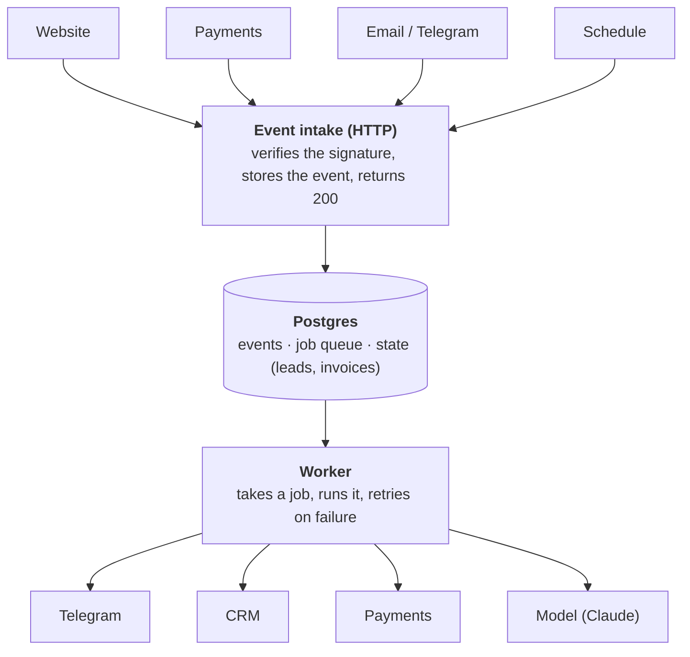

:::tldr
The automation that pays off is not the one that looks impressive, but the one that covers a frequent process where a delay or a mistake costs money. In a small business there are usually four of them: leads, payments, support and reports. Those are the ones we will build. Underneath them sits a shared foundation: one server, Postgres as both the database and the queue, event intake with retries and a log of everything that happened.
:::

## What this series is about

"Automation" usually means one of two things. Either a Zapier chain that copies a form submission into a spreadsheet, or a big implementation project that takes a year. We are interested in the middle: small programs that run on their own, save people hours or bring money back, and do not fall over the first time an external service has a bad day.

To keep the examples concrete, take a typical small company that sells a service or a subscription online. It has:

- a website with a contact form;
- managers who handle leads and keep clients in a CRM;
- payments through a payment provider;
- support over email and Telegram;
- a founder who wants to know the numbers.

It could be an online school, a studio, a SaaS product or an agency. The industry does not matter much: the processes look alike.

## Where a business loses money

Before automating anything, walk through the processes and ask of each one: where does money or time leak out here? For our company the picture looks roughly like this.

**Leads wait.** Someone fills in the form at 7:40 pm and a manager sees it the next morning. By then the client has written to three competitors. The faster the reply, the better the chance of a sale, and this is one of the cheapest automations to build and one of the most visible in revenue.

**Payments get lost.** A card is declined, a subscription fails to renew, an invoice is sent and forgotten. Each of these is revenue that was almost in the bank. Without automation they are noticed only when the client leaves.

**Manual fulfilment.** The client has paid, but a person sends the course access, the license key or the receipt. At night and on weekends, the client waits.

**Support drowns in repeated questions.** Half the emails are "where is my access", "how do I change my plan", "please send the invoice documents". Each takes a couple of minutes, and there are hundreds.

**Reports are built by hand.** Every Monday someone exports data from the CRM and the payment provider and merges it in a spreadsheet. A drop in conversion is noticed a month later, when it is too late.

## How to choose what to automate

Any automation idea can be looked at through four questions.

1. **How often does it happen?** A process that happens once a quarter is almost never worth automating. Dozens of times a day almost always is.
2. **How long does it take a person?** Multiply by frequency and you get hours per month.
3. **What does a delay cost?** For a lead, a delay costs a lost sale. For a report, almost nothing.
4. **What does a mistake cost?** If the automation gets it wrong, what happens? A mislabelled email gets fixed by an operator. Charging a client's card twice means a complaint and a refund.

The first three questions tell you how much the automation will bring. The fourth tells you how carefully it has to be built. Hence a simple rule: start with processes that are frequent, slow and expensive to delay, and where a mistake is expensive, leave the final word to a person.

Lay our five processes out against these questions and you get the order of this series:

| Process | Frequency | Cost of delay | Cost of mistake | What we do |
|---|---|---|---|---|
| Leads | daily | high | low | fully automatic |
| Payments and access | daily | high | high | automatic, with idempotency and a log |
| Unpaid invoices | weekly | medium | medium | automatic reminders |
| Support | daily | medium | medium | the model drafts, a person sends |
| Reports and alerts | daily | low while all is well | low | fully automatic |

## What we will build

One automation per part, all on a shared foundation. Each one takes the routine off one role in the company.

**Replacing the salesperson.** A form submission goes straight into the system. The model pulls out of the free text what the person needs, estimates how hot the lead is, and within a minute a manager gets a Telegram card with "I'll take it" and "spam" buttons, while a deal appears in the CRM. If nobody takes the lead within 15 minutes, the bot sends a reminder.

**Replacing the accountant.** The payment provider sends a payment event and the system grants access and sends the receipt by itself, exactly once, even if the event arrives three times. Failed payments and unpaid invoices get a chain of polite reminders that stops as soon as the client pays.

**Replacing support.** Incoming emails and messages are sorted by type. For repeated questions the model drafts a reply from the knowledge base, and an operator edits it and sends it with one button. The model never sends anything to a client on its own.

**Replacing the analyst.** Every morning a digest arrives in the team chat: leads, payments, revenue, a comparison with last week. If something drops sharply, for example zero leads from the website in a day, the alert arrives right away rather than on Monday.

## Ready-made service or your own code

There are ready-made tools for automations: Zapier, Make, n8n. They are good, and for many tasks they are enough. An honest comparison:

**No-code services** shine when the chain is short (form to spreadsheet, spreadsheet to email), the logic is simple and a mistake is cheap. They are quick to put together and a non-programmer can manage them. n8n can also run on your own server.

**Your own code** wins when:

- the logic has branches, state and waiting: "remind in 15 minutes if nobody took it";
- money is involved and you must guarantee an action runs exactly once;
- you want tests and change history in git;
- volume grows and paying per operation in a cloud service gets expensive;
- you need a model inside that reads text, with your own prompts and checks.

In this series we write our own code, because each of the four automations hits at least one of these points. But the code stays small: a few hundred lines of TypeScript, no frameworks.

## Architecture

**Event intake.** A small HTTP server. Everything that comes from outside (a form submission, a payment webhook, a message to the bot) is verified, stored in the database and acknowledged immediately. No business logic at intake time: if the CRM is down at this exact second, we must not lose the lead.

**Postgres.** Both the database and the queue. A small business does not need a separate message broker like RabbitMQ or Redis: Postgres can hand jobs to workers without double processing (`FOR UPDATE SKIP LOCKED`), and that is one less system to run, back up and monitor.

**Worker.** Takes jobs from the queue and runs them: send a message, create a deal, grant access, ask the model. If an external service returns an error, the job is retried later with a growing delay. If it still fails after several attempts, the job is marked as failed and a notification goes out.

**Schedule.** Some automations are triggered by time rather than events: the morning digest, the unpaid invoice check. The schedule simply puts jobs into the same queue.

## Principles

1. **Store first, process later.** An incoming event is written to the database before any logic runs. Then a failure anywhere downstream loses no data, and the event can be replayed.
2. **Every action is idempotent.** Payment providers and messengers deliver the same event more than once, and a worker can crash in the middle of a job. Running a job again must not grant access twice or charge money a second time.
3. **Failures are normal.** Every external API will one day return an error or not answer at all. Retries with delays and a clear "failed" status are built into the core, not bolted on later.
4. **A person where mistakes are expensive.** The model drafts the reply to a client, but a person sends it. A person issues refunds.
5. **Everything is logged.** Which event came in, which jobs it produced, what external services answered. Without that you cannot answer "why didn't the client get access".
6. **Cheap and boring.** One server, proven tools, few moving parts. An automation people are afraid to touch is worse than the manual process.

## Tools

A short overview here, with details in the following parts.

| Job | We use | Why | Alternatives |
|---|---|---|---|
| Language and runtime | TypeScript, [Bun](https://bun.sh) | quick start, built-in HTTP server, Postgres client and test runner | Node.js, Go, Python |
| Hosting | one VPS | predictable price, no limits on background processes and schedules | PaaS (Render, Railway, Fly.io), serverless |
| Running it | Docker Compose | the whole service is described by one file in the repo | Coolify, Dokku, Kamal |
| HTTPS | [Caddy](https://caddyserver.com) | gets and renews certificates by itself | nginx with certbot, Traefik |
| Database and queue | Postgres | one system for data and the queue | Redis, RabbitMQ, SQS |
| Deploys | GitHub Actions | deploy on push to main, same repository | GitLab CI, manual deploys |
| Notifications | a Telegram bot | free, instant, has buttons | Slack, email |
| Understanding text | Claude API | extracting data from leads, sorting emails, drafting replies | other commercial models |

Hosting deserves a separate word. Serverless platforms are convenient for websites, but automations need background processes, schedules and a database close by, and on serverless each of those becomes a separate paid service. A VPS with a couple of cores costs a few euros a month at any major provider and comfortably runs all the automations of a small company. If the team does not want to deal with a server at all, the Docker Compose setup from the next part runs unchanged on Coolify or a PaaS.

## What's next

In the [next part](/blog/automations-foundation/) we build the foundation: rent a server, set it up, write the first Bun service with a database and migrations, package it with Docker and set up deploy on push to main. By the end of it we will have a live HTTPS address that accepts events and stores them in the database.
