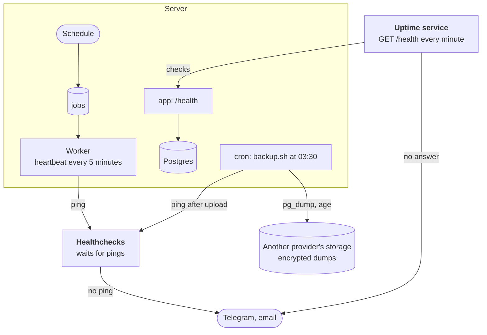

:::tldr
Every 5 minutes the worker pings Healthchecks through the queue, and a separate service checks `/health` from outside: if anything dies, the alert comes from beyond the server. Docker logs are capped in size. Every night `backup.sh` dumps the database, encrypts it with age and puts it into another provider's object storage with a key that can't delete, and once a month `restore-check.sh` proves the dump restores. Every Claude request is recorded with its cost: the spend shows up in the morning digest, and going over the daily limit raises an alert. Secrets live only in `.env` on the server, and their list is kept in the repository as `.env.example`.
:::

This is the eighth and last part of the series on commercial automations. In the [previous part](/blog/automations-analytics/) the system learned to notice problems in the business by itself. Now we teach it to notice problems in itself, and take care of what happens when the server burns down one day.

## What can go wrong

| What happened | How we find out | Section |
|---|---|---|
| the server or the app went down | an outside check of `/health` | step 1 |
| the worker hung or died, the queue is stuck | pings through the queue stop reaching Healthchecks | step 1 |
| logs filled the disk | they won't: logs are capped | step 2 |
| the database is lost or corrupted | restore from the nightly backup | steps 3–4 |
| a key leaked | rotate it by the procedure; keys have minimal rights | step 5 |
| model costs grew | a line in the digest and a limit alert | step 6 |
| a silent breakage in the business | the alerts from the previous part | — |



## Step 1. Outside monitoring

The alerts from the previous part run in the worker itself. If it dies, nobody sends them. A system can't reliably report its own death, so it needs an outside watcher. There are two checks, and each catches its own kind of problem.

**A heartbeat through the queue.** Every 5 minutes the `heartbeat` job hits a URL at [Healthchecks.io](https://healthchecks.io). It's a dead man's switch: it doesn't check us, it waits for pings, and if no ping arrives within the set time, it sends an alert to Telegram or email. Importantly, the ping doesn't come from a separate cron but from an ordinary job: the schedule creates it, puts it into the queue and the worker runs it. While pings arrive, the whole chain works; if any link breaks, the pings stop.

```ts
// src/handlers.ts
// Every 5 minutes through the whole chain: schedule, queue, worker.
// If the pings stop, Healthchecks raises the alarm from outside.
heartbeat: async () => {
  if (config.heartbeatUrl) {
    const response = await fetch(config.heartbeatUrl, { signal: AbortSignal.timeout(10_000) });
    await check(response, "heartbeat");
  }
},
```

`heartbeat` now runs every 5 minutes instead of every hour. In Healthchecks create a check with a 5-minute period and a 10-minute grace, connect the Telegram integration and put the ping URL into `HEARTBEAT_URL`.

**A check from outside.** The heartbeat won't notice that Caddy went down or the certificate expired: the worker is still alive and pinging. So a second service opens `https://auto.example.com/health` every minute. The route from the second part runs `select 1` against the database, so the check also confirms the app can see Postgres. Any uptime service works: UptimeRobot, Better Stack, or your own Uptime Kuma, but then on another server, or it dies together with what it watches.

## Step 2. Logs

By default Docker keeps container logs without limits. Half a year later a chatty worker fills the whole disk with them, and the database goes down. We cap every service with one anchor: at most five files of 10 MB per container.

```yaml
# compose.yml
# Docker keeps container logs forever by default; cap them so the disk never fills
x-logging: &logging
  driver: json-file
  options:
    max-size: 10m
    max-file: "5"

x-app: &app
  image: ghcr.io/your-name/automations:${TAG:-latest}
  restart: unless-stopped
  logging: *logging
  env_file: .env
  environment:
    DATABASE_URL: postgres://app:${POSTGRES_PASSWORD}@db:5432/app
    TZ: Europe/Moscow
  depends_on:
    db:
      condition: service_healthy

services:
  app:
    <<: *app

  worker:
    <<: *app
    command: ["bun", "src/worker.ts"]
    stop_grace_period: 60s

  db:
    image: postgres:18
    restart: unless-stopped
    logging: *logging
    environment:
      POSTGRES_USER: app
      POSTGRES_PASSWORD: ${POSTGRES_PASSWORD}
      POSTGRES_DB: app
    volumes:
      # Since Postgres 18 the image keeps data in /var/lib/postgresql/18/docker
      - pgdata:/var/lib/postgresql
    healthcheck:
      test: ["CMD-SHELL", "pg_isready -U app"]
      interval: 5s
      retries: 10

  caddy:
    image: caddy:2
    restart: unless-stopped
    logging: *logging
    ports:
      - "80:80"
      - "443:443"
      - "443:443/udp"
    volumes:
      - ./Caddyfile:/etc/caddy/Caddyfile:ro
      - caddy_data:/data
      - caddy_config:/config

volumes:
  pgdata:
  caddy_data:
  caddy_config:
```

A system this size doesn't need a log collection stack. `docker compose logs -f --since 1h worker` and `grep` are enough. Job errors are already visible in the `last_error` field of the `jobs` table, and final failures arrive in the alert chat.

Note the database volume: since Postgres 18 it's mounted at `/var/lib/postgresql`, not at `/var/lib/postgresql/data` as with images up to version 17. How to move a running database to a new major version is in step 7.

## Step 3. Backups

A Docker volume on the same server isn't a backup. A disk dies, someone deletes the server by mistake in the hosting panel, the account gets blocked, and the volume goes with the database. A real backup meets three conditions:

1. **It lives somewhere else.** S3-compatible object storage with another provider, preferably in another country: Backblaze B2, Cloudflare R2 and the like. For a small database that's gigabytes, which costs pennies.
2. **It's encrypted.** Dumps are encrypted with [age](https://age-encryption.org) using a public key. The private key isn't on the server; it lives in a password manager. The storage, and anyone who gets access to it, sees only encrypted files.
3. **It can't be erased from the server.** The storage access key can write but not delete. Old copies are removed by a lifecycle rule on the storage side, say after 30 days. If the server is hacked, the attacker can't destroy the backups. If the storage supports versioning or object lock, turn those on too.

Install age and [rclone](https://rclone.org) on the server: `apt install age rclone`. `backup.sh` itself lives in the repository, and the deploy from the second part copies it to the server along with `compose.yml`: the `scp` step got one more file.

```bash
#!/usr/bin/env bash
# backup.sh: an encrypted database dump to object storage in another place.
# Runs from cron on the server, for example every night at 03:30:
#   30 3 * * * /opt/automations/backup.sh >> /var/log/automations-backup.log 2>&1
set -euo pipefail # pipefail: a failed pg_dump must fail the script, not upload an empty file
cd "$(dirname "$0")"
source ./backup.env

# If anything below fails, tell Healthchecks right away instead of waiting for silence
trap 'curl -fsS -m 10 --retry 3 "$BACKUP_PING_URL/fail" > /dev/null || true' ERR

name="app-$(date +%Y-%m-%d-%H%M).dump.age"
file="$(mktemp)"
trap 'rm -f "$file"' EXIT

# Custom format is compressed, and pg_restore can restore a single table from it.
# age encrypts with the public key: the private key never lives on this server.
docker compose exec -T db pg_dump -U app -Fc app | age -r "$BACKUP_RECIPIENT" > "$file"

# Refuse to upload something suspiciously small: a dump of a live database is never 1 KB
size=$(stat -c %s "$file")
if [ "$size" -lt 1024 ]; then
  echo "backup is only $size bytes, not uploading" >&2
  false
fi

rclone copyto "$file" "backup:$BACKUP_BUCKET/automations/$name"
echo "$(date -Is) uploaded $name ($size bytes)"

curl -fsS -m 10 --retry 3 "$BACKUP_PING_URL" > /dev/null
```

`set -o pipefail` matters more than anything else here. Without it, the exit code of `pg_dump | age` comes from the last command. If `pg_dump` fails, age dutifully encrypts nothing, and the script successfully uploads an empty file. With `pipefail` the script stops and pings Healthchecks at `/fail`, and the size check catches more exotic cases.

The settings live next to it, in a separate file with `600` permissions:

```bash
# backup.env.example: settings for backup.sh. Copy to backup.env, chmod 600.

# age public key (age1...). The private key stays in your password manager.
BACKUP_RECIPIENT=age1...

# Bucket in S3-compatible storage with another provider than the server
BACKUP_BUCKET=my-backups

# rclone reads its remote "backup" from these variables, no config file needed
export RCLONE_CONFIG_BACKUP_TYPE=s3
export RCLONE_CONFIG_BACKUP_PROVIDER=Other
export RCLONE_CONFIG_BACKUP_ENDPOINT=https://s3.example-storage.com
export RCLONE_CONFIG_BACKUP_ACCESS_KEY_ID=
export RCLONE_CONFIG_BACKUP_SECRET_ACCESS_KEY=
# The key can write but not delete; old backups are removed by a lifecycle rule
export RCLONE_CONFIG_BACKUP_NO_CHECK_BUCKET=true

# Healthchecks check for backups: expect a ping every 24 hours
BACKUP_PING_URL=https://hc-ping.com/your-uuid
```

Create a separate Healthchecks check for backups with a one-day period. If the nightly backup failed or cron didn't run at all, an alert arrives in the morning.

## Step 4. The restore check

A backup nobody has ever restored is a hope, not a backup. The dump may turn out empty, the key may get lost, the format may not suit a new Postgres version. Finding out on the day of the disaster is too late. So once a month, on your own machine, download a fresh file from storage and run:

```bash
#!/usr/bin/env bash
# restore-check.sh <backup file> <age private key file>
# Restores a backup into a throwaway Postgres and prints row counts.
# Run it once a month on your own machine: a backup nobody has restored is a hope, not a backup.
set -euo pipefail
backup="$1"
key="$2"
name="restore-check-$$"

docker run -d --rm --name "$name" -e POSTGRES_PASSWORD=check postgres:18 > /dev/null
trap 'docker stop "$name" > /dev/null' EXIT
until docker exec "$name" pg_isready -U postgres > /dev/null 2>&1; do sleep 1; done

docker exec "$name" createdb -U postgres app
age -d -i "$key" "$backup" | docker exec -i "$name" pg_restore -U postgres -d app --no-owner

docker exec "$name" psql -U postgres -d app -c "
  select 'leads' as table, count(*) as rows, max(created_at) as newest from leads
  union all select 'orders', count(*), max(created_at) from orders
  union all select 'tickets', count(*), max(created_at) from tickets
  union all select 'events', count(*), max(received_at) from events"
```

The script starts a throwaway Postgres, restores the dump into it and shows the row count and the newest record for the main tables. Here's a local run on a test database:

```text
  table  | rows |            newest
---------+------+-------------------------------
 leads   |    1 | 2026-11-04 11:36:59.329272+00
 orders  |    1 | 2026-11-04 11:36:59.329272+00
 tickets |    0 |
 events  |    0 |
(4 rows)
```

If the numbers look right and the newest record is from yesterday, the backups work. You've also practiced a restore, so on the day of a disaster it won't be your first time.

## Step 5. Secrets

The system already has over a dozen secrets: the bot token, the YooKassa, email, Claude and storage keys, the webhook secrets. The rules are simple.

- **Secrets live only in `.env` on the server** with `600` permissions. It isn't in git and doesn't get into the image (it has been in `.dockerignore` since the second part).
- **The list of secrets lives in the repository** as `.env.example` without values. A new person or a new server sees at once what to fill in, and `required()` in `config.ts` refuses to start without a mandatory one.

```bash
# .env.example: every setting the service reads. Copy to .env on the server,
# fill in, chmod 600. The real .env never goes into git.

# Database (compose builds DATABASE_URL from this)
POSTGRES_PASSWORD=

# Incoming webhooks
SITE_WEBHOOK_SECRET=
TELEGRAM_WEBHOOK_SECRET=

# Telegram bot and chats
TELEGRAM_BOT_TOKEN=
ALERT_CHAT_ID=
LEADS_CHAT_ID=
SUPPORT_CHAT_ID=
DIGEST_CHAT_ID=

# Leads
FORM_REDIRECT_URL=https://example.com/thanks
CRM_WEBHOOK_URL=

# Payments
YOOKASSA_SHOP_ID=
YOOKASSA_SECRET_KEY=
PUBLIC_URL=https://auto.example.com
ACCESS_URL=https://example.com/access/

# Email
EMAIL_API_KEY=
EMAIL_FROM=
EMAIL_INBOUND_SECRET=

# Claude
ANTHROPIC_API_KEY=
LLM_DAILY_LIMIT_USD=5

# Operations
HEARTBEAT_URL=
```

- **GitHub gets only what the deploy needs:** the SSH key in Actions secrets and the server address in variables. The image is published with the built-in `GITHUB_TOKEN`, and GitHub never sees any of the app's keys.
- **Each key has minimal rights.** The Bitrix24 webhook has CRM rights only, the storage key can't delete, Claude gets its own workspace in the Console with its own spend limit. One leaked key doesn't open everything else.
- **Rotation.** Issue a new key at the provider, change it in `.env`, run `docker compose up -d`, revoke the old key. It has to be `up -d`: that recreates the containers with the new environment, while `docker compose restart` restarts them with the old one.
- **Secrets don't get into logs or model prompts.** We never log whole request headers or bodies, and requests to Claude carry only lead and ticket data.

## Step 6. What it costs

**Infrastructure.** One small VPS is enough for everything we've built: 2 vCPU and 2–4 GB of memory. As a rough guide at the time of writing, that's 5–10 euros a month. Backup storage costs pennies, Healthchecks and uptime services have free plans, and email services have free volumes for small loads too. Check the current terms; they change.

**Claude.** Here the cost depends on load, and it should be measured, not guessed. Every request is now recorded in a table together with its cost:

```sql
-- migrations/007_llm_usage.sql
-- One row per model request: what it was for, the tokens and what it cost
create table llm_usage (
  id bigint generated always as identity primary key,
  task text not null,
  model text not null,
  input_tokens int not null,
  cache_read_tokens int not null,
  cache_write_tokens int not null,
  output_tokens int not null,
  cost numeric(12, 6) not null, -- dollars
  created_at timestamptz not null default now()
);

create index llm_usage_created on llm_usage (created_at);
```

```ts
// src/claude.ts
import Anthropic from "@anthropic-ai/sdk";
import { sql } from "./db";
import { PermanentError } from "./errors";

const client = new Anthropic();
const MODEL = "claude-opus-5-5";

// Dollars per million tokens. Prices change: check them on the Anthropic site
const PRICE = { input: 4, output: 20, cacheRead: 0.2, cacheWrite: 5 };

/** What one answer cost, from the token counts in `usage`. */
export function cost(usage: Anthropic.Beta.BetaUsage) {
  return (
    (usage.input_tokens * PRICE.input +
      (usage.cache_read_input_tokens ?? 0) * PRICE.cacheRead +
      (usage.cache_creation_input_tokens ?? 0) * PRICE.cacheWrite +
      usage.output_tokens * PRICE.output) /
    1_000_000
  );
}

/**
 * One request whose answer must match a JSON Schema. Every automation that
 * asks the model to fill in fields goes through here: leads, tickets and so on.
 */
export async function askJson<T>(request: {
  task: string;
  system: string | Anthropic.Beta.BetaTextBlockParam[];
  content: string;
  schema: Record<string, unknown>;
  effort: "low" | "medium" | "high";
}): Promise<T> {
  let response: Anthropic.Beta.BetaMessage;
  try {
    response = await client.beta.messages.create({
      model: MODEL,
      max_tokens: 8000,
      // If the model declines, the API reruns the request on a fallback model
      betas: ["server-side-fallback-2026-07-01"],
      fallbacks: "default",
      output_config: {
        effort: request.effort,
        format: { type: "json_schema", schema: request.schema },
      },
      system: request.system,
      messages: [{ role: "user", content: request.content }],
    });
  } catch (error) {
    // 400 means our request is wrong: retrying won't help
    if (error instanceof Anthropic.BadRequestError) {
      throw new PermanentError(error.message);
    }
    throw error; // 429, 5xx, network: the queue retries
  }

  // Every request is recorded: the digest shows the spend, an alert guards the limit
  const usage = response.usage;
  await sql`
    insert into llm_usage (task, model, input_tokens, cache_read_tokens, cache_write_tokens, output_tokens, cost)
    values (${request.task}, ${response.model}, ${usage.input_tokens}, ${usage.cache_read_input_tokens ?? 0},
            ${usage.cache_creation_input_tokens ?? 0}, ${usage.output_tokens}, ${cost(usage)})
  `;
  console.log(
    `claude ${request.task}: in ${usage.input_tokens}, cached ${usage.cache_read_input_tokens ?? 0}, out ${usage.output_tokens}`
  );

  if (response.stop_reason === "refusal") {
    throw new PermanentError(`the model declined: ${request.task}`);
  }
  const text = response.content.find((block) => block.type === "text");
  if (!text) {
    throw new Error(`no text in the answer, stop_reason ${response.stop_reason}`);
  }
  return JSON.parse(text.text);
}
```

The prices in the code are for Claude Opus 5.5 at the time of writing: 4 dollars per million input tokens, 20 per million output tokens, 0.20 for cache reads. If the model or the prices change, update `PRICE`. If the fallback model answered, its name goes into `model`, but the cost is computed with the main model's prices, so treat it as an estimate rather than an invoice.

The morning digest got a line like "Claude: 34 requests for 0.41 dollars", and the checks got an alert when the day's spend exceeds `LLM_DAILY_LIMIT_USD`:

```ts
// src/alerts.ts, in runChecks
{
  name: "llm.spend",
  firing: spend.today > config.llmDailyLimit,
  text: `Claude has cost $${spend.today.toFixed(2)} today, over the $${config.llmDailyLimit} limit`,
},
```

The alert informs but doesn't stop anything. The hard cap is a workspace spend limit in the Claude Console: even if a loop creeps into the code, it can't spend past the limit.

A rough estimate for our requests. Qualifying a lead is a few hundred input tokens and a couple hundred output tokens, under a cent. A support draft is longer, and the model thinks about it longer: about two cents, with the knowledge base read from the cache at a twentieth of the normal input price. The morning digest costs a couple of cents a day. At 100 leads and 30 tickets a day that comes to roughly 30–40 dollars a month. After a week of work `llm_usage` will show the exact figure.

If the figure looks big, here are the levers in order:

- **A model per task.** Sorting leads into fields is something Claude Haiku 5.5 does perfectly well, at a few dozen times less than Opus: 0.10 and 0.50 dollars per million tokens. Change the `model` line, but note that Haiku has no server-side fallback, so drop the `betas` and `fallbacks` parameters for it. Keep client drafts on Opus.
- **Prompt caching** for anything repeated (the support part).
- **`effort`** no higher than needed: we use `low` for classification and `medium` for drafts.

## Step 7. Updates

- **The OS.** Turn on `unattended-upgrades` on the server so security updates install themselves.
- **Images.** `caddy:2` and `postgres:18` are pinned to a major version, so `docker compose pull && docker compose up -d` once a month pulls in the fixes.
- **App dependencies.** Dependabot or Renovate on GitHub sends a weekly PR with updates to `bun.lock` and the actions' versions. The CI tests from the earlier parts tell you whether it's safe to merge.

**A new Postgres major version.** One comes out every year, and it can't be installed by just changing the tag: data files aren't compatible between versions. The example below moves from 17 to 18, in case you started with the older image. Version 18 also changed the data path, so the volume is mounted at `/var/lib/postgresql`. A year later you move to 19 the same way. The simplest route for a small database is a dump and restore with the same tools as the backup:

```bash
cd /opt/automations
docker compose stop app worker                     # nobody writes to the database any more
docker compose exec -T db pg_dump -U app -Fc app > /root/before-18.dump
docker compose down                                # the old pgdata volume stays where it is
# in compose.yml: postgres:18, volume pgdata_18:/var/lib/postgresql, and pgdata_18 under volumes
docker compose up -d db
docker compose exec -T db pg_restore -U app -d app --no-owner < /root/before-18.dump
docker compose up -d
```

Leave the old `pgdata` volume alone for a week: if something goes wrong, going back to `postgres:17` takes a minute. Before the move, make sure last night's backup is in place.

## Step 8. Tests

The new tests check the cost calculation with caching, the recording of every model request, a single alert for the limit, and that the heartbeat pings the URL and fails loudly when it can't reach it. Failing is the right behavior here: the queue retries the job, and Healthchecks, missing the ping, raises the alarm.

```ts
// test/ops.test.ts
import { beforeEach, expect, test } from "bun:test";
import { evaluate, runChecks } from "../src/alerts";
import { askJson, cost } from "../src/claude";
import { config } from "../src/config";
import { sql } from "../src/db";
import { handlers } from "../src/handlers";
import type { Job } from "../src/queue";
import { calls, claude, reset } from "./stubs";

beforeEach(async () => {
  reset();
  await sql`truncate llm_usage, alerts, jobs restart identity cascade`;
});

test("the cost counts cached input at the cache price", () => {
  const usage = {
    input_tokens: 1_000,
    cache_read_input_tokens: 10_000,
    cache_creation_input_tokens: 0,
    output_tokens: 500,
  } as any;
  // 1000 × $4 + 10 000 × $0.20 + 500 × $20, per million tokens
  expect(cost(usage)).toBeCloseTo(0.016, 6);
});

test("every model request is recorded with its tokens and cost", async () => {
  claude.answer = { ok: true };
  await askJson({ task: "test", system: "s", content: "c", schema: { type: "object" }, effort: "low" });
  const [row] = await sql`select task, model, input_tokens, output_tokens, cost::float8 from llm_usage`;
  // The stub answers with 1000 input and 100 output tokens
  expect(row).toEqual({ task: "test", model: "claude-opus-5-5", input_tokens: 1000, output_tokens: 100, cost: 0.006 });
});

test("spending over the daily limit raises one alert", async () => {
  await sql`
    insert into llm_usage (task, model, input_tokens, cache_read_tokens, cache_write_tokens, output_tokens, cost)
    values ('x', 'm', 0, 0, 0, 0, ${config.llmDailyLimit + 1})
  `;
  await evaluate(await runChecks());
  await evaluate(await runChecks());
  const alerts = calls.filter((c) => c.method === "sendMessage" && String(c.body.text).includes("Claude has cost"));
  expect(alerts).toHaveLength(1);
});

test("the heartbeat pings the monitoring URL and fails loudly if it can't", async () => {
  config.heartbeatUrl = "http://localhost:3995/ping/abc"; // the email stub records any request
  await handlers.heartbeat({}, {} as Job);
  expect(calls.filter((c) => c.api === "email" && c.method === "abc")).toHaveLength(1);

  config.heartbeatUrl = "http://localhost:1/unreachable";
  await expect(handlers.heartbeat({}, {} as Job)).rejects.toThrow();
  config.heartbeatUrl = "";
});
```

```text
 34 pass
 0 fail
```

There are no new required variables: without `HEARTBEAT_URL` the heartbeat simply does nothing, and the spend limit has a default.

The backup scripts were checked against a local Postgres in Docker, with stubs instead of rclone and Healthchecks. A successful run uploads the file and pings the check. A restore through `restore-check.sh` shows the rows. With the database stopped, the script fails at `pg_dump`, uploads nothing and pings `/fail`.

## The operations checklist

| How often | What to do |
|---|---|
| every day | read the morning digest, deal with alerts |
| every week | merge the dependency update PR if CI is green |
| every month | `restore-check.sh` on a fresh backup, `docker compose pull && up -d` |
| every quarter | review keys and rights, revoke unused ones, weigh the Claude spend against its value |
| every year | move to the new Postgres major version |

## The series in summary

Over eight parts we went from an idea to a system that runs on one server and takes over most of a small company's routine:

- **Foundation:** Bun, TypeScript and Postgres on one VPS, Docker Compose, Caddy with automatic HTTPS, and deploy on push through GitHub Actions.
- **Core:** webhook intake with signature checks and duplicate protection, a Postgres job queue with retries and a schedule.
- **Sales:** a website lead reaches a manager within seconds, with Claude's triage, the CRM and reminders.
- **Payments:** invoices, a pay link that never expires, access granted exactly once, reconciliation and reminders to clients who owe.
- **Support:** all incoming messages in one chat, drafts from the knowledge base, a person sends.
- **Analytics:** a morning digest where SQL computes the numbers, and alerts about silent breakages.
- **Operations:** outside monitoring, backups proven by restores, secrets and cost tracking.

It's about 2,200 lines of code and SQL plus 700 lines of tests, without a single framework, and every line can be read and understood. A few ideas run through the whole system: an event is stored first and processed second, every action has an idempotency key, races are settled by one conditional `update`, the model helps a person but the person decides and sends, and the system reports problems by itself, once and to the point.

All parts of the series are collected on the [series page](/blog/series/automations/).
