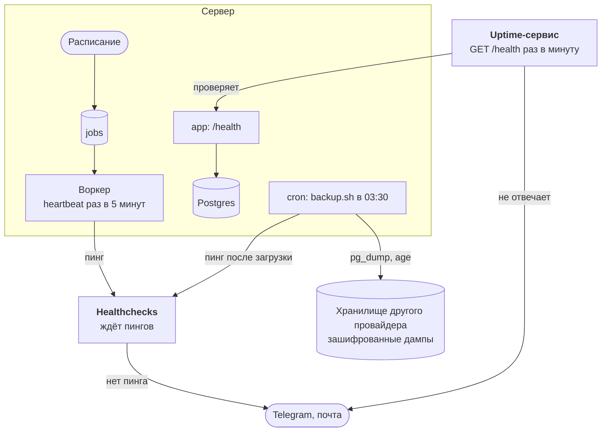

:::tldr
Каждые 5 минут воркер через очередь пингует Healthchecks, а отдельный сервис проверяет `/health` снаружи: если умрёт хоть что-то, тревога придёт из-за пределов сервера. Логи Docker ограничены по размеру. Каждую ночь `backup.sh` снимает дамп базы, шифрует его через age и кладёт в объектное хранилище другого провайдера ключом без права удаления, а раз в месяц `restore-check.sh` проверяет, что дамп восстанавливается. Каждый запрос к Claude записывается со стоимостью: расход виден в утренней сводке, а превышение дневного лимита вызывает тревогу. Секреты лежат только в `.env` на сервере, а их список ведётся в репозитории в `.env.example`.
:::

Это восьмая, последняя часть цикла про коммерческие автоматизации. В [прошлой части](/blog/ru/automations-analytics/) система научилась сама замечать проблемы в бизнесе. Теперь научим её замечать проблемы в себе самой и позаботимся о том, что будет, когда сервер однажды сгорит.

## Что может пойти не так

| Что случилось | Как узнаем | Раздел |
|---|---|---|
| сервер или приложение упали | внешняя проверка `/health` | шаг 1 |
| воркер завис или умер, очередь стоит | пинги через очередь перестали приходить в Healthchecks | шаг 1 |
| диск заполнился логами | не заполнится: логи ограничены | шаг 2 |
| база потеряна или испорчена | восстанавливаемся из ночного бэкапа | шаги 3–4 |
| утёк ключ | меняем по инструкции, ключи с минимальными правами | шаг 5 |
| расходы на модель выросли | строка в сводке и тревога о лимите | шаг 6 |
| тихая поломка в бизнесе | тревоги из прошлой части | — |



::news{topic="cost automation"}

## Шаг 1. Внешний мониторинг

Тревоги из прошлой части выполняет сам воркер. Если он умер, их некому отправить. Система не может надёжно сообщить о собственной смерти, поэтому нужен наблюдатель снаружи. Нужны две проверки, и каждая ловит свои проблемы.

**Пульс через очередь.** Задача `heartbeat` раз в 5 минут дёргает адрес в [Healthchecks.io](https://healthchecks.io). Это сервис по принципу «мёртвой руки»: он не проверяет нас сам, а ждёт пингов, и если пинга нет дольше заданного времени, присылает тревогу в Telegram или на почту. Важно, что пинг идёт не из отдельного cron, а обычной задачей: её ставит расписание, кладёт в очередь и выполняет воркер. Пока пинги приходят, работает вся цепочка, а если сломалось любое звено, пинги прекратятся.

```ts
// src/handlers.ts
// Каждые 5 минут через всю цепочку: расписание, очередь, воркер.
// Если пинги прекратятся, Healthchecks поднимет тревогу снаружи.
heartbeat: async () => {
  if (config.heartbeatUrl) {
    const response = await fetch(config.heartbeatUrl, { signal: AbortSignal.timeout(10_000) });
    await check(response, "heartbeat");
  }
},
```

В расписании `heartbeat` теперь раз в 5 минут вместо часа. В Healthchecks создайте проверку с периодом 5 минут и запасом 10, подключите интеграцию с Telegram и положите адрес пинга в `HEARTBEAT_URL`.

**Проверка снаружи.** Пульс не заметит, что упал Caddy или кончился сертификат: воркер при этом жив и пингует. Поэтому второй сервис раз в минуту открывает `https://auto.example.com/health`. Маршрут из второй части делает `select 1` к базе, поэтому проверка заодно подтверждает, что приложение видит Postgres. Подойдёт любой uptime-сервис: UptimeRobot, Better Stack или свой Uptime Kuma, но тогда на другом сервере, иначе он умрёт вместе с наблюдаемым.

## Шаг 2. Логи

По умолчанию Docker хранит логи контейнеров без ограничений. Через полгода болтливый воркер займёт ими весь диск, и упадёт база. Ограничиваем все сервисы одним якорем: не больше пяти файлов по 10 МБ на контейнер.

```yaml
# compose.yml
# По умолчанию Docker хранит логи бесконечно; ограничиваем, чтобы не забить диск
x-logging: &logging
  driver: json-file
  options:
    max-size: 10m
    max-file: "5"

x-app: &app
  image: ghcr.io/your-name/automations:${TAG:-latest}
  restart: unless-stopped
  logging: *logging
  env_file: .env
  environment:
    DATABASE_URL: postgres://app:${POSTGRES_PASSWORD}@db:5432/app
    TZ: Europe/Moscow
  depends_on:
    db:
      condition: service_healthy

services:
  app:
    <<: *app

  worker:
    <<: *app
    command: ["bun", "src/worker.ts"]
    stop_grace_period: 60s

  db:
    image: postgres:18
    restart: unless-stopped
    logging: *logging
    environment:
      POSTGRES_USER: app
      POSTGRES_PASSWORD: ${POSTGRES_PASSWORD}
      POSTGRES_DB: app
    volumes:
      # С Postgres 18 образ хранит данные в /var/lib/postgresql/18/docker
      - pgdata:/var/lib/postgresql
    healthcheck:
      test: ["CMD-SHELL", "pg_isready -U app"]
      interval: 5s
      retries: 10

  caddy:
    image: caddy:2
    restart: unless-stopped
    logging: *logging
    ports:
      - "80:80"
      - "443:443"
      - "443:443/udp"
    volumes:
      - ./Caddyfile:/etc/caddy/Caddyfile:ro
      - caddy_data:/data
      - caddy_config:/config

volumes:
  pgdata:
  caddy_data:
  caddy_config:
```

Для системы такого размера стек сбора логов не нужен. Хватает `docker compose logs -f --since 1h worker` и `grep`. Ошибки задач и так видны в таблице `jobs` в поле `last_error`, а окончательные провалы приходят в чат тревог.

Обратите внимание на том базы: начиная с Postgres 18 он подключается к `/var/lib/postgresql`, а не к `/var/lib/postgresql/data`, как было в образах до 17-й версии. Как перейти на новую мажорную версию с работающей базы, рассказано в шаге 7.

## Шаг 3. Бэкапы

Docker-том на том же сервере это не бэкап. Сгорит диск, удалят сервер по ошибке в панели хостинга, уйдёт в блокировку аккаунт, и том пропадёт вместе с базой. Настоящий бэкап отвечает трём условиям:

1. **Лежит в другом месте.** Объектное хранилище, совместимое с S3, у другого провайдера и лучше в другой стране: Backblaze B2, Cloudflare R2, Yandex Object Storage, Selectel. Для небольшой базы это гигабайты, а значит копейки.
2. **Зашифрован.** Дампы шифруются через [age](https://age-encryption.org) открытым ключом. Закрытый ключ на сервере не лежит, он хранится в менеджере паролей. Хранилище и любой, кто получит к нему доступ, видят только шифрованные файлы.
3. **Его нельзя стереть с сервера.** Ключ доступа к хранилищу может записывать, но не может удалять. Старые копии удаляет правило жизненного цикла на стороне хранилища, например через 30 дней. Если сервер взломают, злоумышленник не сможет уничтожить бэкапы. Если хранилище поддерживает версионирование или блокировку объектов, включите и их.

Ставим на сервер age и [rclone](https://rclone.org): `apt install age rclone`. Сам `backup.sh` лежит в репозитории, и деплой из второй части копирует его на сервер вместе с `compose.yml`: в шаге `scp` добавился ещё один файл.

```bash
#!/usr/bin/env bash
# backup.sh: зашифрованный дамп базы в объектное хранилище в другом месте.
# Запускается из cron на сервере, например каждую ночь в 03:30:
#   30 3 * * * /opt/automations/backup.sh >> /var/log/automations-backup.log 2>&1
set -euo pipefail # pipefail: упавший pg_dump должен ронять скрипт, а не загружать пустой файл
cd "$(dirname "$0")"
source ./backup.env

# Если что-то ниже упадёт, сразу сообщаем Healthchecks, не дожидаясь тишины
trap 'curl -fsS -m 10 --retry 3 "$BACKUP_PING_URL/fail" > /dev/null || true' ERR

name="app-$(date +%Y-%m-%d-%H%M).dump.age"
file="$(mktemp)"
trap 'rm -f "$file"' EXIT

# Формат custom сжат, и pg_restore умеет восстановить из него отдельную таблицу.
# age шифрует открытым ключом: закрытый ключ на этом сервере никогда не лежит.
docker compose exec -T db pg_dump -U app -Fc app | age -r "$BACKUP_RECIPIENT" > "$file"

# Не загружаем подозрительно маленький файл: дамп живой базы не бывает размером в 1 КБ
size=$(stat -c %s "$file")
if [ "$size" -lt 1024 ]; then
  echo "бэкап всего $size байт, не загружаем" >&2
  false
fi

rclone copyto "$file" "backup:$BACKUP_BUCKET/automations/$name"
echo "$(date -Is) загружен $name ($size байт)"

curl -fsS -m 10 --retry 3 "$BACKUP_PING_URL" > /dev/null
```

`set -o pipefail` здесь важнее всего остального. Без него в цепочке `pg_dump | age` код возврата берётся у последней команды. Если `pg_dump` упадёт, age честно зашифрует пустоту, и скрипт с успехом загрузит пустой файл. С `pipefail` скрипт остановится, пингнёт Healthchecks адресом `/fail`, а проверка размера отсечёт и более экзотические случаи.

Настройки лежат рядом, в отдельном файле с правами `600`:

```bash
# backup.env.example: настройки backup.sh. Скопируйте в backup.env, chmod 600.

# Открытый ключ age (age1...). Закрытый хранится в менеджере паролей.
BACKUP_RECIPIENT=age1...

# Бакет в S3-совместимом хранилище у другого провайдера, не у того, где сервер
BACKUP_BUCKET=my-backups

# rclone берёт хранилище "backup" из этих переменных, файл настроек не нужен
export RCLONE_CONFIG_BACKUP_TYPE=s3
export RCLONE_CONFIG_BACKUP_PROVIDER=Other
export RCLONE_CONFIG_BACKUP_ENDPOINT=https://s3.example-storage.com
export RCLONE_CONFIG_BACKUP_ACCESS_KEY_ID=
export RCLONE_CONFIG_BACKUP_SECRET_ACCESS_KEY=
# Ключ может писать, но не удалять; старые бэкапы удаляет правило жизненного цикла
export RCLONE_CONFIG_BACKUP_NO_CHECK_BUCKET=true

# Проверка в Healthchecks для бэкапов: пинг раз в 24 часа
BACKUP_PING_URL=https://hc-ping.com/your-uuid
```

Для бэкапов заведите в Healthchecks отдельную проверку с периодом сутки. Если ночной бэкап не прошёл или cron вообще не запустился, утром придёт тревога.

## Шаг 4. Проверка восстановления

Бэкап, который никто ни разу не восстанавливал, это надежда, а не бэкап. Дамп может оказаться пустым, ключ может потеряться, формат может не подойти к новой версии Postgres. Узнавать об этом в день аварии поздно. Поэтому раз в месяц на своём компьютере скачиваем свежий файл из хранилища и запускаем:

```bash
#!/usr/bin/env bash
# restore-check.sh <файл бэкапа> <файл закрытого ключа age>
# Восстанавливает бэкап во временный Postgres и показывает число строк.
# Запускайте раз в месяц на своём компьютере: бэкап, который никто не восстанавливал, это надежда, а не бэкап.
set -euo pipefail
backup="$1"
key="$2"
name="restore-check-$$"

docker run -d --rm --name "$name" -e POSTGRES_PASSWORD=check postgres:18 > /dev/null
trap 'docker stop "$name" > /dev/null' EXIT
until docker exec "$name" pg_isready -U postgres > /dev/null 2>&1; do sleep 1; done

docker exec "$name" createdb -U postgres app
age -d -i "$key" "$backup" | docker exec -i "$name" pg_restore -U postgres -d app --no-owner

docker exec "$name" psql -U postgres -d app -c "
  select 'leads' as table, count(*) as rows, max(created_at) as newest from leads
  union all select 'orders', count(*), max(created_at) from orders
  union all select 'tickets', count(*), max(created_at) from tickets
  union all select 'events', count(*), max(received_at) from events"
```

Скрипт поднимает временный Postgres, восстанавливает в него дамп и показывает число строк и дату самой свежей записи по основным таблицам. Вот результат локального прогона на тестовой базе:

```text
  table  | rows |            newest
---------+------+-------------------------------
 leads   |    1 | 2026-11-04 11:36:59.329272+00
 orders  |    1 | 2026-11-04 11:36:59.329272+00
 tickets |    0 |
 events  |    0 |
(4 rows)
```

Если числа похожи на правду, а самая свежая запись вчерашняя, бэкапы работают. Заодно вы потренировались в восстановлении, и в день аварии будете делать это не впервые.

## Шаг 5. Секреты

Секретов в системе уже полтора десятка: токен бота, ключи ЮKassa, почты, Claude, хранилища, секреты вебхуков. Правила простые.

- **Секреты живут только в `.env` на сервере** с правами `600`. В git его нет, в образ он не попадает (он в `.dockerignore` со второй части).
- **Список секретов живёт в репозитории** в виде `.env.example` без значений. Новый человек или новый сервер сразу видят, что нужно заполнить, а `required()` в `config.ts` не даст запуститься без обязательного.

```bash
# .env.example: все настройки, которые читает сервис. Скопируйте в .env на сервере,
# заполните, chmod 600. Настоящий .env никогда не попадает в git.

# База (compose собирает из этого DATABASE_URL)
POSTGRES_PASSWORD=

# Входящие вебхуки
SITE_WEBHOOK_SECRET=
TELEGRAM_WEBHOOK_SECRET=

# Бот и чаты Telegram
TELEGRAM_BOT_TOKEN=
ALERT_CHAT_ID=
LEADS_CHAT_ID=
SUPPORT_CHAT_ID=
DIGEST_CHAT_ID=

# Заявки
FORM_REDIRECT_URL=https://example.com/thanks
CRM_WEBHOOK_URL=

# Оплаты
YOOKASSA_SHOP_ID=
YOOKASSA_SECRET_KEY=
PUBLIC_URL=https://auto.example.com
ACCESS_URL=https://example.com/access/

# Почта
EMAIL_API_KEY=
EMAIL_FROM=
EMAIL_INBOUND_SECRET=

# Claude
ANTHROPIC_API_KEY=
LLM_DAILY_LIMIT_USD=5

# Эксплуатация
HEARTBEAT_URL=
```

- **В GitHub только то, что нужно для деплоя:** SSH-ключ в секретах Actions и адрес сервера в переменных. Образ публикуется встроенным `GITHUB_TOKEN`, и ни один ключ приложения GitHub не видит.
- **У каждого ключа минимальные права.** Вебхук Bitrix24 только с правами на CRM, ключ хранилища без права удаления, для Claude отдельный workspace в Console со своим лимитом расходов. Утечка одного ключа не открывает всё остальное.
- **Ротация.** Выпустить новый ключ у провайдера, поменять в `.env`, выполнить `docker compose up -d`, отозвать старый ключ. Именно `up -d`: эта команда пересоздаст контейнеры с новым окружением, а `docker compose restart` перезапустит их со старым.
- **Секреты не попадают в логи и тексты для модели.** Мы нигде не логируем заголовки и тела запросов целиком, а в запросы к Claude уходят только данные заявок и обращений.

## Шаг 6. Сколько это стоит

**Инфраструктура.** Для всего, что мы построили, хватает одной небольшой VPS: 2 vCPU и 2–4 ГБ памяти. Ориентир на момент написания: несколько сотен рублей или 5–10 евро в месяц. Хранилище для бэкапов стоит копейки, у Healthchecks и uptime-сервисов есть бесплатные тарифы, у почтовых сервисов тоже бесплатные объёмы для небольшой нагрузки. Проверьте актуальные условия, они меняются.

**Claude.** Здесь расходы зависят от нагрузки, и их нужно не угадывать, а измерять. Каждый запрос теперь записывается в таблицу вместе со стоимостью:

```sql
-- migrations/007_llm_usage.sql
-- Одна строка на запрос к модели: для чего, сколько токенов и сколько стоил
create table llm_usage (
  id bigint generated always as identity primary key,
  task text not null,
  model text not null,
  input_tokens int not null,
  cache_read_tokens int not null,
  cache_write_tokens int not null,
  output_tokens int not null,
  cost numeric(12, 6) not null, -- в долларах
  created_at timestamptz not null default now()
);

create index llm_usage_created on llm_usage (created_at);
```

```ts
// src/claude.ts
import Anthropic from "@anthropic-ai/sdk";
import { sql } from "./db";
import { PermanentError } from "./errors";

const client = new Anthropic();
const MODEL = "claude-opus-5-5";

// Доллары за миллион токенов. Цены меняются: сверяйтесь с сайтом Anthropic
const PRICE = { input: 4, output: 20, cacheRead: 0.2, cacheWrite: 5 };

/** Сколько стоил ответ, по числу токенов из `usage`. */
export function cost(usage: Anthropic.Beta.BetaUsage) {
  return (
    (usage.input_tokens * PRICE.input +
      (usage.cache_read_input_tokens ?? 0) * PRICE.cacheRead +
      (usage.cache_creation_input_tokens ?? 0) * PRICE.cacheWrite +
      usage.output_tokens * PRICE.output) /
    1_000_000
  );
}

/**
 * Один запрос, ответ на который обязан соответствовать JSON Schema. Через эту
 * функцию идёт каждая автоматизация, которая просит модель заполнить поля.
 */
export async function askJson<T>(request: {
  task: string;
  system: string | Anthropic.Beta.BetaTextBlockParam[];
  content: string;
  schema: Record<string, unknown>;
  effort: "low" | "medium" | "high";
}): Promise<T> {
  let response: Anthropic.Beta.BetaMessage;
  try {
    response = await client.beta.messages.create({
      model: MODEL,
      max_tokens: 8000,
      // Если модель откажется, API повторит запрос на запасной модели
      betas: ["server-side-fallback-2026-07-01"],
      fallbacks: "default",
      output_config: {
        effort: request.effort,
        format: { type: "json_schema", schema: request.schema },
      },
      system: request.system,
      messages: [{ role: "user", content: request.content }],
    });
  } catch (error) {
    // 400 значит, что неправ наш запрос: повтор не поможет
    if (error instanceof Anthropic.BadRequestError) {
      throw new PermanentError(error.message);
    }
    throw error; // 429, 5xx, сеть: очередь повторит
  }

  // Каждый запрос записывается: сводка показывает расход, тревога следит за лимитом
  const usage = response.usage;
  await sql`
    insert into llm_usage (task, model, input_tokens, cache_read_tokens, cache_write_tokens, output_tokens, cost)
    values (${request.task}, ${response.model}, ${usage.input_tokens}, ${usage.cache_read_input_tokens ?? 0},
            ${usage.cache_creation_input_tokens ?? 0}, ${usage.output_tokens}, ${cost(usage)})
  `;
  console.log(
    `claude ${request.task}: in ${usage.input_tokens}, cached ${usage.cache_read_input_tokens ?? 0}, out ${usage.output_tokens}`
  );

  if (response.stop_reason === "refusal") {
    throw new PermanentError(`модель отказалась: ${request.task}`);
  }
  const text = response.content.find((block) => block.type === "text");
  if (!text) {
    throw new Error(`в ответе нет текста, stop_reason ${response.stop_reason}`);
  }
  return JSON.parse(text.text);
}
```

Цены в коде указаны для Claude Opus 5.5 на момент написания: 4 доллара за миллион входных токенов, 20 за миллион выходных, 0.20 за чтение из кэша. При смене модели или цен поправьте `PRICE`. Если сработал запасной вариант модели, в `model` попадёт её имя, а стоимость будет посчитана по ценам основной, так что это оценка, а не счёт.

Утренняя сводка получила строку «Claude: 34 запроса на 0.41 доллара», а в проверки добавилась тревога, если за день потрачено больше `LLM_DAILY_LIMIT_USD`:

```ts
// src/alerts.ts, в runChecks
{
  name: "llm.spend",
  firing: spend.today > config.llmDailyLimit,
  text: `Claude сегодня обошёлся в $${spend.today.toFixed(2)}, это больше лимита $${config.llmDailyLimit}`,
},
```

Тревога сообщает, но ничего не останавливает. Жёсткий предел задаётся в Claude Console лимитом расходов на workspace: даже если в коде заведётся цикл, больше лимита не спишут.

Грубая оценка по нашим запросам. Разбор заявки это несколько сотен входных токенов и пара сотен выходных, меньше цента. Черновик ответа поддержки длиннее, и модель над ним дольше думает, это около двух центов, причём база знаний читается из кэша в 20 раз дешевле обычного входа. Утренняя сводка стоит пару центов в день. При 100 заявках и 30 обращениях в день получается порядка 30–40 долларов в месяц. Точную цифру покажет `llm_usage` через неделю работы.

Если цифра кажется большой, вот рычаги по порядку:

- **Модель под задачу.** Сортировку заявок по полям прекрасно выполняет Claude Haiku 5.5, и стоит она в десятки раз меньше Opus: 0.10 и 0.50 доллара за миллион токенов. Меняется строка `model`, но учтите, что серверного запасного варианта у Haiku нет, поэтому параметры `betas` и `fallbacks` для неё нужно убрать. Черновики клиентам лучше оставить на Opus.
- **Кэш промпта** для всего, что повторяется (часть про поддержку).
- **`effort`** не выше нужного: у нас `low` для классификации и `medium` для черновиков.

## Шаг 7. Обновления

- **Система.** На сервере включите `unattended-upgrades`, чтобы обновления безопасности ставились сами.
- **Образы.** `caddy:2` и `postgres:18` указаны по мажорной версии, поэтому раз в месяц `docker compose pull && docker compose up -d` подтягивает исправления.
- **Зависимости приложения.** Dependabot или Renovate в GitHub раз в неделю присылает PR с обновлениями `bun.lock` и версий actions. CI с тестами из прошлых частей показывает, можно ли мержить.

**Новая мажорная версия Postgres.** Она выходит раз в год, и её нельзя поставить, просто поменяв тег: файлы данных несовместимы между версиями. Пример ниже для перехода с 17 на 18, если вы начинали со старого образа. В 18-й версии к тому же поменялся путь данных, поэтому том подключается к `/var/lib/postgresql`. Через год так же переходят на 19. Самый простой путь для небольшой базы это дамп и восстановление, теми же инструментами, что и бэкап:

```bash
cd /opt/automations
docker compose stop app worker                     # больше никто не пишет в базу
docker compose exec -T db pg_dump -U app -Fc app > /root/before-18.dump
docker compose down                                # старый том pgdata остаётся на месте
# в compose.yml: postgres:18, том pgdata_18:/var/lib/postgresql, в volumes: pgdata_18
docker compose up -d db
docker compose exec -T db pg_restore -U app -d app --no-owner < /root/before-18.dump
docker compose up -d
```

Старый том `pgdata` не трогаем неделю: если что-то пойдёт не так, вернуть `postgres:17` можно за минуту. Перед переходом убедитесь, что свежий ночной бэкап на месте.

## Шаг 8. Тесты

Новые тесты проверяют расчёт стоимости с учётом кэша, запись каждого запроса к модели, однократную тревогу о лимите и то, что пульс пингует адрес и громко падает, если адрес недоступен. Падение здесь правильное поведение: очередь повторит задачу, а Healthchecks, не дождавшись пинга, поднимет тревогу.

```ts
// test/ops.test.ts
import { beforeEach, expect, test } from "bun:test";
import { evaluate, runChecks } from "../src/alerts";
import { askJson, cost } from "../src/claude";
import { config } from "../src/config";
import { sql } from "../src/db";
import { handlers } from "../src/handlers";
import type { Job } from "../src/queue";
import { calls, claude, reset } from "./stubs";

beforeEach(async () => {
  reset();
  await sql`truncate llm_usage, alerts, jobs restart identity cascade`;
});

test("the cost counts cached input at the cache price", () => {
  const usage = {
    input_tokens: 1_000,
    cache_read_input_tokens: 10_000,
    cache_creation_input_tokens: 0,
    output_tokens: 500,
  } as any;
  // 1000 × $4 + 10 000 × $0.20 + 500 × $20, за миллион токенов
  expect(cost(usage)).toBeCloseTo(0.016, 6);
});

test("every model request is recorded with its tokens and cost", async () => {
  claude.answer = { ok: true };
  await askJson({ task: "test", system: "s", content: "c", schema: { type: "object" }, effort: "low" });
  const [row] = await sql`select task, model, input_tokens, output_tokens, cost::float8 from llm_usage`;
  // Заглушка отвечает 1000 входных и 100 выходных токенов
  expect(row).toEqual({ task: "test", model: "claude-opus-5-5", input_tokens: 1000, output_tokens: 100, cost: 0.006 });
});

test("spending over the daily limit raises one alert", async () => {
  await sql`
    insert into llm_usage (task, model, input_tokens, cache_read_tokens, cache_write_tokens, output_tokens, cost)
    values ('x', 'm', 0, 0, 0, 0, ${config.llmDailyLimit + 1})
  `;
  await evaluate(await runChecks());
  await evaluate(await runChecks());
  const alerts = calls.filter((c) => c.method === "sendMessage" && String(c.body.text).includes("Claude сегодня обошёлся"));
  expect(alerts).toHaveLength(1);
});

test("the heartbeat pings the monitoring URL and fails loudly if it can't", async () => {
  config.heartbeatUrl = "http://localhost:3995/ping/abc"; // заглушка почты записывает любой запрос
  await handlers.heartbeat({}, {} as Job);
  expect(calls.filter((c) => c.api === "email" && c.method === "abc")).toHaveLength(1);

  config.heartbeatUrl = "http://localhost:1/unreachable";
  await expect(handlers.heartbeat({}, {} as Job)).rejects.toThrow();
  config.heartbeatUrl = "";
});
```

```text
 34 pass
 0 fail
```

Новых обязательных переменных нет: без `HEARTBEAT_URL` пульс просто ничего не делает, а у лимита расходов есть значение по умолчанию.

Скрипты бэкапа проверены на локальном Postgres в Docker, с заглушками вместо rclone и Healthchecks. Успешный прогон загружает файл и пингует проверку. Восстановление через `restore-check.sh` показывает строки. Если остановить базу, скрипт падает на `pg_dump`, ничего не загружает и пингует `/fail`.

## Чек-лист эксплуатации

| Как часто | Что делать |
|---|---|
| каждый день | прочитать утреннюю сводку, разобраться с тревогами |
| раз в неделю | смержить PR с обновлениями зависимостей, если CI зелёный |
| раз в месяц | `restore-check.sh` на свежем бэкапе, `docker compose pull && up -d` |
| раз в квартал | пересмотреть ключи и права, отозвать неиспользуемые, сверить расходы на Claude с пользой |
| раз в год | перейти на новую мажорную версию Postgres |

## Итоги цикла

За восемь частей мы прошли путь от идеи до системы, которая работает на одном сервере и заменяет большую часть рутины небольшой компании:

- **Фундамент:** Bun, TypeScript и Postgres на одной VPS, Docker Compose, Caddy с автоматическим HTTPS и деплой по пушу через GitHub Actions.
- **Ядро:** приём вебхуков с проверкой подписи и защитой от дублей, очередь задач на Postgres с повторами и расписанием.
- **Продажи:** заявка с сайта у менеджера через секунды, разбор Claude, CRM и напоминания.
- **Оплаты:** счета, ссылка на оплату, которая не протухает, доступ ровно один раз, сверка и напоминания должникам.
- **Поддержка:** входящие в одном чате, черновики по базе знаний, отправляет человек.
- **Аналитика:** утренняя сводка, где цифры считает SQL, и тревоги о тихих поломках.
- **Эксплуатация:** внешний мониторинг, бэкапы, которые проверены восстановлением, секреты и учёт расходов.

Это около 2200 строк кода и SQL и ещё 700 строк тестов, без единого фреймворка, и каждую строку можно прочитать и понять. Через всю систему проходят несколько идей: событие сначала сохраняется и только потом обрабатывается, у каждого действия есть ключ идемпотентности, гонки решает один условный `update`, модель помогает человеку, но решает и отправляет человек, а о проблемах система сообщает сама, один раз и по делу.

Все части цикла собраны на [странице серии](/blog/ru/series/automations/).
