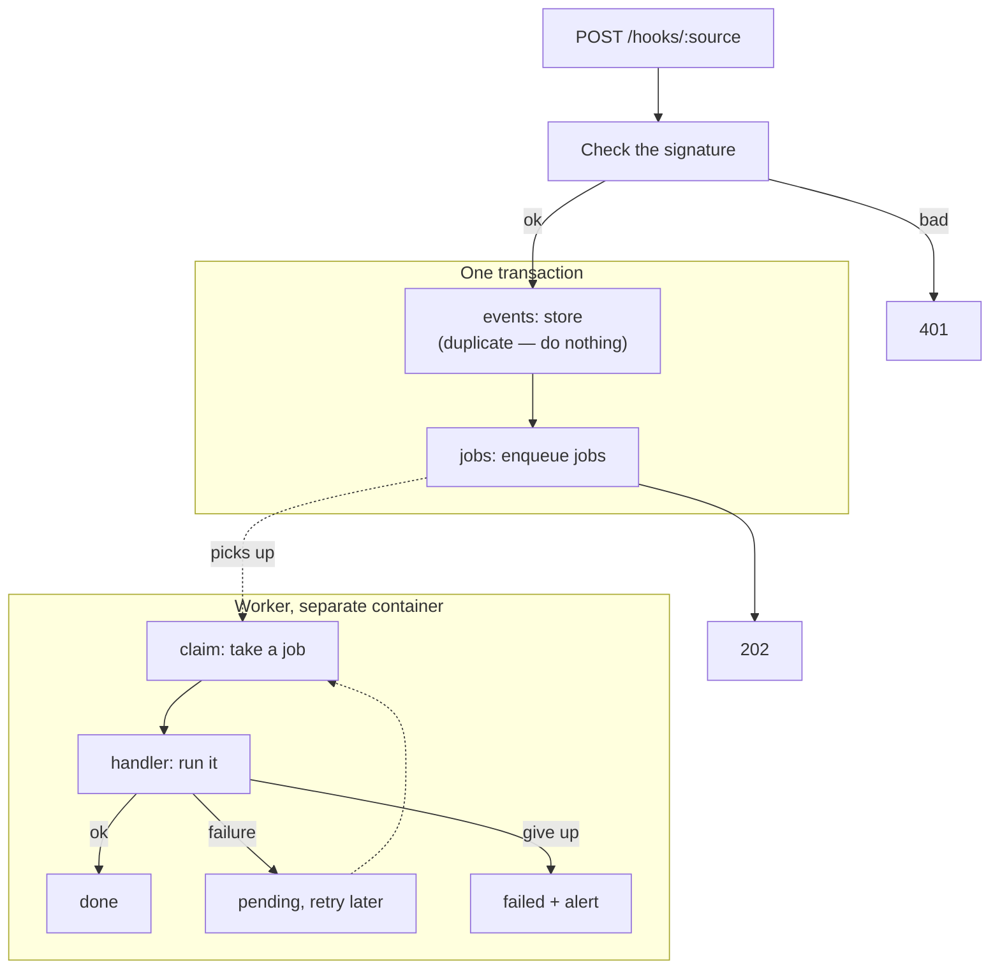

:::tldr
The intake verifies the signature, stores the event and, in the same transaction, puts jobs into a queue. A separate worker takes jobs with `FOR UPDATE SKIP LOCKED`, retries them with a growing delay on failure and sends a Telegram alert after the last attempt. The schedule puts jobs into the same queue with an idempotency key, so each one runs exactly once. All of it is about 300 lines with no external dependencies.
:::

This is the third part of the series on commercial automations. In the [previous part](/blog/automations-foundation/) we set up a server, a database and deploys, and the service learned to store incoming events in a table. Now we teach it to process those events reliably. This is the most "infrastructural" part of the series, but after it every new automation takes a few dozen lines: an event source and a handler. The article shows only the key pieces of code; the full code of the series, tests included, is in the [repository](https://github.com/balkhaev/balkhaev.com/tree/main/examples/automations).

## What can go wrong

Before writing code, let's list what we are protecting against. All of it happens within the first month of any automation.

- **Forged requests.** A webhook URL is easy to find, and anyone can send a fake "payment".
- **Repeated delivery.** Payment providers and Telegram deliver events "at least once": if our answer got lost on the way, they send the same event again.
- **An external service is down.** The CRM is down, Telegram answered 502, the model API is overloaded. A minute later everything works.
- **The worker dies mid-job.** A deploy, running out of memory, a server reboot.
- **A bug in our code.** The job fails on every attempt until we fix the code.
- **Nobody notices.** The most dangerous one: an automation silently does nothing for a week.

::news{topic="automation"}

## How it fits together



The key idea: the HTTP handler does nothing but write to the database. It is fast and almost never fails, so the sender always gets an answer, and all the slow, unreliable work moves into the worker, where it can be retried.

## Step 1. The jobs table

The second migration adds a deduplication key to events and creates the queue, the `jobs` table:

```sql
create table jobs (
  id bigint generated always as identity primary key,
  kind text not null,
  payload jsonb not null default '{}',
  status text not null default 'pending', -- pending, running, done, failed
  attempts int not null default 0,
  max_attempts int not null default 8,
  run_at timestamptz not null default now(),
  locked_until timestamptz,
  last_error text,
  key text unique,
  event_id bigint references events (id)
);
```

The fields all the reliability rests on:

- `status`: `pending` is waiting, `running` is in progress, `done` is finished, `failed` has failed for good;
- `run_at`: not before when to run. Both delayed jobs ("remind in 15 minutes") and the pauses between retries work through it;
- `locked_until`: until when the job counts as taken. If the worker died, another one picks the job up after this moment;
- `key`: the idempotency key. A second job with the same key is not created;
- `event_id`: which event the job grew out of. That answers "why did this happen".

`events` gets a unique index on `(source, dedup_key)`. In Postgres, `NULL` values in a unique index count as distinct, so events without a key are all stored, and events with a key only once.

## Step 2. The queue

The queue is four functions: `enqueue` adds a job (`insert ... on conflict (key) do nothing`, so a job with the same key is never created twice), `claim` takes the next one, `complete` marks it done, and `fail` records the error and decides whether to retry. Here is the query `claim` is built on:

```sql
update jobs
set status = 'running',
    attempts = attempts + 1,
    locked_until = now() + interval '5 minutes'
where id = (
  select id from jobs
  where (status = 'pending' and run_at <= now())
     or (status = 'running' and locked_until < now())
  order by run_at
  for update skip locked
  limit 1
)
returning id, kind, payload, attempts, max_attempts
```

The subquery picks one due job and locks its row, and `SKIP LOCKED` says: if another worker has already locked the row, don't wait, take the next one. So you can run ten workers and they will never take the same job twice. The outer `update` marks the job as taken right away and bumps the attempt counter. One more detail: `enqueue` takes an optional transaction, so a job lands in the database together with the event it came from.

The condition `status = 'running' and locked_until < now()` picks up stuck jobs: a worker took the job and died. Five minutes of lock should comfortably cover any job; if yours take longer, raise the interval.

The delay between attempts doubles: 10 seconds, 20, 40 and so on up to an hour. The 20% random jitter keeps a hundred jobs that failed at once because of a CRM outage from hitting it again at once. Eight attempts by default stretch over about 40 minutes, and most temporary outages pass in that time.

## Step 3. Which errors to retry

Not everything is worth retrying. If the CRM answered 503, it may work in a minute. If it answered 400 "invalid phone number", it never will, and eight attempts only delay the alert by 40 minutes. So we add a `PermanentError` class for errors a retry won't fix, and a `check(response, what)` function: it looks at an external API's response and throws a permanent error on 4xx codes and an ordinary one on everything else. The whole rule fits in one line:

```ts
const permanent = status >= 400 && status < 500 && status !== 429;
```

`check` comes in handy in every integration: call an external API, pass the response to `check`, and the error comes out with the right type. The exception is 429, "too many requests", where retrying later is exactly right.

## Step 4. Telegram for replies and alerts

First, the new settings in `config.ts`: secrets for verifying the website's and Telegram's webhooks, the bot token and the alert chat id. All of them are required, so the service won't start without them. The Telegram client is two functions: `sendMessage(chatId, text)` for replies and `alert(text)` for alerts.

Every external request has a timeout. Without one, a hung service holds the worker forever and the queue stops. `alert` never throws: if the alert fails too, we log it, but we don't break the code that called it.

The API address is a setting, `TELEGRAM_API`, so tests can point it at a stub.

Create the bot with [@BotFather](https://t.me/BotFather), which gives you a token. The alert chat is an ordinary group the bot has been added to; the easiest way to find its id is to post a message in the group and open `https://api.telegram.org/bot<token>/getUpdates`.

## Step 5. Event sources

Each source describes three things: how to check that a request is genuine, how to get the event id for deduplication, and which jobs the event produces. Sources live in a `sources` map by name, and the intake picks one by the `/hooks/:source` path.

```ts
export interface Source {
  /** Checks that the request really comes from this source. */
  verify(headers: Headers, body: string): boolean;
  /** The sender's event id: a redelivered event gets the same key. */
  dedupKey(body: string): string | undefined;
  /** Which jobs the event produces. */
  route(body: string): NewJob[];
}
```

Two verification schemes cover almost every service:

**HMAC signature.** The sender and we share a secret. The sender computes HMAC-SHA256 of the request body and puts it in a header; we compute the same and compare. Without the secret the signature cannot be forged, and the body cannot be changed unnoticed. GitHub, Stripe and many other services work this way; only the header name and format differ. Some payment providers send no signature at all; they need a different check, which we cover in the payments part. That is why we store the body as text: the signature covers the exact bytes, and JSON that was parsed and serialized again will not pass.

**Secret in a header.** Simpler and weaker: the secret is sent as is. Telegram works this way: when registering the webhook we pass a `secret_token`, and Telegram sends it back in the `X-Telegram-Bot-Api-Secret-Token` header with every update.

In both cases we compare with `timingSafeEqual`, not `===`. A plain string comparison stops at the first mismatching character, and response timing can be used to guess the secret character by character.

We connect the `site` source to the form in the next part. A secret cannot live in the browser, so the request will be signed by the website's backend or a small function that receives the form.

## Step 6. The intake

The intake is `Bun.serve` with two routes: `/health` for liveness checks and `POST /hooks/:source` for events. The heart of the second route is a transaction:

```ts
const result = await sql.begin(async (tx) => {
  const [event] = await tx`
    insert into events (source, headers, body, dedup_key)
    values (${name}, ${headers}, ${body}, ${dedupKey ?? null})
    on conflict (source, dedup_key) do nothing
    returning id
  `;
  if (!event) {
    return { duplicate: true };
  }
  for (const job of jobs) {
    await enqueue({ ...job, eventId: event.id }, tx);
  }
  return { id: event.id, jobs: jobs.length };
});
return Response.json(result, { status: 202 });
```

The order of operations:

1. An unknown source gets 404, a bad signature 401. Nothing is written to the database: this is junk.
2. Parse the event. If parsing fails, that is our bug rather than the sender's, so we still store the event, just without jobs. Once the code is fixed, it can be replayed.
3. The event and its jobs are written in one transaction. There is never an event without its jobs or jobs without their event.
4. If an event with this key already exists, `on conflict do nothing` inserts nothing and `returning` comes back empty. We answer 202 so the sender stops redelivering, and we don't create the jobs a second time.

The answer is always fast: a couple of inserts. That matters, because many services treat a slow answer as a failure and send the event again.

## Step 7. Handlers

A handler is a function that receives the job's `payload`. All handlers live in a `handlers` map by job kind. There are three for now: `site.form` just logs that a form arrived, `telegram.message` answers `/ping` with "pong", and the scheduled `heartbeat` shows the queue is alive. Real automations appear here in the next parts.

The main rule for handlers: **running again must do no harm**. The worker can run the handler, send a message and die before it marks the job done. Then the job runs once more. For sending "pong" that's fine; for granting access or charging money you have to check whether it has already been done. We'll come back to this in the payments part.

## Step 8. The schedule

Classic cron on the server is a poor fit: if the service was down at run time, the run is lost, and with two workers the job runs twice. Let's build the schedule on the same queue. A schedule is a list like `{ kind: "heartbeat", everyMinutes: 60 }` or `{ kind: "digest", dailyAt: "09:00" }`, and a `slot` function computes the current slot from the current time. The rest is one line:

```ts
await enqueue({ kind: schedule.kind, key: `${schedule.kind}:${slot(schedule, now)}` });
```

The idea is in the key. For an hourly job the key is the start of the current hour; for a daily one it is today's date. Every 30 seconds the worker tries to enqueue a job with that key, and the unique index lets only the first attempt through. This gives three useful properties:

- however many workers run, there is one job per slot;
- if the worker was down at 9:00 and came back at 9:40, the daily job still runs today;
- the `jobs` table shows when each slot actually ran and with what error.

Daily times are computed in the process's time zone, which we set with the `TZ` variable in the compose file.

## Step 9. The worker

The worker takes a job, finds the handler for its kind and calls it. If it succeeds, the job becomes `done`. If it fails, we call `fail`, and if the attempts have run out or the error is permanent, we send an `alert` to Telegram with the job id and the error text.

The loop is simple: check the schedule every 30 seconds, take a job, run it, and if there are no jobs, wait a second. A one-second delay on an empty queue is invisible to the business and puts no load on the database. If you ever need faster reactions, Postgres has `LISTEN/NOTIFY` for that, but our jobs don't need it.

On SIGTERM the worker doesn't abandon a job halfway: the `running` flag stops the loop after the current job.

If the database itself goes down, `claim` throws, the process exits, and Docker restarts it thanks to `restart: unless-stopped`. No special handling needed.

## Step 10. Manual controls

Jobs will fail, and you need a quick way to see the failed ones, retry them after a fix and replay an event. A small `cli.ts` script has three commands: `failed` lists the latest failed jobs, `retry` resets a job's attempts and puts it back in the queue, and `replay` parses a stored event again and creates its jobs.

On the server:

```bash
docker compose exec app bun src/cli.ts failed
docker compose exec app bun src/cli.ts retry 42
docker compose exec app bun src/cli.ts replay 1337
```

## Step 11. Tests

The queue is code that must always work, so its tests run against a real Postgres rather than mocks: everything interesting here happens in SQL. The tests check five things:

- a job with the same key is created once;
- thirty parallel `claim` calls on twenty jobs take each exactly once;
- a failed attempt waits out its delay, and after the last one the job becomes `failed`;
- a job stuck in `running` comes back once its lock expires;
- the delay grows and never exceeds an hour.

Separately there are quick schedule tests with no database: an hourly slot is the start of the hour, and a daily one appears only after its time. Locally the tests run against a separate empty `app_test` database, in CI against a Postgres started next to them as a service.

## Step 12. Deploying

The worker runs from the same image as the server, just with a different command. To avoid repeating settings, the shared part (image, `.env`, database URL, time zone) moves into an `x-app` YAML anchor, and the worker service in `compose.yml` takes four lines:

```yaml
  worker:
    <<: *app # same image and settings as app
    command: ["bun", "src/worker.ts"]
    stop_grace_period: 60s
```

`stop_grace_period: 60s` gives the worker a minute to finish its current job during a deploy. In `deploy.sh`, pull both images: `docker compose pull app worker`.

In CI, add Postgres as a service and run the migrations and tests before building the image. If tests fail, there is no deploy.

On the server, append the new secrets to `.env`: the bot token, the alert chat id and two webhook secrets, generated randomly with `openssl rand -hex 32`.

After the deploy, register the webhook with Telegram:

```bash
curl https://api.telegram.org/bot<token>/setWebhook \
  -d url=https://auto.example.com/hooks/telegram \
  -d secret_token=<TELEGRAM_WEBHOOK_SECRET from .env>
```

Send the bot `/ping` and get `pong` back. That means the whole chain works: Telegram, Caddy, the secret check, the event in the database, the job in the queue, the worker, the reply through the API.

## Testing failures

The interesting part: making sure the system survives the things we built it for. Here is a local run against a Telegram API stub that answers the first request with 502:

| What we did | What happened |
|---|---|
| Sent the same Telegram update twice | first answer `{"id":"1","jobs":1}`, second `{"duplicate":true}`, one job |
| Sent it with a wrong secret | 401, nothing in the database |
| Telegram answered 502 to `sendMessage` | the job went back to `pending`, the second attempt ~10 seconds later succeeded, `attempts = 2` |
| Sent a non-JSON body to `site` with a valid signature | event stored, 0 jobs, error in the log |
| Enqueued a job of an unknown kind | `failed` on the first attempt, the alert chat got "Job 4 (nope) failed: no handler for nope" |
| Stopped the worker during a deploy | finished the current job and exited in a fraction of a second |

## What we have

- Webhooks are verified by signature or secret, duplicates are dropped by event id.
- The event and its jobs are stored atomically, before any external work.
- A queue on Postgres with no broker: parallel workers, delayed jobs, retries with growing delays, recovery of stuck jobs.
- Permanent errors are not retried in vain, final failures arrive as Telegram alerts.
- A schedule on the same queue: exactly one run per slot, catching up on missed ones.
- Queue tests against a real database in CI, before every deploy.

The foundation is done. In the [next part](/blog/automations-sales/) we build the first real automation: a form submission turns into a card for a manager in Telegram within a minute, the model pulls out of free text what the client needs, and if nobody takes the lead, the bot sends a reminder.
