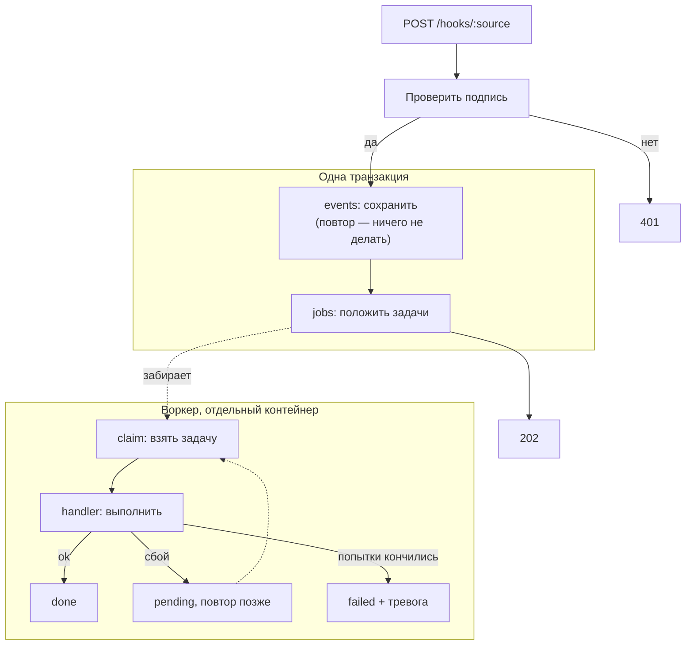

:::tldr
Приёмник проверяет подпись, сохраняет событие и в той же транзакции кладёт задачи в очередь. Отдельный воркер забирает задачи через `FOR UPDATE SKIP LOCKED`, при сбое повторяет их с растущей паузой, а после последней попытки присылает тревогу в Telegram. Расписание кладёт задачи в ту же очередь с ключом идемпотентности, поэтому каждая запускается ровно один раз. Всё это 300 строк без внешних зависимостей.
:::

Это третья часть цикла про коммерческие автоматизации. В [прошлой части](/blog/ru/automations-foundation/) мы подняли сервер, базу и деплой, и сервис научился складывать входящие события в таблицу. Теперь научим его эти события надёжно обрабатывать. Эта часть самая «инфраструктурная» в цикле, зато после неё каждая новая автоматизация будет занимать десятки строк: источник событий и обработчик. В статье только ключевые фрагменты кода, полный код серии с тестами лежит в [репозитории](https://github.com/balkhaev/balkhaev.com/tree/main/examples/automations).

## Что может пойти не так

Прежде чем писать код, перечислим, от чего защищаемся. Всё это случается в первый же месяц работы любой автоматизации.

- **Чужие запросы.** Адрес вебхука несложно узнать, и кто угодно может прислать поддельную «оплату».
- **Повторная доставка.** Платёжки и Telegram доставляют событие «как минимум один раз»: если наш ответ потерялся по дороге, они пришлют то же событие снова.
- **Внешний сервис недоступен.** CRM лежит, Telegram ответил 502, API модели перегружен. Через минуту всё работает.
- **Воркер упал посреди задачи.** Деплой, нехватка памяти, перезагрузка сервера.
- **Ошибка в нашем коде.** Задача падает при каждой попытке, пока мы не исправим код.
- **Никто не заметил.** Самое опасное: автоматизация молча не работает неделю.

::news{topic="automation"}

## Как всё устроено



Главная мысль: HTTP-обработчик ничего не делает, кроме записи в базу. Он быстрый и почти никогда не падает, поэтому отправитель всегда получает ответ, а вся медленная и ненадёжная работа уходит в воркер, где её можно повторить.

## Шаг 1. Таблица задач

Вторая миграция добавляет к событиям ключ для отсечения повторов и создаёт очередь, таблицу `jobs`:

```sql
create table jobs (
  id bigint generated always as identity primary key,
  kind text not null,
  payload jsonb not null default '{}',
  status text not null default 'pending', -- pending, running, done, failed
  attempts int not null default 0,
  max_attempts int not null default 8,
  run_at timestamptz not null default now(),
  locked_until timestamptz,
  last_error text,
  key text unique,
  event_id bigint references events (id)
);
```

Поля, на которых держится вся надёжность:

- `status`: `pending` ждёт, `running` выполняется, `done` готово, `failed` упало окончательно;
- `run_at`: не раньше какого момента выполнять. Через него работают и отложенные задачи («напомнить через 15 минут»), и паузы между повторами;
- `locked_until`: до какого момента задача считается занятой. Если воркер умер, после этого времени задачу возьмёт другой;
- `key`: ключ идемпотентности. Вторая задача с тем же ключом не создастся;
- `event_id`: из какого события выросла задача. Это ответ на вопрос «почему это произошло».

У `events` уникальный индекс по `(source, dedup_key)`. В Postgres значения `NULL` в уникальном индексе считаются разными, поэтому события без ключа сохраняются все, а с ключом только по одному.

## Шаг 2. Очередь

Очередь это четыре функции: `enqueue` кладёт задачу (`insert ... on conflict (key) do nothing`, поэтому задача с тем же ключом не создаётся дважды), `claim` берёт следующую, `complete` отмечает выполненной, `fail` записывает ошибку и решает, повторять ли. Вот запрос, на котором держится `claim`:

```sql
update jobs
set status = 'running',
    attempts = attempts + 1,
    locked_until = now() + interval '5 minutes'
where id = (
  select id from jobs
  where (status = 'pending' and run_at <= now())
     or (status = 'running' and locked_until < now())
  order by run_at
  for update skip locked
  limit 1
)
returning id, kind, payload, attempts, max_attempts
```

Подзапрос выбирает одну готовую задачу и блокирует строку, а `SKIP LOCKED` говорит: если строку уже заблокировал другой воркер, не жди его, бери следующую. Поэтому можно запустить хоть десять воркеров, и они никогда не возьмут одну задачу дважды. Внешний `update` сразу помечает задачу как занятую и увеличивает счётчик попыток. Ещё одна деталь: `enqueue` принимает необязательную транзакцию, чтобы задача попадала в базу вместе с событием, из которого выросла.

Условие `status = 'running' and locked_until < now()` подбирает задачи, которые застряли: воркер взял задачу и умер. Пять минут блокировки должно хватать на любую задачу с запасом; если у вас бывают задачи дольше, увеличьте интервал.

Паузы между попытками растут вдвое: 10 секунд, 20, 40 и так до часа. Случайный разброс в 20% нужен, чтобы сто задач, упавших одновременно из-за сбоя CRM, не пришли к ней снова тоже одновременно. Восемь попыток по умолчанию растягиваются примерно на 40 минут, и большинство временных сбоев за это время проходит.

## Шаг 3. Какие ошибки повторять

Повторять имеет смысл не всё. Если CRM ответила 503, через минуту может получиться. Если она ответила 400 «неверный телефон», не получится никогда, и восемь попыток только отложат тревогу на 40 минут. Поэтому заводим класс `PermanentError` для ошибок, которые повтор не исправит, и функцию `check(response, what)`: она смотрит на ответ внешнего API и бросает постоянную ошибку на коды 4xx, а обычную на остальные. Всё правило умещается в одну строку:

```ts
const permanent = status >= 400 && status < 500 && status !== 429;
```

Функция `check` пригодится в каждой интеграции: вызвали внешний API, передали ответ в `check`, и ошибка сама стала правильного типа. Исключение для 429: это «слишком много запросов», и повторить позже как раз правильно.

## Шаг 4. Telegram для ответов и тревог

Сначала новые настройки в `config.ts`: секреты для проверки входящих вебхуков сайта и Telegram, токен бота и id чата для тревог. Все обязательные, поэтому без них сервис не стартует. Клиент Telegram это две функции: `sendMessage(chatId, text)` для ответов и `alert(text)` для тревог.

У каждого внешнего запроса таймаут. Без него зависший сервис держит воркер бесконечно, и очередь встаёт. `alert` никогда не бросает исключение: если упала и тревога, пишем в лог, но не ломаем код, который её вызвал.

Адрес API вынесен в настройку `TELEGRAM_API`, чтобы в тестах подставить заглушку.

Бота создаём у [@BotFather](https://t.me/BotFather), он выдаст токен. Чат для тревог это обычная группа, куда добавлен бот; её id проще всего узнать, написав в группу сообщение и открыв `https://api.telegram.org/bot<токен>/getUpdates`.

## Шаг 5. Источники событий

Каждый источник описывает три вещи: как проверить, что запрос настоящий, как узнать id события для отсечения повторов и какие задачи из события получаются. Источники лежат в словаре `sources` по имени, и приёмник находит нужный по адресу `/hooks/:source`.

```ts
export interface Source {
  /** Проверяет, что запрос действительно от этого источника. */
  verify(headers: Headers, body: string): boolean;
  /** Id события у отправителя: повторно доставленное событие получит тот же ключ. */
  dedupKey(body: string): string | undefined;
  /** Какие задачи порождает событие. */
  route(body: string): NewJob[];
}
```

Две схемы проверки, которые покрывают почти все сервисы:

**Подпись HMAC.** Отправитель и мы знаем общий секрет. Отправитель считает HMAC-SHA256 от тела запроса и кладёт в заголовок, мы считаем то же самое и сравниваем. Подделать подпись без секрета нельзя, а изменить тело незаметно тоже нельзя. Так работают GitHub, Stripe и многие другие сервисы, отличаются только имя заголовка и формат. Некоторые платёжки подписей не присылают; для них проверка устроена иначе, разберём в части про оплаты. Поэтому тело мы храним как текст: подпись считается от точных байтов, и разобранный и собранный обратно JSON её уже не пройдёт.

**Секрет в заголовке.** Проще и слабее: секрет передаётся как есть. Так работает Telegram: при регистрации вебхука мы передаём `secret_token`, и Telegram присылает его в заголовке `X-Telegram-Bot-Api-Secret-Token` с каждым обновлением.

В обоих случаях сравниваем через `timingSafeEqual`, а не через `===`. Обычное сравнение строк останавливается на первом несовпавшем символе, и по времени ответа можно подбирать секрет посимвольно.

Источник `site` мы подключим к форме в следующей части. Секрет нельзя держать в браузере, поэтому подписывать запрос будет серверная часть сайта или небольшая функция, которая принимает форму.

## Шаг 6. Приёмник

Приёмник это `Bun.serve` с двумя маршрутами: `/health` для проверки живости и `POST /hooks/:source` для событий. Сердце второго маршрута это транзакция:

```ts
const result = await sql.begin(async (tx) => {
  const [event] = await tx`
    insert into events (source, headers, body, dedup_key)
    values (${name}, ${headers}, ${body}, ${dedupKey ?? null})
    on conflict (source, dedup_key) do nothing
    returning id
  `;
  if (!event) {
    return { duplicate: true };
  }
  for (const job of jobs) {
    await enqueue({ ...job, eventId: event.id }, tx);
  }
  return { id: event.id, jobs: jobs.length };
});
return Response.json(result, { status: 202 });
```

Порядок действий:

1. Неизвестный источник получает 404, неверная подпись 401. Ничего не пишем в базу: это мусор.
2. Разбираем событие. Если разобрать не получилось, это наша ошибка, а не отправителя, поэтому событие всё равно сохраняем, просто без задач. Позже, исправив код, его можно переиграть.
3. Событие и задачи пишем в одной транзакции. Не бывает события без задач или задач без события.
4. Если событие с таким ключом уже есть, `on conflict do nothing` ничего не вставит и `returning` вернёт пустой результат. Отвечаем 202, чтобы отправитель перестал присылать повтор, и задачи второй раз не создаём.

Ответ всегда быстрый: пара вставок в базу. Это важно, потому что многие сервисы считают медленный ответ ошибкой и присылают событие снова.

## Шаг 7. Обработчики

Обработчик это функция, которая получает `payload` задачи. Все обработчики лежат в словаре `handlers` по типу задачи. Пока их три: `site.form` просто пишет в лог, что форма пришла, `telegram.message` отвечает «pong» на `/ping`, а `heartbeat` по расписанию показывает, что очередь жива. В следующих частях здесь появятся настоящие автоматизации.

Главное правило для обработчиков: **повторный запуск не должен навредить**. Воркер может выполнить обработчик, отправить сообщение и упасть до того, как отметил задачу выполненной. Тогда задача выполнится ещё раз. Для отправки «pong» это не страшно, для выдачи доступа или списания денег нужно проверять, не сделано ли это уже. К этому вернёмся в части про оплаты.

## Шаг 8. Расписание

Классический cron на сервере плохо подходит: если в момент запуска сервис лежал, запуск пропадёт, а если воркеров два, задача выполнится дважды. Сделаем расписание через ту же очередь. Расписание это список вида `{ kind: "heartbeat", everyMinutes: 60 }` или `{ kind: "digest", dailyAt: "09:00" }`, а функция `slot` по текущему времени вычисляет текущий слот. Дальше одна строка:

```ts
await enqueue({ kind: schedule.kind, key: `${schedule.kind}:${slot(schedule, now)}` });
```

Идея в ключе. Для ежечасной задачи ключ это начало текущего часа, для ежедневной это сегодняшняя дата. Воркер раз в 30 секунд пытается положить задачу с этим ключом, и уникальный индекс пропускает только первую попытку. Отсюда три полезных свойства:

- сколько бы воркеров ни работало, задача на слот одна;
- если воркер лежал в 9:00 и поднялся в 9:40, ежедневная задача всё равно выполнится сегодня;
- в таблице `jobs` видно, когда каждый слот реально выполнился и с какой ошибкой.

Время ежедневных задач считается в часовом поясе процесса. Его задаём переменной `TZ` в compose-файле.

## Шаг 9. Воркер

Воркер берёт задачу, находит обработчик по её типу и вызывает его. Удалось, задача становится `done`. Упало, вызываем `fail`, и если попытки кончились или ошибка постоянная, шлём `alert` в Telegram с номером задачи и текстом ошибки.

Цикл простой: раз в 30 секунд проверить расписание, взять задачу, выполнить, если задач нет, подождать секунду. Секунда задержки на пустой очереди незаметна для бизнеса и не нагружает базу. Если когда-нибудь понадобится реакция быстрее, в Postgres для этого есть `LISTEN/NOTIFY`, но для наших задач это лишнее.

На SIGTERM воркер не бросает задачу на середине: флаг `running` останавливает цикл после текущей задачи.

Если упадёт сама база, `claim` бросит исключение, процесс завершится, и Docker перезапустит его благодаря `restart: unless-stopped`. Отдельно обрабатывать такой случай не нужно.

## Шаг 10. Ручное управление

Задачи будут падать, и нужен способ быстро посмотреть упавшие, перезапустить после исправления и переиграть событие. Для этого небольшой скрипт `cli.ts` с тремя командами: `failed` показывает последние упавшие задачи, `retry` сбрасывает задаче счётчик попыток и возвращает её в очередь, `replay` заново разбирает сохранённое событие и создаёт по нему задачи.

На сервере:

```bash
docker compose exec app bun src/cli.ts failed
docker compose exec app bun src/cli.ts retry 42
docker compose exec app bun src/cli.ts replay 1337
```

## Шаг 11. Тесты

Очередь это код, который должен работать всегда, поэтому на неё пишем тесты против настоящего Postgres, а не моков: всё интересное здесь происходит в SQL. Тесты проверяют пять вещей:

- задача с тем же ключом создаётся один раз;
- тридцать параллельных `claim` на двадцать задач берут каждую ровно один раз;
- упавшая попытка ждёт паузу, а после последней задача становится `failed`;
- задача, застрявшая в `running`, возвращается после истечения блокировки;
- пауза растёт и не превышает часа.

Отдельно быстрые тесты расписания без базы: часовой слот это начало часа, а ежедневный появляется только после заданного времени. Локально тесты запускаются против отдельной пустой базы `app_test`, в CI против Postgres, поднятого рядом сервисом.

## Шаг 12. Деплой

Воркер запускается из того же образа, что и сервер, только с другой командой. Чтобы не повторять настройки, общее (образ, `.env`, адрес базы, часовой пояс) выносим в якорь YAML `x-app`, и сервис воркера в `compose.yml` занимает четыре строки:

```yaml
  worker:
    <<: *app # тот же образ и настройки, что у app
    command: ["bun", "src/worker.ts"]
    stop_grace_period: 60s
```

`stop_grace_period: 60s` даёт воркеру минуту, чтобы доделать текущую задачу при деплое. В `deploy.sh` скачиваем оба образа: `docker compose pull app worker`.

В CI добавляем Postgres как сервис и запуск миграций и тестов перед сборкой образа. Если тесты упали, деплоя не будет.

На сервере дописываем в `.env` новые секреты: токен бота, id чата тревог и два секрета вебхуков, которые генерируем случайно через `openssl rand -hex 32`.

После деплоя регистрируем вебхук у Telegram:

```bash
curl https://api.telegram.org/bot<токен>/setWebhook \
  -d url=https://auto.example.com/hooks/telegram \
  -d secret_token=<TELEGRAM_WEBHOOK_SECRET из .env>
```

Пишем боту `/ping` и получаем `pong`. Это значит, что работает вся цепочка: Telegram, Caddy, проверка секрета, событие в базе, задача в очереди, воркер, ответ через API.

## Проверяем сбои

Самое интересное: убедиться, что система переживает то, ради чего мы всё это строили. Вот результат локального прогона с заглушкой Telegram API, которая на первый запрос отвечает 502:

| Что сделали | Что произошло |
|---|---|
| Отправили одно обновление Telegram дважды | первый ответ `{"id":"1","jobs":1}`, второй `{"duplicate":true}`, задача одна |
| Отправили с неверным секретом | 401, в базе ничего |
| Telegram ответил 502 на `sendMessage` | задача вернулась в `pending`, через ~10 секунд вторая попытка прошла, `attempts = 2` |
| Отправили на `site` тело, которое не JSON, но с правильной подписью | событие сохранено, задач 0, ошибка в логе |
| Положили задачу неизвестного типа | `failed` с первой попытки, в чат тревог пришло «Job 4 (nope) failed: no handler for nope» |
| Остановили воркер при деплое | доделал текущую задачу, вышел за доли секунды |

## Что получилось

- Вебхуки проверяются подписью или секретом, повторы отсекаются по id события.
- Событие и задачи сохраняются атомарно, до любой внешней работы.
- Очередь на Postgres без брокера: параллельные воркеры, отложенные задачи, повторы с растущей паузой, возврат застрявших задач.
- Постоянные ошибки не повторяются зря, окончательные падения приходят тревогой в Telegram.
- Расписание через ту же очередь: ровно один запуск на слот, догоняет пропущенное.
- Тесты очереди против настоящей базы в CI, перед каждым деплоем.

Фундамент готов. В [следующей части](/blog/ru/automations-sales/) строим первую настоящую автоматизацию: заявка с сайта за минуту превращается в карточку у менеджера в Telegram, модель вытаскивает из свободного текста, что нужно клиенту, а если заявку никто не взял, бот напомнит.
