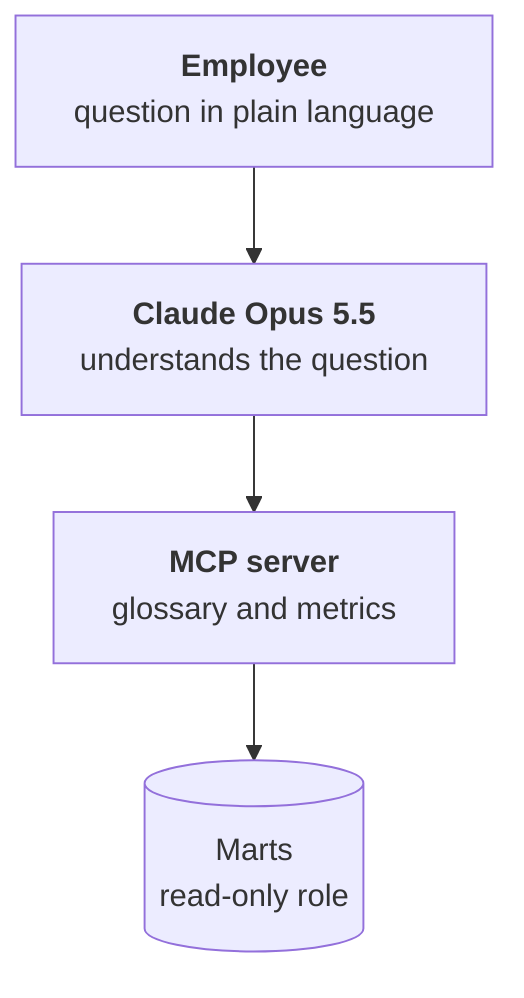

:::tldr
The assistant is Claude Opus 5.5 and a small MCP server with three tools: read the metric glossary, compute a metric over a period with breakdowns, and, as a last resort, run a SELECT on the marts. The second tool is the main one: the model picks the metric and breakdowns and the server builds the SQL from the glossary, so revenue is always computed the same way. The server connects with a role that sees only marts, can't change anything and can't run a query longer than ten seconds. Every answer names the metric, period, filters and data freshness. Quality is tested with thirty real questions with known answers.
:::

## What we want

The sales director types into the chat: "Which wholesale customers are at risk and how much did they bring in over the last year?" Half a minute later there's a table of twelve customers, a total, and a line at the bottom: "Metric: at-risk customer, revenue for 01.11.2025–31.10.2026, segment wholesale. Data as of 05:00 today." Ask the same tomorrow and you get the same answer, computed the same way.

That's the difference between an assistant on top of one picture and an assistant with access to every system. The second will answer too, but each time a little differently.

::news{topic="data mcp"}

## How it works



The assistant has three parts. The client where the employee asks: Claude with a connector added, or your own chat from the [company agent series](/blog/agent-interface/). The Claude Opus 5.5 model, which understands the question and decides which tools to call. And the MCP server, which knows the metric glossary and can safely query the marts.

All knowledge about the data lives in the server and the glossary, not in the prompt. So one server can be connected to any client, and when a metric changes, you only edit the glossary.

## Three tools

**`list_metrics`** returns the glossary from the last part: metric names, plain-language descriptions, exclusions, allowed breakdowns and last update time. The model calls it first and uses the descriptions to pick the metric that fits the question.

**`query_metric`** computes one metric over a period with chosen breakdowns. The model passes only the name, dates and breakdowns; the server builds the SQL from the glossary. That's the main idea of the whole part: the model doesn't write a query for revenue, it asks for revenue.

**`sql`** runs an arbitrary SELECT on the marts. It's the escape hatch for questions that don't fit metrics: "which products are most often bought together". The model uses it only when no metric fits and must say so in the answer.

The server is written in TypeScript with MCP SDK v2, as in the [MCP part](/blog/agent-mcp/) of the agent series. The main tool looks like this:

```ts
server.registerTool(
  "query_metric",
  {
    description: "Compute a glossary metric over a period with breakdowns. Returns rows, the SQL and data freshness.",
    inputSchema: z.object({
      metric: z.enum(metricNames),
      from: z.iso.date(),
      to: z.iso.date(),
      group_by: z.array(z.string()).default([]),
    }),
    annotations: { readOnlyHint: true },
  },
  async ({ metric, from, to, group_by }) => {
    const m = glossary[metric];
    const bad = group_by.filter((d) => !m.dimensions.includes(d));
    if (bad.length) return fail(`No breakdowns ${bad.join(", ")}. Available: ${m.dimensions.join(", ")}`);
    const query = buildQuery(m, group_by);
    const rows = await sql.unsafe(query, [from, to]);
    return ok({ rows: rows.slice(0, 500), sql: query, fresh_at: m.freshAt });
  },
);
```

`z.enum(metricNames)` won't let the model invent a metric, and the breakdown check returns a clear error with a hint, so the model fixes the call itself. `buildQuery` puts only column names from the glossary into the template and passes values as parameters, so nothing dangerous can be assembled from a call.

The SQL comes back with the data. The model shows it if the user asks how it was computed, and an engineer can rerun the query by hand.

## A read-only role

Even with careful tools, the database should protect itself. The server connects to the warehouse with its own role:

```sql
create role assistant_ro login password '…';
grant usage on schema marts to assistant_ro;
grant select on all tables in schema marts to assistant_ro;
alter role assistant_ro set default_transaction_read_only = on;
alter role assistant_ro set statement_timeout = '10s';
```

The role sees only the marts: no raw data and no `core` with hashed phones. Every transaction it opens is read-only, and any query longer than ten seconds is cut off. Even if the model tries to delete something or run a heavy join over millions of rows through the `sql` tool, the database won't let it.

If managers should see only their own customers, add Postgres row-level security, as in the [access part](/blog/agent-auth/) of the agent series: the server knows who is asking and the database returns only their rows.

## Answer rules

The system prompt is short because knowledge about the data lives in the glossary. Its rules are about how to answer:

- Read the glossary first. If a metric fits, compute only through `query_metric`.
- If the question can be read two ways, such as revenue or deal sales, ask instead of choosing.
- End every answer with numbers by stating the metric, period, filters and data update time.
- If you had to use `sql`, say it isn't a glossary metric and the number isn't approved by an owner.
- If the data is missing or more than a day stale, say so. Don't make things up.

The last rule matters more than it seems. An assistant that honestly says "we don't have that data" earns trust. An assistant that once confidently invented a number loses it for good.

## What it looks like

An employee asks: "Why did retail margin drop in October?"

The assistant reads the glossary, computes gross margin by month broken down by channel and sees the drop in retail. Then it computes the same margin by product category for September and October and finds that one category fell. Then it looks at the return rate for that category and sees it grew. The answer: retail margin fell from 31 to 26 percent, almost all of it in one category where returns tripled, with the three calls, metrics and periods listed below.

That's three or four tool calls in half a minute. Before, it was a request to an analyst and a three-day wait.

## Testing the assistant

The assistant changes: metrics are added, the glossary is edited, new models come out. To know it didn't get worse, you need a set of questions with known answers.

Take thirty real questions people asked in the first weeks and write down the correct answer for each, computed by hand: a number, a list of customers or an expected clarifying question. For example, the correct answer to "what was revenue in October" includes the figure from the mart, while for "how much did we sell" the expected answer is a clarifying question: revenue or deal sales.

Run the set after every glossary or prompt change. Check three things: the numbers match the reference, a metric was used rather than the fallback SQL, and the answer cites its source. The approach is the same as in the [evaluation part](/blog/finetune-eval/) of the fine-tuning series, except we test the whole chain instead of a fine-tuned model.

Look separately at questions where the assistant fell back to SQL. If the same kind of question keeps coming up, that's a signal to add a new metric to the glossary, agreed with its owner.

## What it costs

A question to the assistant is a few tool calls and a few thousand tokens. The glossary and the system prompt are the same for every question, so we cache them and repeated calls read them almost for free. In practice a question costs a few cents, and a hundred questions a day cost less than an hour of an analyst's time. How to count and cap spend is covered in the [cost part](/blog/agent-cost/) of the agent series.

## What's next

The assistant answers when asked. But the most valuable signals in data are the ones nobody thinks to ask about: a customer quietly stopped ordering, the site load broke, a category's returns went up. In the [last part](/blog/data-automate/) we make data come to people and back into the working systems by itself.
