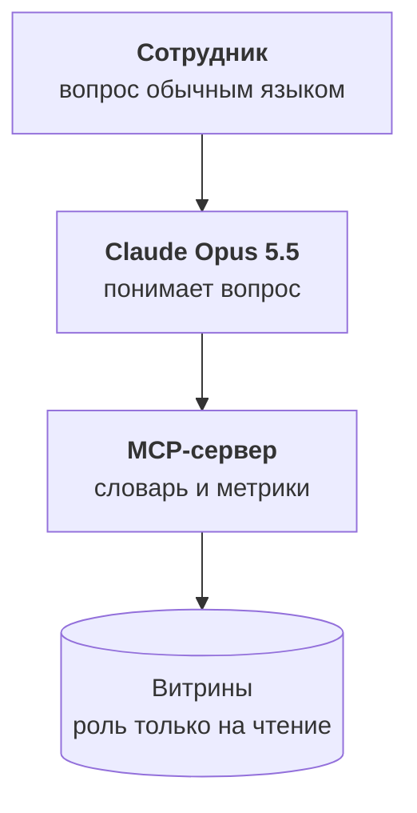

:::tldr
Помощник это Claude Opus 5.5 и небольшой MCP-сервер с тремя инструментами: прочитать словарь метрик, посчитать метрику за период с разрезами и, в крайнем случае, выполнить SELECT по витринам. Главный инструмент второй: модель выбирает метрику и разрезы, а SQL строит сервер по словарю, поэтому выручка всегда считается одинаково. Сервер ходит в базу ролью, которая видит только витрины, не может ничего изменить и не может выполнять запрос дольше десяти секунд. В каждом ответе помощник называет метрику, период, фильтры и свежесть данных. Качество проверяем набором из тридцати настоящих вопросов с известными ответами.
:::

## Чего мы хотим

Коммерческий директор пишет в чат: «Кто из оптовиков в зоне риска и сколько они принесли за последний год?» Через полминуты получает таблицу из двенадцати клиентов, сумму, и строчку внизу: «Метрика: клиент в зоне риска, выручка за 01.11.2025–31.10.2026, сегмент опт. Данные на 05:00 сегодня». Если он спросит то же самое завтра, получит тот же ответ, посчитанный тем же способом.

Это и есть разница между помощником поверх одной картины и помощником с доступом ко всем системам. Второй тоже ответит, но каждый раз немного по-своему.

::news{topic="data mcp"}

## Как устроен



Помощник состоит из трёх частей. Клиент, в котором сотрудник задаёт вопрос: это может быть Claude с подключённым коннектором или свой чат из [цикла про корпоративного агента](/blog/ru/agent-interface/). Модель Claude Opus 5.5, которая понимает вопрос и решает, какие инструменты вызвать. И MCP-сервер, который знает словарь метрик и умеет безопасно ходить в витрины.

Всё знание о данных живёт в сервере и словаре, а не в промпте. Поэтому один сервер можно подключить к любому клиенту, а при изменении метрики достаточно поправить словарь.

## Три инструмента

**`list_metrics`** возвращает словарь из прошлой части: имена метрик, описания простым языком, что в них не входит, допустимые разрезы и время последнего обновления. Модель вызывает его первым и по описаниям понимает, какая метрика подходит к вопросу.

**`query_metric`** считает одну метрику за период с выбранными разрезами. Модель передаёт только имя, даты и разрезы, а SQL строит сервер из словаря. Это главная идея всей части: модель не пишет запрос для выручки, она просит выручку.

**`sql`** выполняет произвольный SELECT по витринам. Это запасной выход для вопросов, которые не укладываются в метрики: «какие товары чаще всего покупают вместе». Модель пользуется им, только если подходящей метрики нет, и обязана сказать об этом в ответе.

Сервер написан на TypeScript с MCP SDK второй версии, как в [части про MCP](/blog/ru/agent-mcp/) цикла про агента. Главный инструмент выглядит так:

```ts
server.registerTool(
  "query_metric",
  {
    description: "Посчитать метрику из словаря за период с разрезами. Вернёт строки, SQL и время обновления данных.",
    inputSchema: z.object({
      metric: z.enum(metricNames),
      from: z.iso.date(),
      to: z.iso.date(),
      group_by: z.array(z.string()).default([]),
    }),
    annotations: { readOnlyHint: true },
  },
  async ({ metric, from, to, group_by }) => {
    const m = glossary[metric];
    const bad = group_by.filter((d) => !m.dimensions.includes(d));
    if (bad.length) return fail(`Нет разрезов ${bad.join(", ")}. Доступны: ${m.dimensions.join(", ")}`);
    const query = buildQuery(m, group_by);
    const rows = await sql.unsafe(query, [from, to]);
    return ok({ rows: rows.slice(0, 500), sql: query, fresh_at: m.freshAt });
  },
);
```

`z.enum(metricNames)` не даст модели придумать несуществующую метрику, а проверка разрезов вернёт понятную ошибку с подсказкой, и модель сама исправит вызов. `buildQuery` подставляет в шаблон только имена колонок из словаря, а значения передаются параметрами, так что собрать из вызова что-то опасное нельзя.

SQL возвращается вместе с данными. Модель покажет его, если пользователь спросит, как посчитано, а инженер сможет повторить запрос руками.

## Роль только на чтение

Даже с аккуратными инструментами база должна защищать себя сама. Сервер ходит в хранилище отдельной ролью:

```sql
create role assistant_ro login password '…';
grant usage on schema marts to assistant_ro;
grant select on all tables in schema marts to assistant_ro;
alter role assistant_ro set default_transaction_read_only = on;
alter role assistant_ro set statement_timeout = '10s';
```

Роль видит только витрины: ни сырых данных, ни `core` с телефонами в хэшах. Любая транзакция у неё только на чтение, а запрос дольше десяти секунд обрывается. Даже если модель через инструмент `sql` попробует что-то удалить или запустить тяжёлое соединение на миллионы строк, база не даст.

Если менеджеры должны видеть только своих клиентов, сюда добавляется безопасность на уровне строк в Postgres, как в [части про права доступа](/blog/ru/agent-auth/) цикла про агента: сервер знает, кто спрашивает, и база отдаёт только его строки.

## Правила ответа

Системный промпт короткий, потому что знание о данных живёт в словаре. Правила в нём про то, как отвечать:

- Сначала прочитай словарь. Если есть подходящая метрика, считай только через `query_metric`.
- Если вопрос можно понять двумя способами, например выручка или продажи по сделкам, спроси, а не выбирай сам.
- В конце каждого ответа с цифрами укажи метрику, период, фильтры и время обновления данных.
- Если пришлось использовать `sql`, скажи, что это не метрика из словаря и цифра не проверена владельцем.
- Если данных нет или они устарели больше чем на сутки, так и скажи. Не придумывай.

Последнее правило важнее, чем кажется. Помощник, который честно говорит «таких данных у нас нет», вызывает доверие. Помощник, который один раз уверенно придумал цифру, теряет его навсегда.

## Как это выглядит

Сотрудник спрашивает: «Почему в октябре упала маржа в рознице?»

Помощник читает словарь, считает валовую маржу по месяцам с разрезом по каналу и видит падение в рознице. Затем считает ту же маржу по категориям товаров за сентябрь и октябрь и находит, что упала одна категория. Затем смотрит долю возвратов по этой категории и видит рост. Ответ: маржа в рознице упала с 31 до 26 процентов, почти всё падение в одной категории, где возвраты выросли втрое, и ниже три вызова с метриками и периодами.

Это три-четыре вызова инструментов за полминуты. Раньше это был запрос аналитику и три дня ожидания.

## Проверяем помощника

Помощник меняется: добавляются метрики, правится словарь, выходят новые модели. Чтобы знать, что он не стал хуже, нужен набор вопросов с известными ответами.

Берём тридцать настоящих вопросов, которые люди задавали за первые недели, и для каждого записываем правильный ответ, посчитанный вручную: число, список клиентов или ожидаемое уточнение. Например, на «какая выручка в октябре» правильный ответ включает цифру из витрины, а на «сколько мы продали» ожидаемый ответ это уточняющий вопрос, выручка или продажи по сделкам.

Набор прогоняется после каждого изменения словаря или промпта. Проверяем три вещи: цифры совпадают с эталоном, использована метрика, а не запасной SQL, и в ответе есть источник. Подход тот же, что в [части про оценку](/blog/ru/finetune-eval/) цикла про дообучение, только вместо дообученной модели проверяем всю связку.

Отдельно смотрим на вопросы, где помощник ушёл в запасной SQL. Если один и тот же вид вопроса повторяется, это сигнал добавить новую метрику в словарь, договорившись о ней с владельцем.

## Сколько это стоит

Вопрос к помощнику это несколько вызовов инструментов и несколько тысяч токенов. Словарь и системный промпт одинаковые для всех вопросов, поэтому их кэшируем, и повторные вызовы читают их почти бесплатно. На практике вопрос стоит несколько рублей, а сотня вопросов в день обходится дешевле часа работы аналитика. Как считать и ограничивать расходы, подробно разобрано в [части про стоимость](/blog/ru/agent-cost/) цикла про агента.

## Что дальше

Помощник отвечает, когда его спрашивают. Но самые ценные сигналы в данных никто не догадается спросить: клиент тихо перестал заказывать, загрузка из сайта сломалась, у категории выросли возвраты. В [последней части](/blog/ru/data-automate/) делаем так, чтобы данные сами приходили к людям и обратно в рабочие системы.
