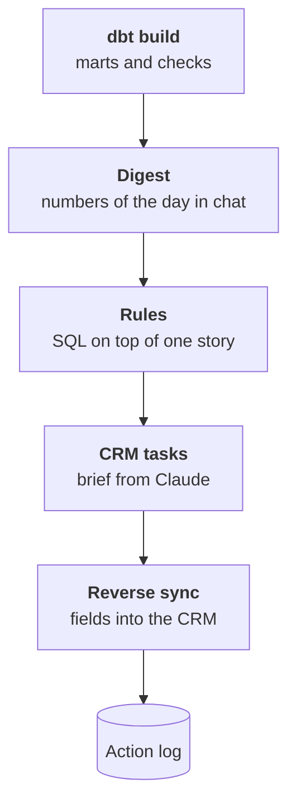

:::tldr
The assistant answers questions, but nobody thinks to ask about the most important signals. So after every marts build an actions step runs. A daily digest brings the key numbers and what changed into the chat. Rules written as SQL on top of the one story find at-risk customers and create CRM tasks, and Claude adds a short customer brief to each task. A reverse sync puts the shared customer ID, segment and twelve-month revenue into the CRM, so managers see them where they work. Every action is written to a log, so a rerun duplicates nothing. Source owners, load freshness and a short monthly review keep the system alive.
:::

## From questions to signals

Over six parts the company got one picture: data from every system in one warehouse, merged customers, agreed metrics and an assistant that answers questions. That already saves days of work. But the assistant is passive: it answers only when asked.

The most valuable thing in data is usually what nobody asks about. A wholesale customer who ordered fifteen times every two weeks hasn't ordered for a month and a half. Nobody noticed: the manager has forty customers, and one going quiet doesn't look like an event. Three months later it turns out the customer moved to a competitor.

The last layer makes such signals come to people by themselves and the right fields appear in working systems by themselves.

::news{topic="data automation"}

## The actions step

Actions run on the same schedule, right after `dbt build`, and only if the checks passed. Acting on broken data is worse than not acting: a task to call a customer who actually ordered yesterday, but whose order didn't load, quickly teaches managers to ignore all tasks.



## The daily digest

Every morning a message lands in the managers' chat: revenue and orders for yesterday and month to date against plan, at-risk customers, return rate. Numbers come from the marts, the plan from the sales director's spreadsheet, which now lives in the warehouse too.

The digest has few numbers, five to seven. Below them are three or four sentences written by Claude: what changed noticeably and what to look at. The model gets the same marts for recent weeks and the glossary, and answers by schema: short observations, each with a metric and a number. If nothing notable happened, it says so. Such a report is covered in detail in the [analyst part](/blog/automations-analytics/) of the automations series; here it simply gets data from one picture instead of one system.

You can ask a question about the digest right in the chat: the assistant from the last part answers.

## Rules on top of the one story

A rule is a view in the marts that returns rows needing action. For example, wholesale customers who have been quiet for twice their usual interval:

```sql
with gaps as (
  select customer_id,
         ordered_on - lag(ordered_on) over (partition by customer_id order by ordered_on) as gap
  from core.orders
  where channel = 'wholesale'
)
select c.customer_id, c.name, c.manager_id,
       current_date - c.last_order_on as days_silent
from core.customers c
join gaps g using (customer_id)
group by c.customer_id, c.name, c.manager_id, c.last_order_on
having count(g.gap) >= 4
   and current_date - c.last_order_on > 2 * percentile_cont(0.5) within group (order by g.gap)
```

Each customer has their own usual interval: some order weekly, some quarterly. The median gap between orders is robust to rare outliers, and requiring four gaps filters out customers without enough history yet.

This query was impossible while the customer was split across five records: wholesale orders in 1C under one counterparty, retail on the site under an employee's email, and silence in one channel didn't mean silence overall. On top of one story it's plain SQL.

Similar rules for our company:

- A big customer opened three help desk tickets in a week.
- A customer's receivables exceed the limit in the key accounts sheet.
- A product's return rate is twice its category average.
- A shopper from ads placed a second order: time to hand them to the wholesale team if the amount is large.

Each rule goes the same way as a metric: the owner approves the wording, the rule is written into the glossary, and the assistant can explain why a customer is on the list.

## Tasks with a brief

A rule row becomes a CRM task for the account manager. "Call Romashka" is useful, but the manager still has to dig up what's been going on. So Claude adds a five-line brief to the task: what the customer bought and how often, when the last order was, whether there were tickets and how they ended, what terms are in the key accounts sheet. The model gets the customer card from the one story and answers briefly and factually, with no sales advice.

Tasks are created through the CRM API with the same access as loading, plus the right to create tasks. So that a rerun doesn't produce duplicates, each action is first written to a log with a unique key of rule, customer and period. If the row already exists, no task is created. Idempotent handlers in the [automations series](/blog/automations-queue/) work the same way: first a mark in the database, then the external call.

The log also gives a metric for the automation itself: how many tasks were created, how many closed, and how many customers ordered again after the call. If tasks get closed en masse with no result, revisit the rule rather than adding new ones.

## Reverse sync

Managers live in the CRM, not the warehouse. For one picture to be useful every day, part of it should go back into the CRM as customer card fields:

| CRM field | From |
|---|---|
| Shared customer ID | the merge from part four |
| Revenue over 12 months, wholesale and store together | the revenue metric |
| Last order date in any channel | the one story of orders |
| Segment and risk status | the rules |

This is called reverse ETL. There are commercial services for it, but for one CRM and a dozen fields a small script is enough: read the mart, compare with what was written last time, and send only changed fields to the API. The comparison matters: CRMs rate-limit requests, and updating thousands of cards every night quickly hits the limit.

One rule with no exceptions: write back only into your own fields created for this. The warehouse never overwrites what people enter. Otherwise a manager fixes a customer's phone, the nightly sync puts the old one back, and trust in the system is gone.

## Keeping the system alive

One picture isn't a project you hand over once. Sources change: a field was added to the CRM, 1C's configuration changed, marketing started a new spreadsheet. To keep the system from rotting within six months, it needs a bit of regular work.

- **Owners.** Every source and every metric has an owner from the map in part two. They agree on source changes in advance instead of learning about them from a failed check.
- **Freshness and checks.** In place since part five. A failed check is a task with an owner, not a message everyone scrolled past.
- **A monthly review.** Half an hour a month: revenue reconciliation with accounting, the list of excluded keys for customer merging, questions where the assistant fell back to SQL, rules whose tasks get closed with no result.
- **A new source.** The same path every time: a row on the map, read-only access, a raw schema, staging, links to the one story, checks.

All this fits into a few hours a month of one engineer's time. For comparison: before one picture, several days a month went into manual exports and reconciliation alone.

## Series recap

Over seven parts we covered the whole path:

1. [Concept](/blog/data-concept/): data sprawls because every department picks its own tool, and the cure isn't replacing systems but one picture on top of them.
2. [Inventory](/blog/data-inventory/): a map of sources, owners and questions, read-only access, personal data decisions.
3. [Ingest](/blog/data-ingest/): Postgres 18 as the warehouse, dlt for loading, a window for 1C, the schedule.
4. [One story](/blog/data-model/): customers merged by keys with the help of Claude and a person, orders without double counting.
5. [Numbers](/blog/data-metrics/): metrics with one definition and owner, a plain-language glossary, checks.
6. [Assistant](/blog/data-assistant/): an MCP server over metrics; Claude answers with its source.
7. Automation: digests, rules, tasks with briefs and fields back into the CRM.

The main idea of the series is the order of the layers. An AI assistant and automations are exactly as good as the data under them. Companies that start with AI get confident wrong answers. Companies that start with one picture get, within a couple of months, both correct numbers and an assistant they can trust.
