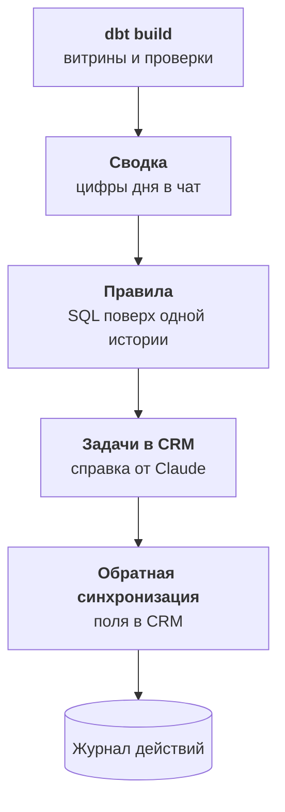

:::tldr
Помощник отвечает на вопросы, но самые важные сигналы никто не догадается спросить. Поэтому после каждой сборки витрин запускается шаг действий. Ежедневная сводка приносит в чат главные цифры и то, что изменилось. Правила, записанные как SQL поверх одной истории, находят клиентов в зоне риска и создают задачи в CRM, а Claude дописывает к задаче короткую справку о клиенте. Обратная синхронизация кладёт в CRM общий идентификатор клиента, сегмент и выручку за год, чтобы менеджер видел их там, где работает. Каждое действие записывается в журнал, поэтому повторный запуск ничего не дублирует. Живой систему держат владельцы источников, свежесть загрузок и короткий ежемесячный разбор.
:::

## От вопросов к сигналам

За шесть частей компания получила одну картину: данные из всех систем в одном хранилище, сведённых клиентов, договорённые метрики и помощника, который отвечает на вопросы. Это уже экономит дни работы. Но помощник пассивен: он отвечает, только когда спросят.

Самое ценное в данных обычно то, о чём не спрашивают. Оптовый клиент, который пятнадцать раз заказывал раз в две недели, не заказывал уже полтора месяца. Никто этого не заметил: у менеджера сорок клиентов, и тишина одного из них не выглядит событием. А через три месяца выясняется, что клиент ушёл к конкуренту.

Последний слой делает так, чтобы такие сигналы сами приходили к людям, а нужные поля сами появлялись в рабочих системах.

::news{topic="data automation"}

## Шаг действий

Действия запускаются в том же расписании, сразу после `dbt build`, и только если проверки прошли. Действие на сломанных данных хуже, чем отсутствие действия: задача менеджеру о клиенте, который на самом деле вчера заказал, но заказ не загрузился, быстро научит игнорировать все задачи.



## Ежедневная сводка

Каждое утро в общий чат руководителей приходит сообщение: выручка и заказы за вчера и с начала месяца против плана, клиенты в зоне риска, доля возвратов. Цифры берутся из витрин, план из таблицы коммерческого директора, которая теперь тоже лежит в хранилище.

Цифр в сводке немного, пять-семь. Под ними три-четыре фразы, которые пишет Claude: что заметно изменилось и на что посмотреть. Модели передаются те же витрины за последние недели и словарь, и она отвечает по схеме: короткие наблюдения, у каждого метрика и число. Если ничего заметного не произошло, так и пишет. Подробно такой отчёт разобран в [части про аналитика](/blog/ru/automations-analytics/) цикла про автоматизации, здесь он просто получает данные из одной картины, а не из одной системы.

К сводке можно задать вопрос прямо в чате: ответит помощник из прошлой части.

## Правила поверх одной истории

Правило это представление в витринах, которое возвращает строки, требующие действия. Например, оптовые клиенты, которые молчат вдвое дольше своего обычного интервала:

```sql
with gaps as (
  select customer_id,
         ordered_on - lag(ordered_on) over (partition by customer_id order by ordered_on) as gap
  from core.orders
  where channel = 'wholesale'
)
select c.customer_id, c.name, c.manager_id,
       current_date - c.last_order_on as days_silent
from core.customers c
join gaps g using (customer_id)
group by c.customer_id, c.name, c.manager_id, c.last_order_on
having count(g.gap) >= 4
   and current_date - c.last_order_on > 2 * percentile_cont(0.5) within group (order by g.gap)
```

Обычный интервал у каждого клиента свой: кто-то заказывает каждую неделю, кто-то раз в квартал. Медиана промежутков между заказами устойчива к редким выбросам, а условие на четыре промежутка отсекает клиентов, у которых истории ещё мало.

Такой запрос был невозможен, пока клиент был разбит на пять записей: оптовые заказы в 1С под одним контрагентом, розничные на сайте под почтой сотрудника, и молчание в одном канале не означало молчания вообще. Поверх одной истории это обычный SQL.

Похожие правила для нашей компании:

- Крупный клиент открыл три обращения в поддержку за неделю.
- Дебиторка клиента больше лимита из таблицы ключевых клиентов.
- Товар с долей возвратов вдвое выше средней по категории.
- Покупатель из рекламы сделал второй заказ: пора передать его в оптовый отдел, если сумма большая.

Каждое правило проходит тот же путь, что метрика: формулировку подтверждает владелец, правило записывается в словарь, и помощник может объяснить, почему клиент попал в список.

## Задачи со справкой

Строка правила превращается в задачу в CRM на ответственного менеджера. Задача «позвонить Ромашке» полезна, но менеджеру всё равно придётся выяснять, что происходило. Поэтому к задаче Claude дописывает справку на пять строк: что и как часто клиент покупал, когда был последний заказ, были ли обращения в поддержку и чем закончились, какие условия в таблице ключевых клиентов. Модель получает карточку клиента из одной истории и отвечает коротко и по фактам, без советов, как продавать.

Задачи создаются через API CRM тем же доступом, что и загрузка, только с правом создавать задачи. Чтобы повторный запуск не плодил дубли, каждое действие сначала записывается в журнал с уникальным ключом из правила, клиента и периода. Если запись уже есть, задача не создаётся. Так же устроены идемпотентные обработчики в [цикле про автоматизации](/blog/ru/automations-queue/): сначала отметка в базе, потом внешний вызов.

Журнал заодно даёт метрику самой автоматизации: сколько задач создано, сколько закрыто, и сколько клиентов после звонка снова заказали. Если задачи массово закрываются без результата, правило надо пересмотреть, а не добавлять новые.

## Обратная синхронизация

Менеджеры живут в CRM, а не в хранилище. Чтобы одна картина была полезна каждый день, часть её стоит вернуть в CRM полями карточки клиента:

| Поле в CRM | Откуда |
|---|---|
| Общий идентификатор клиента | склейка из четвёртой части |
| Выручка за 12 месяцев, опт и магазин вместе | метрика выручки |
| Дата последнего заказа в любом канале | одна история заказов |
| Сегмент и статус риска | правила |

Это называют обратной загрузкой данных, reverse ETL. Есть коммерческие сервисы для неё, но для одной CRM и десятка полей хватает небольшого скрипта: прочитать витрину, сравнить с тем, что записывали в прошлый раз, и отправить в API только изменившиеся поля. Сравнение важно: CRM ограничивает число запросов, а обновление тысяч карточек каждую ночь быстро упрётся в лимит.

Одно правило без исключений: обратно пишем только в свои поля, созданные под это. Хранилище никогда не перезаписывает то, что вводят люди. Иначе менеджер поправит телефон клиента, а ночью синхронизация вернёт старый, и доверие к системе кончится.

## Как держать систему живой

Одна картина не проект, который однажды сдают. Источники меняются: в CRM добавили поле, в 1С поменяли конфигурацию, маркетинг завёл новую таблицу. Чтобы система не сгнила за полгода, нужно немного регулярной работы.

- **Владельцы.** У каждого источника и каждой метрики есть владелец из карты во второй части. Изменения в источнике он согласует заранее, а не узнаёт о них по упавшей проверке.
- **Свежесть и проверки.** Уже стоят с пятой части. Падение проверки это задача с владельцем, а не сообщение, которое все пролистали.
- **Ежемесячный разбор.** Полчаса раз в месяц: сверка выручки с бухгалтерией, список ключей-исключений для склейки клиентов, вопросы, на которых помощник ушёл в запасной SQL, правила, задачи по которым закрывают без результата.
- **Новый источник.** Каждый раз один и тот же путь: строка в карте, доступ только на чтение, сырая схема, staging, связи с одной историей, проверки.

Вся эта работа укладывается в несколько часов в месяц одного инженера. Для сравнения: до одной картины несколько дней в месяц уходило только на ручные выгрузки и сверки.

## Итог цикла

За семь частей мы прошли весь путь:

1. [Концепция](/blog/ru/data-concept/): данные расползаются, потому что каждый отдел выбирает свой инструмент, и лечится это не заменой систем, а одной картиной поверх них.
2. [Инвентаризация](/blog/ru/data-inventory/): карта источников, владельцев и вопросов, доступы только на чтение, решения по персональным данным.
3. [Сбор](/blog/ru/data-ingest/): Postgres 18 как хранилище, dlt для загрузки, окно для 1С, расписание.
4. [Одна история](/blog/ru/data-model/): клиенты, сведённые по ключам с помощью Claude и человека, заказы без двойного счёта.
5. [Цифры](/blog/ru/data-metrics/): метрики с одним определением и владельцем, словарь простым языком, проверки.
6. [Помощник](/blog/ru/data-assistant/): MCP-сервер поверх метрик, Claude отвечает с указанием источника.
7. Автоматизация: сводки, правила, задачи со справкой и поля обратно в CRM.

Главная мысль цикла в порядке слоёв. ИИ-помощник и автоматизации хороши ровно настолько, насколько хороши данные под ними. Компании, которые начинают с ИИ, получают уверенные неправильные ответы. Компании, которые начинают с одной картины, через пару месяцев получают и правильные цифры, и помощника, которому можно верить.
