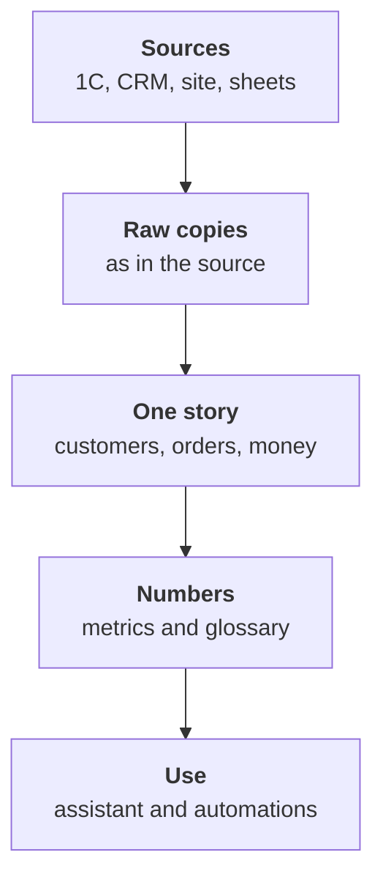

:::tldr
Data sprawls not because the systems are bad but because every department picks a tool for its own job. Replacing them all with one system is expensive and almost always pointless. What works is different: the systems stay as they are, their data is copied regularly into a separate warehouse, reconciled there into one story of customers, orders and money, and the numbers are defined once on top of it. Only then does an AI assistant start answering correctly and automations stop breaking. Start not with tools but with three to five questions the business cannot answer today.
:::

## What the chaos looks like

Take our running company: a wholesale and retail distributor with eighty people. It has an online store, a wholesale sales team, a warehouse, accounting and a couple of marketers. Where the data lives:

- **1C** (the accounting and trade system most Russian companies run on; QuickBooks, Xero or an ERP play the same role elsewhere): wholesale orders, shipments, payments, stock, counterparties with tax IDs.
- **CRM**: deals, manager tasks, call and message history.
- **The site's database**: online store orders, shoppers, carts.
- **Help desk**: tickets, complaints, returns.
- **Google Sheets**: the sales plan, the wholesale price list, the key accounts list the sales director keeps.
- **Ad accounts**: spend and clicks per campaign.
- **Email and messengers**: agreements that never made it anywhere else.

Each system works on its own. The trouble starts when an answer needs two systems at once.

::news{topic="data automation"}

## Symptoms

Data chaos shows up as the same situations again and again.

**Different numbers at the same meeting.** The sales director says monthly revenue is twelve million, the CFO says eleven. Both are right: one counts CRM deals, the other counts payments in 1C, and returns and VAT are handled differently.

**One customer in five places.** Romashka LLC in 1C, "Romashka wholesale" in the CRM, "Ivan Petrov" with a Romashka email on the site, and another Romashka with a different tax ID because it is their second legal entity. Nobody knows how much Romashka bought in total.

**A three-day report.** Every "how many do we…" question goes to an analyst or the sharpest manager, who exports data to Excel and glues it by hand. Three days later the number is ready, the question is no longer relevant, and next month it all happens again.

**Automations break.** A script that creates a CRM task when a payment lands in 1C fails on customers who aren't in the CRM, or creates duplicates. Every point-to-point integration knows its own piece of the truth.

**The AI assistant lies.** The assistant got access to the site database and the CRM and confidently answers a revenue question, except it counts revenue its own way and slightly differently each time.

## Why another system doesn't cure it

The first idea is to buy one system that replaces everything: an ERP, a big CRM or a new platform. It almost never works. Accounting won't leave 1C because the statutory reports live there. Managers won't leave the CRM they're used to. The site won't move into the ERP. Even if the move succeeds, a year later new spreadsheets and services appear next to it, because departments have their own jobs again.

The second idea is to connect the systems directly. Payments from 1C go to the CRM, site orders go to 1C, tickets go to the CRM. Each link is reasonable on its own, but with five systems there are up to twenty links, and each has its own idea of who a customer is. That's not one picture, it's a web.

The third way works: systems stay as they are and keep doing their job. Their data is copied regularly into a separate warehouse, and one picture is built there.

## What one picture means

One picture has several layers, and each solves its own problem.

1. **Raw copies.** Each system's data sits in the warehouse exactly as it arrived. Nothing is fixed, only copied, regularly and without gaps. If a model turns out to be wrong later, the raw data lets you recompute everything.
2. **One story.** Customers from five systems become one customer with one ID, site orders and 1C orders become one orders table, payments are tied to orders. This is the hardest and most valuable layer.
3. **Numbers.** Revenue, active customer, average order value and churn are defined once, in writing, with an owner and checks. From then on everyone, AI included, counts only that way.
4. **Use.** The AI assistant answers questions based on the defined numbers. Automations react to events in the one story, not in a single system.

Note that the flow goes one way. Sources remain the masters of their data: accounting fixes payments in 1C, not in the warehouse. The warehouse only reads and reconciles. Data goes back into systems separately and deliberately; that's the last part of the series.

## Why AI belongs on top

It is very tempting today to skip the middle: give a language model access to all systems at once and ask it to figure things out. The model really can write SQL and call APIs. But if the data has three Romashkas and two definitions of revenue, the model will pick one, and pick differently on different days. The mistake will sound convincing, which is worse than no answer.

Once the middle is built, the model's job becomes simple and reliable. It doesn't have to guess how tables relate or what revenue is: that is already written in the glossary and computed in the metrics. The model only has to understand the question, pick the metric and the breakdowns, and explain the answer. That it does very well.

Same with automations. The rule "if a customer hasn't ordered for twice their usual interval, create a task for the manager" can't be written while the customer is split across five records in different systems. On top of one story it's ten lines of SQL.

## The stack

A company our size doesn't need expensive platforms. The whole stack is open and fits on one server.

| Layer | Tool | Why |
|---|---|---|
| Warehouse | Postgres 18 | everyone knows it, enough for hundreds of millions of rows |
| Loading | dlt 1.32 | a Python library with ready sources and incremental loading |
| Models | dbt Core 1.12 | SQL models with tests and docs |
| Assistant | MCP server and Claude Opus 5.5 | read-only access to metrics |
| Schedule | one container with cron | load, models, checks in order |

If data grows by orders of magnitude, the warehouse can move to ClickHouse or DuckDB and the models and metrics move almost unchanged. But don't start there.

## Where to start

Not with tools. Start with three to five questions the business can't answer quickly today and that are worth money. For our company:

1. How much revenue and margin does each customer bring when wholesale and the online store are added up?
2. Which wholesale customers stopped ordering although they used to order regularly?
3. What does it cost to acquire a shopper from each ad channel, and does it pay off?
4. Which products get returned most often, and why?

Each question shows which sources are needed and which entities must be reconciled. The first needs the customer from 1C, the CRM and the site. The second also needs order history. The third links ads to orders. If the system can't answer at least these questions, it isn't needed.

## What we'll build

Parts of the series:

1. This part: why one picture and what it's made of.
2. [Inventory](/blog/data-inventory/): a map of sources, owners and questions, access and personal data.
3. [Ingest](/blog/data-ingest/): copy data from 1C, the CRM, the site and sheets into Postgres with dlt.
4. [One story](/blog/data-model/): reconcile customers across systems, orders and payments in dbt.
5. [Numbers](/blog/data-metrics/): define metrics once, write a glossary and quality checks.
6. [AI assistant](/blog/data-assistant/): an MCP server over metrics; Claude answers in plain language.
7. [Automation](/blog/data-automate/): daily digests, rules, CRM tasks and syncing back.

## What's next

Before copying anything, you need to know what the company actually has, who keeps it and who is responsible for it. In the [second part](/blog/data-inventory/) we map sources and questions and deal with access and personal data.
