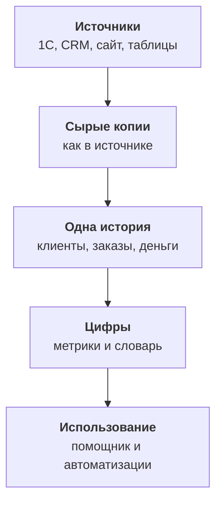

:::tldr
Данные расползаются не из-за плохих систем, а потому что каждый отдел выбирает инструмент под свою задачу. Лечить это заменой всех систем на одну дорого и почти всегда бесполезно. Работает другое: системы остаются как есть, а их данные регулярно копируются в отдельное хранилище, там сводятся в одну историю клиентов, заказов и денег, и поверх неё один раз определяются цифры. Только после этого ИИ-помощник начинает отвечать правильно, а автоматизации перестают ломаться. Начинать стоит не с инструментов, а с трёх-пяти вопросов, на которые бизнес сейчас не может ответить.
:::

## Как выглядит хаос

Возьмём нашу сквозную компанию: оптово-розничный дистрибьютор на восемьдесят человек. У неё есть интернет-магазин, отдел оптовых продаж, склад, бухгалтерия и пара маркетологов. Где живут данные:

- **1С**: заказы оптовиков, отгрузки, оплаты, остатки, контрагенты с ИНН.
- **CRM**: сделки, задачи менеджеров, история звонков и переписки.
- **База сайта**: заказы из интернет-магазина, покупатели, корзины.
- **Сервис поддержки**: обращения, жалобы, возвраты.
- **Google Таблицы**: план продаж, прайс для оптовиков, список ключевых клиентов, который ведёт коммерческий директор.
- **Рекламные кабинеты**: расходы и клики по кампаниям.
- **Почта и мессенджеры**: договорённости, которые никуда больше не попали.

Каждая система по отдельности работает. Проблемы начинаются, когда нужен ответ, который требует двух систем сразу.

::news{topic="data automation"}

## Симптомы

Хаос с данными узнаётся по повторяющимся ситуациям.

**Разные цифры на одной планёрке.** Коммерческий директор говорит, что выручка за месяц двенадцать миллионов, финансовый, что одиннадцать. Оба правы: один считает по сделкам в CRM, другой по оплатам в 1С, а возвраты и НДС учтены по-разному.

**Один клиент в пяти местах.** ООО «Ромашка» в 1С, «Ромашка опт» в CRM, «Иван Петров» с почтой ромашки на сайте и ещё одна «Ромашка» с другим ИНН, потому что это их второе юрлицо. Сколько всего купила «Ромашка», не знает никто.

**Отчёт за три дня.** Любой вопрос «а сколько у нас…» уходит аналитику или самому толковому менеджеру, который выгружает данные в Excel и склеивает их руками. Через три дня цифра готова, но вопрос уже не актуален, а в следующем месяце всё повторяется заново.

**Автоматизации ломаются.** Скрипт, который по оплате в 1С ставит задачу в CRM, падает на клиентах, которых нет в CRM, или создаёт дубли. Каждая интеграция точка-точка знает свой кусок правды.

**ИИ-помощник врёт.** Ассистенту дали доступ к базе сайта и к CRM, и он уверенно отвечает на вопрос про выручку, только считает её по-своему и каждый раз немного иначе.

## Почему это не лечится ещё одной системой

Первая мысль: купить одну систему, которая заменит всё. ERP, большую CRM или новую платформу. Это почти никогда не срабатывает. Бухгалтерия не уйдёт из 1С, потому что там отчётность. Менеджеры не уйдут из CRM, к которой привыкли. Сайт не переедет в ERP. Даже если переезд удастся, через год рядом появятся новые таблицы и сервисы, потому что у отделов снова возникнут свои задачи.

Вторая мысль: связать системы напрямую. Оплата из 1С пишется в CRM, заказ с сайта в 1С, обращение в CRM. Каждая связь по отдельности разумна, но при пяти системах таких связей до двадцати, и каждая по-своему понимает, кто такой клиент. Это не одна картина, а паутина.

Работает третий путь: системы остаются как есть и продолжают делать свою работу. Их данные регулярно копируются в отдельное хранилище, и уже там из них собирается одна картина.

## Что значит одна картина

Одна картина состоит из нескольких слоёв, и каждый решает свою проблему.

1. **Сырые копии.** Данные каждой системы лежат в хранилище в том виде, в каком пришли. Ничего не исправляем, только копируем, регулярно и без пропусков. Если в модели позже найдётся ошибка, сырые данные позволят всё пересчитать.
2. **Одна история.** Здесь клиенты из пяти систем сводятся в одного клиента с одним идентификатором, заказы с сайта и из 1С становятся одной таблицей заказов, оплаты привязываются к заказам. Это самый трудный и самый ценный слой.
3. **Цифры.** Выручка, активный клиент, средний чек и отток определяются один раз, письменно, с владельцем и проверками. Дальше все, включая ИИ, считают только так.
4. **Использование.** ИИ-помощник отвечает на вопросы, опираясь на определённые цифры. Автоматизации реагируют на события в одной истории, а не в отдельной системе.

Важно, что поток идёт в одну сторону. Источники остаются главными для своих данных: бухгалтерия правит оплаты в 1С, а не в хранилище. Хранилище только читает и сводит. Обратно в системы данные возвращаются отдельно и осознанно, об этом последняя часть цикла.

## Почему ИИ нужен именно сверху

Сейчас очень хочется пропустить середину: дать языковой модели доступ ко всем системам сразу и попросить разобраться. Модель действительно умеет писать SQL и вызывать API. Но если в данных три «Ромашки» и два определения выручки, модель выберет одно из них, и выберет по-разному в разные дни. Ошибка будет звучать убедительно, и это хуже, чем отсутствие ответа.

Когда середина собрана, задача модели становится простой и надёжной. Ей не нужно угадывать, как связаны таблицы и что такое выручка: это уже записано в словаре и посчитано в метриках. Модели остаётся понять вопрос, выбрать нужную метрику и разрезы и объяснить ответ. Это она делает очень хорошо.

То же с автоматизациями. Правило «если клиент не заказывал вдвое дольше обычного, поставить задачу менеджеру» невозможно написать, пока клиент разбит на пять записей в разных системах. Поверх одной истории это десять строк SQL.

## Стек

Для компании нашего размера не нужны дорогие платформы. Весь стек открытый и помещается на один сервер.

| Слой | Инструмент | Почему |
|---|---|---|
| Хранилище | Postgres 18 | знаком всем, хватает до сотен миллионов строк |
| Загрузка | dlt 1.32 | библиотека на Python, готовые источники и инкрементальная загрузка |
| Модели | dbt Core 1.12 | SQL-модели с тестами и документацией |
| Помощник | MCP-сервер и Claude Opus 5.5 | доступ к метрикам только на чтение |
| Расписание | один контейнер с cron | загрузка, модели, проверки по очереди |

Если данных станет на порядки больше, хранилище можно поменять на ClickHouse или DuckDB, а модели и метрики переедут почти без изменений. Но начинать с этого не надо.

## С чего начинать

Не с инструментов. Начинать стоит с трёх-пяти вопросов, на которые бизнес сейчас не может быстро ответить, и которые стоят денег. Для нашей компании это:

1. Сколько выручки и маржи приносит каждый клиент, если сложить опт и интернет-магазин?
2. Какие оптовые клиенты перестали заказывать, хотя раньше заказывали регулярно?
3. Сколько стоит привлечь покупателя из каждого рекламного канала и окупается ли он?
4. Какие товары чаще всего возвращают и почему?

Каждый вопрос показывает, какие источники нужны и какие сущности придётся сводить. Первый требует клиента из 1С, CRM и сайта. Второй ещё и истории заказов. Третий связывает рекламу с заказами. Если вся система не отвечает хотя бы на эти вопросы, она не нужна.

## Что мы построим

По частям цикла:

1. Эта часть: зачем нужна одна картина и из чего она состоит.
2. [Инвентаризация](/blog/ru/data-inventory/): карта источников, их владельцев и вопросов, доступы и персональные данные.
3. [Сбор](/blog/ru/data-ingest/): копируем данные из 1С, CRM, сайта и таблиц в Postgres с помощью dlt.
4. [Одна история](/blog/ru/data-model/): сводим клиентов из разных систем, заказы и оплаты в dbt.
5. [Цифры](/blog/ru/data-metrics/): определяем метрики один раз, пишем словарь и проверки качества.
6. [ИИ-помощник](/blog/ru/data-assistant/): MCP-сервер поверх метрик, Claude отвечает на вопросы обычным языком.
7. [Автоматизация](/blog/ru/data-automate/): ежедневные сводки, правила, задачи в CRM и обратная синхронизация.

## Что дальше

Прежде чем что-то копировать, надо понять, что вообще есть в компании, у кого это лежит и кто за это отвечает. Во [второй части](/blog/ru/data-inventory/) составим карту источников и вопросов и разберёмся с доступами и персональными данными.
