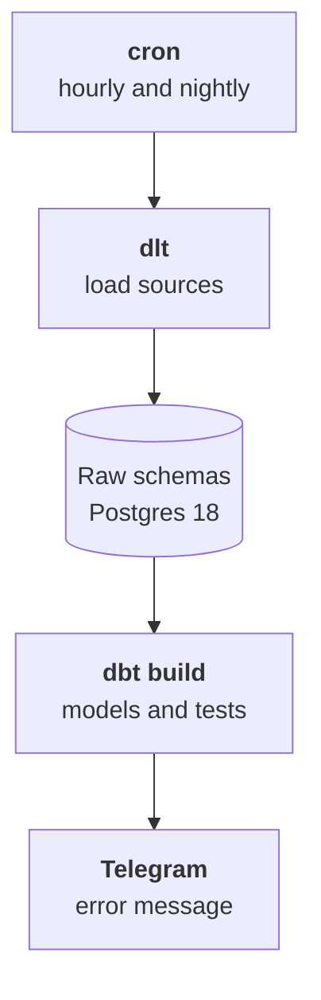

:::tldr
The warehouse is a separate Postgres 18, not the site's database and not 1C's. Each source is copied into its own raw schema as is, without fixes. For copying we use dlt: a Python library that pulls data from REST APIs, SQL databases and Google Sheets, creates the tables itself and loads only the changes. Sources with a modified date load incrementally; 1C, whose documents usually have none, is reloaded nightly over a sliding sixty-day window and fully once a month. Everything runs on a schedule from one container.
:::

## The warehouse

The warehouse is a separate database that data is only copied into. Not a site replica and not a schema in the CRM database, but its own Postgres on its own server or in the cloud. The reasons are simple: heavy analytical queries shouldn't slow down the store, and a failed load shouldn't break anything in production systems.

For a company our size, Postgres 18 on a server with four to eight cores and a hundred gigabytes of disk is enough. All our sources together amount to a few million rows; that's a small database. If in a couple of years there are hundreds of millions of event rows, analytical tables can move to ClickHouse, but there's no reason to start with it.

Inside the warehouse, schemas keep order:

| Schema | What's in it | Who writes |
|---|---|---|
| `raw_crm`, `raw_1c`, `raw_site`, `raw_sheets`, … | source copies as is | the loader |
| `staging`, `core` | the one story, next part | dbt |
| `marts` | metrics and marts for people and the assistant | dbt |

And three users with different rights: the loader writes only to raw schemas, dbt reads raw and writes models, and the assistant and reports only read marts. If the AI assistant ever tries to change something, the database simply won't let it.

::news{topic="data automation"}

## Why dlt

You can write loading from every API by hand, but it's a lot of repetitive code: pagination, retries, creating tables, new fields, nested lists. dlt takes all of that on. As of November 2026 the current version is 1.32.

What it does:

- Pulls data from a REST API described as a dict, from any SQL database, and from ready sources such as Google Sheets.
- Creates Postgres tables from incoming data and adds columns when new fields appear in the source. Nested lists go into child tables.
- Remembers how far it loaded and next time fetches only new and changed records.
- Can update records by key, not just append.

The alternative for those who don't want to write any code is Airbyte with hundreds of ready connectors and a web UI. It's heavier to run, and for a handful of sources dlt is simpler.

## CRM over a REST API

Almost every CRM has an API that returns deals and contacts with a modified date. That's the best case: every hour we fetch only what changed since last time.

```python
crm = rest_api_source({
    "client": {
        "base_url": "https://crm.example.com/api/v4/",
        "auth": {"type": "bearer", "token": dlt.secrets["crm_token"]},
    },
    "resource_defaults": {"primary_key": "id", "write_disposition": "merge"},
    "resources": [
        {"name": "deals", "endpoint": {"path": "leads", "params": {
            "updated_since": {"type": "incremental", "cursor_path": "updated_at", "initial_value": 0},
        }}},
        {"name": "contacts", "endpoint": {"path": "contacts"}},
    ],
})
dlt.pipeline("crm", destination="postgres", dataset_name="raw_crm").run(crm)
```

Two lines are key. `write_disposition: merge` with a primary key means a changed deal updates its row instead of appearing twice. `incremental` on `updated_at` means dlt remembers the latest date and passes it to the next request. The first load fetches everything, later ones only changes.

Lookups such as users and pipeline stages are small; it's simpler to reload them fully every time.

## The site database through a replica

The site database is even simpler: dlt reads tables directly. We connect to the read replica, not the primary, and fetch only the tables on the source map.

```python
site = sql_database(credentials=dlt.secrets["site_replica"], table_names=["orders", "order_items", "customers"])
for table in (site.orders, site.customers):
    table.apply_hints(primary_key="id", write_disposition="merge",
                      incremental=dlt.sources.incremental("updated_at"))
```

If a table has no modified date column, fix it on the site side: add a column and a trigger that updates it. That's five minutes for the developer and saves work on every load. Until the column exists, the table is reloaded fully, which is tolerable for a million rows.

## 1C without a modified date

1C exposes data through its standard OData interface: every document and catalogue is available at an address like `/odata/standard.odata/Document_ЗаказКлиента`. For dlt it's an ordinary REST API: the response is in the `value` field, paging via `$top` and `$skip`.

The difficulty is elsewhere. 1C documents usually have no last modified date, only the document date. An accountant can post last month's payment retroactively or fix a two-week-old shipment, and incremental loading by document date won't see it.

A practical fix without changing 1C:

- **Every night**, reload documents for the last sixty days by document date, merging on the `Ref_Key` key. Almost all corrections fall into this window.
- **Once a month**, reload everything and delete from the warehouse documents that no longer exist in 1C.
- **Catalogues** of counterparties and products are reloaded fully every night; they're small.

If a sixty-day window isn't good enough, the next step is an exchange plan in 1C: it registers every object change, and the loader fetches only registered ones. That needs a 1C programmer but gives real change tracking. You don't have to start with it.

One more trap: 1C field names are in Cyrillic, and by default dlt normalizes names to Latin snake_case and silently drops every non-ASCII character. `СуммаДокумента` becomes `x` and `Контрагент_Key` becomes `_key`. So run the 1C load with the environment variable `SCHEMA__NAMING=direct`: table and field names stay exactly as in 1C, and we'll rename them to readable English in the models.

And a last detail: include the deletion mark and the posted flag in the loaded fields. An unposted document or one marked for deletion must not count as revenue, and we'll decide that in the models, not at load time.

## Google Sheets

dlt has a ready source for spreadsheets: a Google service account, the spreadsheet ID and sheet names. Each sheet becomes a table in the `raw_sheets` schema.

Spreadsheets have one problem: people maintain them, and the structure drifts. Someone renamed a column, added an empty row in the middle or typed "check" into the amount field. So we load everything from sheets as text and check nothing at load time. Checks and type casting happen in the models, along with a clear message to the sheet owner that row forty-two has a word instead of a number.

## The schedule

All loading runs from one container on a schedule. A separate orchestrator like Airflow or Dagster isn't needed for a dozen sources: cron inside the container running the scripts in order is enough.



| Source | How often | How |
|---|---|---|
| CRM, help desk | hourly | changes |
| Site database | hourly | changes |
| 1C documents | nightly | 60-day window |
| 1C everything | monthly | full with deletes |
| Sheets, catalogues | nightly | full |
| Ads | nightly | yesterday and a week back, spend gets revised |

Every run logs how many rows came from each source. If a load failed or a source returned zero rows where there are usually thousands, a Telegram message goes out. A silent load failure is the most dangerous kind: reports keep showing numbers, just stale ones.

## What we have

After this part the warehouse holds fresh copies of every source on the map: CRM deals and contacts, site orders, 1C documents and catalogues, the sales director's spreadsheets and ad spend. They know nothing about each other yet: a customer in 1C and the same customer in the CRM are just two rows in different schemas.

## What's next

The hardest and most valuable part is ahead. In the [fourth part](/blog/data-model/) we merge customers from different systems into one, combine wholesale and store orders and tie payments to them. We'll also see where a language model helps merge customers and where it can't be trusted.
