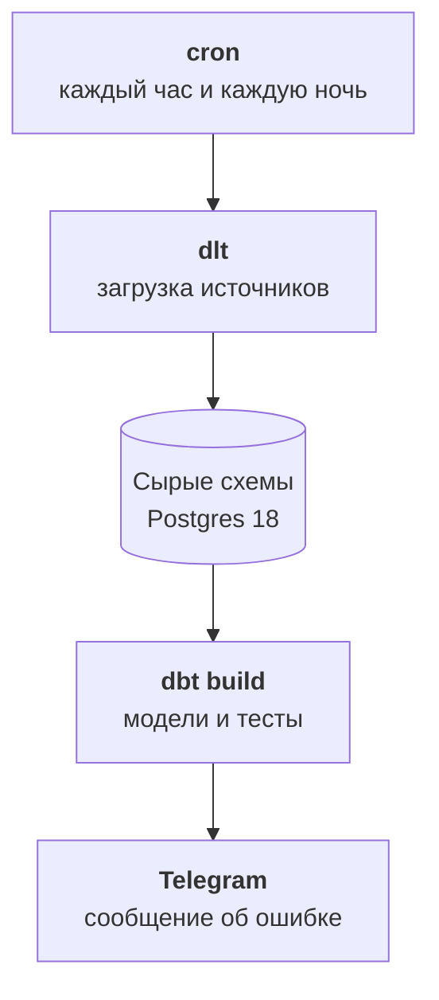

:::tldr
Хранилище это отдельный Postgres 18, не база сайта и не база 1С. Каждый источник копируется в свою сырую схему как есть, без исправлений. Для копирования берём dlt: это библиотека на Python, которая умеет забирать данные из REST API, SQL-баз и Google Таблиц, сама создаёт таблицы и догружает только изменения. Источники с датой изменения грузим инкрементально, а 1С, где у документов её обычно нет, перегружаем скользящим окном за последние два месяца каждую ночь и целиком раз в месяц. Всё запускается по расписанию из одного контейнера.
:::

## Хранилище

Хранилище это отдельная база, куда только копируются данные. Не реплика сайта и не схема в базе CRM, а свой Postgres на своём сервере или в облаке. Причины простые: тяжёлые аналитические запросы не должны тормозить магазин, а сбой загрузки не должен ничего ломать в рабочих системах.

Для компании нашего размера хватает Postgres 18 на сервере с четырьмя-восемью ядрами и сотней гигабайт диска. Все наши источники вместе дают несколько миллионов строк, это небольшая база. Если через пару лет станут сотни миллионов строк событий, аналитические таблицы можно будет вынести в ClickHouse, но начинать с него незачем.

Внутри хранилища порядок задают схемы:

| Схема | Что в ней | Кто пишет |
|---|---|---|
| `raw_crm`, `raw_1c`, `raw_site`, `raw_sheets`, … | копии источников как есть | загрузчик |
| `staging`, `core` | одна история, следующая часть | dbt |
| `marts` | метрики и витрины для людей и помощника | dbt |

И три пользователя с разными правами: загрузчик пишет только в сырые схемы, dbt читает сырые и пишет модели, а помощник и отчёты только читают витрины. Если ИИ-помощник когда-нибудь попробует что-то изменить, база ему просто не даст.

::news{topic="data automation"}

## Почему dlt

Писать загрузку из каждого API руками можно, но это много однообразного кода: пагинация, повторы при ошибках, создание таблиц, новые поля, вложенные списки. dlt берёт всё это на себя. На ноябрь 2026 года актуальна версия 1.32.

Что он делает:

- Забирает данные из REST API по описанию в словаре, из любой SQL-базы и из готовых источников вроде Google Таблиц.
- Сам создаёт таблицы в Postgres по пришедшим данным и добавляет колонки, когда в источнике появляются новые поля. Вложенные списки раскладывает в дочерние таблицы.
- Помнит, до какого места догрузил, и в следующий раз забирает только новое и изменённое.
- Умеет обновлять записи по ключу, а не только дописывать.

Альтернатива для тех, кто не хочет писать код вовсе, это Airbyte с сотнями готовых коннекторов и веб-интерфейсом. Он тяжелее в эксплуатации, а для нескольких источников dlt проще.

## CRM через REST API

Почти у любой CRM есть API, которое отдаёт сделки и контакты с датой изменения. Это лучший случай: каждый час забираем только то, что изменилось с прошлого раза.

```python
crm = rest_api_source({
    "client": {
        "base_url": "https://crm.example.com/api/v4/",
        "auth": {"type": "bearer", "token": dlt.secrets["crm_token"]},
    },
    "resource_defaults": {"primary_key": "id", "write_disposition": "merge"},
    "resources": [
        {"name": "deals", "endpoint": {"path": "leads", "params": {
            "updated_since": {"type": "incremental", "cursor_path": "updated_at", "initial_value": 0},
        }}},
        {"name": "contacts", "endpoint": {"path": "contacts"}},
    ],
})
dlt.pipeline("crm", destination="postgres", dataset_name="raw_crm").run(crm)
```

Ключевые строки две. `write_disposition: merge` с первичным ключом означает, что изменённая сделка обновит свою строку, а не появится второй раз. `incremental` по полю `updated_at` означает, что dlt запомнит самую позднюю дату и в следующий раз передаст её в запрос. Первая загрузка заберёт всё, следующие только изменения.

Справочники вроде пользователей и этапов воронки маленькие, их проще перегружать целиком каждый раз.

## База сайта через реплику

С базой сайта ещё проще: dlt читает таблицы напрямую. Подключаемся к реплике для чтения, а не к основной базе, и забираем только таблицы из карты источников.

```python
site = sql_database(credentials=dlt.secrets["site_replica"], table_names=["orders", "order_items", "customers"])
for table in (site.orders, site.customers):
    table.apply_hints(primary_key="id", write_disposition="merge",
                      incremental=dlt.sources.incremental("updated_at"))
```

Если в таблице нет поля с датой изменения, это стоит исправить на стороне сайта: добавить колонку и триггер, который её обновляет. Это пять минут работы разработчика и экономия на каждой загрузке. Пока колонки нет, таблицу перегружают целиком, и для миллиона строк это терпимо.

## 1С без даты изменения

1С отдаёт данные через стандартный интерфейс OData: каждый документ и справочник доступен по адресу вида `/odata/standard.odata/Document_ЗаказКлиента`. Для dlt это обычный REST API: ответ в поле `value`, постраничная выдача через параметры `$top` и `$skip`.

Сложность в другом. У документов 1С обычно нет даты последнего изменения, есть только дата документа. Бухгалтер может провести задним числом оплату за прошлый месяц или исправить отгрузку двухнедельной давности, и инкрементальная загрузка по дате документа этого не увидит.

Практичное решение без доработки 1С:

- **Каждую ночь** перегружаем документы за последние шестьдесят дней по дате документа с обновлением по ключу `Ref_Key`. Почти все исправления попадают в это окно.
- **Раз в месяц** перегружаем всё целиком и удаляем из хранилища документы, которых в 1С больше нет.
- **Справочники** контрагентов и номенклатуры перегружаем целиком каждую ночь, они небольшие.

Если окно в шестьдесят дней не устраивает, следующий шаг это план обмена в 1С: он регистрирует каждое изменение объекта, и загрузчик забирает только зарегистрированные. Это требует программиста 1С, зато даёт настоящие изменения. Начинать с этого не обязательно.

Ещё одна ловушка: имена полей в 1С кириллические, а dlt по умолчанию приводит имена к латинскому snake_case и молча выбрасывает все не-ASCII символы. `СуммаДокумента` превращается в `x`, а `Контрагент_Key` в `_key`. Поэтому загрузку 1С запускаем с переменной окружения `SCHEMA__NAMING=direct`: так имена таблиц и полей остаются ровно такими, как в 1С, а переводить их в понятные английские будем в моделях.

И последняя деталь: ставьте пометку удаления и флаг проведения в загружаемые поля. Непроведённый документ или документ с пометкой удаления в выручку попадать не должен, и решать это будем в моделях, а не при загрузке.

## Google Таблицы

Для таблиц у dlt есть готовый источник: сервисный аккаунт Google, идентификатор таблицы и названия листов. Каждый лист становится таблицей в схеме `raw_sheets`.

С таблицами одна проблема: их ведут люди, и структура плывёт. Кто-то переименовал колонку, добавил пустую строку в середину или написал в поле суммы «уточнить». Поэтому из таблиц грузим всё как текст и ничего не проверяем при загрузке. Проверки и приведение типов будут в моделях, и там же будет понятное сообщение владельцу таблицы, что в строке сорок две вместо числа слово.

## Расписание

Весь сбор запускается из одного контейнера по расписанию. Отдельный оркестратор вроде Airflow или Dagster для десятка источников не нужен: хватает cron внутри контейнера, который по очереди запускает скрипты.



| Источник | Как часто | Как |
|---|---|---|
| CRM, поддержка | каждый час | изменения |
| База сайта | каждый час | изменения |
| 1С документы | каждую ночь | окно 60 дней |
| 1С целиком | раз в месяц | всё с удалением |
| Таблицы, справочники | каждую ночь | целиком |
| Реклама | каждую ночь | вчера и неделя назад, расходы уточняются |

Каждый запуск пишет в лог, сколько строк пришло из каждого источника. Если загрузка упала или источник вернул ноль строк там, где обычно тысячи, в Telegram приходит сообщение. Молчаливая поломка загрузки самая опасная: отчёты продолжают показывать цифры, просто устаревшие.

## Что получилось

После этой части в хранилище лежат свежие копии всех источников из карты: сделки и контакты CRM, заказы сайта, документы и справочники 1С, таблицы коммерческого директора и расходы на рекламу. Они ещё ничего не знают друг о друге: клиент в 1С и тот же клиент в CRM пока просто две строки в разных схемах.

## Что дальше

Самое трудное и самое ценное впереди. В [четвёртой части](/blog/ru/data-model/) сводим клиентов из разных систем в одного, объединяем заказы опта и магазина и привязываем к ним оплаты. Там же разберёмся, где языковая модель помогает сводить клиентов, а где ей доверять нельзя.
