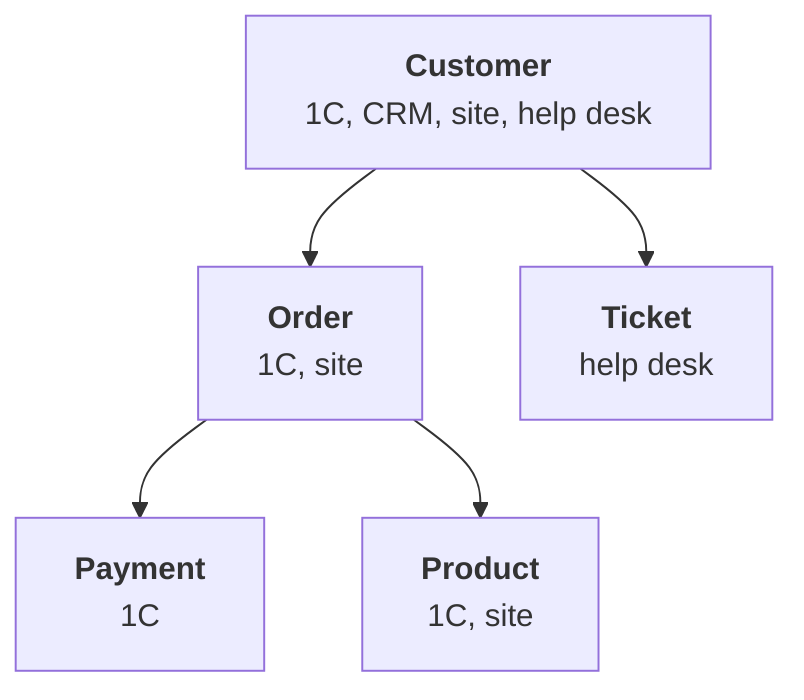

:::tldr
An inventory takes a week and saves months. The result is one document: a table of sources with owner, access method, volume and change rate, and a table of questions with the sources and entities each one needs. Find sources through people, not IT: ask every department where they keep their work and where their report numbers come from. Create a separate read-only account for every source. Mark customer personal data right away and decide what of it needs copying at all: usually identifiers and hashes are enough, not passports and addresses.
:::

## Why a map

The urge is to start copying right away: connect 1C, the CRM, the site and see what happens. Almost everyone does that, and almost everyone finds a month later that they copied the wrong things. Half the tables aren't needed, and the important key accounts list that the sales director keeps in a spreadsheet was never connected because IT didn't know about it.

A source map does three jobs. It shows what really exists, not what the documentation says. It tells you who is responsible for each source and whom to ask when the data looks odd. And it links sources to business questions, so it's clear where to start.

::news{topic="data security"}

## How to find sources

Through people. IT knows about servers and subscriptions but doesn't know that the accountant exports a bank report to Excel every week and edits it by hand, or that the marketer calculates payback in a personal spreadsheet.

A short half-hour meeting with each department and three questions:

1. **Where do you do your work?** Systems, spreadsheets, chats, email.
2. **What reports do you make or receive?** And where do their numbers come from.
3. **What numbers are you missing?** What you'd like to know but takes too long or is impossible to get.

The third question matters most: its answers become the list of business questions. The first two give the list of sources. Write answers straight into a shared document, not into your head.

## The source map

For our company, after a week of meetings, the map looks like this.

| Source | What's inside | Owner | Access | Volume | Changes |
|---|---|---|---|---|---|
| 1C Trade Management | wholesale orders, shipments, payments, stock, counterparties | chief accountant | OData, read-only | 2M rows | constantly |
| CRM | deals, contacts, tasks, calls | head of sales | REST API, token | 300K | constantly |
| Site database | store orders, shoppers | site developer | Postgres replica | 1M | constantly |
| Help desk | tickets, returns | head of support | REST API | 80K | constantly |
| "Key accounts" sheet | segment, account manager, terms | sales director | Google Sheets API | 200 rows | weekly |
| "Sales plan" sheet | plan by manager and month | sales director | Google Sheets API | 500 rows | monthly |
| Yandex Direct | spend and clicks per campaign | marketer | reports API | 50K | daily |

The columns aren't random. The **owner** is the person who knows what the fields mean and whom to go to when numbers don't add up. Not the IT admin but whoever creates the data. **Access** decides how we'll fetch the data. **Volume and change rate** decide how often and how to copy: everything or only changes.

Also write down what won't go into the first round: email, messengers, files on the shared drive. They are sources too, but unstructured, and it makes sense to handle them later once the foundation stands.

## Entities

Sources talk about a small set of the same things. Write them out explicitly; they are the future tables of the one story.

For each entity, note which sources it appears in and which fields identify it. A customer in 1C is identified by tax ID, in the CRM by phone and email, on the site by email, in the help desk by email or phone. This will matter when we merge customers: it's already clear that the tax ID exists only in 1C, while email is almost everywhere but not always written the same way.

Products are usually simpler: the SKU matches in 1C and on the site if the site imports its catalogue from 1C. If not, that's the first thing to find out.

## Questions and their sources

Now we link the questions from the first part to the map.

| Question | Sources | Entities | Difficulty |
|---|---|---|---|
| Revenue and margin per customer, wholesale and store together | 1C, site, CRM | customer, order, product | merging customers |
| Which wholesale customers stopped ordering | 1C, key accounts sheet | customer, order | low |
| Cost per shopper by channel | Direct, site | order, campaign | ad tags in site orders |
| What gets returned and why | help desk, 1C | ticket, order, product | linking a ticket to an order |

The difficulty column suggests the order. The question about wholesale customers who stopped ordering needs one main source and pays off immediately: managers get a list of customers to call. Start there, and do revenue per customer second, once we can merge customers.

Separately, check whether the site stores ad tags on the order. If not, the cost-per-shopper question can't be solved without changing the site, and it's better to learn that now than in a month.

## Read-only access

For each source, create a separate technical account that can only read. Not the accountant's password and not the CRM admin token.

- **1C.** A separate user with a read-only role on the needed objects and the standard OData interface enabled. The list of published objects is set in the configurator: only what's on the map.
- **CRM and services.** A separate API key or integration with minimal rights. Most CRMs let you restrict a key to reading.
- **Site database.** Not the primary database but a read replica, and a user with `SELECT` only on the needed tables. Heavy exports from the store's primary database will one day take the site down.
- **Spreadsheets.** A Google service account that the sheets are shared with as a viewer.

Keep all keys in one place, the server's secrets, not in code. Record every key in the map: if a person leaves or a key leaks, it's clear what to revoke.

## Personal data

Customer data contains names, phones, emails and addresses. Copying them into one more system widens the circle of people with access, and that should be done deliberately. Personal data laws still apply, and a warehouse that an AI assistant looks into is an especially sensitive place.

The rule is simple: copy only what the questions need. Merging customers needs phone and email, but not in the clear: a hash of the normalized value is enough to match records. The contact person's name and delivery address are almost never needed for analytics. Passport data and card details are never needed.

On the source map, mark each personal data field with one of three decisions: don't copy, copy as a hash, copy as is with restricted access. Keep the last option for rare cases, such as the legal entity name and tax ID, which are public anyway.

## The week's result

The inventory produces one document with three tables: sources, entities, questions. Plus the list of access accounts and the personal data decisions. It doesn't have to be perfect: it will change as new sources turn up. But with it you can already see what to copy first and why.

## What's next

The map is ready and access is set up. In the [third part](/blog/data-ingest/) we stand up a Postgres warehouse and set up regular copying from 1C, the CRM, the site and spreadsheets with dlt: first everything, then only the changes.
