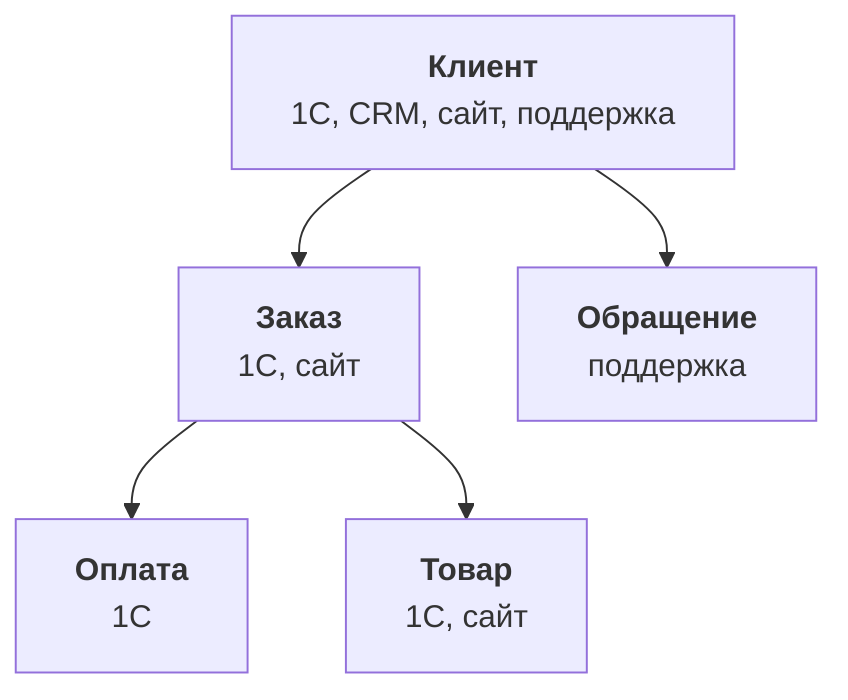

:::tldr
Инвентаризация занимает неделю и экономит месяцы. Результат один документ: таблица источников с владельцем, способом доступа, объёмом и частотой изменений, и таблица вопросов с тем, какие источники и сущности каждому нужны. Источники ищем через людей, а не через ИТ: спрашиваем каждый отдел, где он что ведёт и откуда берёт цифры для отчётов. Для каждого источника заводим отдельный доступ только на чтение. Персональные данные клиентов сразу помечаем и решаем, что из них вообще нужно копировать: обычно хватает идентификаторов и хэшей, а не паспортов и адресов.
:::

## Зачем карта

Хочется сразу начать копировать данные: подключить 1С, CRM, сайт и посмотреть, что получится. Так делают почти все, и почти все через месяц обнаруживают, что скопировали не то. Половина таблиц не нужна, а важный список ключевых клиентов, который коммерческий директор ведёт у себя в таблице, никто не подключил, потому что про него не знало ИТ.

Карта источников решает три задачи. Показывает, что существует на самом деле, а не по документации. Говорит, кто отвечает за каждый источник и к кому идти, когда данные странные. И связывает источники с вопросами бизнеса, чтобы было понятно, с чего начать.

::news{topic="data security"}

## Как искать источники

Через людей. ИТ знает про серверы и подписки, но не знает, что бухгалтер раз в неделю выгружает отчёт из банка в Excel и правит его руками, а маркетолог считает окупаемость в своей таблице.

С каждым отделом короткая встреча на полчаса и три вопроса:

1. **Где вы ведёте свою работу?** Системы, таблицы, чаты, почта.
2. **Какие отчёты вы делаете или получаете?** И откуда для них берутся цифры.
3. **Каких цифр вам не хватает?** Что вы хотели бы знать, но долго или невозможно получить.

Третий вопрос самый важный: из ответов на него собирается список вопросов бизнеса. Первые два дают список источников. Ответы записываем сразу в общий документ, а не в голове.

## Карта источников

Для нашей компании после недели встреч карта выглядит так.

| Источник | Что внутри | Владелец | Доступ | Объём | Меняется |
|---|---|---|---|---|---|
| 1С:Управление торговлей | заказы опта, отгрузки, оплаты, остатки, контрагенты | главный бухгалтер | OData, только чтение | 2 млн строк | постоянно |
| CRM | сделки, контакты, задачи, звонки | руководитель продаж | REST API, токен | 300 тыс. | постоянно |
| База сайта | заказы магазина, покупатели | разработчик сайта | реплика Postgres | 1 млн | постоянно |
| Сервис поддержки | обращения, возвраты | руководитель поддержки | REST API | 80 тыс. | постоянно |
| Таблица «Ключевые клиенты» | сегмент, ответственный, условия | коммерческий директор | Google Sheets API | 200 строк | раз в неделю |
| Таблица «План продаж» | план по менеджерам и месяцам | коммерческий директор | Google Sheets API | 500 строк | раз в месяц |
| Яндекс Директ | расходы и клики по кампаниям | маркетолог | API отчётов | 50 тыс. | раз в день |

Колонки здесь не случайные. **Владелец** это человек, который знает, что значат поля, и к которому идти, когда цифры не сходятся. Не ИТ-администратор, а тот, кто данные создаёт. **Доступ** определяет, как будем забирать данные. **Объём и частота** определяют, как часто и каким способом копировать: целиком или только изменения.

Отдельно стоит записать то, что не войдёт в первую очередь: почта, мессенджеры, файлы на общем диске. Они тоже источники, но неструктурированные, и с ними разумно работать позже, когда основа уже стоит.

## Сущности

Источники говорят о небольшом наборе одних и тех же вещей. Их стоит выписать явно, это будущие таблицы одной истории.

Для каждой сущности записываем, в каких источниках она встречается и по каким полям её можно узнать. Клиент в 1С узнаётся по ИНН, в CRM по телефону и почте, на сайте по почте, в поддержке по почте или телефону. Это пригодится, когда будем сводить клиентов в одного: уже сейчас видно, что ИНН есть только в 1С, а почта есть почти везде, но не всегда одинаково записана.

Товар обычно проще: артикул совпадает в 1С и на сайте, если сайт выгружает каталог из 1С. Если нет, это первое, что надо выяснить.

## Вопросы и их источники

Теперь связываем вопросы из первой части с картой.

| Вопрос | Источники | Сущности | Трудность |
|---|---|---|---|
| Выручка и маржа по клиенту, опт и магазин вместе | 1С, сайт, CRM | клиент, заказ, товар | сводить клиентов |
| Кто из оптовиков перестал заказывать | 1С, таблица ключевых | клиент, заказ | низкая |
| Стоимость покупателя по каналам | Директ, сайт | заказ, кампания | метки в заказах сайта |
| Что возвращают и почему | поддержка, 1С | обращение, заказ, товар | связать обращение с заказом |

Колонка трудности подсказывает порядок. Вопрос про оптовиков, которые перестали заказывать, требует одного главного источника и даёт пользу сразу: менеджеры получат список клиентов, которым надо позвонить. С него и стоит начать, а вопрос про выручку по клиенту пойдёт вторым, когда научимся сводить клиентов.

Отдельно стоит проверить, сохраняет ли сайт рекламные метки в заказе. Если нет, вопрос про стоимость покупателя без доработки сайта не решить, и лучше узнать это сейчас, а не через месяц.

## Доступы только на чтение

Для каждого источника заводим отдельную техническую учётную запись, которая умеет только читать. Не пароль бухгалтера и не токен администратора CRM.

- **1С.** Отдельный пользователь с ролью только на чтение нужных объектов и включённый стандартный интерфейс OData. Список публикуемых объектов задаётся в конфигураторе: только то, что есть в карте.
- **CRM и сервисы.** Отдельный API-ключ или интеграция с минимальными правами. Большинство CRM позволяют ограничить ключ на чтение.
- **База сайта.** Не основная база, а реплика для чтения, и пользователь с правом `SELECT` только на нужные таблицы. Тяжёлые выгрузки с основной базы магазина однажды положат сайт.
- **Таблицы.** Сервисный аккаунт Google, которому таблицы расшарены на просмотр.

Все ключи храним в одном месте, в секретах сервера, а не в коде. Каждый ключ записываем в карту: если человек уйдёт или ключ утечёт, будет понятно, что отзывать.

## Персональные данные

В данных клиентов есть имена, телефоны, почты и адреса. Копирование их в ещё одну систему расширяет круг тех, у кого есть доступ, и это надо делать осознанно. Требования закона о персональных данных никто не отменял, а хранилище, куда смотрит ИИ-помощник, место особенно чувствительное.

Правило простое: копировать только то, что нужно для вопросов. Для сведения клиентов нужны телефон и почта, но не в открытом виде: достаточно их нормализованного хэша, по которому можно сопоставить записи. Имя контактного лица и адрес доставки для аналитики не нужны почти никогда. Паспортные данные и реквизиты карт не нужны никогда.

В карте источников каждое поле с персональными данными помечаем одним из трёх решений: не копируем, копируем как хэш, копируем как есть с ограниченным доступом. Последний вариант оставляем для редких случаев, например названия юрлица и ИНН, которые и так публичны.

## Результат недели

Итог инвентаризации один документ из трёх таблиц: источники, сущности, вопросы. Плюс список доступов и решения по персональным данным. Документ не надо делать идеальным: он будет меняться, когда найдутся новые источники. Но с ним уже видно, что копировать в первую очередь и зачем.

## Что дальше

Карта есть, доступы заведены. В [третьей части](/blog/ru/data-ingest/) поднимаем хранилище на Postgres и настраиваем регулярное копирование из 1С, CRM, сайта и таблиц с помощью dlt: сначала целиком, потом только изменения.
