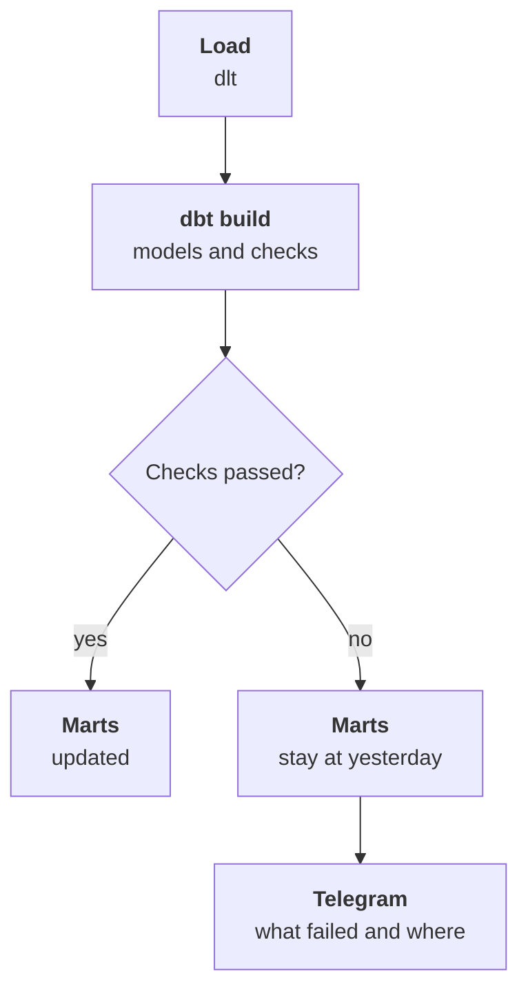

:::tldr
Different numbers at a meeting are almost never a mistake: they are different definitions. The cure isn't technology but agreement: each metric gets one written definition, an owner, a time grain and a list of what it excludes. Metrics are computed in dbt marts, and definitions live in a glossary next to the code. Both people and the AI assistant read the glossary, so it's written in plain language. dbt checks catch duplicates, broken links, stale loads and drift from the accounting books, and if a check fails the marts aren't updated: yesterday's correct numbers beat today's wrong ones.
:::

## Why the numbers differ

Back to the meeting from the first part. The sales director says October revenue is twelve million, the CFO says eleven. Now that data is reconciled into one story, we can finally see where the difference comes from:

- The sales director counts CRM deals closed in October. Two big deals that ship only in November got in.
- The CFO counts 1C shipments without VAT. The sales director sees deal amounts with VAT.
- The CFO subtracts six hundred thousand in returns, the sales director doesn't.

Both computed correctly, just different things. One story of data doesn't fix this on its own: leave it as is and everyone keeps counting their own way, only now from one warehouse. You need an agreement.

::news{topic="data"}

## Agree once

Gather the people who use the numbers: the sales director and the CFO, the heads of sales and marketing. One ninety-minute meeting going through the main metrics. For each, answer the same questions.

| Question | Example for revenue |
|---|---|
| What we count | shipments to customers |
| With or without VAT | without VAT |
| By which date | shipment date, not payment or deal |
| What we subtract | returns, by return date |
| What's excluded | deals without shipment, internal transfers |
| Who owns it | the CFO |

A metric's owner is the person who settles disputed cases and approves definition changes. Not whoever computes it but whoever is responsible for its meaning.

If two people genuinely need different numbers, those are two metrics with different names. The sales director needs the sum of closed deals to see how managers perform. Call it "deal sales" and keep "revenue" for shipments. What matters is that one name means one thing.

For our company the first set is: revenue, gross margin, order count, average order value, active customer, at-risk customer, shopper acquisition cost, return rate. Eight metrics cover every question from the first part. You don't need more at the start.

## Where metrics live

Each metric is computed in a mart: a dbt model in the `marts` schema where one row is one time unit and a set of breakdowns. For example, `revenue_daily`: day, channel, manager, customer segment, revenue, margin, order count. Reports, the assistant and automations take numbers only from here and never recompute them from `core`.

The definition sits next to it in the glossary, a plain file in the models repository:

```yaml
- name: revenue
  label: Revenue
  description: Shipments to customers without VAT, minus returns. By shipment date.
  owner: CFO
  table: marts.revenue_daily
  column: revenue
  dimensions: [day, channel, manager, customer_segment]
  excludes: CRM deals without a shipment and internal transfers are not included.
  see_also: [deal_sales, gross_margin]
```

`description` and `excludes` are written for a person, not a machine: short sentences, no internal table names. A new hire, the CFO and the AI assistant will read them, and they all need the same thing: what the number means and what it isn't.

`see_also` helps when someone asks about revenue but means deal sales. The assistant sees a similar metric next to it and asks.

dbt also has a full semantic layer built on MetricFlow, where metrics are declared and queries against them are generated, and there are standalone systems like Cube. For eight metrics and one warehouse that's overkill: marts plus a glossary are simpler, and you can move to a semantic layer later without redoing the marts.

## Checks

One story and metrics are useless if a load quietly breaks one day and everyone looks at wrong numbers for a week. Worse, after that people stop trusting the numbers again. So checks go in right away, of four kinds.

**Integrity.** The customer ID is unique and not null. Every order has a customer. Every payment links to an existing order or customer. In dbt that's a few lines next to the model:

```yaml
models:
  - name: orders
    columns:
      - name: order_id
        data_tests: [unique, not_null]
      - name: customer_id
        data_tests:
          - not_null
          - relationships:
              arguments: {to: ref('customers'), field: customer_id}
```

**Freshness.** Each source's last load is no older than expected: the CRM no older than two hours, 1C no older than a day. dlt records the time of every load, and dbt checks it with `dbt source freshness`.

**Plausibility.** Yesterday's revenue isn't zero and isn't five times the usual. Site orders didn't drop to zero on a weekday. The share of orders without a customer is under one percent. These catch what integrity checks miss: say, the site changed its status format and every order became cancelled.

**Reconciliation with accounting.** Once a month, after closing, the month's revenue in the mart is compared with the figure from the 1C report. A gap over half a percent is a reason to dig in. Reconciliation checks not the code but the whole chain: loading, staging filters, order merging. When it matches several months in a row, the CFO starts trusting the marts more than their own Excel.

## What to do when something breaks

All models, marts and checks run with one command, `dbt build`, after every load. It builds models in order and checks each right away. If a check on `orders` fails, the marts that depend on it aren't rebuilt and stay at yesterday's state.

That's a deliberate choice: the assistant and reports should show yesterday's correct numbers rather than today's broken ones. A failed check message goes to Telegram with which check failed and how many rows violated it. The glossary gets each mart's last successful update time, so the assistant honestly says: data as of last night.



## Documentation for free

dbt builds a documentation site from models, column descriptions and checks, with a dependency graph. It's useful to the engineer, but business people need the plain-language metric glossary instead. So the glossary is published as a separate page in the internal wiki, and it's also the first thing the AI assistant reads.

## What we have

The company now has eight metrics with one definition and an owner each, marts where they're computed, a plain-language glossary and checks that keep broken data from going further. Nobody argues at the meeting about whose revenue is right: there is one revenue and separately deal sales, and everyone knows the difference.

## What's next

Everything is ready for what people usually start with. In the [sixth part](/blog/data-assistant/) we stand up an MCP server over the marts and the glossary, connect Claude and teach it to answer questions in plain language, showing which metric and which filters it used.
