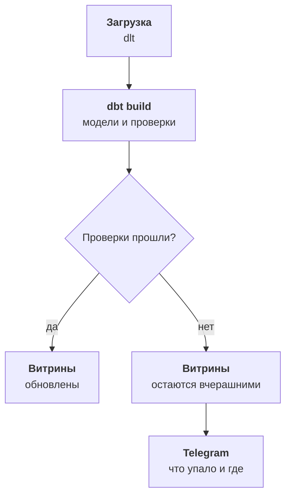

:::tldr
Разные цифры на планёрке почти никогда не ошибка: это разные определения. Лечится это не техникой, а договорённостью: каждая метрика получает одно письменное определение, владельца, единицу времени и список того, что в неё не входит. Метрики считаются в витринах dbt, а определения лежат в словаре рядом с кодом. Словарь читают и люди, и ИИ-помощник, поэтому он пишется простым языком. Проверки dbt ловят дубли, потерянные связи, устаревшие загрузки и расхождение с бухгалтерией, и если проверка не прошла, витрины не обновляются: лучше вчерашние правильные цифры, чем сегодняшние неправильные.
:::

## Почему цифры разные

Вернёмся к планёрке из первой части. Коммерческий директор говорит, что выручка за октябрь двенадцать миллионов, финансовый, что одиннадцать. После того как данные сведены в одну историю, можно наконец посмотреть, откуда разница:

- Коммерческий считает по сделкам в CRM, закрытым в октябре. Туда попали две крупные сделки, которые отгрузят только в ноябре.
- Финансовый считает по отгрузкам в 1С без НДС. Коммерческий видит суммы сделок с НДС.
- Возвраты на шестьсот тысяч финансовый вычитает, коммерческий нет.

Оба посчитали правильно, просто разные вещи. Одна история данных сама по себе этого не решает: если оставить всё как есть, каждый продолжит считать по-своему, только теперь из одного хранилища. Нужна договорённость.

::news{topic="data"}

## Договариваемся один раз

Собираем тех, кто пользуется цифрами: коммерческого и финансового директоров, руководителей продаж и маркетинга. Одна встреча на полтора часа, на которой проходим главные метрики. Для каждой отвечаем на одни и те же вопросы.

| Вопрос | Пример для выручки |
|---|---|
| Что считаем | отгрузки клиентам |
| С НДС или без | без НДС |
| По какой дате | дата отгрузки, не оплаты и не сделки |
| Что вычитаем | возвраты, по дате возврата |
| Что не входит | сделки без отгрузки, внутренние перемещения |
| Кто владелец | финансовый директор |

Владелец метрики это человек, который решает спорные случаи и подтверждает изменения определения. Не тот, кто считает, а тот, кто отвечает за смысл.

Если двум людям действительно нужны разные цифры, это две разные метрики с разными именами. Коммерческому директору нужна сумма закрытых сделок, чтобы видеть работу менеджеров. Пусть это будет «продажи по сделкам», а «выручка» остаётся за отгрузками. Главное, что одно имя значит одно.

Для нашей компании первый набор получается такой: выручка, валовая маржа, количество заказов, средний чек, активный клиент, клиент в зоне риска, стоимость привлечения покупателя, доля возвратов. Восемь метрик закрывают все вопросы из первой части. Больше на старте не надо.

## Где живут метрики

Каждая метрика считается в витрине: модели dbt в схеме `marts`, где одна строка это одна единица времени и набор разрезов. Например, `revenue_daily`: день, канал, менеджер, сегмент клиента, выручка, маржа, количество заказов. Отчёты, помощник и автоматизации берут цифры только отсюда, а не считают заново из `core`.

Определение лежит рядом, в словаре. Это простой файл в репозитории с моделями:

```yaml
- name: revenue
  label: Выручка
  description: Сумма отгрузок клиентам без НДС за вычетом возвратов. По дате отгрузки.
  owner: финансовый директор
  table: marts.revenue_daily
  column: revenue
  dimensions: [day, channel, manager, customer_segment]
  excludes: Сделки CRM без отгрузки и внутренние перемещения сюда не входят.
  see_also: [deal_sales, gross_margin]
```

Поля `description` и `excludes` пишутся для человека, а не для машины: короткими фразами, без внутренних названий таблиц. Их будет читать новый сотрудник, финансовый директор и ИИ-помощник, и всем им нужно одно и то же: понять, что значит цифра и чем она не является.

Поле `see_also` помогает, когда человек спрашивает про выручку, а имеет в виду продажи по сделкам. Помощник увидит, что рядом есть похожая метрика, и уточнит.

У dbt есть и полноценный семантический слой на MetricFlow, где метрики описываются декларативно и запросы к ним собираются автоматически, а также отдельные системы вроде Cube. Для восьми метрик и одного хранилища это лишнее: витрины плюс словарь проще, а перейти на семантический слой позже можно без переделки витрин.

## Проверки

Одна история и метрики бесполезны, если однажды загрузка тихо сломалась, и неделю все смотрят на неправильные цифры. Хуже того, после такого случая цифрам снова перестанут верить. Поэтому проверки ставим сразу, четырёх видов.

**Целостность.** Идентификатор клиента уникален и не пустой. У каждого заказа есть клиент. Каждая оплата привязана к существующему заказу или клиенту. В dbt это несколько строк рядом с моделью:

```yaml
models:
  - name: orders
    columns:
      - name: order_id
        data_tests: [unique, not_null]
      - name: customer_id
        data_tests:
          - not_null
          - relationships:
              arguments: {to: ref('customers'), field: customer_id}
```

**Свежесть.** Последняя загрузка каждого источника не старше, чем ожидается: CRM не старше двух часов, 1С не старше суток. dlt записывает время каждой загрузки, dbt проверяет его командой `dbt source freshness`.

**Правдоподобие.** Выручка за вчера не ноль и не в пять раз больше обычной. Число заказов с сайта не упало до нуля в будний день. Доля заказов без клиента меньше процента. Такие проверки ловят то, что пропускают проверки целостности: например, сайт поменял формат статусов, и все заказы стали отменёнными.

**Сверка с бухгалтерией.** Раз в месяц, после закрытия, выручка за месяц в витрине сравнивается с цифрой из отчёта 1С. Расхождение больше половины процента это повод разбираться. Сверка проверяет не код, а всю цепочку: загрузку, фильтры staging, склейку заказов. Когда она сходится несколько месяцев подряд, финансовый директор начинает доверять витринам больше, чем своему Excel.

## Что делать при сбое

Все модели, витрины и проверки запускаются одной командой `dbt build` после каждой загрузки. Она строит модели по порядку и сразу проверяет каждую. Если проверка на `orders` не прошла, зависящие от неё витрины не перестраиваются и остаются вчерашними.

Это осознанный выбор: помощник и отчёты лучше покажут вчерашние правильные цифры, чем сегодняшние сломанные. Сообщение о проваленной проверке уходит в Telegram вместе с тем, какая проверка упала и сколько строк её нарушили. В словарь витрины добавляем время последнего успешного обновления, чтобы помощник честно говорил: данные на вчерашний вечер.



## Документация бесплатно

dbt собирает из моделей, описаний колонок и проверок сайт документации со схемой зависимостей. Это полезно инженеру, но людям из бизнеса нужен не он, а словарь метрик простым языком. Поэтому словарь публикуем отдельной страницей во внутренней вики, и она же будет первым, что прочитает ИИ-помощник.

## Что получилось

У компании теперь восемь метрик с одним определением и владельцем, витрины, где они посчитаны, словарь простым языком и проверки, которые не пускают сломанные данные дальше. На планёрке больше не спорят, чья выручка правильная: есть одна выручка и отдельно продажи по сделкам, и каждый знает, чем они отличаются.

## Что дальше

Всё готово для того, ради чего обычно и начинают. В [шестой части](/blog/ru/data-assistant/) поднимаем MCP-сервер поверх витрин и словаря, подключаем Claude и учим его отвечать на вопросы обычным языком, показывая, какой метрикой и с какими фильтрами он посчитал ответ.
