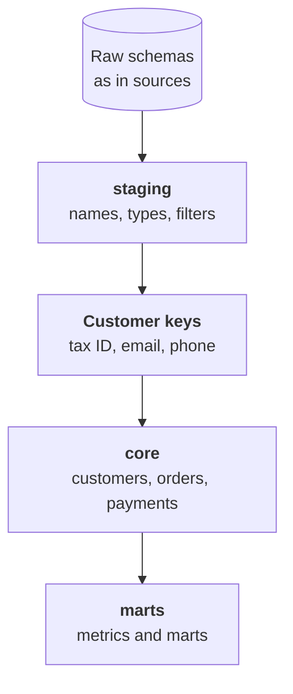

:::tldr
The one story is built in dbt in two layers: `staging` brings each source to clear names and types, `core` merges them into shared tables of customers, orders and payments. Customers are merged by keys: tax ID, normalized email, normalized phone, excluding shared addresses and numbers. Exact matches merge automatically, disputed pairs are reviewed by Claude with a structured answer, and the final decision stays with a person and is stored in a table, so a rebuild gives the same result. The most common order mistake is double counting: a site order lands both in the site database and in 1C.
:::

## What the one story is

After the last part the warehouse holds copies of the sources. Each speaks its own language: in 1C a shipment is `Document_РеализацияТоваровУслуг` with the amount in `СуммаДокумента`, in the site database it's the `orders` table with `total`, in the CRM a deal with `price`. The same customer is recorded differently in each system.

The one story is a small set of tables that mean the same to everyone: `customers`, `orders`, `order_items`, `payments`, `products`, `tickets`. Each has one row per real thing. One customer is one row, however many records the systems have about it. These tables are what metrics are computed on and what the assistant queries.

::news{topic="data search"}

## dbt and layers

We write models in dbt Core: as of November 2026 that's version 1.12 with the Postgres adapter. A dbt model is a plain file with one `SELECT`; dbt creates a table or view from it, orders models by dependencies, runs tests and builds documentation.



**staging** is one model per raw table. Here we rename fields to clear English names, cast types and drop junk. For example, for 1C shipment documents:

```sql
select
  "Ref_Key"                  as shipment_id,
  "Date"::date               as shipped_on,
  "Контрагент_Key"           as counterparty_id,
  "СуммаДокумента"::numeric  as amount,
  nullif("НомерЗаказаСайта", '') as site_order_number
from {{ source('raw_1c', 'shipments') }}  -- Document_РеализацияТоваровУслуг
where "Posted" and not "DeletionMark"
```

The last line matters: unposted documents and those marked for deletion don't count as revenue. Rules like this live in one place, staging, and nobody has to think about them downstream.

**core** combines staging from different sources into shared tables. That's the next sections.

## Merging customers

This is the central task of the whole series. Romashka exists in 1C with a tax ID, in the CRM as a company with a phone and email, on the site as a shopper with an employee's email, and in the help desk as an email sender. We need to see that it's one Romashka without merging two different customers.

### Keys

First, from all sources we build a keys table: source, record ID, key type and normalized value.

| Key type | Normalization |
|---|---|
| Tax ID | digits only, checksum validated |
| Email | lowercase, no spaces, no dots and plus tags for Gmail |
| Phone | E.164 format: `+79161234567` |

Normalization solves half the problem. `8 (916) 123-45-67`, `+7 916 1234567` and `79161234567` become one value. Exclusions solve the rest.

### Exclusions

Some keys only look unique:

- A shared office or call centre phone listed for a dozen different customers.
- Your manager's own email, typed in place of the customer's in a hurry.
- Addresses like `info@` and `orders@` on shared domains, and test records.

The rule: a key that appears on records with different tax IDs, or on too many records, doesn't take part in merging. Such keys go into a separate exclusions model, and once a month someone looks through it.

### Groups

Two records with a shared key are one customer. If record A matches B by email and B matches C by phone, then A, B and C are one customer, even if A and C have nothing in common. In SQL that's a recursive query over the links that gives each record a group number. The group number becomes the customer ID in the `customers` table.

The ID must be stable: if a new record joins the group tomorrow, the customer shouldn't get a new number. So the group number is the earliest ID among its records, not a sequence number.

### Where a language model helps

Exact keys merge most records, but disputed pairs remain. Romashka LLC with one tax ID and Romashka-Opt LLC with another, sharing a delivery address and a contact phone. A sole trader who bought on the site as a private person. A company that changed its name.

Claude works well here. For each disputed pair we build a short card: names, tax IDs, email domains, cities, first order dates, managers. The model answers strictly by schema: same customer, different, or related companies of one group, and why. Related companies aren't merged but marked with a shared group: for the manager it's one customer, for accounting it's two legal entities.

But the model's decision isn't applied automatically. It goes into a queue where someone from sales confirms or rejects it with one tap, like the [cards from the automations series](/blog/automations-sales/). Confirmed decisions are stored in a separate table, and the merge model reads it as one more source of links. That way a rebuild from scratch gives the same result, and a mistake is fixed with a row in a table, not a code change.

The model saves a person's time, it doesn't replace them. Instead of sorting through a thousand pairs, a person confirms a hundred where the model has already gathered the arguments.

## Orders without double counting

Orders come from two places: wholesale from 1C, retail from the site database. It seems enough to add them up. But a site order almost always also lands in 1C, because the warehouse ships against 1C documents. Add them up and retail is counted twice.

The fix depends on how the site passes orders to 1C. Usually the 1C document stores the site order number; we already pulled it out in staging. Then the rule is:

- A 1C document with a site order number is the same order as on the site. Take one row: amount and shipping status from 1C, channel and ad tags from the site.
- A 1C document without a site number is a wholesale order.
- A site order with no 1C document hasn't shipped yet or was cancelled. It isn't revenue, but the funnel needs it.

If 1C doesn't store the site order number, that's the first thing to fix in the site to 1C exchange. Matching orders by amount and date is possible but a constant source of errors.

## Payments and money

Payments live in 1C and link to documents through the basis field. We tie each payment to an order and through it to a customer. Payments without a basis, and wholesale customers have many, are tied to the customer by counterparty, and receivables are tracked at the customer level, not the order level.

Here we also decide what counts as money in each table: with or without VAT, before or after returns. Decide once and write it in the column description. In the next part these decisions become part of the metric glossary.

## Check by eye

Before moving on, take twenty well-known customers that sales knows well and check them by hand: did all records merge, are there any strangers, does the year's purchase total match what the manager remembers. It's an hour of work, and it will find mistakes no test will.

## What we have

The `core` schema now has a customers table where Romashka is one row with links to all its records in 1C, the CRM, the site and the help desk. An orders table without double counting, where each order has a customer, a channel and an amount. Payments tied to orders and customers. "How much did Romashka buy in total, wholesale and store together" is now one simple query.

## What's next

The tables exist, but everyone can still compute numbers on top of them their own way. In the [fifth part](/blog/data-metrics/) we define metrics once, write a glossary that both people and the AI assistant read, and add checks that catch broken data before the CFO does.
