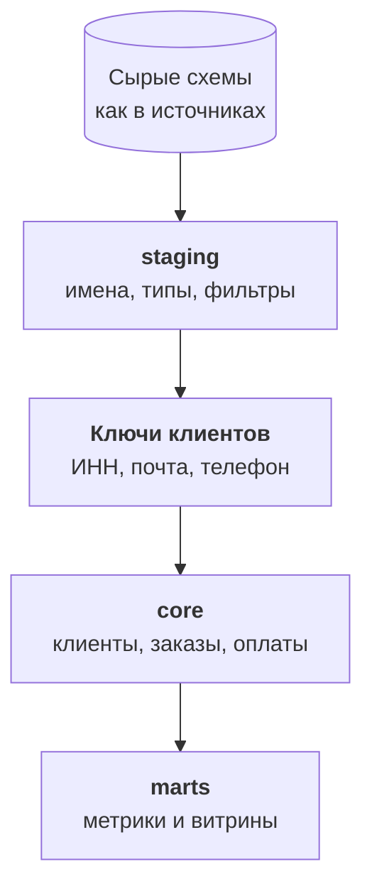

:::tldr
Одна история строится в dbt в два слоя: `staging` приводит каждый источник к понятным именам и типам, `core` сводит их в общие таблицы клиентов, заказов и оплат. Клиентов сводим по ключам: ИНН, нормализованная почта, нормализованный телефон, с исключением общих адресов и номеров. Точные совпадения склеиваем автоматически, спорные пары разбирает Claude со структурированным ответом, а окончательное решение остаётся за человеком и хранится в таблице, чтобы пересборка давала тот же результат. Самая частая ошибка с заказами это двойной счёт: заказ с сайта попадает и в базу сайта, и в 1С.
:::

## Что такое одна история

После прошлой части в хранилище лежат копии источников. Каждый говорит на своём языке: в 1С документ называется `Document_РеализацияТоваровУслуг` и сумма лежит в поле `СуммаДокумента`, в базе сайта таблица `orders` с полем `total`, в CRM сделка с полем `price`. Один и тот же клиент записан в каждой системе по-своему.

Одна история это небольшой набор таблиц, которые одинаково понятны всем: `customers`, `orders`, `order_items`, `payments`, `products`, `tickets`. В каждой одна строка на одну реальную вещь. Один клиент это одна строка, сколько бы записей о нём ни было в системах. Эти таблицы и есть то, на чём дальше считаются метрики и к чему обращается помощник.

::news{topic="data search"}

## dbt и слои

Модели пишем в dbt Core: на ноябрь 2026 года это версия 1.12 с адаптером для Postgres. Модель в dbt это обычный файл с одним `SELECT`, а dbt сам создаёт из него таблицу или представление, строит порядок по зависимостям, гоняет тесты и собирает документацию.



**staging** это одна модель на одну сырую таблицу. Здесь переименовываем поля в понятные английские имена, приводим типы, выкидываем мусор. Например, для документов реализации из 1С:

```sql
select
  "Ref_Key"                  as shipment_id,
  "Date"::date               as shipped_on,
  "Контрагент_Key"           as counterparty_id,
  "СуммаДокумента"::numeric  as amount,
  nullif("НомерЗаказаСайта", '') as site_order_number
from {{ source('raw_1c', 'shipments') }}  -- Document_РеализацияТоваровУслуг
where "Posted" and not "DeletionMark"
```

Последняя строка важная: непроведённые документы и документы с пометкой удаления в выручку не попадают. Такие правила живут в одном месте, в staging, и дальше про них можно не думать.

**core** собирает staging разных источников в общие таблицы. Это следующие разделы.

## Сводим клиентов

Это главная задача всего цикла. Клиент «Ромашка» есть в 1С с ИНН, в CRM как компания с телефоном и почтой, на сайте как покупатель с почтой сотрудника, в поддержке как отправитель писем. Нужно понять, что это одна «Ромашка», и при этом не склеить двух разных клиентов.

### Ключи

Сначала из всех источников собираем таблицу ключей: источник, идентификатор записи, тип ключа и нормализованное значение.

| Тип ключа | Нормализация |
|---|---|
| ИНН | только цифры, проверка контрольной суммы |
| Почта | нижний регистр, без пробелов, без точек и плюсов в Gmail |
| Телефон | формат E.164: `+79161234567` |

Нормализация решает половину проблемы. `8 (916) 123-45-67`, `+7 916 1234567` и `79161234567` превращаются в одно значение. Остальное решают исключения.

### Исключения

Некоторые ключи только кажутся уникальными:

- Общий телефон офиса или колл-центра, указанный у десятка разных клиентов.
- Почта вашего менеджера, которую он вписал вместо клиентской, когда спешил.
- Адреса вида `info@`, `zakaz@` на общих доменах, а также тестовые записи.

Правило: ключ, который встречается у записей с разными ИНН, или у слишком многих записей, в склейке не участвует. Такие ключи складываем в отдельную модель-исключение и раз в месяц просматриваем глазами.

### Группы

Две записи с общим ключом считаются одним клиентом. Если запись A совпала с B по почте, а B с C по телефону, то A, B и C один клиент, даже если у A и C ничего общего. В SQL это рекурсивный запрос по связям, который даёт каждой записи номер группы. Номер группы и становится идентификатором клиента в таблице `customers`.

Идентификатор должен быть стабильным: если завтра к группе добавится новая запись, клиент не должен получить новый номер. Поэтому номер группы берём как самый ранний идентификатор из её записей, а не как порядковый номер.

### Где помогает языковая модель

Точные ключи склеивают большинство записей, но остаются спорные пары. ООО «Ромашка» с одним ИНН и ООО «Ромашка-Опт» с другим, у которых один адрес доставки и один контактный телефон. Индивидуальный предприниматель, который покупал на сайте как физлицо. Компания, которая сменила название.

Здесь хорошо работает Claude. Для каждой спорной пары собираем короткую карточку: названия, ИНН, домены почт, города, даты первых заказов, менеджеры. Модель отвечает строго по схеме: один это клиент, разные, или это связанные компании одной группы, и почему. Связанные компании не склеиваем, а помечаем общей группой: для менеджера это один клиент, а для бухгалтерии два юрлица.

Но решение модели не применяется автоматически. Оно попадает в очередь, где человек из продаж подтверждает или отклоняет его одним нажатием, как в [карточках из цикла про автоматизации](/blog/ru/automations-sales/). Подтверждённые решения хранятся в отдельной таблице, и модель склейки читает её как ещё один источник связей. Так пересборка с нуля даёт тот же результат, а ошибка исправляется строкой в таблице, а не правкой кода.

Модель здесь экономит время человека, а не заменяет его. Вместо того чтобы разбирать тысячу пар, человек подтверждает сотню, по которым модель уже собрала доводы.

## Заказы без двойного счёта

Заказы приходят из двух мест: оптовые из 1С, розничные из базы сайта. Кажется, что их достаточно сложить. Но заказ с сайта почти всегда тоже попадает в 1С, потому что склад отгружает по документам 1С. Сложили и получили розницу дважды.

Решение зависит от того, как сайт передаёт заказы в 1С. Обычно в документе 1С сохраняется номер заказа сайта, мы уже вытащили его в staging. Тогда правило такое:

- Документ 1С с номером заказа сайта это тот же заказ, что на сайте. Берём одну строку: сумму и статус отгрузки из 1С, канал и рекламные метки с сайта.
- Документ 1С без номера сайта это оптовый заказ.
- Заказ сайта без документа в 1С это заказ, который ещё не отгружен или отменён. В выручку он не идёт, но в воронке нужен.

Если номер заказа сайта в 1С не сохраняется, это первое, что стоит доработать в обмене сайта с 1С. Сопоставлять заказы по сумме и дате можно, но это источник постоянных ошибок.

## Оплаты и деньги

Оплаты живут в 1С и связаны с документами через поле основания. Привязываем каждую оплату к заказу, а через него к клиенту. Оплаты без основания, а у оптовиков их много, привязываем к клиенту по контрагенту и считаем дебиторку на уровне клиента, а не заказа.

Здесь же решаем, что считать деньгами в каждой таблице: сумму с НДС или без, до возвратов или после. Решаем один раз и записываем в описание колонки. В следующей части эти решения станут частью словаря метрик.

## Проверяем глазами

Перед тем как идти дальше, стоит взять двадцать известных клиентов, которых хорошо знают продажи, и проверить их вручную: все ли записи склеились, нет ли чужих, сходится ли сумма покупок за год с тем, что помнит менеджер. Это час работы, и он найдёт ошибки, которых не найдут никакие тесты.

## Что получилось

В схеме `core` теперь есть таблица клиентов, где «Ромашка» одна строка со ссылками на все её записи в 1С, CRM, сайте и поддержке. Таблица заказов без двойного счёта, где у каждого заказа есть клиент, канал и сумма. Оплаты, привязанные к заказам и клиентам. На вопрос «сколько всего купила Ромашка, опт и магазин вместе» теперь отвечает один простой запрос.

## Что дальше

Таблицы есть, но цифры поверх них каждый всё ещё может посчитать по-своему. В [пятой части](/blog/ru/data-metrics/) определяем метрики один раз, пишем словарь, который будут читать и люди, и ИИ-помощник, и добавляем проверки, которые ловят сломанные данные раньше, чем их заметит финансовый директор.
