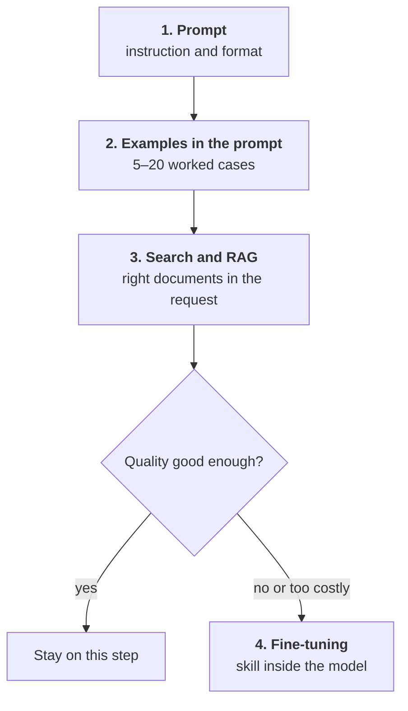
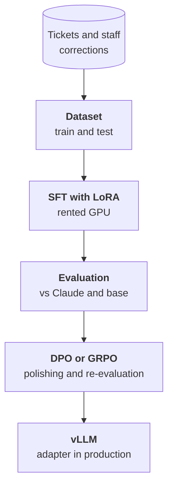

:::tldr
Fine-tuning changes a model's behaviour: answer format, tone, a narrow skill, the ability to work without a long prompt. It is bad at teaching new facts; that is what search and RAG are for. So the order is: first a prompt with examples in it, then search over documents, and only if the task is high-volume, narrow and easy to check, fine-tuning. The main win is usually cost, not quality: a small fine-tuned model does one job as well as a big general one at a fraction of the price. A LoRA run on a rented GPU costs a few dollars; the data and the evaluation are what's expensive.
:::

## What this series is about

In the [inference series](/blog/series/inference/) we ran an open model on a rented GPU. It answers requests, but it stays general: it knows a little about everything, and you steer it towards your task with the prompt. The prompt grows, it gains rules, exceptions and a dozen examples, and every request carries that load again.

Fine-tuning moves all of that inside the model. The model sees a thousand examples of your task and starts doing it on its own, without instructions. It sounds like a magic button, but it has a price and plenty of ways to make things worse. This series goes the whole way: decide whether you need fine-tuning at all, collect data, train, measure honestly, improve and ship to production.

::news{topic="training open-models"}

## What fine-tuning changes and what it doesn't

The model learns from examples shaped as "input and correct answer". After fine-tuning it reproduces better what it has seen many times. Hence a simple rule.

| Fine-tuning is good for | Fine-tuning is bad for |
|---|---|
| a stable answer format, e.g. strict JSON with your fields | new facts: prices, stock, rules that change |
| your tone and style, answer length | citing where an answer came from |
| a narrow skill: classification, field extraction, translation with your terminology | reasoning stronger than the base model's |
| working without a long prompt and examples in it | knowledge absent from the data |
| a small model instead of a big one on one task | staying general: the model may get worse at everything else |

You can "bake" facts into a model by showing them many times, but it's a bad idea. Facts change, and nobody retrains a model after every price list update. Besides, a model that memorised a fact can't say where it learned it and confidently mixes up similar ones. Facts belong in search: the model gets the right documents right in the request. How to build that is covered in the [search part](/blog/agent-search/) of the agent series.

## The ladder

Before fine-tuning, climb three cheaper steps. Each solves its own share of problems, and often the task ends at the first or second.

1. **Prompt.** A clear instruction, a format description and a JSON schema the engine uses to constrain the answer. A strong model with a good prompt handles most tasks.
2. **Examples in the prompt.** Five to twenty worked cases, especially borderline ones. It's the cheap version of fine-tuning: the model learns from examples right inside the request.
3. **Search.** If the errors come from not knowing things (rules, docs, the customer's history), no fine-tuning helps as much as the right document in context.
4. **Fine-tuning.** If after three steps the quality still isn't there, or it is, but too expensive.

That last "too expensive" happens more often than you'd think. A big model with a three-thousand-token prompt triages tickets beautifully, but at a million tickets a month the bill is noticeable. A small model that needs no prompt does the same job many times cheaper and faster.

## When fine-tuning is justified

Fine-tune when three conditions meet.

**The task is narrow and repeats.** The same action over a stream of similar inputs: triage a ticket, extract fields from a document, tag items, rewrite text in a given style. A general chat assistant can't be made this way.

**The result can be checked.** There is a correct answer, or at least a clear way to compare two answers. If you can't tell whether an answer got better, you won't know whether fine-tuning helped.

**There is data.** Hundreds, preferably thousands, of examples with correct answers. They can come from logs where people corrected the model, from manual labelling or from a big model. That's [part two](/blog/finetune-data/).

Good candidates: classifying and routing incoming requests, extracting fields from emails and documents, answers in your house style, translation with your glossary, calling your tools in the right format. Bad ones: "so the model knows everything about our company", "so it's smarter", "so it doesn't hallucinate".

## Kinds of fine-tuning in plain words

| Method | What it is | When |
|---|---|---|
| **SFT** (supervised fine-tuning) | show "input and correct answer" pairs, the model learns to reproduce them | the basis of everything, always the starting point |
| **LoRA** | change not all weights but small add-on matrices; the adapter weighs tens of megabytes | almost always instead of full fine-tuning |
| **QLoRA** | LoRA on top of a model compressed to 4 bits | when the GPU is small |
| **DPO** | show pairs of "good answer and bad answer" to one input | when you have human edits or a choice between two options |
| **GRPO** | the model generates answers, a program scores them, the model learns from the best | when correctness can be checked by code |
| **Distillation** | a big model labels data, a small one learns from its answers | when you have little data and need a small fast model |

In practice the path is nearly always the same: SFT with LoRA, then DPO or GRPO on top if needed. Full fine-tuning of all weights is rarely needed for applied tasks: it takes many times more memory, and its quality edge over LoRA is usually small.

## What it costs

The training run itself is cheaper than it seems. LoRA for an 8 to 9 billion parameter model on a couple of thousand examples takes twenty minutes to an hour on one rented GPU with 48 to 96 GB of memory, one to a few dollars. Even with a dozen failed runs the GPU bill rarely exceeds a couple of tens of dollars.

The rest is what's expensive:

- **Data.** Collecting, cleaning and checking a couple of thousand examples is days of work. Almost all the quality depends on the data.
- **Evaluation.** A test set, metrics, comparison with the base model and a commercial one. Without it fine-tuning becomes guesswork.
- **Operations.** The model has to live somewhere, be updated when the base model changes and retrained when the task changes. How to host your own model and what it costs is in the [inference series](/blog/inference-cost/).

So count the payback honestly: how much you pay a commercial API for this task now, and what your own model will cost including the GPU and your time. If the task costs a hundred dollars a month, fine-tuning will never pay off.

## What we'll build

The running example is support ticket triage. In the [automations series](/blog/automations-support/) Claude does it: reads the email and returns JSON with the category, urgency and a short summary. It works great, but every call costs money, and customers' emails go to an external provider.

We'll teach a small open model to do the same:

Part by part:

1. This part: when fine-tuning is needed.
2. [Data](/blog/finetune-data/): where to get examples, the format, cleaning, the test set.
3. [First run](/blog/finetune-lora/): LoRA on a rented GPU with Unsloth and TRL.
4. [Evaluation](/blog/finetune-eval/): metrics, comparison with the base model and with Claude.
5. [Preferences](/blog/finetune-preference/): DPO from staff corrections and GRPO with a reward computed by code.
6. [Distillation](/blog/finetune-distill/): when you have little data, a big model labels it.
7. [To production](/blog/finetune-serve/): an adapter in vLLM, shadow mode next to Claude and a retraining loop.

## What's next

All of a fine-tuned model's quality is set by its data. In [part two](/blog/finetune-data/) we look at where to get examples, how to store them, how to clean them and why the test set must be set aside before anything else.
