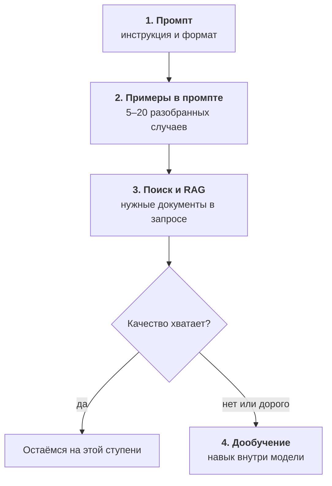
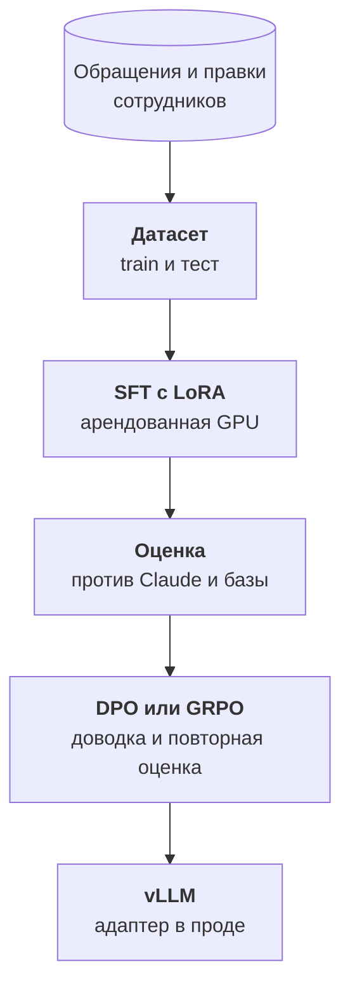

:::tldr
Дообучение меняет поведение модели: формат ответа, тон, узкий навык, умение обходиться без длинного промпта. Новым фактам оно учит плохо, для них есть поиск и RAG. Поэтому порядок такой: сначала промпт и примеры в нём, потом поиск по документам, и только если задача массовая, узкая и хорошо проверяемая, дообучение. Главная выгода обычно не в качестве, а в цене: маленькая дообученная модель делает одну работу так же хорошо, как большая универсальная, но в десятки раз дешевле. Один запуск LoRA на арендованной видеокарте стоит несколько долларов, дорого обходятся данные и оценка.
:::

## О чём цикл

В [цикле про инференс](/blog/ru/series/inference/) мы подняли открытую модель на арендованной видеокарте. Она отвечает на запросы, но остаётся универсальной: знает понемногу обо всём, а под вашу задачу её приходится подстраивать промптом. Промпт растёт, в нём появляются правила, исключения и десяток примеров, и каждый запрос несёт этот груз заново.

Дообучение позволяет перенести всё это внутрь модели. Модель видит тысячу примеров вашей задачи и начинает решать её сама, без инструкций. Звучит как волшебная кнопка, но у неё есть цена и много способов сделать хуже. Этот цикл проходит весь путь: решаем, нужно ли дообучение вообще, собираем данные, учим, честно меряем, улучшаем и выкатываем в прод.

::news{topic="training open-models"}

## Что дообучение меняет, а что нет

Модель учится на примерах в формате «вход и правильный ответ». После дообучения она лучше воспроизводит то, что видела много раз. Отсюда простое правило.

| Дообучение хорошо даёт | Дообучение плохо даёт |
|---|---|
| стабильный формат ответа, например строгий JSON с вашими полями | новые факты: цены, остатки, правила, которые меняются |
| ваш тон и стиль, длину ответов | ссылки на источник, откуда взят ответ |
| узкий навык: классификация, извлечение полей, перевод в вашей терминологии | рассуждения сильнее, чем у исходной модели |
| работу без длинного промпта и примеров в нём | знания, которых нет в данных |
| маленькую модель вместо большой на одной задаче | универсальность: модель может хуже справляться с остальным |

Факты можно «вшить» в модель, если показать их много раз, но это плохая идея. Факты меняются, а переучивать модель после каждого изменения прайса никто не будет. Кроме того, модель, которая выучила факт, не может сказать, откуда она его знает, и уверенно путает похожие. Для фактов есть поиск: модель получает нужные документы прямо в запросе. Как его строить, разобрано в [части про поиск](/blog/ru/agent-search/) цикла про агента.

## Лестница решений

Перед дообучением стоит пройти три более дешёвые ступени. Каждая решает свою часть проблем, и часто задача заканчивается на первой или второй.

1. **Промпт.** Чёткая инструкция, описание формата и JSON-схема, по которой движок ограничит ответ. Сильная модель с хорошим промптом решает большинство задач.
2. **Примеры в промпте.** Пять-двадцать разобранных случаев, особенно пограничных. Это дешёвая версия дообучения: модель учится на примерах прямо в запросе.
3. **Поиск.** Если ошибки от незнания (правил, документации, истории клиента), никакое дообучение не поможет так, как нужный документ в контексте.
4. **Дообучение.** Если после трёх ступеней качество всё ещё не устраивает, или устраивает, но слишком дорого.

Последнее «слишком дорого» встречается чаще, чем кажется. Большая модель с промптом на три тысячи токенов прекрасно разбирает обращения, но на миллионе обращений в месяц это ощутимый счёт. Маленькая модель, которой промпт не нужен, делает ту же работу в разы дешевле и быстрее.

## Когда дообучение оправдано

Дообучать стоит, когда сходятся три условия.

**Задача узкая и повторяется.** Одно и то же действие над потоком однотипных входов: разобрать обращение, извлечь поля из документа, проставить теги, переписать текст в нужном стиле. Универсальный чат-ассистент так не сделать.

**Результат можно проверить.** Есть правильный ответ или хотя бы понятный способ сравнить два ответа. Если вы не можете сказать, стал ли ответ лучше, вы не узнаете, помогло ли дообучение.

**Есть данные.** Сотни, а лучше тысячи примеров с правильными ответами. Их можно взять из логов, где люди исправляли модель, разметить вручную или получить от большой модели. Этому посвящена [вторая часть](/blog/ru/finetune-data/).

Хорошие кандидаты: классификация и маршрутизация входящих, извлечение полей из писем и документов, ответы в фирменном стиле, перевод с вашим глоссарием, вызов ваших инструментов в правильном формате. Плохие: «чтобы модель знала всё про нашу компанию», «чтобы была умнее», «чтобы не галлюцинировала».

## Виды дообучения простыми словами

| Метод | Что это | Когда |
|---|---|---|
| **SFT** (supervised fine-tuning) | показываем пары «вход и правильный ответ», модель учится их воспроизводить | основа всего, с него начинают всегда |
| **LoRA** | меняем не все веса, а маленькие добавочные матрицы, адаптер весит десятки мегабайт | почти всегда вместо полного дообучения |
| **QLoRA** | LoRA поверх сжатой до 4 бит модели | когда видеокарта маленькая |
| **DPO** | показываем пары «хороший ответ и плохой ответ» на один вход | когда есть правки людей или выбор из двух вариантов |
| **GRPO** | модель сама генерирует ответы, программа ставит им оценки, модель учится на лучших | когда правильность можно проверить кодом |
| **Дистилляция** | большая модель размечает данные, маленькая учится на её ответах | когда своих данных мало, а нужна маленькая быстрая модель |

На практике путь почти всегда один: SFT с LoRA, а потом, если нужно, DPO или GRPO поверх. Полное дообучение всех весов для прикладных задач почти не нужно: оно требует в разы больше памяти, а выигрыш по качеству у LoRA обычно небольшой.

## Сколько это стоит

Сам запуск обучения стоит дешевле, чем кажется. LoRA для модели на 8 – 9 миллиардов параметров на паре тысяч примеров идёт от двадцати минут до часа на одной арендованной видеокарте с 48 – 96 ГБ памяти, это от одного до нескольких долларов. Даже с десятком неудачных запусков счёт за видеокарту редко превышает пару десятков долларов.

Дорого обходится остальное:

- **Данные.** Собрать, почистить и проверить пару тысяч примеров это дни работы. От данных зависит почти всё качество.
- **Оценка.** Тестовый набор, метрики, сравнение с исходной моделью и с коммерческой. Без этого дообучение превращается в гадание.
- **Эксплуатация.** Модель надо где-то держать, обновлять при смене базовой модели и переучивать, когда меняется задача. Как держать свою модель и сколько это стоит, разобрано в [цикле про инференс](/blog/ru/inference-cost/).

Поэтому считайте окупаемость честно: сколько вы сейчас платите за эту задачу коммерческому API, сколько будет стоить своя модель с учётом видеокарты и вашего времени. Если задача обходится в сотню долларов в месяц, дообучение не окупится никогда.

## Что мы построим

Сквозной пример цикла: разбор обращений в поддержку. В [цикле про автоматизации](/blog/ru/automations-support/) это делает Claude: читает письмо и возвращает JSON с категорией, срочностью и краткой сутью. Работает отлично, но каждый вызов стоит денег, а письма клиентов уходят внешнему провайдеру.

Мы научим небольшую открытую модель делать то же самое:

По частям цикла:

1. Эта часть: когда дообучение нужно.
2. [Данные](/blog/ru/finetune-data/): откуда взять примеры, формат, чистка, тестовый набор.
3. [Первый запуск](/blog/ru/finetune-lora/): LoRA на арендованной видеокарте с Unsloth и TRL.
4. [Оценка](/blog/ru/finetune-eval/): метрики, сравнение с исходной моделью и с Claude.
5. [Предпочтения](/blog/ru/finetune-preference/): DPO по правкам сотрудников и GRPO с наградой, которую считает код.
6. [Дистилляция](/blog/ru/finetune-distill/): когда своих данных мало, их размечает большая модель.
7. [В прод](/blog/ru/finetune-serve/): адаптер в vLLM, теневой режим рядом с Claude и цикл переобучения.

## Что дальше

Всё качество дообученной модели определяется данными. Во [второй части](/blog/ru/finetune-data/) разбираемся, где взять примеры, в каком формате их хранить, как почистить и почему тестовый набор надо отложить раньше всего остального.
