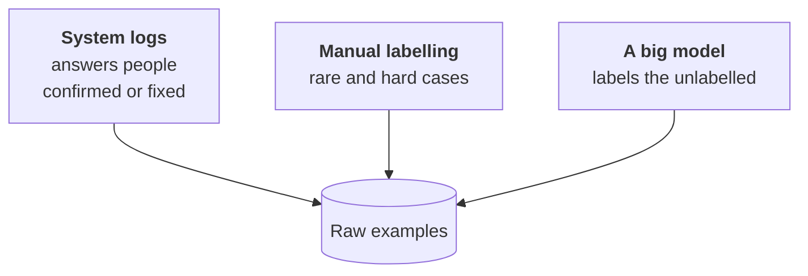
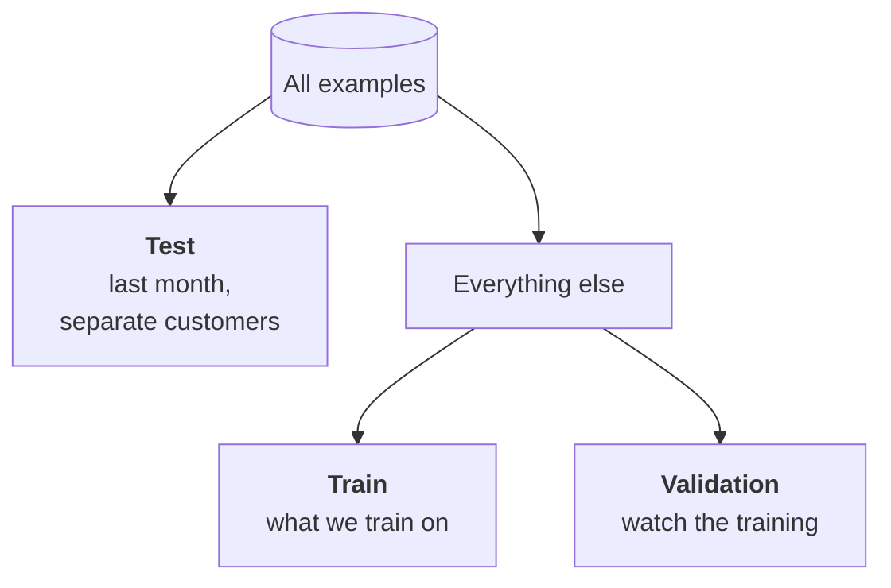

:::tldr
The best fine-tuning data sits in your logs: inputs the system has already processed and correct answers that people confirmed or fixed. For a skill, five hundred to a couple of thousand clean examples usually suffice, and quality beats quantity. Store them as JSONL in chat format: the user message and the assistant answer, with the same system prompt you'll use in production. First of all set aside a test set, split by time and by customer, and never train on it. Then remove duplicates, contradictions and junk, balance rare classes and read a hundred examples with your own eyes.
:::

## The task we train on

A reminder of the running example from [part one](/blog/finetune-concept/). The input is a customer request: an email or a Telegram message. The output is JSON:

| Field | Contents |
|---|---|
| `category` | one of eight categories: payment, refund, access, bug, plan question and so on |
| `urgency` | `high`, `normal` or `low` |
| `summary` | the gist of the request in one sentence for the card in chat |
| `needs_human` | `true` if a human must handle it: a complaint, a legal question, a threat to leave |

The task is narrow, high-volume and easy to check: every field except the summary has a correct answer. A perfect fine-tuning candidate.

::news{topic="training"}

## Where examples come from



**Logs with human corrections.** The most valuable source. In the [support system from the automations series](/blog/automations-support/) Claude sets the category and urgency, and a staff member sees the card and corrects it if needed. Every card nobody touched is a confirmed example. Every corrected one is worth even more: the model got it wrong there and a human showed how it should be. If your system doesn't store corrections yet, start today, even if fine-tuning is far off.

**Manual labelling.** Needed for what's scarce in logs: rare categories, borderline cases, new kinds of requests. Label them yourself or ask the people who do this work every day. A spreadsheet or a simple tool like Label Studio or Argilla is enough. What matters is that all labellers share one instruction with examples of borderline cases.

**A big teacher model.** When you have little data of your own, a strong model can label unlabelled inputs, and a small one then learns from its answers. That's distillation; it has its own rules and legal subtleties and gets [part six](/blog/finetune-distill/).

## How many you need

There's no exact number, but here are reference points:

| Goal | Examples |
|---|---|
| teach an answer format | 200 – 500 |
| a narrow skill like our classification | 1,000 – 3,000 |
| a complex skill, many classes, long answers | 5,000 – 20,000 |

A hundred clean examples beat a thousand dirty ones. The model diligently learns everything you show it, including labelling errors. If a tenth of the examples have the wrong category, the model will be wrong about as often. So spend time on cleaning, not on collecting another thousand.

The good news: quality grows with data predictably. Train on half the data, then on all of it, and compare on the test set. If the gap is large, more data will help. If it's small, you're limited by something else.

## Format: chat-style JSONL

The de facto standard: a JSONL file, one example per line, each example a list of chat messages. All the training tools in the next part read it as is.

```json
{"messages": [
  {"role": "system", "content": "Triage the support request. Answer with JSON."},
  {"role": "user", "content": "Subject: payment fails\n\nHi, third time trying to pay for the plan, the card keeps getting declined..."},
  {"role": "assistant", "content": "{\"category\":\"payment\",\"urgency\":\"high\",\"summary\":\"Card declined when paying for the plan\",\"needs_human\":false}"}
]}
```

In the file each example takes one line; here it's broken up for readability. A few rules:

- **The same system prompt as in production.** Short, without examples and long rules: the model learns those from the data. But training and production must match word for word.
- **The answer exactly as you want to receive it.** The same field order, the same category values, no explanations around the JSON.
- **The input as it will be in production.** If production strips signatures and quoted earlier messages, strip them in the data too.
- **No reasoning unless you need it.** Many current models can think before answering. For classification that's extra tokens and latency. Train on answers without reasoning and turn thinking mode off in production.

The model learns only from the assistant's answer: it sees the system prompt and the input, but the loss counts only what it must generate. TRL turns that on with a single parameter, more in the [next part](/blog/finetune-lora/).

## Set the test aside first

This is the most important rule of the whole series. Before any cleaning or experiments, split off a test set and never train on it.



How to split so the test doesn't lie:

- **By time.** Put the last few weeks into the test. In production the model will see future requests, not random ones from the past, and the test should mirror that. New products, new phrasings and seasonal issues end up in the test naturally.
- **By customer.** If one customer wrote five similar emails, all of them go either into training or into the test. Otherwise the model "recognises" the email instead of understanding it, and the test shows higher quality than the real one.
- **Large enough.** At least 200 to 300 examples, with a couple of dozen in each category. On fifty examples a difference of a couple of percent is noise.
- **Checked by hand.** The test is labelled better than anything else: recheck every example. An error in training data hurts the model a little; an error in the test ruins all your conclusions.

Separately from the test, cut off a small validation set, 5 to 10% of the training data. During training it shows whether the model has started memorising examples instead of learning the skill.

## Cleaning

| Problem | What to do |
|---|---|
| exact and near duplicates | keep one; otherwise the model overfits to frequent templates |
| contradictions: same input, different answers | sort them out and keep the right one; usually a labelling error or a vague instruction |
| junk: empty emails, newsletters, auto-replies | remove, or make a separate category if production gets them too |
| class imbalance: 60% "plan question", 1% "legal" | add rare classes by hand, thin out frequent ones |
| long inputs with an email thread | strip quotes and signatures exactly as in production |
| personal data | mask what the task doesn't need: card numbers, passports, phone numbers |
| answers that fail the schema | fix or remove; the format must be flawless |

Your own model is nice because customer emails don't go to an external provider. But the dataset outlives the model, sits in storage and gets copied onto rented GPUs. Mask everything in it that isn't needed to solve the task and store it like any customer data: privately and with clear access.

After automatic cleaning, open a hundred random examples and read them. It's dull and takes an hour, but every time you find something no script caught: a category labellers understand differently, a template email that makes up a fifth of the data, answers with an old field name.

## Where to store it

Store the dataset in versions, next to the model trained on it. A convenient option is a private dataset on Hugging Face. It loads with one line on any rented GPU, has version history, and the model card can state which data version it was trained on. Plain object storage works too, as long as the file name carries a version and a date.

In three months you'll want to retrain the model on fresh data and compare it with the current one. Without dataset versions you won't be able to say what exactly changed.

## What's next

The data is ready: a training part, validation and a held-out test. In [part three](/blog/finetune-lora/) we rent a GPU and run the first LoRA training: choose a base model, set the few parameters that actually matter and learn to read the loss curve.
