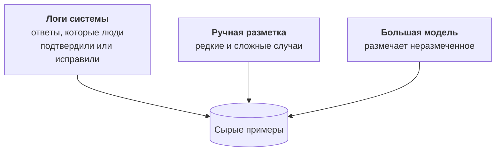
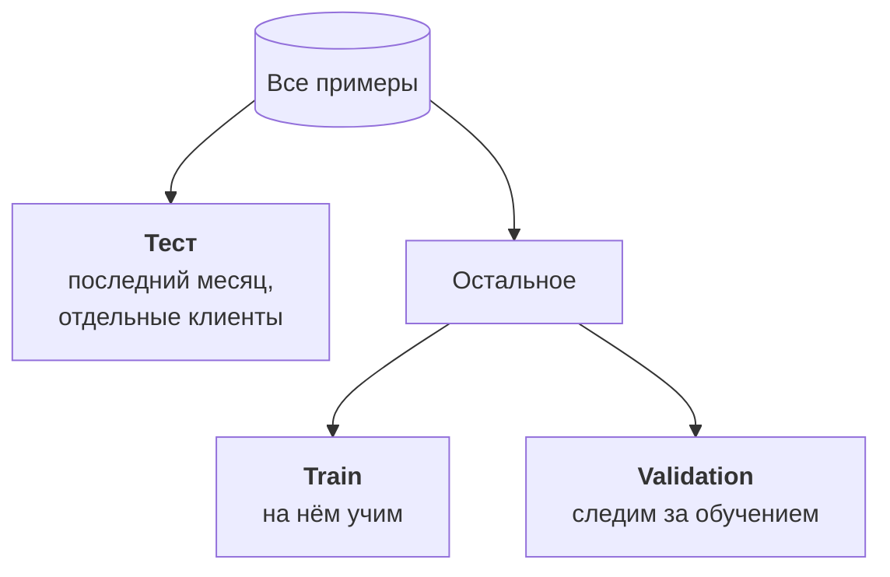

:::tldr
Лучшие данные для дообучения лежат в логах: входы, которые уже обработала система, и правильные ответы, которые подтвердили или исправили люди. Для навыка обычно хватает от пятисот до пары тысяч чистых примеров, и качество важнее количества. Храните их в JSONL в формате чата: сообщение пользователя и ответ ассистента, с тем же системным промптом, что будет в проде. Первым делом отложите тестовый набор, отделив его по времени и по клиентам, и никогда не учите на нём. Потом уберите дубли, противоречия и мусор, выровняйте редкие классы и прочитайте сотню примеров глазами.
:::

## Задача, на которой учимся

Напомню сквозной пример из [первой части](/blog/ru/finetune-concept/). На вход приходит обращение клиента: письмо или сообщение в Telegram. На выходе нужен JSON:

| Поле | Что внутри |
|---|---|
| `category` | одна из восьми категорий: оплата, возврат, доступ, ошибка, вопрос по тарифу и так далее |
| `urgency` | `high`, `normal` или `low` |
| `summary` | суть обращения одной фразой для карточки в чате |
| `needs_human` | `true`, если без человека не обойтись: жалоба, юридический вопрос, угроза уйти |

Задача узкая, массовая и хорошо проверяемая: для каждого поля, кроме суммари, есть правильный ответ. Идеальный кандидат на дообучение.

::news{topic="training"}

## Откуда брать примеры



**Логи с правками людей.** Самый ценный источник. В [системе поддержки из цикла про автоматизации](/blog/ru/automations-support/) Claude проставляет категорию и срочность, а сотрудник видит карточку и при необходимости исправляет. Каждая карточка, которую человек не тронул, это подтверждённый пример. Каждая исправленная это пример ещё ценнее: в нём модель ошиблась, а человек показал, как надо. Если ваша система пока не сохраняет правки, начните сохранять их сегодня, даже если до дообучения ещё далеко.

**Ручная разметка.** Нужна для того, чего мало в логах: редкие категории, пограничные случаи, новые типы обращений. Разметьте сами или попросите людей, которые делают эту работу каждый день. Для разметки хватит таблицы или простого инструмента вроде Label Studio или Argilla. Главное, чтобы у всех размечающих была одна инструкция с примерами пограничных случаев.

**Большая модель-учитель.** Когда своих данных мало, неразмеченные входы может разметить сильная модель, а маленькая потом учится на её ответах. Это дистилляция, у неё свои правила и юридические тонкости, ей посвящена [шестая часть](/blog/ru/finetune-distill/).

## Сколько нужно

Точного числа нет, но ориентиры такие:

| Цель | Примеров |
|---|---|
| научить формату ответа | 200 – 500 |
| узкий навык вроде нашей классификации | 1 000 – 3 000 |
| сложный навык, много классов, длинные ответы | 5 000 – 20 000 |

Сто чистых примеров полезнее тысячи грязных. Модель старательно выучит всё, что вы ей покажете, включая ошибки разметки. Если в десятой части примеров категория проставлена неправильно, модель будет ошибаться примерно так же часто. Поэтому время лучше тратить на чистку, а не на сбор ещё одной тысячи.

Хорошая новость: качество растёт с данными предсказуемо. Обучите модель на половине данных, потом на всех, и сравните результат на тесте. Если разница большая, больше данных поможет. Если маленькая, упираетесь во что-то другое.

## Формат: JSONL в виде чата

Стандарт де-факто: файл JSONL, по одному примеру на строку, каждый пример это список сообщений в формате чата. Все инструменты обучения из следующей части читают его без преобразований.

```json
{"messages": [
  {"role": "system", "content": "Разбери обращение в поддержку. Ответь JSON."},
  {"role": "user", "content": "Тема: не проходит оплата\n\nДобрый день, третий раз пытаюсь оплатить тариф, карта отклоняется..."},
  {"role": "assistant", "content": "{\"category\":\"payment\",\"urgency\":\"high\",\"summary\":\"Карта отклоняется при оплате тарифа\",\"needs_human\":false}"}
]}
```

В файле каждый пример занимает одну строку, здесь он разбит для читаемости. Несколько правил:

- **Системный промпт тот же, что будет в проде.** Короткий, без примеров и длинных правил: их модель выучит из данных. Но в обучении и в проде он должен совпадать слово в слово.
- **Ответ в точности такой, какой вы хотите получать.** Тот же порядок полей, те же значения категорий, без пояснений вокруг JSON.
- **Вход такой, каким он будет в проде.** Если в проде вы отрезаете подпись и цитаты прошлой переписки, отрежьте их и в данных.
- **Без рассуждений, если они не нужны.** Многие современные модели умеют сначала думать, а потом отвечать. Для классификации это лишние токены и задержка. Учите на ответах без рассуждений и в проде отключайте режим размышлений.

Модель учится только на ответе ассистента: системный промпт и вход она видит, но ошибка считается лишь по тому, что она должна сгенерировать. В TRL это включается одним параметром, об этом в [следующей части](/blog/ru/finetune-lora/).

## Сначала отложите тест

Это самое важное правило всего цикла. До любой чистки и экспериментов отделите тестовый набор и больше не учите на нём никогда.



Как отделять, чтобы тест не врал:

- **По времени.** Возьмите в тест последние несколько недель. В проде модель будет видеть будущие обращения, а не случайные из прошлого, и тест должен это повторять. Новые продукты, новые формулировки, сезонные проблемы попадут в тест естественно.
- **По клиентам.** Если один клиент написал пять похожих писем, все они должны оказаться либо в обучении, либо в тесте. Иначе модель «узнаёт» письмо, а не понимает его, и тест показывает качество выше настоящего.
- **Достаточного размера.** Минимум 200 – 300 примеров, и в каждой категории хотя бы два-три десятка. На пятидесяти примерах разница в пару процентов это шум.
- **Проверенный руками.** Тест размечен лучше всего остального: перепроверьте каждый пример. Ошибка в обучающих данных портит модель немного, ошибка в тесте портит все ваши выводы.

Отдельно от теста отрежьте небольшой validation, 5 – 10% обучающих данных. По нему видно во время обучения, не начала ли модель заучивать примеры вместо навыка.

## Чистка

| Проблема | Что делать |
|---|---|
| точные и почти точные дубли | удалить, оставив один; иначе модель переучивается на частых шаблонах |
| противоречия: одинаковый вход, разные ответы | разобраться и оставить правильный; обычно это ошибка разметки или нечёткая инструкция |
| мусор: пустые письма, рассылки, автоответы | удалить или выделить в отдельную категорию, если в проде они тоже приходят |
| перекос классов: 60% «вопрос по тарифу», 1% «юридический» | добрать редкие классы вручную, частые проредить |
| длинные входы с цепочкой переписки | отрезать цитаты и подписи так же, как в проде |
| персональные данные | замаскировать то, что не нужно для задачи: номера карт, паспорта, телефоны |
| ответы, не проходящие схему | исправить или удалить; формат должен быть безупречным |

Своя модель хороша тем, что письма клиентов не уходят внешнему провайдеру. Но датасет живёт дольше модели, лежит в хранилищах и копируется на арендованные видеокарты. Маскируйте в нём всё, что не нужно для решения задачи, и храните его как любые клиентские данные: приватно и с понятным доступом.

После автоматической чистки откройте сто случайных примеров и прочитайте их глазами. Это скучно и занимает час, но каждый раз находится что-то, чего не поймал ни один скрипт: категория, которую размечающие понимают по-разному, шаблонное письмо, которое занимает пятую часть данных, ответы со старым названием поля.

## Где хранить

Храните датасет версиями и рядом с моделью, которая на нём обучена. Удобный вариант: приватный датасет на Hugging Face. Его можно загрузить одной строкой на любой арендованной видеокарте, у него есть история версий, а в карточке модели можно указать, на какой версии данных она обучена. Подойдёт и обычное объектное хранилище, если в имени файла есть версия и дата.

Через три месяца вы захотите переобучить модель на свежих данных и сравнить с текущей. Без версий датасета вы не сможете ответить на вопрос, что именно изменилось.

## Что дальше

Данные готовы: обучающая часть, validation и отложенный тест. В [третьей части](/blog/ru/finetune-lora/) арендуем видеокарту и запускаем первое обучение LoRA: выбираем базовую модель, настраиваем несколько параметров, которые действительно важны, и учимся читать график ошибки.
