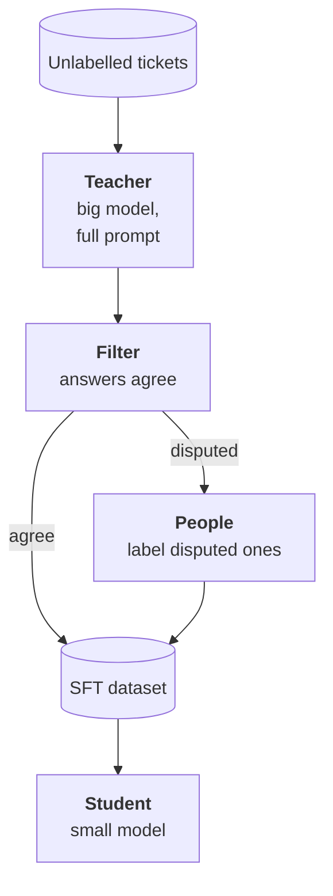

:::tldr
Distillation: a strong model labels thousands of unlabelled inputs, a small one learns from its answers and on its task nearly catches up with the teacher while staying many times cheaper and faster. The teacher sets the ceiling, so check it on your test set first. Pick a teacher with a permissive licence, such as an open model under Apache 2.0 or MIT: commercial API terms often forbid training other models on their outputs. Don't trust the teacher blindly: ask several times or ask two different teachers, keep only agreeing answers and send the disputed ones to people. The test is labelled only by people, never by the teacher.
:::

## The idea

In [earlier parts](/blog/finetune-data/) we trained on labelled data: logs with corrections and manual labels. There's never enough. Unlabelled inputs, on the other hand, are plentiful: all tickets for a couple of years, the whole document archive, every chat message.

Distillation turns unlabelled into labelled. A big strong model answers each input with a full prompt, examples and reasoning. A small one learns to reproduce its final answers without the prompt and without reasoning. On a narrow task the small model nearly catches up with the teacher, because it doesn't need everything the teacher can do, just this one thing.

Many small open models were built this way: trained on big models' answers. We need the same, just for one task.

::news{topic="training open-models"}

## The teacher and licences

The legal question comes first. Commercial API terms often forbid using outputs to train models that compete with the provider's. Where the line lies for a narrow internal classifier, lawyers read differently. Read your provider's terms before building a process on it.

The calmest option is a teacher with a permissive licence.

| Teacher | Licence | Where to get it |
|---|---|---|
| Qwen3.8-27B | Apache 2.0 | on your own GPU or from a provider |
| GLM-5.3-Flash, DeepSeek V4.1 Flash | MIT | from a pay-per-token provider |
| Llama 4 | its own licence | allowed, but the derived model must mention Llama in its name |

The teacher needn't be the biggest model. It's enough that it shows the quality you need on your test. Check a few candidates with the same script from the [evaluation part](/blog/finetune-eval/): the teacher sets a ceiling the student almost never jumps over.

## How to label

**Pick the inputs.** You don't need to label a hundred thousand tickets. Take five to twenty thousand, but varied: different months, different channels, different lengths. If payment tickets make up half the archive, thin them out, and take all the rare kinds.

**Give the teacher everything.** The teacher runs once, so don't skimp on it: the full prompt with instructions and borderline examples, reasoning mode, structured output with the same JSON schema. The student learns only from the final JSON; it doesn't need the teacher's reasoning.

**Label in batch.** It isn't an interactive task; the answer is needed by morning, not in a second. Providers' batch mode is usually half price. On your own GPU vLLM runs thousands of requests in parallel, as in the [your own endpoint part](/blog/inference-serve/).

## Don't trust the teacher blindly

The teacher makes mistakes, and the student will diligently learn them. So a filter sits between the teacher and the dataset.

- **Self-consistency.** Ask the teacher three times with non-zero temperature. If all three answers agree on category and flags, the example is most likely correct. If they diverge, the input is ambiguous.
- **Two teachers.** More reliable still: ask two different models. Two independent models agreeing are wrong less often than three answers from one.
- **Disputed ones to people.** Examples where the teachers disagreed are the most valuable: these are borderline cases where the student will stumble too. Send them for manual labelling and add them to the dataset.

Usually most examples agree and only a small share is disputed. That turns manual labelling from "label ten thousand" into "label a few hundred of the hardest".

**The test is labelled only by people.** If the teacher labels the test, you measure how much the student resembles the teacher, not how often it's right. The test from [part two](/blog/finetune-data/) stays as is.

## Training the student

From here it's as in [part three](/blog/finetune-lora/): SFT with LoRA on a mix of manual and teacher-labelled examples. Manual examples can be repeated two or three times in the dataset: they deserve more trust.

Try two students of different sizes, e.g. Qwen3.5-4B and Qwen3.5-9B, and compare on the test. Often on a narrow task the smaller student is barely behind the bigger one, while running twice as fast and fitting on a really cheap GPU.

There's also a deeper kind of distillation: the student learns not only from the teacher's final answers but from its probabilities for every token. TRL has a dedicated trainer for it. It requires the teacher and student to be from one family with a shared tokenizer, and the teacher to run on your GPU during training. For classification and field extraction the gain is usually small; start with the simple answers-only variant.

## What it costs

Ballpark for our task: ten thousand tickets, a teacher prompt of about three thousand tokens, three passes for self-consistency. That's about a hundred million input tokens and a little output. At a provider of a mid-size open model it's usually a few to a few tens of dollars, cheaper still in batch mode. On your own rented GPU with Qwen3.8-27B such a run takes a few hours.

Compare that with the cost of the same labelling by hand, and it's clear why distillation became the standard way to collect data for narrow models.

## Where the limits are

- **The student is no smarter than the teacher.** If the teacher is systematically wrong on some kind of ticket, all three of its answers agree, the filter lets the error through and the student learns it. Only a second teacher and manual checks of a sample help.
- **The teacher doesn't know your specifics.** Internal rules, plan names, special customers. All of that must be in the teacher's prompt, or it will confidently label by common sense rather than your rules.
- **Data ages.** A new product appears, refund rules change. Distillation is cheap, so it's easier to repeat it on fresh tickets than to maintain an old dataset.

## What's next

We have an adapter that passed evaluation: trained on a mix of manual labels and teacher answers and polished with GRPO. All that's left is to ship it without breaking anything. In the [final part](/blog/finetune-serve/) we plug the adapter into vLLM, run it in shadow mode next to Claude, switch traffic and build a retraining loop on fresh corrections.
