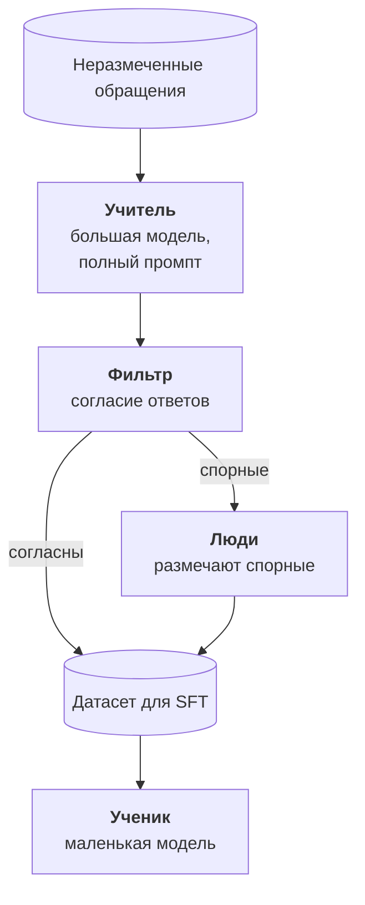

:::tldr
Дистилляция: сильная модель размечает тысячи неразмеченных входов, маленькая учится на её ответах и на своей задаче почти догоняет учителя, оставаясь в разы дешевле и быстрее. Учитель задаёт потолок, поэтому сначала проверьте его на своём тесте. Учителя берите с разрешительной лицензией, например открытую модель под Apache 2.0 или MIT: условия коммерческих API часто запрещают учить на их ответах другие модели. Не верьте учителю слепо: спрашивайте несколько раз или двух разных учителей, оставляйте только согласованные ответы, а спорные отдавайте людям. Тест размечают только люди, никогда учитель.
:::

## Идея

В [прошлых частях](/blog/ru/finetune-data/) мы учились на размеченных данных: логах с правками и ручной разметке. Их всегда мало. Зато неразмеченных входов обычно сколько угодно: все обращения за пару лет, весь архив документов, все сообщения в чатах.

Дистилляция превращает неразмеченное в размеченное. Большая сильная модель отвечает на каждый вход с полным промптом, примерами и рассуждениями. Маленькая учится воспроизводить её итоговые ответы без промпта и без рассуждений. На узкой задаче маленькая модель почти догоняет учителя, потому что ей не нужно уметь всё, что умеет учитель, только эту одну вещь.

Так устроены многие маленькие открытые модели: их учили на ответах больших. Нам нужно то же самое, только для одной задачи.

::news{topic="training open-models"}

## Учитель и лицензии

Первым делом юридический вопрос. Условия использования коммерческих API часто запрещают использовать ответы для обучения моделей, которые конкурируют с моделями провайдера. Где проходит граница для узкого внутреннего классификатора, юристы трактуют по-разному. Прочитайте условия своего провайдера, прежде чем строить на этом процесс.

Самый спокойный вариант: учитель с разрешительной лицензией.

| Учитель | Лицензия | Где взять |
|---|---|---|
| Qwen3.8-27B | Apache 2.0 | на своей видеокарте или у провайдера |
| GLM-5.3-Flash, DeepSeek V4.1 Flash | MIT | у провайдера с оплатой за токены |
| Llama 4 | своя лицензия | можно, но производная модель должна упоминать Llama в названии |

Учителем не обязательно должна быть самая большая модель. Достаточно той, которая на вашем тесте показывает нужное качество. Проверьте нескольких кандидатов тем же скриптом из [части про оценку](/blog/ru/finetune-eval/): учитель задаёт потолок, выше которого ученик почти никогда не прыгнет.

## Как размечать

**Выберите входы.** Сто тысяч обращений размечать не нужно. Возьмите пять-двадцать тысяч, но разнообразных: из разных месяцев, разных каналов, разной длины. Если обращения про оплату составляют половину архива, проредите их, а редкие типы возьмите все.

**Дайте учителю всё.** Учитель работает один раз, поэтому на нём не экономят: полный промпт с инструкцией и примерами пограничных случаев, режим рассуждений, структурированный вывод по той же JSON-схеме. Ученик будет учиться только на итоговом JSON, рассуждения учителя ему не нужны.

**Размечайте пакетом.** Это не интерактивная задача, ответ нужен не через секунду, а к утру. У провайдеров пакетный режим обычно вдвое дешевле. На своей видеокарте vLLM прогоняет тысячи запросов параллельно, как в [части про свой эндпоинт](/blog/ru/inference-serve/).

## Не верьте учителю слепо

Учитель ошибается, и ученик старательно выучит его ошибки. Поэтому между учителем и датасетом стоит фильтр.

- **Самосогласованность.** Спросите учителя три раза с ненулевой температурой. Если все три ответа совпали по категории и флагам, пример, скорее всего, правильный. Если разошлись, вход неоднозначный.
- **Два учителя.** Ещё надёжнее спросить две разные модели. Совпадение двух независимых моделей ошибается реже, чем три ответа одной.
- **Спорное людям.** Примеры, на которых учителя разошлись, самые ценные: это пограничные случаи, на которых будет спотыкаться и ученик. Отдайте их на ручную разметку и добавьте в датасет.

Обычно согласованными оказывается большинство примеров, а спорными небольшая доля. Это превращает ручную разметку из «разметить десять тысяч» в «разметить несколько сотен самых трудных».

**Тест размечают только люди.** Если тест разметит учитель, вы будете мерить, насколько ученик похож на учителя, а не насколько он прав. Тест из [второй части](/blog/ru/finetune-data/) остаётся как есть.

## Обучение ученика

Дальше всё как в [третьей части](/blog/ru/finetune-lora/): SFT с LoRA на смеси ручных и размеченных учителем примеров. Ручные примеры можно повторить два-три раза в датасете: им больше доверия.

Попробуйте двух учеников разного размера, например Qwen3.5-4B и Qwen3.5-9B, и сравните на тесте. Часто оказывается, что на узкой задаче меньший ученик почти не уступает большему, а работает вдвое быстрее и помещается на совсем дешёвую видеокарту.

Есть и более глубокий вариант дистилляции: ученик учится не только на итоговых ответах учителя, но и на его вероятностях для каждого токена. В TRL для этого есть отдельный тренер. Он требует, чтобы учитель и ученик были из одного семейства с общим токенизатором, а учитель работал на вашей видеокарте во время обучения. Для классификации и извлечения полей выигрыш обычно небольшой, начинайте с простого варианта на ответах.

## Сколько это стоит

Порядок цифр для нашей задачи: десять тысяч обращений, промпт учителя около трёх тысяч токенов, три прохода для самосогласованности. Это около ста миллионов входных токенов и немного выходных. У провайдера открытой модели среднего размера это обычно единицы или десятки долларов, в пакетном режиме ещё дешевле. На своей арендованной видеокарте с Qwen3.8-27B такой прогон занимает несколько часов.

Сравните с тем, сколько стоит та же разметка руками, и станет понятно, почему дистилляция стала стандартным способом собирать данные для узких моделей.

## Где предел

- **Ученик не умнее учителя.** Если учитель ошибается на каком-то типе обращений систематически, все три его ответа совпадут, фильтр пропустит ошибку, и ученик её выучит. Против этого помогают только второй учитель и ручная проверка выборки.
- **Учитель не знает вашей специфики.** Внутренние правила, названия тарифов, особые клиенты. Всё это должно быть в промпте учителя, иначе он будет уверенно размечать по здравому смыслу, а не по вашим правилам.
- **Данные стареют.** Появился новый продукт, поменялись правила возврата. Дистилляция дешёвая, поэтому её проще повторить на свежих обращениях, чем пытаться поддерживать старый датасет.

## Что дальше

У нас есть адаптер, который прошёл оценку: обученный на смеси ручной разметки и ответов учителя и доведённый GRPO. Осталось выпустить его в прод так, чтобы ничего не сломать. В [последней части](/blog/ru/finetune-serve/) подключаем адаптер в vLLM, запускаем его в теневом режиме рядом с Claude, переключаем трафик и строим цикл переобучения на свежих правках.
