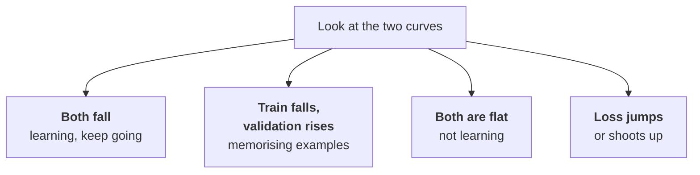

:::tldr
Take a small instruct model under Apache 2.0, such as Qwen3.5-9B, and train a 16-bit LoRA adapter on one GPU with 48 to 96 GB of memory. With a 24 GB card, QLoRA on top of a 4-bit model works. Tools: Unsloth for speed and memory savings, TRL for the training itself. There are few important parameters: rank 16, learning rate 2e-4, one to three epochs, loss on the answer only. During training, watch the validation loss: when it stops falling and starts rising, the model is memorising examples and further training is pointless. On a couple of thousand examples a run takes up to an hour and costs a few dollars.
:::

## What LoRA is

A 9 billion parameter model is 9 billion numbers. Full fine-tuning changes all of them: memory must hold the weights, the gradients and the optimizer state, several times the model's size. For 9B that's hundreds of gigabytes and several GPUs.

LoRA is smarter. The original weights are frozen, and two small matrices are added next to each large layer. Only they are trained, and together they are a fraction of a percent of the model. The result is an adapter of a few tens of megabytes applied on top of the original model. On applied tasks quality is usually almost the same as full fine-tuning, with many times less memory and time.

Adapters have another perk: one base model can carry many adapters for different tasks and switch between them by name in the request. More on that in the [final part](/blog/finetune-serve/).

::news{topic="training gpu"}

## The base model

Rules of choice:

- **The instruct version, not base.** An instruct model already follows instructions and answers in chat format; we only narrow it to our task. A base model would have to learn that too.
- **A permissive licence.** Apache 2.0 or MIT, so the fine-tuned model can be used in a product without worry. More on licences in the [models part](/blog/inference-models/) of the inference series.
- **The smallest one that almost manages.** Run the test set from the [previous part](/blog/finetune-data/) through several models with a good prompt. Fine-tuning usually pulls a small model's quality up to a big one's, but it doesn't work miracles. If the model with a prompt gets 60% right, expect 85 to 90% after fine-tuning. If 20%, the task is beyond it.
- **Good language support.** Our tickets are in Russian, and Qwen handles it well.

For ticket triage we take Qwen3.5-9B: a dense 9 billion parameter model under Apache 2.0, good with Russian, runs on a cheap GPU. If it isn't enough, the next step is Qwen3.8-27B, and for high-volume classification Qwen3.5-4B is worth a try.

## Tools

| Tool | What it is | When |
|---|---|---|
| [TRL](https://huggingface.co/docs/trl) | Hugging Face library with SFT, DPO, GRPO and other trainers; version 1.17 as of early November 2026 | the foundation of almost all other tools |
| [Unsloth](https://unsloth.ai/docs) | roughly doubles training speed and saves memory, runs on top of TRL | a single GPU, the default choice |
| [Axolotl](https://docs.axolotl.ai) | training from a YAML config, good on multiple GPUs | big models, repeatable configs |

We use Unsloth together with TRL: Unsloth loads the model and prepares LoRA, TRL trains. Unsloth also has a desktop app, but a script is handier for repeatable runs.

## The GPU

Memory for LoRA on a 9B model:

| Mode | Memory | GPU |
|---|---|---|
| LoRA, model in 16 bits | about 30 – 40 GB with room for a batch | RTX PRO 6000 96 GB, L40S 48 GB, A100 80 GB |
| QLoRA, model in 4 bits | about 12 – 20 GB | RTX 4090 or 5090 |

QLoRA saves memory, but training is slower and quality is sometimes slightly lower. If the budget allows a 48 GB card or bigger, train in 16 bits. A 27B model needs 80 to 96 GB for LoRA or 24 to 48 GB for QLoRA.

We rent as in the [inference series](/blog/inference-clouds/): a pod on RunPod or Vast.ai with a network volume where the weights and dataset are downloaded and results are saved. A PyTorch and CUDA image from the platform; Unsloth installs with one command, `pip install unsloth`. After training we delete the pod; the volume stays.

## The training script

The whole script fits on one screen. The key part:

```python
from unsloth import FastLanguageModel
from trl import SFTTrainer, SFTConfig
from datasets import load_dataset

model, tokenizer = FastLanguageModel.from_pretrained(
    "Qwen/Qwen3.5-9B", max_seq_length=2048, load_in_4bit=False)
model = FastLanguageModel.get_peft_model(
    model, r=16, lora_alpha=16,
    target_modules=["q_proj", "k_proj", "v_proj", "o_proj",
                    "gate_proj", "up_proj", "down_proj"])

data = load_dataset("your-org/support-triage", revision="v3")
trainer = SFTTrainer(
    model=model, processing_class=tokenizer,
    train_dataset=data["train"], eval_dataset=data["validation"],
    args=SFTConfig(num_train_epochs=2, learning_rate=2e-4,
                   per_device_train_batch_size=8, eval_strategy="steps",
                   eval_steps=50, output_dir="/workspace/runs/v3"))
trainer.train()
model.save_pretrained("/workspace/adapters/triage-v3")
```

What you don't see here but must have:

- **Loss on the answer only.** The model should learn to generate the answer, not to rewrite customer emails. TRL has `assistant_only_loss=True` for this if the model's chat template supports it. The universal route in Unsloth is the `train_on_responses_only` function, which masks everything except the assistant's answer.
- **The same chat template as in production.** TRL applies the template from the model's tokenizer. vLLM in production applies the same one unless you override it. Mismatched templates are the most common reason a model worked perfectly in a notebook and oddly in production.
- **Thinking mode off.** If the model can think before answering and the data has no reasoning, disable it in the template both for training and for serving.

## The parameters that matter

Training has dozens of parameters, but only a handful are worth changing.

| Parameter | Start with | What it does |
|---|---|---|
| `r` (rank) | 16 | adapter size; 8 – 16 for format and classification, 32 – 64 for a complex skill |
| `lora_alpha` | equal to rank | adapter scale; simplest to keep equal to `r` and leave alone |
| `learning_rate` | 2e-4 | learning rate; higher for LoRA than for full fine-tuning; if the loss jumps around, halve it |
| `num_train_epochs` | 1 – 3 | how many times the model sees each example; more than three is almost always overfitting |
| batch size | 16 – 32 in total | examples per step; if it doesn't fit, lower the batch and enable gradient accumulation |
| `max_seq_length` | the longest example | longer isn't needed, shorter truncates examples |

`target_modules` with all linear layers, as in the script above, is more reliable than attention layers only: quality is noticeably better at almost the same memory.

## Reading the loss curve

During training TRL prints the training loss every few steps and the validation loss every `eval_steps`. They tell you almost everything.



- **Both curves fall.** The model is learning. Validation loss usually drops fast over the first hundreds of steps and then plateaus.
- **Training loss falls, validation rises.** Overfitting: the model memorises specific examples. Stop at the validation minimum; save checkpoints and take the best. Fewer epochs, a lower rank or more data help.
- **Both are flat.** The learning rate is too low, or the loss is computed in the wrong place, e.g. the answer mask didn't apply.
- **The loss jumps or shoots up.** The learning rate is too high. Halve it.

The loss is only an indirect signal. A model with lower loss doesn't necessarily do the task better. The real answer comes only from evaluating on the test set, which is the [next part](/blog/finetune-eval/).

## A quick check

Right after training, without deleting the pod, run a dozen validation examples through the model and read the answers. Valid JSON with the right fields? Does the model stop after the JSON or keep generating? Do the categories look right? If any of that is off, look for the problem in the chat template or the answer mask before running a full evaluation.

## Time, money and what to save

Ballpark numbers for Qwen3.5-9B on two thousand examples of 600 tokens, two epochs, 16-bit LoRA on an RTX PRO 6000: twenty to forty minutes of training. At RunPod list prices that's 1 to 2 dollars. With starting the pod, downloading the model and a quick check it comes to about an hour.

Save along with the adapter:

- the dataset version it was trained on;
- the exact name and revision of the base model;
- the training parameters and loss curves;
- a short result of the quick check.

It's convenient to push the adapter to a private Hugging Face repository with `push_to_hub`: both the evaluation and production will pull it from there. In a month you'll have five adapters, and without these notes you won't remember how they differ.

## What's next

The adapter is trained, the loss went down, the answers look plausible. But are they better than the base model's with a prompt, or Claude's? In [part four](/blog/finetune-eval/) we build an honest evaluation: per-field metrics, comparison with the base and a commercial model, and a check that the model hasn't broken on odd inputs.
