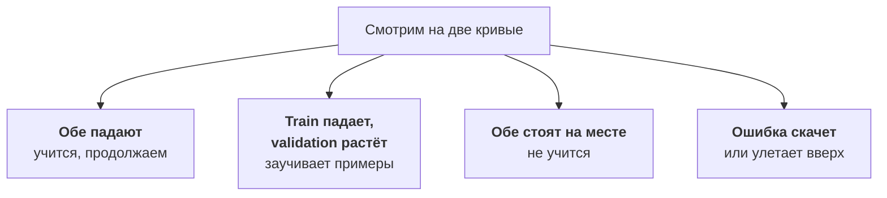

:::tldr
Берём небольшую instruct-модель под Apache 2.0, например Qwen3.5-9B, и учим LoRA-адаптер в 16 битах на одной видеокарте с 48 – 96 ГБ памяти. Если карта на 24 ГБ, подойдёт QLoRA поверх 4-битной модели. Инструменты: Unsloth для скорости и экономии памяти, TRL для самого обучения. Важных параметров немного: ранг 16, скорость обучения 2e-4, одна-три эпохи, ошибка только на ответе. Главное во время обучения следить за ошибкой на validation: когда она перестаёт падать и начинает расти, модель заучивает примеры, и дальше учить не надо. На паре тысяч примеров запуск занимает до часа и стоит несколько долларов.
:::

## Что такое LoRA

Модель на 9 миллиардов параметров это 9 миллиардов чисел. Полное дообучение меняет их все: нужно хранить в памяти сами веса, градиенты и состояние оптимизатора, это в несколько раз больше, чем занимает модель. Для 9B это сотни гигабайт и несколько видеокарт.

LoRA поступает хитрее. Исходные веса замораживаются, а рядом с каждым большим слоем добавляются две маленькие матрицы. Учатся только они, и вместе это доли процента от размера модели. На выходе получается адаптер на несколько десятков мегабайт, который накладывается поверх исходной модели. Качество на прикладных задачах обычно почти такое же, как у полного дообучения, а памяти и времени нужно в разы меньше.

У адаптеров есть ещё одно удобство: на одной базовой модели можно держать много адаптеров под разные задачи и переключать их по имени в запросе. Об этом в [последней части](/blog/ru/finetune-serve/).

::news{topic="training gpu"}

## Базовая модель

Правила выбора:

- **Instruct-версия, а не base.** Instruct-модель уже умеет следовать инструкциям и отвечать в формате чата, мы лишь сужаем её на свою задачу. Base-модель придётся учить и этому.
- **Разрешительная лицензия.** Apache 2.0 или MIT, чтобы дообученную модель можно было спокойно использовать в продукте. Про лицензии подробнее в [части про модели](/blog/ru/inference-models/) цикла про инференс.
- **Самая маленькая из тех, что почти справляются.** Прогоните тестовый набор из [прошлой части](/blog/ru/finetune-data/) через несколько моделей с хорошим промптом. Дообучение обычно подтягивает качество маленькой модели до уровня большой, но не делает чудес. Если модель с промптом даёт 60% правильных ответов, после дообучения можно ждать 85 – 90%. Если 20%, задача ей не по силам.
- **Хорошая поддержка языка.** Наши обращения на русском, Qwen с ним справляется хорошо.

Для разбора обращений возьмём Qwen3.5-9B: плотная модель на 9 миллиардов параметров под Apache 2.0, хорошо понимает русский, работает на дешёвой видеокарте. Если её не хватит, следующий шаг Qwen3.8-27B, а для массовой классификации можно попробовать и Qwen3.5-4B.

## Инструменты

| Инструмент | Что это | Когда брать |
|---|---|---|
| [TRL](https://huggingface.co/docs/trl) | библиотека Hugging Face с тренерами SFT, DPO, GRPO и другими; версия 1.17 на начало ноября 2026 | основа почти всех остальных инструментов |
| [Unsloth](https://unsloth.ai/docs) | ускоряет обучение примерно вдвое и экономит память, работает поверх TRL | одна видеокарта, выбор по умолчанию |
| [Axolotl](https://docs.axolotl.ai) | обучение по YAML-конфигу, хорошо работает на нескольких видеокартах | большие модели, повторяемые конфиги |

Мы используем Unsloth вместе с TRL: Unsloth загружает модель и готовит LoRA, TRL обучает. У Unsloth есть и графическое приложение, но для повторяемых запусков удобнее скрипт.

## Видеокарта

Сколько памяти нужно под LoRA для модели на 9B:

| Режим | Память | Видеокарта |
|---|---|---|
| LoRA, модель в 16 битах | около 30 – 40 ГБ с запасом под батч | RTX PRO 6000 96 ГБ, L40S 48 ГБ, A100 80 ГБ |
| QLoRA, модель в 4 битах | около 12 – 20 ГБ | RTX 4090 или 5090 |

QLoRA экономит память, но обучение идёт медленнее, а качество бывает чуть ниже. Если бюджет позволяет взять карту на 48 ГБ и больше, учите в 16 битах. Для модели на 27B уже понадобится 80 – 96 ГБ под LoRA или 24 – 48 ГБ под QLoRA.

Арендуем как в [цикле про инференс](/blog/ru/inference-clouds/): под на RunPod или Vast.ai с сетевым томом, на который скачиваются веса, датасет и куда сохраняются результаты. Образ с PyTorch и CUDA от площадки, Unsloth ставится одной командой `pip install unsloth`. После обучения под удаляем, том остаётся.

## Скрипт обучения

Весь скрипт помещается на экран. Ключевая часть:

```python
from unsloth import FastLanguageModel
from trl import SFTTrainer, SFTConfig
from datasets import load_dataset

model, tokenizer = FastLanguageModel.from_pretrained(
    "Qwen/Qwen3.5-9B", max_seq_length=2048, load_in_4bit=False)
model = FastLanguageModel.get_peft_model(
    model, r=16, lora_alpha=16,
    target_modules=["q_proj", "k_proj", "v_proj", "o_proj",
                    "gate_proj", "up_proj", "down_proj"])

data = load_dataset("your-org/support-triage", revision="v3")
trainer = SFTTrainer(
    model=model, processing_class=tokenizer,
    train_dataset=data["train"], eval_dataset=data["validation"],
    args=SFTConfig(num_train_epochs=2, learning_rate=2e-4,
                   per_device_train_batch_size=8, eval_strategy="steps",
                   eval_steps=50, output_dir="/workspace/runs/v3"))
trainer.train()
model.save_pretrained("/workspace/adapters/triage-v3")
```

Чего здесь не видно, но что обязательно:

- **Ошибка только на ответе.** Модель должна учиться генерировать ответ, а не переписывать письма клиентов. В TRL для этого есть `assistant_only_loss=True`, если шаблон чата модели его поддерживает. Универсальный путь в Unsloth: функция `train_on_responses_only`, которая маскирует всё, кроме ответа ассистента.
- **Тот же шаблон чата, что в проде.** TRL сам применяет шаблон из токенизатора модели. vLLM в проде применит тот же, если вы не переопределяете его. Расхождение шаблонов самая частая причина, почему модель отлично работала в ноутбуке и странно в проде.
- **Режим размышлений выключен.** Если модель умеет думать перед ответом, а в данных рассуждений нет, отключите их в шаблоне и при обучении, и при запуске.

## Параметры, которые важны

Параметров у обучения десятки, но менять стоит единицы.

| Параметр | С чего начать | Что делает |
|---|---|---|
| `r` (ранг) | 16 | размер адаптера; 8 – 16 для формата и классификации, 32 – 64 для сложного навыка |
| `lora_alpha` | равен рангу | масштаб адаптера; проще держать равным `r` и не трогать |
| `learning_rate` | 2e-4 | скорость обучения; для LoRA выше, чем для полного дообучения; если ошибка скачет, уменьшайте вдвое |
| `num_train_epochs` | 1 – 3 | сколько раз модель видит каждый пример; больше трёх почти всегда переобучение |
| размер батча | 16 – 32 в сумме | сколько примеров за шаг; если не влезает, уменьшайте батч и включайте накопление градиента |
| `max_seq_length` | по самому длинному примеру | длиннее не нужно, короче обрежет примеры |

`target_modules` со всеми линейными слоями, как в скрипте выше, надёжнее, чем только слои внимания: качество заметно лучше при почти той же памяти.

## Как читать график ошибки

Во время обучения TRL печатает ошибку на обучающих данных каждые несколько шагов и ошибку на validation каждые `eval_steps`. По ним видно почти всё.



- **Обе кривые падают.** Модель учится. Ошибка на validation обычно падает быстро в первые сотни шагов, потом выходит на плато.
- **Ошибка на обучении падает, на validation растёт.** Переобучение: модель заучивает конкретные примеры. Остановитесь в точке минимума validation; для этого сохраняйте чекпоинты и берите лучший. Помогает меньше эпох, меньший ранг или больше данных.
- **Обе стоят на месте.** Скорость обучения слишком маленькая или ошибка считается не там, например маска ответа не сработала.
- **Ошибка скачет или улетает вверх.** Скорость обучения слишком большая. Уменьшите вдвое.

Ошибка это лишь косвенный сигнал. Модель с меньшей ошибкой не обязательно лучше решает задачу. Настоящий ответ даёт только оценка на тесте, ей посвящена [следующая часть](/blog/ru/finetune-eval/).

## Быстрая проверка

Сразу после обучения, не удаляя под, прогоните через модель десяток примеров из validation и посмотрите на ответы глазами. Ответ в виде валидного JSON с нужными полями? Модель останавливается после JSON или продолжает генерировать? Категории похожи на правильные? Если что-то из этого не так, ищите проблему в шаблоне чата или в маске ответа, прежде чем запускать полную оценку.

## Время, деньги и что сохранить

Порядок цифр для Qwen3.5-9B на двух тысячах примеров по 600 токенов, две эпохи, LoRA в 16 битах на RTX PRO 6000: от двадцати до сорока минут обучения. По прейскуранту RunPod это 1 – 2 доллара. С поднятием пода, скачиванием модели и быстрой проверкой выходит около часа.

Сохраните вместе с адаптером:

- версию датасета, на которой он обучен;
- точное имя и ревизию базовой модели;
- параметры обучения и графики ошибки;
- короткий результат быстрой проверки.

Адаптер удобно отправить в приватный репозиторий на Hugging Face методом `push_to_hub`: оттуда его заберёт и оценка, и прод. Через месяц у вас будет пять адаптеров, и без этих записей вы не вспомните, чем они отличаются.

## Что дальше

Адаптер обучен, ошибка упала, ответы похожи на правду. Но похожи ли они на правду лучше, чем у исходной модели с промптом и у Claude? В [четвёртой части](/blog/ru/finetune-eval/) строим честную оценку: метрики по каждому полю, сравнение с базой и коммерческой моделью и проверку на странных входах.
