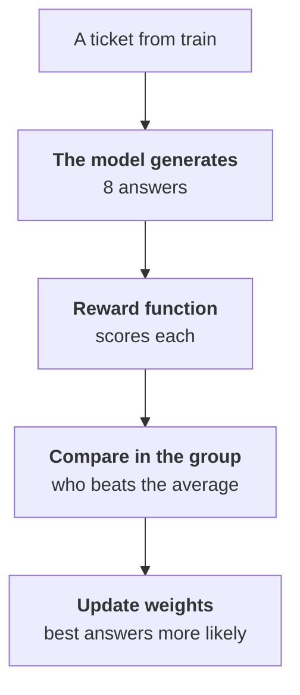

:::tldr
SFT shows the model correct answers but not what to avoid. Preference tuning closes that gap. DPO learns from pairs of "good and bad answer to one input"; such pairs pile up in your logs for free whenever a staff member corrects the model. GRPO needs no ready-made pairs: the model generates several answers itself, a reward function in code scores each, and the model shifts towards the better ones. For tasks with a checkable answer, like our classification, GRPO is especially good: the reward can say outright that missing a complaint is worse than calling a human once too often. Both run on top of the SFT adapter, not instead of it, and are checked with the same evaluation script.
:::

## What SFT is missing

After the [previous part](/blog/finetune-eval/) we have an adapter that triages tickets well but misses some that need a human. You can add more such examples to training, and that should come first. But SFT has a limit: it teaches the model to reproduce the correct answer and says nothing about wrong ones. To the model, "didn't call a human for a complaint" and "mixed up payment and refund" cost the same: both simply differ from the reference.

Preference tuning lets you tell the model more: this answer is better than that one, and this error is worse than the other. The two most practical methods today are DPO and GRPO, both available in TRL and Unsloth.

::news{topic="training open-models"}

## Which method when

| | SFT | DPO | GRPO |
|---|---|---|---|
| learns from | input and correct answer | input, good and bad answer | input and a reward function |
| data from | labelling, logs | human edits, a choice between two options | correct answers that code checks |
| gives | skill and format | removes typical errors, style | optimises exactly what you consider important |
| cost of a run | minutes | minutes | hours: the model generates many answers |

The order is always the same: SFT first, then DPO or GRPO on top of the resulting adapter if needed. Teaching preferences to a model that can't do the task yet is pointless.

## DPO: learning from edits

DPO (Direct Preference Optimization) takes pairs of answers to one input and shifts the model so the good answer becomes more likely than the bad one. Example data:

```json
{"prompt": [{"role": "user", "content": "Third time writing: money taken, no access. If this isn't fixed today, I'm going to my bank."}],
 "chosen": [{"role": "assistant", "content": "{\"category\":\"payment\",\"urgency\":\"high\",\"summary\":\"Charged but no access, threatens a chargeback\",\"needs_human\":true}"}],
 "rejected": [{"role": "assistant", "content": "{\"category\":\"access\",\"urgency\":\"normal\",\"summary\":\"No access after payment\",\"needs_human\":false}"}]}
```

Where pairs come from:

- **Staff corrections.** The model answered, a human corrected it. The model's answer becomes `rejected`, the corrected one `chosen`. In a support system this happens every day, and these pairs are the most valuable: they are exactly about the errors the model makes in production.
- **Reply drafts.** If the model writes email drafts and staff edit them before sending, the pair "draft and sent text" teaches the model to write the way your people do.
- **Sampling your own model.** Generate several answers from the SFT adapter on training examples; take a correct one as `chosen` and a wrong one as `rejected`. This works when correctness can be checked against labels.

What to watch:

- **You need fewer pairs than SFT examples.** A few hundred pairs already shift behaviour noticeably.
- **The learning rate is much lower than in SFT,** around 5e-6 for LoRA, one epoch. The `beta` parameter (usually 0.1) sets how far the model may drift from the SFT version.
- **DPO likes to lengthen answers** if good answers in the pairs are longer on average than bad ones. For JSON that's harmless; for text, check the length in evaluation.

## GRPO: code computes the reward

GRPO (Group Relative Policy Optimization) is reinforcement learning that became popular with reasoning models. The idea is simple:



The model needs no ready-made pairs. It needs inputs and a way to score an answer. For our task the score is easy to write in code, because the training examples have correct categories and flags:

```python
import json

def triage_reward(completions, category, needs_human, **kwargs):
    rewards = []
    for completion, cat, human in zip(completions, category, needs_human):
        try:
            answer = json.loads(completion[0]["content"])
        except (json.JSONDecodeError, TypeError):
            rewards.append(-1.0)
            continue
        score = 0.5 if answer.get("category") == cat else 0.0
        if answer.get("needs_human") == human:
            score += 1.0 if human else 0.5
        rewards.append(score)
    return rewards
```

TRL calls this function for each group of answers and passes in the dataset columns with the same names, here `category` and `needs_human`. Invalid JSON is penalised. A correct "needs a human" flag on a real complaint earns twice as much as a correct flag on an ordinary ticket: that's how we tell the model outright which error costs more.

The run is almost the same as SFT, just with a different trainer:

```python
trainer = GRPOTrainer(
    model=model, reward_funcs=triage_reward,
    train_dataset=data["train"],
    args=GRPOConfig(num_generations=8, max_completion_length=128,
                    learning_rate=5e-6, use_vllm=True,
                    output_dir="/workspace/runs/grpo-v1"))
trainer.train()
```

`use_vllm=True` hands answer generation to vLLM, which is many times faster. Generation takes most of the time: on every step the model writes eight answers per input. So GRPO runs for hours, not minutes, and wants a bigger GPU. For a 9B model an 80 to 96 GB card is comfortable.

## The model will game the reward if it can

The main danger of reinforcement learning: the model optimises exactly what the function says, not what you meant. If the reward only gave points for finding tickets for a human, the model would quickly learn to put `needs_human: true` everywhere: recall at a hundred percent, maximum reward, and staff drowning in cards.

How to defend against it:

- **Penalise both errors.** In the function above a false alarm also loses points, just fewer than a miss.
- **Watch the answer distribution.** If the share of `needs_human: true` creeps up, the model has found a loophole.
- **Read answers during training.** TRL logs sample generations; every few hundred steps, look at them.
- **Check on a separate test.** The result is always measured with the evaluation script from the [previous part](/blog/finetune-eval/), not with the training reward.

## What to choose in our example

For ticket triage with clear correctness, GRPO fits better: the reward directly encodes the cost of errors, and the data is already labelled. DPO is worth adding once staff corrections from production accumulate, especially if the model starts writing reply drafts: there correctness can't be checked by code, but human edits exist.

After polishing, run the new adapter through the same evaluation script. Compare it with the SFT adapter, not just with Claude: if polishing gave no noticeable gain on the important fields, it's simpler to stay with SFT.

## What's next

All along we relied on labelled data: logs with corrections and manual labels. What if labels are scarce but there are hundreds of thousands of unlabelled tickets? In [part six](/blog/finetune-distill/) a big model becomes the teacher: it labels data for a small one, and we look at how to filter out its mistakes and what the licences say.
