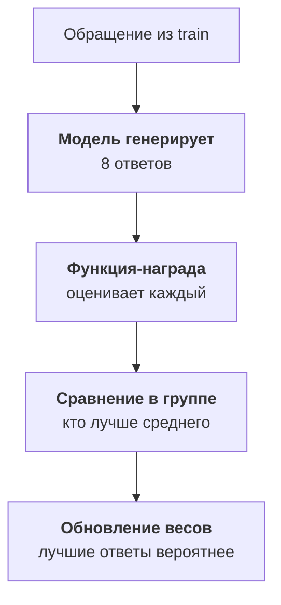

:::tldr
SFT показывает модели правильные ответы, но не показывает, чего делать не надо. Доводка по предпочтениям закрывает этот пробел. DPO учится на парах «хороший и плохой ответ на один вход»; такие пары бесплатно копятся в логах, когда сотрудник исправляет ответ модели. GRPO обходится без готовых пар: модель сама генерирует несколько ответов, функция-награда в коде оценивает каждый, и модель сдвигается к лучшим. Для задач с проверяемым ответом, как наша классификация, GRPO особенно хорош: в награде можно прямо сказать, что пропустить жалобу хуже, чем лишний раз позвать человека. Оба метода запускаются поверх SFT-адаптера, а не вместо него, и проверяются тем же скриптом оценки.
:::

## Чего не хватает SFT

После [прошлой части](/blog/ru/finetune-eval/) у нас адаптер, который хорошо разбирает обращения, но пропускает часть тех, где нужен человек. Можно добавить таких примеров в обучение, и это стоит сделать в первую очередь. Но у SFT есть ограничение: он учит модель воспроизводить правильный ответ и ничего не говорит про неправильные. Для модели ошибка «не позвать человека к жалобе» и ошибка «перепутать оплату с возвратом» стоят одинаково: обе просто отличаются от эталона.

Доводка по предпочтениям позволяет сказать модели больше: вот этот ответ лучше того, а вот эта ошибка хуже другой. Два самых практичных метода сейчас DPO и GRPO, оба есть в TRL и Unsloth.

::news{topic="training open-models"}

## Какой метод когда

| | SFT | DPO | GRPO |
|---|---|---|---|
| на чём учится | вход и правильный ответ | вход, хороший и плохой ответ | вход и функция-награда |
| откуда данные | разметка, логи | правки людей, выбор из двух вариантов | правильные ответы, которые проверяет код |
| что даёт | навык и формат | убирает типичные ошибки, стиль | оптимизирует именно то, что вы считаете важным |
| стоимость запуска | минуты | минуты | часы: модель генерирует много ответов |

Порядок всегда один: сначала SFT, потом при необходимости DPO или GRPO поверх получившегося адаптера. Учить предпочтениям модель, которая ещё не умеет задачу, бессмысленно.

## DPO: учимся на правках

DPO (Direct Preference Optimization) берёт пары ответов на один вход и сдвигает модель так, чтобы хороший ответ становился вероятнее плохого. Пример данных:

```json
{"prompt": [{"role": "user", "content": "Третий раз пишу, деньги списали, доступа нет. Если сегодня не решите, иду в банк."}],
 "chosen": [{"role": "assistant", "content": "{\"category\":\"payment\",\"urgency\":\"high\",\"summary\":\"Списали деньги, доступа нет, грозит оспорить платёж\",\"needs_human\":true}"}],
 "rejected": [{"role": "assistant", "content": "{\"category\":\"access\",\"urgency\":\"normal\",\"summary\":\"Нет доступа после оплаты\",\"needs_human\":false}"}]}
```

Где брать пары:

- **Правки сотрудников.** Модель ответила, человек исправил. Ответ модели становится `rejected`, исправленный `chosen`. В системе поддержки это происходит каждый день, и такие пары самые ценные: они ровно про те ошибки, которые модель делает в проде.
- **Черновики ответов.** Если модель пишет черновики писем, а сотрудник их правит перед отправкой, пара «черновик и отправленный текст» учит модель писать так, как пишут ваши люди.
- **Выборка из своей модели.** Сгенерируйте несколько ответов SFT-адаптера на обучающие примеры, правильный возьмите как `chosen`, неправильный как `rejected`. Это работает, когда правильность можно проверить по разметке.

На что обратить внимание:

- **Пар нужно меньше, чем примеров для SFT.** Несколько сотен пар уже заметно сдвигают поведение.
- **Скорость обучения намного ниже, чем в SFT,** порядка 5e-6 для LoRA, одна эпоха. Параметр `beta` (обычно 0,1) задаёт, насколько далеко модели можно уходить от SFT-версии.
- **DPO любит удлинять ответы,** если в парах хорошие ответы в среднем длиннее плохих. Для JSON это не страшно, для текстов проверяйте длину на оценке.

## GRPO: награду считает код

GRPO (Group Relative Policy Optimization) это обучение с подкреплением, которое стало популярным после моделей с рассуждениями. Идея простая:



Модели не нужны готовые пары. Ей нужны входы и способ оценить ответ. Для нашей задачи оценку легко написать кодом, потому что у обучающих примеров есть правильные категории и флаги:

```python
import json

def triage_reward(completions, category, needs_human, **kwargs):
    rewards = []
    for completion, cat, human in zip(completions, category, needs_human):
        try:
            answer = json.loads(completion[0]["content"])
        except (json.JSONDecodeError, TypeError):
            rewards.append(-1.0)
            continue
        score = 0.5 if answer.get("category") == cat else 0.0
        if answer.get("needs_human") == human:
            score += 1.0 if human else 0.5
        rewards.append(score)
    return rewards
```

TRL вызывает эту функцию для каждой группы ответов и передаёт в неё колонки датасета с теми же именами, здесь `category` и `needs_human`. Невалидный JSON получает штраф. Правильный флаг «нужен человек» на настоящей жалобе приносит вдвое больше, чем правильный флаг на обычном обращении: так мы прямо говорим модели, какая ошибка дороже.

Запуск почти такой же, как SFT, только с другим тренером:

```python
trainer = GRPOTrainer(
    model=model, reward_funcs=triage_reward,
    train_dataset=data["train"],
    args=GRPOConfig(num_generations=8, max_completion_length=128,
                    learning_rate=5e-6, use_vllm=True,
                    output_dir="/workspace/runs/grpo-v1"))
trainer.train()
```

`use_vllm=True` отдаёт генерацию ответов vLLM, это в разы быстрее. Генерация занимает основное время: на каждом шаге модель пишет по восемь ответов на каждый вход. Поэтому GRPO идёт часами, а не минутами, и ему нужна видеокарта побольше. Для модели на 9B карта на 80 – 96 ГБ работает комфортно.

## Модель обманет награду, если сможет

Главная опасность обучения с подкреплением: модель оптимизирует ровно то, что написано в функции, а не то, что вы имели в виду. Если бы награда давала очки только за найденные обращения для человека, модель быстро научилась бы ставить `needs_human: true` везде: полнота сто процентов, награда максимальная, а сотрудники тонут в карточках.

Как защищаться:

- **Наказывайте обе ошибки.** В функции выше ложная тревога тоже теряет очки, просто меньше, чем пропуск.
- **Следите за распределением ответов.** Если доля `needs_human: true` поползла вверх, модель нашла лазейку.
- **Читайте ответы во время обучения.** TRL логирует примеры генераций; раз в несколько сотен шагов посмотрите на них глазами.
- **Проверяйте отдельным тестом.** Итог всегда меряется скриптом оценки из [прошлой части](/blog/ru/finetune-eval/), а не наградой на обучении.

## Что выбрать в нашем примере

Для разбора обращений с понятной правильностью GRPO подходит лучше: награда прямо кодирует цену ошибок, а данные уже размечены. DPO стоит подключить, когда накопятся правки сотрудников из прода, особенно если модель начнёт писать черновики ответов: там правильность кодом не проверишь, а правки людей есть.

После доводки прогоните новый адаптер через тот же скрипт оценки. Сравнивать нужно с SFT-адаптером, а не только с Claude: если доводка не дала заметного выигрыша на важных полях, проще остаться на SFT.

## Что дальше

Всё это время мы опирались на размеченные данные: логи с правками и ручную разметку. А что делать, если разметки мало, а неразмеченных обращений сотни тысяч? В [шестой части](/blog/ru/finetune-distill/) большая модель становится учителем: размечает данные для маленькой, а мы разбираемся, как отфильтровать её ошибки и что говорят лицензии.
