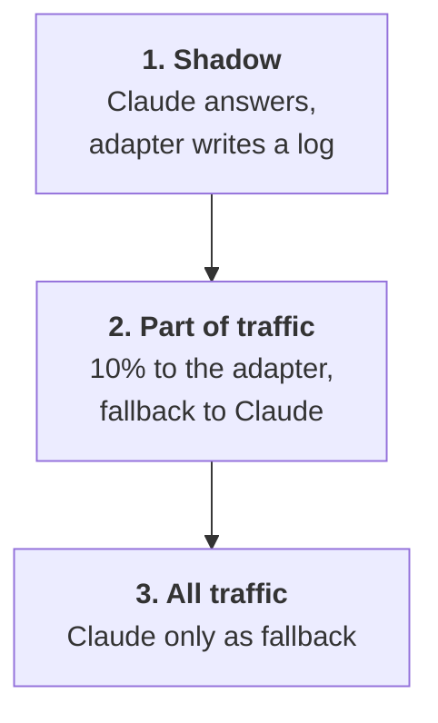
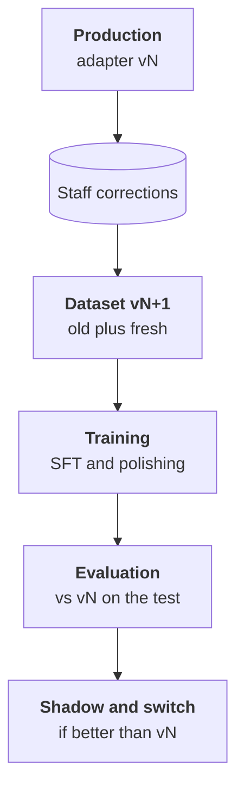

:::tldr
The simplest option is to keep the adapter on top of the base model in vLLM: one server serves the base model and any number of adapters, and the version is picked by the model name in the request. Merging the adapter into the weights and compressing to FP8 makes sense when a busy task gets its own GPU. Ship carefully: first shadow mode, where the current model answers and the new one runs alongside and only writes to a log; then part of the traffic with fallback to the current model on any error; then all traffic. Watch the share of human corrections and the answer distribution, retrain monthly on fresh corrections and run each new adapter through the same evaluation script.
:::

## Two ways to host the model

After training we have an adapter of a few tens of megabytes and the base model it applies to. In production you can host them two ways.

| | Adapter on top of the base | Merged model |
|---|---|---|
| how | vLLM loads the base and adapters, choice by name in the request | the adapter is merged into the weights, giving an ordinary model |
| pros | one GPU for many tasks, a new version is a new file of tens of megabytes | slightly faster, the whole thing can be compressed to FP8 or GGUF |
| cons | a small overhead for the adapter | a separate copy of the model per task |
| when | the base already serves other requests, several tasks | a dedicated GPU for one busy task |

For ticket triage the adapter is handier: the same Qwen3.5-9B can answer other requests in parallel, and the support load isn't big enough to deserve a card of its own.

::news{topic="training inference"}

## The adapter in vLLM

The server from the [your own endpoint part](/blog/inference-serve/) gets a couple of flags:

```bash
vllm serve Qwen/Qwen3.5-9B \
  --enable-lora --max-lora-rank 16 --max-loras 4 \
  --lora-modules triage-v3=/workspace/adapters/triage-v3 \
                 triage-v4=/workspace/adapters/triage-v4
```

Now `/v1/models` lists the base model and both adapters. The app picks the adapter with the `model` field in the request, the way it would pick a model at any OpenAI-compatible provider. `--max-loras` sets how many adapters are held on the GPU at once; requests to different adapters and to the base are processed in one batch.

A few rules:

- **The version in the name.** `triage-v3`, `triage-v4`, not `triage`. The app takes the name from config, and rolling back is a one-line change, with no retraining and no server restart.
- **Pin the base revision.** The adapter was trained on a specific version of the base model. If the base is updated, the adapter may get worse or break. Specify the exact model revision and change it only together with retraining the adapter.
- **The same settings as in evaluation.** Temperature 0, the same system prompt, structured output with a JSON schema, thinking mode off.

If you do need a merged model, Unsloth saves it with one call to `save_pretrained_merged`, after which it can be compressed to FP8 for vLLM or to GGUF for llama.cpp and Ollama. Always run the compressed model through the evaluation script again: compression sometimes eats part of the fine-tuning gain.

## Shipping in three steps

The adapter passed evaluation on the test, but the test is the past. Production traffic is always a bit different. So the new model gets traffic gradually.



**Shadow.** Claude still triages every ticket, and staff see its answer. In parallel the same ticket goes to the adapter, and its answer is logged next to Claude's and the staff member's final decision. Neither customers nor staff notice anything. After a week you have a comparison on real traffic: where the adapter and Claude agree, where they diverge and which of them the staff member ended up agreeing with.

**Part of the traffic.** If the divergences are understood and the adapter is no worse, give it a tenth of the tickets. Any problem with the adapter's answer (invalid JSON, a timeout, the server down) automatically sends the request to Claude. The staff member gets a card either way.

**All traffic.** When the correction rate on the adapter holds at Claude's level, switch everything. Claude remains the fallback in case your GPU is unavailable. That costs pennies, because it rarely fires.

In the [support system from the automations series](/blog/automations-support/), ticket triage already lives in one function that returns JSON. Changing it to call your own endpoint and fall back to Claude is a couple of dozen lines.

## What to monitor

| Metric | What it shows |
|---|---|
| share of cards where staff corrected the category or flags | the main quality metric in production; compare with the period when Claude ran |
| category distribution and share of `needs_human` per day | a sharp shift means the traffic changed or the model broke |
| share of fallbacks to Claude | problems with the server or the answer format |
| latency and requests per second | whether the GPU is enough |

The human correction rate is a free continuous evaluation: every correction is both a quality signal and a new training example. If you haven't collected it yet, start before shipping the adapter so you have something to compare with.

## The retraining loop

A model trained once slowly ages: new products appear, rules change, customers write about new things. So fine-tuning isn't a project but a loop.



Once a month, or when the correction rate creeps up:

1. Add fresh corrections to the dataset, as a new version.
2. Update the test: add the last few weeks, labelled by people. Keep the old test too, so results stay comparable.
3. Train a new adapter with the same scripts.
4. Compare it with the current production adapter on both tests.
5. If it's better, shadow for a few days and switch by name.

The whole loop takes a few hours of work and a couple of dollars of GPU, once the data preparation, training and evaluation scripts exist.

When a new base model comes out, say the next Qwen version, the adapter doesn't carry over: it has to be retrained on the same dataset. The good news is that the dataset and the evaluation script stay yours. Moving to a new base is one training run and one comparison, not a new project.

## The series checklist

1. **Is fine-tuning needed.** The task is narrow, high-volume and checkable; prompt, examples and search have been tried; the savings pay for the work.
2. **Data.** Logs with human corrections, manual labels for rare cases, teacher labelling with an agreement filter when short.
3. **Test.** Set aside first, split by time and customer, labelled by people and rechecked.
4. **Training.** An instruct model under Apache 2.0, LoRA rank 16, learning rate 2e-4, one to three epochs, loss on the answer only, watch validation.
5. **Evaluation.** Three contestants on one test, per-field metrics, recall for expensive errors, every error read, odd inputs, a readiness rule set in advance.
6. **Polishing.** GRPO with a reward that reflects the cost of errors, or DPO on human edits; checked with the same script.
7. **Production.** An adapter with the version in its name, shadow, part of the traffic with fallback, all traffic, monitoring the correction rate, monthly retraining.

## What's next

That concludes the series. If you went through it together with the [inference series](/blog/series/inference/), you have your own model on a rented GPU that does your task as well as a commercial one, costs many times less and gets better with every staff correction. New open models and fine-tuning tools come out all the time; the [news feed](/news/) is a handy way to follow them.
