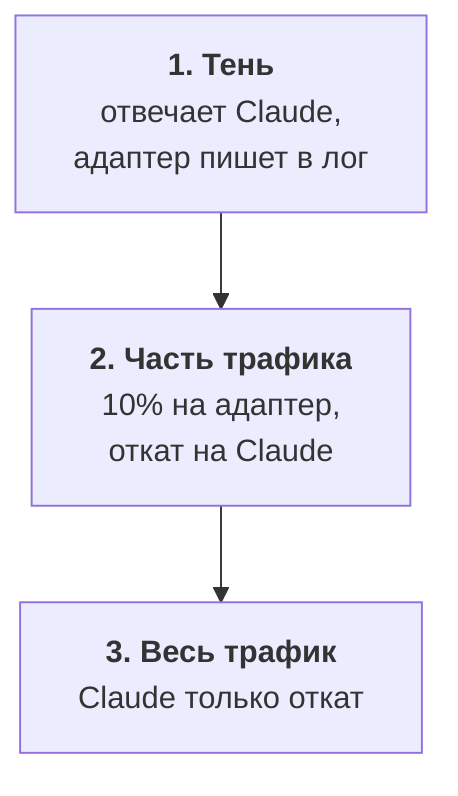
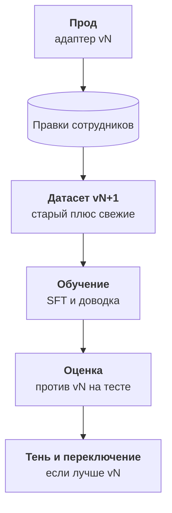

:::tldr
Проще всего держать адаптер поверх базовой модели в vLLM: один сервер обслуживает и базовую модель, и любое число адаптеров, а версия выбирается именем модели в запросе. Слить адаптер с весами и сжать в FP8 имеет смысл, когда под задачу выделена отдельная загруженная видеокарта. Выпускайте осторожно: сначала теневой режим, когда отвечает текущая модель, а новая работает рядом и только пишет в лог; потом часть трафика с откатом на текущую модель при любой ошибке; потом весь трафик. Следите за долей правок людей и распределением ответов, раз в месяц переобучайте на свежих правках и прогоняйте новый адаптер через тот же скрипт оценки.
:::

## Два способа держать модель

После обучения у нас есть адаптер на несколько десятков мегабайт и базовая модель, к которой он прикладывается. В проде их можно держать двумя способами.

| | Адаптер поверх базы | Слитая модель |
|---|---|---|
| как | vLLM загружает базу и адаптеры, выбор по имени в запросе | адаптер вливается в веса, получается обычная модель |
| плюсы | одна видеокарта на много задач, новая версия это новый файл на десятки мегабайт | чуть быстрее, можно сжать в FP8 или GGUF целиком |
| минусы | небольшие накладные расходы на адаптер | на каждую задачу своя копия модели |
| когда | база уже обслуживает другие запросы, задач несколько | отдельная видеокарта под одну загруженную задачу |

Для разбора обращений адаптер удобнее: та же Qwen3.5-9B может параллельно отвечать на другие запросы, а нагрузка от поддержки не настолько большая, чтобы выделять под неё отдельную карту.

::news{topic="training inference"}

## Адаптер в vLLM

Сервер из [части про свой эндпоинт](/blog/ru/inference-serve/) получает пару флагов:

```bash
vllm serve Qwen/Qwen3.5-9B \
  --enable-lora --max-lora-rank 16 --max-loras 4 \
  --lora-modules triage-v3=/workspace/adapters/triage-v3 \
                 triage-v4=/workspace/adapters/triage-v4
```

Теперь `/v1/models` показывает базовую модель и оба адаптера. Приложение выбирает адаптер полем `model` в запросе, как выбирало бы модель у любого OpenAI-совместимого провайдера. `--max-loras` задаёт, сколько адаптеров одновременно держится на видеокарте; запросы к разным адаптерам и к базе обрабатываются в одном батче.

Несколько правил:

- **Версия в имени.** `triage-v3`, `triage-v4`, а не `triage`. Приложение берёт имя из конфига, и откат на прошлую версию это смена одной строки, без переобучения и перезапуска сервера.
- **Ревизия базы закреплена.** Адаптер обучен на конкретной версии базовой модели. Если база обновится, адаптер может начать работать хуже или сломаться. Указывайте точную ревизию модели и меняйте её только вместе с переобучением адаптера.
- **Те же настройки, что на оценке.** Температура 0, тот же системный промпт, структурированный вывод по JSON-схеме, режим размышлений выключен.

Если всё-таки нужна слитая модель, Unsloth сохраняет её одной командой `save_pretrained_merged`, после чего её можно сжать в FP8 для vLLM или в GGUF для llama.cpp и Ollama. Сжатую модель обязательно прогоните через скрипт оценки ещё раз: сжатие иногда съедает часть выигрыша от дообучения.

## Выпуск в три шага

Адаптер прошёл оценку на тесте, но тест это прошлое. Поток в проде всегда немного другой. Поэтому новая модель получает трафик постепенно.



**Тень.** Каждое обращение по-прежнему разбирает Claude, и сотрудники видят его ответ. Параллельно то же обращение уходит адаптеру, его ответ пишется в лог рядом с ответом Claude и финальным решением сотрудника. Клиенты и сотрудники ничего не замечают. Через неделю у вас есть сравнение на настоящем потоке: где адаптер и Claude согласны, где расходятся и кто из них в итоге оказался прав по мнению сотрудника.

**Часть трафика.** Если расхождения разобраны и адаптер не хуже, отдайте ему десятую часть обращений. Любая проблема с ответом адаптера (невалидный JSON, таймаут, недоступный сервер) автоматически переводит запрос на Claude. Сотрудник получает карточку в любом случае.

**Весь трафик.** Когда доля правок на адаптере держится на уровне Claude, переключайте всё. Claude остаётся откатом на случай, если ваша видеокарта недоступна. Это стоит копейки, потому что срабатывает редко.

В [системе поддержки из цикла про автоматизации](/blog/ru/automations-support/) разбор обращения уже вынесен в одну функцию, которая возвращает JSON. Поменять её так, чтобы она шла в свой эндпоинт и откатывалась на Claude, это пара десятков строк.

## Что мониторить

| Метрика | Что показывает |
|---|---|
| доля карточек, где сотрудник поправил категорию или флаги | главная метрика качества в проде; сравнивайте с периодом, когда работал Claude |
| распределение категорий и доля `needs_human` по дням | резкий сдвиг значит, что изменился поток или модель сломалась |
| доля откатов на Claude | проблемы с сервером или с форматом ответа |
| задержка и число запросов в секунду | хватает ли видеокарты |

Доля правок людей это бесплатная непрерывная оценка: каждая правка одновременно сигнал о качестве и новый обучающий пример. Если её ещё не собирали, начните до выпуска адаптера, чтобы было с чем сравнивать.

## Цикл переобучения

Модель, обученная один раз, постепенно стареет: появляются новые продукты, меняются правила, клиенты пишут о новом. Поэтому дообучение это не проект, а цикл.



Раз в месяц или когда доля правок поползла вверх:

1. Добавьте свежие правки в датасет, новая версия.
2. Обновите тест: добавьте последние недели, размеченные людьми. Старый тест тоже оставьте, чтобы не потерять сравнимость.
3. Обучите новый адаптер теми же скриптами.
4. Сравните с текущим адаптером в проде на обоих тестах.
5. Если лучше, тень на несколько дней и переключение по имени.

Весь цикл занимает несколько часов работы и пару долларов видеокарты, если скрипты подготовки данных, обучения и оценки уже есть.

Когда выходит новая базовая модель, например следующая версия Qwen, адаптер с неё не переносится: его нужно обучить заново на том же датасете. Хорошая новость в том, что датасет и скрипт оценки остаются вашими. Переход на новую базу это один запуск обучения и одно сравнение, а не новый проект.

## Чек-лист цикла

1. **Нужно ли дообучение.** Задача узкая, массовая и проверяемая, промпт, примеры и поиск уже испробованы, и экономия окупает работу.
2. **Данные.** Логи с правками людей, ручная разметка редких случаев, при нехватке разметка учителем с фильтром согласия.
3. **Тест.** Отложен первым, разделён по времени и клиентам, размечен людьми и перепроверен.
4. **Обучение.** Instruct-модель под Apache 2.0, LoRA ранга 16, скорость 2e-4, одна-три эпохи, ошибка только на ответе, следим за validation.
5. **Оценка.** Три участника на одном тесте, метрики по полям, полнота для дорогих ошибок, разбор каждой ошибки, странные входы, правило готовности заранее.
6. **Доводка.** GRPO с наградой, которая отражает цену ошибок, или DPO на правках людей; проверка тем же скриптом.
7. **Прод.** Адаптер с версией в имени, тень, часть трафика с откатом, весь трафик, мониторинг доли правок, ежемесячное переобучение.

## Что дальше

На этом цикл закончен. Если вы прошли его вместе с [циклом про инференс](/blog/ru/series/inference/), у вас есть своя модель на арендованной видеокарте, которая решает вашу задачу не хуже коммерческой, стоит в разы дешевле и становится лучше с каждой правкой сотрудника. Свежие открытые модели и инструменты для дообучения выходят постоянно, следить за ними удобно в [ленте новостей](/news/).
