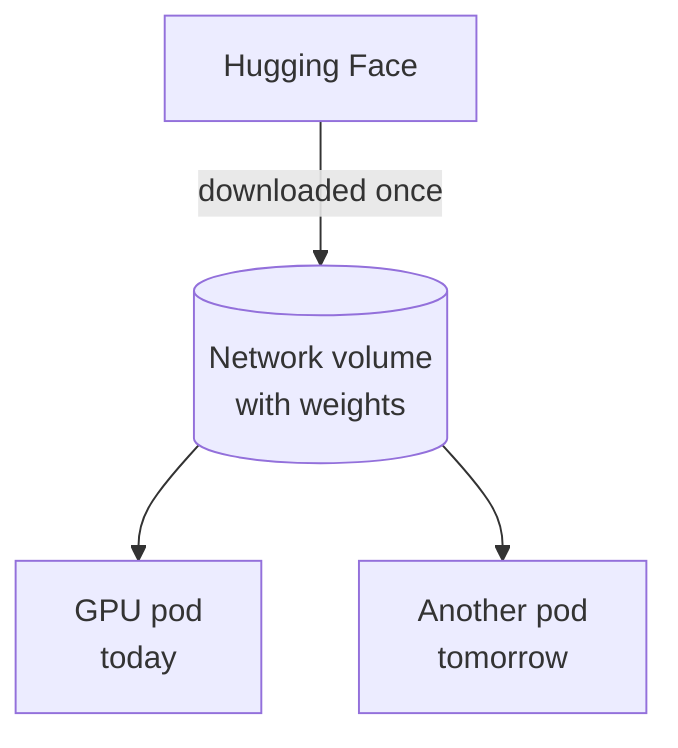
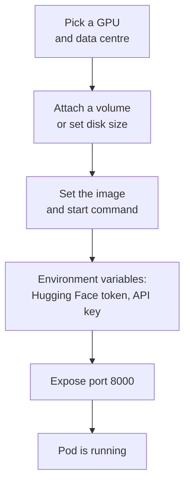
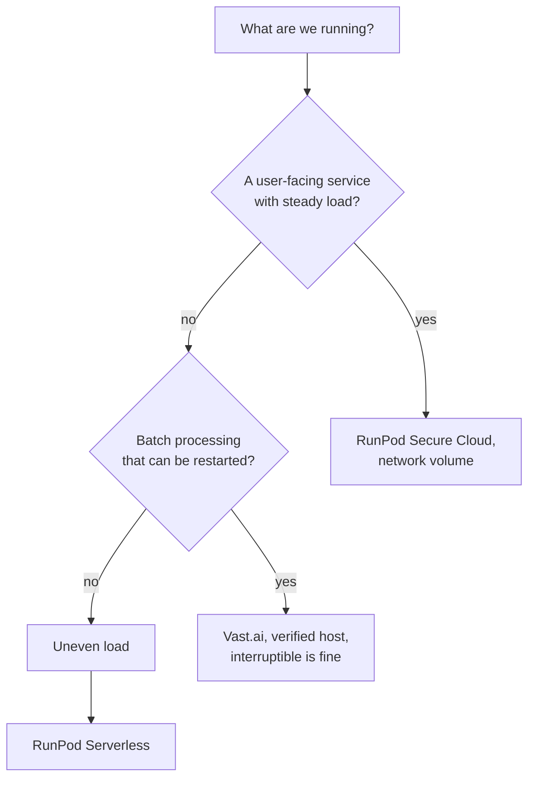

:::tldr
RunPod is a cloud with fixed prices, its own data centres and handy extras: persistent network volumes, ready-made templates, an HTTPS proxy to ports, and serverless. Vast.ai is a marketplace where thousands of owners rent out GPUs: usually cheaper, but you have to check host quality yourself. For a product with steady load, start with RunPod's Secure Cloud. For batch processing and experiments, Vast.ai with a reliability filter often comes out one and a half to two times cheaper. On both platforms most money is lost to idle time and to downloading the weights again.
:::

## How the platforms differ

Both platforms solve the same problem: give you a GPU with a Docker container on it and charge for time. They are built differently.

**RunPod** sells capacity from a price list. There are two kinds of cloud:

- **Secure Cloud**: GPUs in Tier III and higher data centres that RunPod has contracts with. More expensive but more stable, and network volumes are only available here.
- **Community Cloud**: third-party hosts vetted by RunPod. Cheaper, but no network volumes and fewer guarantees.

**Vast.ai** is an exchange. A server owner, whether a data centre or an enthusiast with four RTX 5090s at home, lists it for rent and sets the price. Vast.ai shows statistics for each offer: host reliability, internet speed, actual performance (DLPerf), and whether the server is in a verified data centre.

| | RunPod | Vast.ai |
|---|---|---|
| Prices | fixed, from a price list | market prices, each host sets its own |
| Typical H100 price | 3 to 4 dollars an hour | 1.5 to 2.5 dollars an hour at verified hosts |
| Hardware quality | uniform within a cloud type | varies widely, needs filtering |
| Persistent disks | network volumes that survive pod deletion | disk tied to the machine |
| Port access | HTTPS proxy for each port, plus direct TCP | the host's direct ports, external number assigned at random |
| Serverless | yes, with a ready-made vLLM worker | yes, but a smaller ecosystem |
| Billing | per second, from a prepaid balance | from a prepaid balance; disk is charged even when stopped |

Prices here are guidelines as of early November 2026. Fresh numbers and notable changes in the rental market show up in the feed below.

::news{topic="gpu"}

## Rental types

**On-demand.** The GPU is yours until you release it. The main option for a service that has to answer.

**Interruptible (spot).** 30 to 60 percent cheaper, but the platform can take the GPU back at any moment if someone paying more wants it. On RunPod these are spot pods; on Vast.ai, interruptible offers with a bid. Suitable for batch processing that can resume where it stopped, and unsuitable for an API that users rely on.

**Serverless.** You describe a container, and the platform starts and stops workers to match load and charges only for the time spent processing requests. Convenient for uneven load, but there is a cold start: the first request after idle time waits for a worker to start and load the weights. It is covered in detail in [part seven](/blog/inference-cost/).

**Long-term discounts.** RunPod gives a discount for prepaying months ahead. It only makes sense once load has been measured and is stable.

## The most expensive part: downloading weights

A 27B model in FP8 weighs about 30 GB, gpt-oss-120b about 65 GB. Downloading from Hugging Face takes minutes on a good connection and tens of minutes on a bad one, and all that time you pay for a GPU that does nothing. If you start the server from scratch every day, that adds up.

The solution: keep the weights on a persistent disk, separate from the GPU.



**On RunPod** this is what network volumes are for. A volume lives in a specific data centre, costs about 7 cents per gigabyte per month and attaches to any pod in the same data centre at `/workspace`. Download the weights once, and every new pod starts in a couple of minutes, however long it takes to load the weights from the volume onto the GPU. A 200 GB volume costs 14 dollars a month, less than five hours of H100 rental.

The limitation: the pod has to be in the same data centre as the volume. Before creating a volume, check which data centre has the GPU you need, and create the volume there.

**On Vast.ai** there are no network volumes in this form; the disk is tied to a specific machine. The options are to stop the instance rather than destroy it (the disk keeps being charged, and someone else may rent the GPU on that machine while you are stopped), or to pick hosts with fast internet and accept a download on every start. For batch jobs the second option is perfectly fine.

## Choosing a host on Vast.ai

On a marketplace the cheapest offer often turns out to be the most expensive: the host disappears mid-job, the internet barely downloads the weights, the disk is slow. Before renting, look at four things.

1. **Reliability** of at least 99 percent. This is the share of time the host was available. At 95 percent, three days of work will almost certainly see at least one outage.
2. **Verified data centre.** These hosts have passed Vast.ai's checks and sit in proper data centres. Use them for anything other than experiments.
3. **Internet speed (inet down)** of 1 Gbit/s or more. Otherwise downloading the weights eats all the savings.
4. **Bandwidth price.** Some hosts charge for incoming and outgoing traffic. Downloading 65 GB of weights several times can cost real money.

With the `vastai` command-line tool the same looks like this:

```bash
vastai search offers 'gpu_name=H100_SXM num_gpus=1 verified=true reliability>0.99 inet_down>1000 disk_space>=200' -o 'dph_total'
```

Note that disk size is set when the instance is created and cannot be changed later. Leave headroom: weights, the engine's cache and logs.

## How launching works

On both platforms you launch a Docker image. There are plenty of ready-made templates; for language models the simplest is the official vLLM image, and for images, an image with ComfyUI.



How to reach the server from outside:

- **RunPod** gives an HTTPS address like `https://<pod-id>-8000.proxy.runpod.net` for each exposed HTTP port. It is convenient, but the proxy cuts off requests that run longer than about a hundred seconds. For streaming responses this is usually not a problem; for long non-streaming requests use a direct TCP port.
- **Vast.ai** maps the container's ports to random external ports on the host. The address and port are shown on the instance card. You will have to set up HTTPS yourself or put your own proxy in front of the server.

Either way the server ends up on the internet, so it must not be left without an access key: someone will find it and use it at your expense. We close the endpoint with a key in the next part.

## How not to pay for idle time

A GPU forgotten over a weekend costs as much as a month of network volume. Simple rules:

- **Stop pods you don't need.** On RunPod a stopped pod is not charged for the GPU but is charged for the pod's own disk. If the weights live on a network volume, you can delete the pod entirely instead of stopping it.
- **Set a spending limit.** Both platforms work from a prepaid balance. Don't top it up with more than you are prepared to lose, and enable auto top-up only with a limit.
- **Automatic shutdown when idle.** A simple script that stops the pod if there were no requests in the last hour. It is in [part seven](/blog/inference-cost/).
- **Batch jobs switch the machine off themselves.** The last step of a batch job is a command to destroy the instance.

## What to choose



For experiments any platform will do: take whichever has the GPU you need cheaper right now. It is worth having accounts on both, since availability of specific GPUs changes every day.

## What's next

The GPU is rented and the weights are on disk. In the [next part](/blog/inference-serve/) we run vLLM with the chosen model on it, go through the key settings, measure real speed under load and close the endpoint with an access key.
