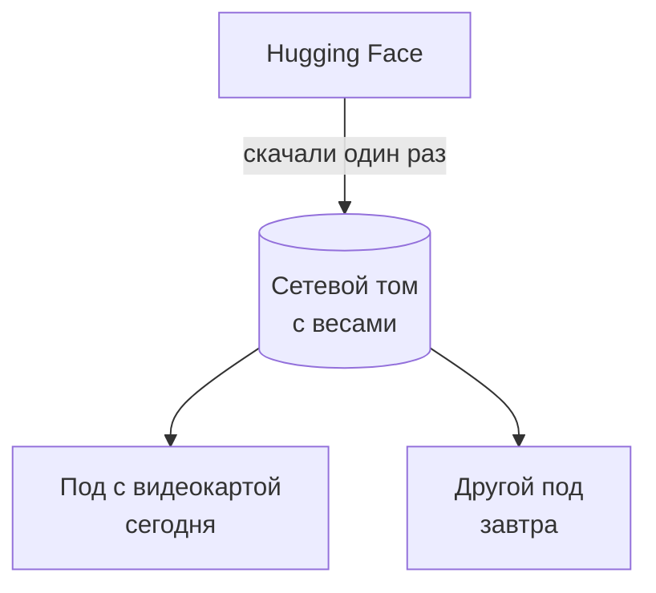
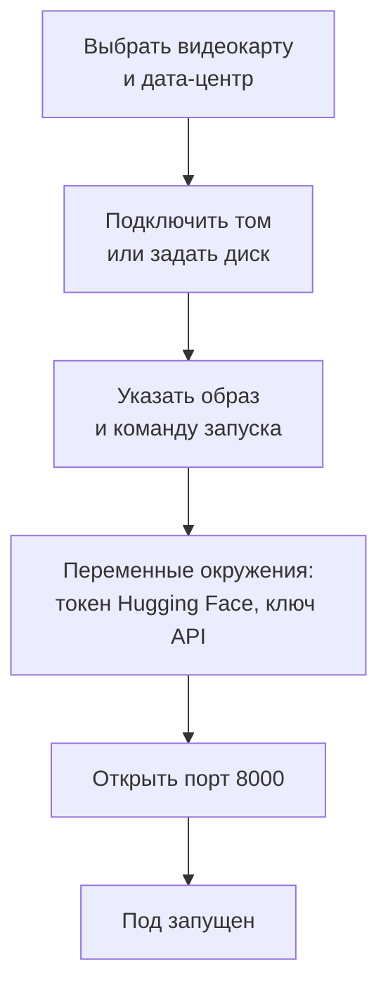
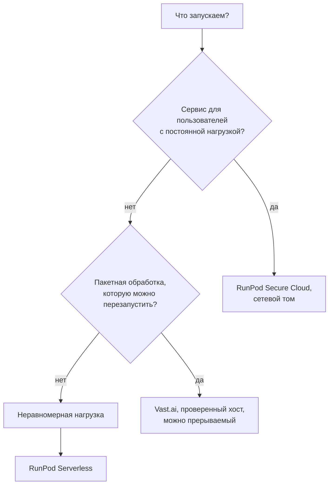

:::tldr
RunPod это облако с фиксированными ценами, своими дата-центрами и удобными мелочами: постоянные сетевые диски, готовые шаблоны, HTTPS-прокси к портам и serverless. Vast.ai это маркетплейс, где видеокарты сдают тысячи владельцев: обычно дешевле, но качество хоста приходится проверять самому. Для продукта с постоянной нагрузкой начинайте с Secure Cloud у RunPod. Для пакетной обработки и экспериментов Vast.ai с фильтром по надёжности часто выходит в полтора-два раза дешевле. На обеих площадках главные деньги теряются на простое и на повторном скачивании весов.
:::

## Чем площадки отличаются

Обе площадки решают одну задачу: дать вам видеокарту с Docker-контейнером на ней и брать деньги за время. Устроены они по-разному.

**RunPod** продаёт мощности по прайсу. Есть два вида облака:

- **Secure Cloud**: видеокарты в дата-центрах уровня Tier III и выше, с которыми у RunPod договор. Дороже, но стабильнее, и только здесь доступны сетевые диски.
- **Community Cloud**: проверенные RunPod сторонние хосты. Дешевле, но без сетевых дисков и с меньшими гарантиями.

**Vast.ai** это биржа. Владелец сервера, будь то дата-центр или энтузиаст с четырьмя RTX 5090 дома, выставляет его на продажу и сам назначает цену. Vast.ai показывает для каждого предложения статистику: надёжность хоста, скорость интернета, реальную производительность (DLPerf), находится ли сервер в проверенном дата-центре.

| | RunPod | Vast.ai |
|---|---|---|
| Цены | фиксированные, по прайсу | рыночные, каждый хост назначает свою |
| Типичная цена H100 | 3 – 4 доллара в час | от 1,5 до 2,5 доллара в час у проверенных хостов |
| Качество железа | одинаковое внутри типа облака | очень разное, нужно фильтровать |
| Постоянные диски | сетевые тома, переживают удаление пода | диск привязан к машине |
| Доступ к портам | HTTPS-прокси на каждый порт и прямой TCP | прямые порты хоста, внешний номер назначается случайно |
| Serverless | есть, с готовым воркером vLLM | есть, но экосистема скромнее |
| Оплата | посекундная, с предоплаченного баланса | с предоплаченного баланса, диск оплачивается и в остановленном состоянии |

Цены здесь ориентиры на начало ноября 2026 года. Свежие цифры и заметные изменения на рынке аренды попадают в ленту ниже.

::news{topic="gpu"}

## Типы аренды

**По требованию (on-demand).** Видеокарта ваша, пока вы её не отпустите. Основной вариант для сервиса, который должен отвечать.

**Прерываемая (spot, interruptible).** Дешевле на 30 – 60 процентов, но площадка может забрать видеокарту в любой момент, если её захочет кто-то, кто платит больше. На RunPod это spot-поды, на Vast.ai interruptible-предложения со ставкой. Подходит для пакетной обработки, которая умеет продолжать с места остановки, и не подходит для API, на который рассчитывают пользователи.

**Serverless.** Вы описываете контейнер, а площадка сама запускает и гасит воркеры под нагрузку и берёт деньги только за время обработки запросов. Удобно при неравномерной нагрузке, но есть холодный старт: первый запрос после простоя ждёт, пока поднимется воркер и загрузятся веса. Подробно разобрано в [седьмой части](/blog/ru/inference-cost/).

**Долгосрочные скидки.** RunPod даёт скидку за предоплату на месяцы вперёд. Имеет смысл, только когда нагрузка уже измерена и стабильна.

## Самое дорогое: скачивание весов

Модель на 27B в FP8 весит около 30 ГБ, gpt-oss-120b около 65 ГБ. Скачивание с Hugging Face на хорошем канале занимает минуты, на плохом десятки минут, и всё это время вы платите за видеокарту, которая ничего не делает. Если поднимать сервер каждый день с нуля, это заметные деньги.

Решение: держать веса на постоянном диске, отдельно от видеокарты.



**На RunPod** для этого есть сетевые тома (network volumes). Том живёт в конкретном дата-центре, стоит около 7 центов за гигабайт в месяц и подключается к любому поду в том же дата-центре в папку `/workspace`. Скачали веса один раз, и дальше каждый новый под стартует за пару минут, сколько займёт загрузка весов с тома в видеокарту. Том на 200 ГБ стоит 14 долларов в месяц, это меньше пяти часов аренды H100.

Ограничение: под должен быть в том же дата-центре, что и том. Перед созданием тома посмотрите, в каком дата-центре есть нужная вам видеокарта, и создавайте том там.

**На Vast.ai** сетевых томов в таком виде нет, диск привязан к конкретной машине. Варианты: не удалять инстанс, а останавливать (диск при этом продолжает оплачиваться, а видеокарту на этой машине за время остановки может арендовать кто-то другой), или выбирать хосты с быстрым интернетом и смириться со скачиванием при каждом запуске. Для пакетных задач второй вариант вполне нормален.

## Как выбрать хост на Vast.ai

На маркетплейсе самое дешёвое предложение часто оказывается самым дорогим: хост пропадает посреди работы, интернет еле качает веса, диск медленный. Перед арендой смотрите на четыре вещи.

1. **Надёжность (reliability)** не ниже 99 процентов. Это доля времени, которое хост был доступен. При 95 процентах за трое суток работы почти наверняка случится хотя бы один обрыв.
2. **Проверенный дата-центр (verified, datacenter).** Такие хосты прошли проверку Vast.ai и стоят в нормальных дата-центрах. Для всего, кроме экспериментов, берите их.
3. **Скорость интернета (inet down)** от 1 Гбит/с. Иначе скачивание весов съест всю экономию.
4. **Цена трафика.** Некоторые хосты берут плату за входящий и исходящий трафик. Скачать 65 ГБ весов несколько раз может стоить заметных денег.

Через консольную утилиту `vastai` то же самое выглядит так:

```bash
vastai search offers 'gpu_name=H100_SXM num_gpus=1 verified=true reliability>0.99 inet_down>1000 disk_space>=200' -o 'dph_total'
```

Учтите, что размер диска задаётся при создании инстанса и потом не меняется. Берите с запасом: веса, кэш движка и логи.

## Как устроен запуск

На обеих площадках вы запускаете Docker-образ. Готовых шаблонов много, и для языковых моделей проще всего взять официальный образ vLLM, а для изображений образ с ComfyUI.



Как достучаться до сервера снаружи:

- **RunPod** даёт HTTPS-адрес вида `https://<id-пода>-8000.proxy.runpod.net` для каждого открытого HTTP-порта. Это удобно, но прокси обрывает запросы, которые выполняются дольше примерно ста секунд. Для потоковых ответов это обычно не проблема, а для долгих запросов без стриминга используйте прямой TCP-порт.
- **Vast.ai** пробрасывает порты контейнера на случайные внешние порты хоста. Адрес и порт показываются в карточке инстанса. HTTPS придётся настроить самим или поставить перед сервером свой прокси.

В обоих случаях сервер оказывается в интернете, поэтому без ключа доступа его оставлять нельзя: найдут и будут пользоваться за ваш счёт. Как закрыть эндпоинт ключом, разберём в следующей части.

## Как не платить за простой

Видеокарта, про которую забыли на выходные, стоит как месяц сетевого тома. Простые правила:

- **Останавливайте поды, которые не нужны.** На RunPod остановленный под не берёт плату за видеокарту, но берёт за диск самого пода. Если веса лежат на сетевом томе, под можно не останавливать, а удалять целиком.
- **Ставьте лимит расходов.** На обеих площадках работа идёт с предоплаченного баланса. Не пополняйте его на сумму, которую не готовы потерять, и включите автопополнение только с лимитом.
- **Автоостановка по простою.** Простой скрипт, который гасит под, если за последний час не было запросов. Он есть в [седьмой части](/blog/ru/inference-cost/).
- **Пакетные задачи выключают машину сами.** Последний шаг пакетной обработки — команда удалить инстанс.

## Что выбрать



Для экспериментов подойдёт любая площадка: возьмите ту, где сейчас дешевле нужная видеокарта. Аккаунты лучше завести на обеих, наличие конкретных видеокарт меняется каждый день.

## Что дальше

Видеокарта арендована, веса на диске. В [следующей части](/blog/ru/inference-serve/) запускаем на ней vLLM с выбранной моделью, разбираемся с ключевыми настройками, замеряем реальную скорость под нагрузкой и закрываем эндпоинт ключом доступа.
