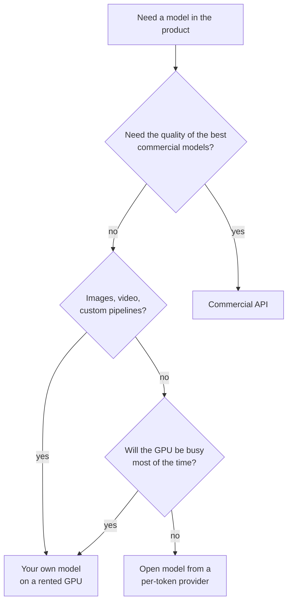
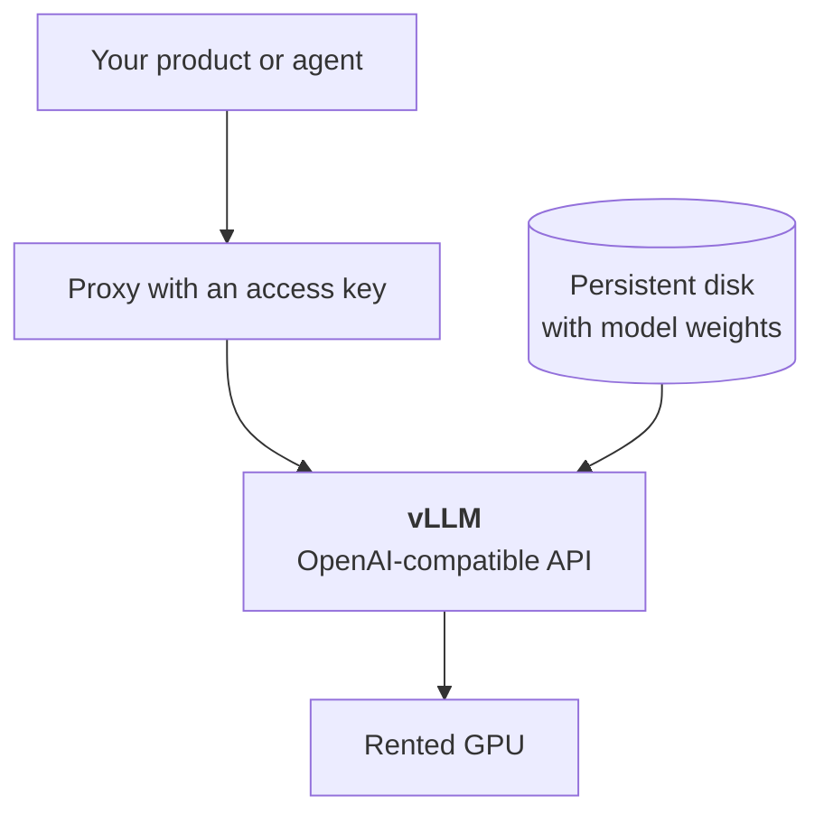

:::tldr
A rented GPU costs money every hour, while an API charges for every token. So your own model only pays off when the GPU is busy most of the time: bulk processing, steady load, your own fine-tuned models, images and video with your own pipelines. If requests are few and uneven, it is cheaper to use the same open model from a per-token provider, or a commercial model over an API.
:::

## What this series is about

Over the last year open models stopped being "almost GPT, only worse". Qwen, DeepSeek, GLM, Gemma, Kimi and gpt-oss handle most working tasks: they parse documents, write code, answer from a knowledge base and call tools. The weights are on Hugging Face, and the GPUs to run them on are rented by the minute.

It is easy to conclude from this that "we'll run our own model and save money". In this series we work out when that is true, and go all the way from choosing a GPU to a running endpoint you can plug into your product instead of a commercial API.

::news{topic="open-models"}

## Two ways to pay

There are two ways to get an answer from a model.

**An API that charges per token.** You send a request and pay for the number of input and output tokens. No requests, no bill. Commercial models (Claude, GPT, Gemini) work this way, and so do providers that host open models: OpenRouter, Together, DeepInfra, Fireworks and dozens of others.

**Your own GPU, paid by time.** You rent a GPU on RunPod, Vast.ai or a cloud provider, run a model on it and pay for every hour it is switched on. It makes no difference whether it served a million requests that hour or none.

Hence the main rule of the whole series: **your own GPU is worth exactly as much as it is utilised.**

## The break-even formula

The price of a million tokens on your own GPU is:

> price per million tokens = hourly rental price / (tokens per second × 3600) × 1,000,000

Take a GPU at 3 dollars an hour and see how the price depends on load.

| Tokens actually generated per second | Price of a million output tokens |
|---|---|
| 50 (one user in a chat) | about 17 dollars |
| 300 (several parallel requests) | about 2.8 dollars |
| 1500 (GPU packed with batches) | about 0.55 dollars |
| 0 (night, weekend, nobody is writing) | infinity |

The speeds here are illustrative; we measure real ones in [part five](/blog/inference-serve/). What matters is the shape of the relationship. One GPU can serve dozens or hundreds of requests at once with little slowdown for each. With a single request you pay for the whole GPU and use a small part of it. With many requests the price per token drops several times over.

That is exactly how a per-token provider makes money: it gathers requests from thousands of customers onto the same GPUs and keeps them busy. You can only beat it on price if you have enough load of your own to keep a GPU occupied.

## When your own model makes sense

**Large volumes in bulk.** You need to label a million support tickets, extract fields from a hundred thousand contracts, translate a catalogue or generate product descriptions. This is batch processing: the GPU runs at full load until the queue is empty and is then switched off. It is the most profitable scenario.

**Steady load.** A product where the model answers users around the clock and there are enough requests to keep the GPU from idling.

**Your own fine-tuned model.** You fine-tuned a model on your data (or attached a LoRA adapter) and providers do not have it. Some providers can host your adapters, but running it yourself is often simpler and cheaper.

**Control over the version.** Commercial models are updated and retired on the provider's schedule. Your own model will not change until you update it. For pipelines where reproducibility matters, that is an argument.

**Images, video and 3D.** This is where your own GPU wins most often. ComfyUI pipelines with your own LoRAs, control networks and chains of models cannot be reproduced at API providers, and paying per generation is expensive. [Part six](/blog/inference-media/) is about this.

**Data must not go to the model provider.** A caveat is needed here. A rented GPU on RunPod or Vast.ai is also someone else's computer. On Vast.ai it may literally be a private individual's computer. If your data requirements are serious, look at isolated clouds with a contract (RunPod's Secure Cloud, verified data centres, the large clouds) or at your own hardware.

## When not to

**Few requests, and uneven ones.** An internal chat bot for 30 employees who write during working hours will load a GPU to a couple of percent. Almost any API will be several times cheaper.

**You need the best quality.** The strongest open models weigh hundreds of gigabytes and need an eight-GPU server. Running one for a single product is expensive. If the task needs the level of the best commercial models, it is more honest to pay for them.

**No time for operations.** Your own model is a server: engine updates, monitoring, restarts, access keys. Not much, but it is work and someone has to do it.

Between the two extremes there is a middle ground that people often forget: **the same open model from a per-token provider.** If you like, say, Qwen or DeepSeek but your load is small, take them through OpenRouter or DeepInfra. The token price there is usually several times lower than for commercial models, and the server is not your concern. When the load grows, you can move to your own GPU without changing code: every one of these APIs is OpenAI-compatible.

## How to decide

This diagram simplifies reality, but nine times out of ten it gives the right answer. Unsure about load? Start with a provider, count your tokens for a month and plug them into the formula above.

## What we will build

By the end of the series we will have:

- an understanding of how much memory and which GPU a particular model needs;
- a chosen model and an engine for it;
- a rented GPU on RunPod or Vast.ai with the weights on a persistent disk, so they are not downloaded on every start;
- a [vLLM](https://docs.vllm.ai) server with an OpenAI-compatible API, protected by a key, with measured speed;
- ComfyUI for images and video on the same platform;
- a table of real costs: the price of a million tokens at your load, automatic shutdown when idle, and a serverless option for uneven load.

Connecting it to a product is no different from connecting to OpenAI: the same request format, a different address and key. So everything built in the series on the [company agent](/blog/series/company-agent/) and [commercial automations](/blog/series/automations/) can move to your own model where that pays off, for example for bulk labelling of incoming messages.

## What's next

In the [next part](/blog/inference-gpu/) we learn to choose a GPU. We look at why the main thing about it is the size and speed of its memory rather than raw compute, how to estimate how much memory a model and its context will take, and which weight formats (FP8, FP4, GGUF) work on which GPUs.
