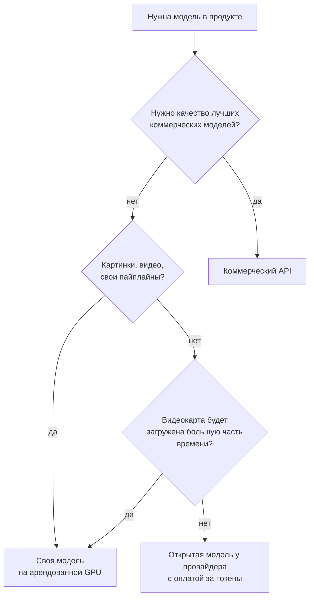
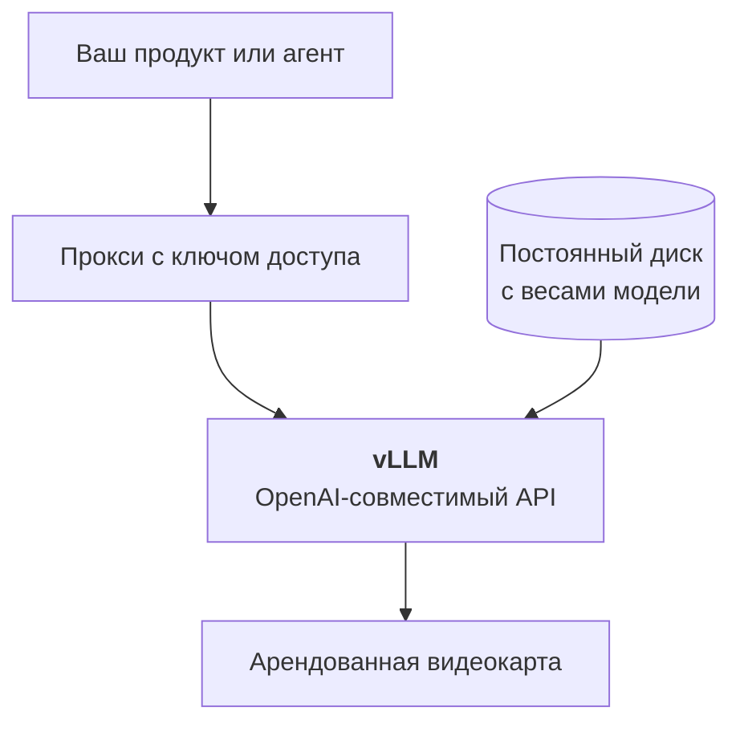

:::tldr
Арендованная видеокарта стоит денег каждый час, а API берёт деньги за каждый токен. Поэтому своя модель выгодна, только когда видеокарта почти всё время занята работой: потоковая обработка больших объёмов, постоянная нагрузка, свои дообученные модели, картинки и видео со своими пайплайнами. Если запросов мало и они приходят неравномерно, дешевле взять ту же открытую модель у провайдера с оплатой за токены или коммерческую модель по API.
:::

## О чём цикл

За последний год открытые модели перестали быть «почти как GPT, но хуже». Qwen, DeepSeek, GLM, Gemma, Kimi и gpt-oss решают большинство рабочих задач: разбирают документы, пишут код, отвечают по базе знаний, вызывают инструменты. Веса лежат на Hugging Face, а видеокарту, на которой их можно запустить, сдают в аренду поминутно.

Из этого легко сделать вывод «поднимем свою модель и сэкономим». В этом цикле мы разберёмся, когда это правда, и пройдём весь путь от выбора видеокарты до работающего эндпоинта, который можно подключить к своему продукту вместо коммерческого API.

::news{topic="open-models"}

## Две модели оплаты

Есть два способа получить ответ от модели.

**API с оплатой за токены.** Вы отправляете запрос и платите за количество входных и выходных токенов. Нет запросов, нет счёта. Так работают коммерческие модели (Claude, GPT, Gemini) и провайдеры, которые хостят открытые модели: OpenRouter, Together, DeepInfra, Fireworks и десятки других.

**Своя видеокарта с оплатой за время.** Вы арендуете GPU на RunPod, Vast.ai или у облачного провайдера, запускаете на ней модель и платите за каждый час, пока она включена. Не важно, обработала она за этот час миллион запросов или ни одного.

Отсюда главное правило всего цикла: **своя видеокарта выгодна ровно настолько, насколько она загружена.**

## Формула окупаемости

Цену миллиона токенов на своей видеокарте считают так:

> цена за миллион токенов = цена часа аренды / (токенов в секунду × 3600) × 1 000 000

Возьмём видеокарту за 3 доллара в час и посмотрим, как цена зависит от загрузки.

| Сколько токенов в секунду реально генерируется | Цена миллиона выходных токенов |
|---|---|
| 50 (один пользователь в чате) | около 17 долларов |
| 300 (несколько параллельных запросов) | около 2,8 доллара |
| 1500 (видеокарта забита батчами) | около 0,55 доллара |
| 0 (ночь, выходные, никто не пишет) | бесконечность |

Цифры скорости здесь условные, реальные мы замерим в [пятой части](/blog/ru/inference-serve/). Важна форма зависимости. Одна видеокарта умеет обрабатывать десятки и сотни запросов одновременно, почти не замедляясь на каждом из них. Если запрос один, вы платите за всю видеокарту, а используете малую её часть. Если запросов много, цена токена падает в разы.

Провайдер с оплатой за токены зарабатывает именно на этом: он собирает запросы тысяч клиентов на одних и тех же видеокартах и держит их загруженными. Обогнать его по цене можно, только если у вас самих достаточно нагрузки, чтобы держать видеокарту занятой.

## Когда своя модель имеет смысл

**Большие объёмы потоком.** Нужно разметить миллион обращений в поддержку, извлечь поля из сотни тысяч договоров, перевести каталог, сгенерировать описания товаров. Это пакетная обработка: видеокарта загружена на сто процентов, пока не закончится очередь, а потом выключается. Это самый выгодный сценарий.

**Постоянная нагрузка.** Продукт, где модель отвечает пользователям круглые сутки и запросов хватает, чтобы видеокарта не простаивала.

**Своя дообученная модель.** Вы дообучили модель на своих данных (или подключили LoRA-адаптер), и у провайдеров её нет. Некоторые провайдеры умеют хостить ваши адаптеры, но часто проще и дешевле поднять самому.

**Контроль над версией.** Коммерческие модели обновляются и снимаются с поддержки по расписанию провайдера. Своя модель не изменится, пока вы сами её не обновите. Для пайплайнов, где важна воспроизводимость, это аргумент.

**Картинки, видео и 3D.** Здесь своя видеокарта выигрывает чаще всего. Пайплайны в ComfyUI со своими LoRA, контрольными сетями и цепочками моделей у API-провайдеров не повторить, а платить за каждую генерацию дорого. Этому посвящена [шестая часть](/blog/ru/inference-media/).

**Данные не должны уходить к провайдеру модели.** Тут нужна оговорка. Арендованная видеокарта на RunPod или Vast.ai тоже чужой компьютер. На Vast.ai это может быть буквально компьютер частного лица. Если требования к данным серьёзные, смотрите на изолированные облака с договором (Secure Cloud у RunPod, проверенные дата-центры, крупные облака) или на собственное железо.

## Когда не стоит

**Мало запросов, и они неравномерны.** Внутренний чат-бот на 30 сотрудников, который пишет в рабочие часы, загрузит видеокарту на пару процентов. Почти любой API будет дешевле в разы.

**Нужно лучшее качество.** Самые сильные открытые модели весят сотни гигабайт и требуют сервер из восьми видеокарт. Поднимать такой ради одного продукта дорого. Если задача требует уровня лучших коммерческих моделей, честнее платить за них.

**Нет времени на эксплуатацию.** Своя модель это сервер: обновления движка, мониторинг, перезапуски, ключи доступа. Немного, но это работа, и её кто-то должен делать.

Между двумя крайностями есть середина, о которой часто забывают: **та же открытая модель у провайдера с оплатой за токены.** Если вам нравится, например, Qwen или DeepSeek, но нагрузка небольшая, возьмите их через OpenRouter или DeepInfra. Цена токена там обычно в разы ниже, чем у коммерческих моделей, а сервер не ваша забота. Когда нагрузка вырастет, можно перейти на свою видеокарту, не меняя код: API у всех OpenAI-совместимый.

## Как принять решение

Эта схема упрощает реальность, но в девяти случаях из десяти приводит к правильному ответу. Сомневаетесь в загрузке? Начните с провайдера, посчитайте токены за месяц и подставьте в формулу выше.

## Что мы построим

К концу цикла у нас будет:

- понимание, сколько памяти и какая видеокарта нужна под конкретную модель;
- выбранная модель и движок для неё;
- арендованная видеокарта на RunPod или Vast.ai с весами на постоянном диске, чтобы не скачивать их при каждом запуске;
- сервер [vLLM](https://docs.vllm.ai) с OpenAI-совместимым API, закрытый ключом, с замеренной скоростью;
- ComfyUI для картинок и видео на той же площадке;
- таблица реальной стоимости: цена миллиона токенов при вашей нагрузке, автоостановка на время простоя и serverless-вариант для неравномерной нагрузки.

Подключение к продукту ничем не отличается от подключения к OpenAI: тот же формат запросов, другой адрес и ключ. Поэтому всё, что было построено в циклах про [корпоративного агента](/blog/ru/series/company-agent/) и [коммерческие автоматизации](/blog/ru/series/automations/), может переехать на свою модель там, где это выгодно, например для массовой разметки входящих.

## Что дальше

В [следующей части](/blog/ru/inference-gpu/) учимся выбирать видеокарту. Разберёмся, почему главное в ней объём и скорость памяти, а не вычислительная мощность, как прикинуть, сколько памяти займёт модель и её контекст, и какие форматы весов (FP8, FP4, GGUF) на каких видеокартах работают.
