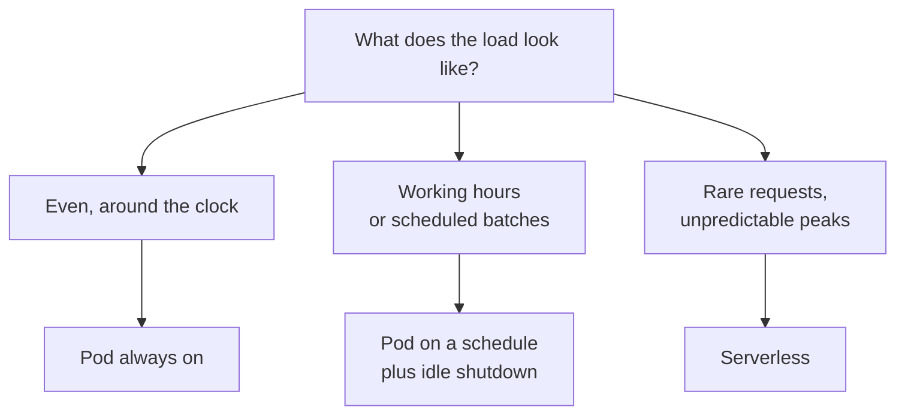

:::tldr
The real price of your own model is the monthly bill divided by the number of useful tokens that month, not the hourly price divided by speed. Idle time eats savings fastest. There are three modes: the GPU is always on (pays off only with round-the-clock load), on a schedule or shut down when idle (for working hours and batch jobs), or serverless (for rare and unpredictable requests, where a second costs more but you only pay for work). Choose the mode by the shape of your load, then compare the total with the price of the same model at a provider.
:::

## What the bill is made of

In [part one](/blog/inference-concept/) we calculated the price of a million tokens from the hourly price and speed. That is a lower bound. A real monthly bill looks like this:

| Item | What it includes |
|---|---|
| GPU hours | all the time the pod is on, including nights and idle time |
| Storage | the network volume with weights, disks of stopped pods |
| Traffic | at some Vast.ai hosts; on RunPod ingress and egress are free |
| Experiments | spin up, try a model, find it doesn't fit, delete |
| Your time | updates, restarts, working out why the server went down at night |

And the right formula:

> real price per million tokens = monthly bill / useful tokens per month × 1,000,000

Count useful tokens from your service's logs or from vLLM's metrics. If the GPU does nothing twelve hours a day, the real token price is twice what you got in the measurement from [part five](/blog/inference-serve/).

::news{topic="cost inference"}

## Three operating modes



Let's see how they differ in money. The example is illustrative: one H100 at 3 dollars an hour, a service needed on working days, with actual request processing taking about three hours a day.

| Mode | Hours per month | Approximate bill | What matters |
|---|---|---|---|
| Always on | 730 | about 2200 dollars | instant answers at any time |
| Scheduled, 10 hours on working days | 220 | about 660 dollars | no service at night or on weekends |
| Serverless, paying only for processing | about 66 | about 400 dollars, if a serverless second costs twice a pod second | the first request after idle waits for a cold start |

Plus a network volume at about 14 dollars a month in every case. The difference between the first and last rows is fivefold, with the same model and the same GPU.

## Mode 1. Always on

Fits when requests come around the clock and the GPU is at least half loaded: a product with users in different time zones, a constant stream of documents to label. This is where RunPod's long-term prepayment discounts work, but only once load has been measured over a couple of months.

The main risk of this mode is that load turns out lower than it seemed. Look at the utilisation metrics once a month. If the GPU is idle more than half the time, it is time to switch modes or move to a provider.

## Mode 2. Scheduled, with idle shutdown

Fits internal services needed during working hours, and batch processing.

**Schedule.** The pod is started in the morning and stopped in the evening through the platform's API. A scheduled start is easy to hang on GitHub Actions or on whatever system runs your other background jobs.

**Idle shutdown.** If there are no requests for half an hour, the pod shuts itself down. vLLM reports the number of running and waiting requests in `/metrics`, and inside a RunPod pod there is the `runpodctl` utility and the pod id in the `RUNPOD_POD_ID` variable. The whole watchdog fits in a few lines that run next to vLLM:

```bash
idle=0
while sleep 60; do
  busy=$(curl -s localhost:8000/metrics | awk '/^vllm:num_requests_(running|waiting)/ {s+=$2} END {print s+0}')
  if [ "$busy" = "0" ]; then idle=$((idle+1)); else idle=0; fi
  [ "$idle" -ge 30 ] && runpodctl stop pod "$RUNPOD_POD_ID"
done
```

If the weights live on a network volume, you can delete the pod entirely instead of stopping it (`runpodctl remove pod`): then you don't pay for its own disk either.

**Batch processing.** The job itself ends with a command to delete the pod or the Vast.ai instance. Batches are also where interruptible GPUs belong: they are 30 to 60 percent cheaper; the processing just has to be able to resume where it stopped. A simple way is to mark processed records in the database and on start take only unprocessed ones.

## Mode 3. Serverless

Fits when requests are rare or load jumps unpredictably. You don't hold a GPU; the platform starts workers for requests and stops them when requests run out. RunPod has a ready-made vLLM worker: you set the model in its settings, attach a network volume with the weights, and get an endpoint with an OpenAI-compatible API at an address like `https://api.runpod.ai/v2/<endpoint-id>/openai/v1`. Product code changes the same way as in part five: the address and the key.

What to know:

- **Cold start.** If there are no workers, the first request waits for a worker to start and load the weights onto the GPU. For a 30 GB model that is tens of seconds; for large models, minutes. A network volume and the platform's fast-start features shorten this, but not to zero.
- **A second costs more.** Serverless worker time costs more than the same time on a pod. Check the price list for the specific GPU.
- **Active workers.** You can keep one worker on permanently (at a discount) and start the rest for peaks. That removes the cold start for the first user but brings back idle charges for one worker.
- **Timeouts.** The platform limits request execution time and how long a worker idles before stopping. These settings determine both latency and the bill.

## What to compare against

The final number from the table above has to be compared with the price of the same model at per-token providers. To do that:

1. Take the real number of input and output tokens per month from your service's logs.
2. Multiply by the provider's prices for the same model. OpenRouter shows several providers' prices side by side.
3. Compare with the bill for your own GPU in the chosen mode, including storage.

If the provider is cheaper or comparable, stay with the provider: you save not only money but also operations time. Your own GPU is justified when it is noticeably cheaper at your real load, or when the provider lacks the model, adapter, pipeline or data terms you need.

Prices at providers and for GPU rental change every month, usually downwards. New models shift the calculation too: a model half the size at the same quality means a GPU half the price. So repeat the calculation once a quarter; the news feed above is a convenient way to follow the changes.

## Final checklist

The whole series in one list:

1. **Decide whether you need your own model.** Estimate the expected GPU utilisation. With small, uneven load, take the same open model from a provider ([part 1](/blog/inference-concept/)).
2. **Choose a model on your own examples** through a provider, before renting a GPU. Take the smallest one that copes ([part 3](/blog/inference-models/)).
3. **Count the memory**: FP8 weights plus 20 to 50 percent for cache. Choose the GPU from that; one big one beats two small ones ([part 2](/blog/inference-gpu/)).
4. **Choose a platform**: RunPod Secure Cloud for a service, Vast.ai for batches and experiments. Keep the weights on a persistent volume ([part 4](/blog/inference-clouds/)).
5. **Bring up vLLM** with a limited context, an FP8 cache and an access key. Measure speed at different levels of parallelism ([part 5](/blog/inference-serve/)).
6. **For images and video** use ComfyUI behind your own service with a key, and keep the pipeline in the repository ([part 6](/blog/inference-media/)).
7. **Choose an operating mode** by the shape of your load, set up idle shutdown, and recalculate the economics once a quarter.
