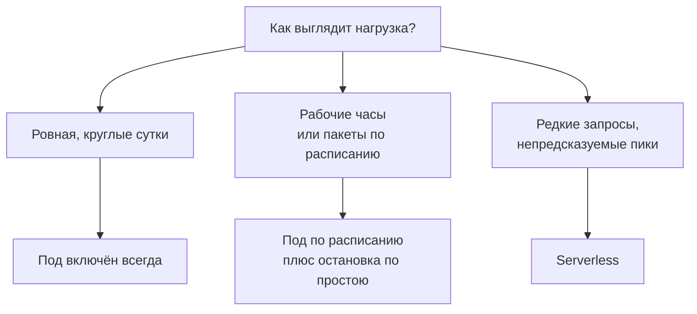

:::tldr
Реальная цена своей модели это месячный счёт, делённый на число полезных токенов за месяц, а не цена часа, делённая на скорость. Простой съедает экономию быстрее всего. Есть три режима: видеокарта включена всегда (выгодно только при круглосуточной нагрузке), включена по расписанию или гаснет по простою (для рабочих часов и пакетных задач), serverless (для редких и непредсказуемых запросов, где секунда дороже, но платите только за работу). Выбирайте режим по форме нагрузки, а потом сравнивайте итог с ценой той же модели у провайдера.
:::

## Из чего складывается счёт

В [первой части](/blog/ru/inference-concept/) мы считали цену миллиона токенов по цене часа и скорости. Это нижняя граница. Реальный счёт за месяц выглядит так:

| Статья | Что входит |
|---|---|
| Часы видеокарты | всё время, пока под включён, включая ночи и простой |
| Хранилище | сетевой том с весами, диски остановленных подов |
| Трафик | на Vast.ai у части хостов; на RunPod входящий и исходящий бесплатны |
| Эксперименты | поднять, попробовать модель, понять, что не подходит, удалить |
| Ваше время | обновления, перезапуски, разбор, почему ночью упал сервер |

И правильная формула:

> реальная цена миллиона токенов = счёт за месяц / полезных токенов за месяц × 1 000 000

Полезные токены считаются по логам вашего сервиса или по метрикам vLLM. Если видеокарта двенадцать часов в сутки ничего не делает, реальная цена токена вдвое выше той, что получилась в замере из [пятой части](/blog/ru/inference-serve/).

::news{topic="cost inference"}

## Три режима работы



Посмотрим, как они отличаются в деньгах. Пример условный: одна H100 за 3 доллара в час, сервис нужен в рабочие дни, а реальная обработка запросов занимает около трёх часов в день.

| Режим | Часов в месяц | Примерный счёт | Что важно |
|---|---|---|---|
| Включена всегда | 730 | около 2200 долларов | ответ мгновенный в любое время |
| По расписанию, 10 часов в рабочие дни | 220 | около 660 долларов | ночью и в выходные сервиса нет |
| Serverless, платим только за обработку | около 66 | около 400 долларов, если секунда serverless вдвое дороже пода | первый запрос после простоя ждёт холодного старта |

Плюс сетевой том около 14 долларов в месяц во всех вариантах. Разница между первой и последней строкой в пять раз, при этом модель и видеокарта одни и те же.

## Режим 1. Включена всегда

Подходит, когда запросы идут круглые сутки и видеокарта загружена хотя бы наполовину: продукт с пользователями в разных часовых поясах, постоянный поток документов на разметку. Здесь работают долгосрочные скидки RunPod за предоплату, но только когда нагрузка уже измерена за пару месяцев.

Главный риск этого режима: нагрузка оказалась меньше, чем казалось. Раз в месяц смотрите на метрики загрузки. Если видеокарта больше половины времени простаивает, пора переходить на другой режим или на провайдера.

## Режим 2. По расписанию и с остановкой по простою

Подходит для внутренних сервисов, которые нужны в рабочее время, и для пакетной обработки.

**Расписание.** Под запускается утром и останавливается вечером через API площадки. Запуск по расписанию удобно повесить на GitHub Actions или на ту же систему, где у вас крутятся остальные фоновые задачи.

**Остановка по простою.** Если запросов нет полчаса, под гасит сам себя. vLLM отдаёт число выполняемых и ожидающих запросов в `/metrics`, а внутри пода на RunPod есть утилита `runpodctl` и идентификатор пода в переменной `RUNPOD_POD_ID`. Весь сторож умещается в несколько строк, которые запускаются рядом с vLLM:

```bash
idle=0
while sleep 60; do
  busy=$(curl -s localhost:8000/metrics | awk '/^vllm:num_requests_(running|waiting)/ {s+=$2} END {print s+0}')
  if [ "$busy" = "0" ]; then idle=$((idle+1)); else idle=0; fi
  [ "$idle" -ge 30 ] && runpodctl stop pod "$RUNPOD_POD_ID"
done
```

Если веса лежат на сетевом томе, под можно не останавливать, а удалять целиком (`runpodctl remove pod`): тогда не придётся платить и за его собственный диск.

**Пакетная обработка.** Задача сама заканчивается командой удалить под или инстанс на Vast.ai. Для пакетов же стоит использовать прерываемые видеокарты: они дешевле на 30 – 60 процентов, нужно только, чтобы обработка умела продолжать с места остановки. Простой способ: отмечать обработанные записи в базе и при старте брать только необработанные.

## Режим 3. Serverless

Подходит, когда запросы редкие или нагрузка скачет непредсказуемо. Вы не держите видеокарту, площадка поднимает воркеры под запросы и гасит их, когда запросы кончаются. На RunPod есть готовый воркер vLLM: в настройках указываете модель, подключаете сетевой том с весами, и получаете эндпоинт с OpenAI-совместимым API по адресу вида `https://api.runpod.ai/v2/<id-эндпоинта>/openai/v1`. Код продукта меняется так же, как в пятой части: адрес и ключ.

Что важно знать:

- **Холодный старт.** Если воркеров нет, первый запрос ждёт, пока воркер поднимется и загрузит веса в видеокарту. Для модели на 30 ГБ это десятки секунд, для больших моделей минуты. Сетевой том и функции быстрого старта площадки сокращают это время, но не до нуля.
- **Секунда дороже.** Время serverless-воркера стоит дороже, чем такое же время пода. Сверьте с прайсом конкретной видеокарты.
- **Активные воркеры.** Можно держать один воркер включённым постоянно (со скидкой), а остальные поднимать под пики. Это убирает холодный старт для первого пользователя, но возвращает плату за простой одного воркера.
- **Таймауты.** Площадка ограничивает время выполнения запроса и время простоя воркера перед остановкой. Эти настройки определяют и задержку, и счёт.

## С чем сравнивать

Итоговое число из таблицы выше нужно сравнить с ценой той же модели у провайдеров с оплатой за токены. Для этого:

1. Возьмите реальное число входных и выходных токенов за месяц из логов вашего сервиса.
2. Умножьте на цены провайдера за ту же модель. На OpenRouter видны цены нескольких провайдеров рядом.
3. Сравните со счётом за свою видеокарту в выбранном режиме, включая хранилище.

Если провайдер дешевле или сопоставим, оставайтесь у провайдера: вы экономите не только деньги, но и время на эксплуатацию. Своя видеокарта оправдана, когда она заметно дешевле при вашей реальной нагрузке, или когда у провайдера нет нужной модели, адаптера, пайплайна или условий по данным.

Цены и у провайдеров, и на аренду видеокарт меняются каждый месяц, обычно вниз. Новые модели тоже сдвигают расчёт: модель вдвое меньше при том же качестве означает видеокарту вдвое дешевле. Поэтому расчёт стоит повторять раз в квартал, а следить за изменениями удобно по ленте новостей выше.

## Итоговый чек-лист

Весь цикл в одном списке:

1. **Решите, нужна ли своя модель.** Посчитайте ожидаемую загрузку видеокарты. При неравномерной и небольшой нагрузке берите ту же открытую модель у провайдера ([часть 1](/blog/ru/inference-concept/)).
2. **Выберите модель на своих примерах** через провайдера, до аренды видеокарты. Берите самую маленькую, которая справляется ([часть 3](/blog/ru/inference-models/)).
3. **Посчитайте память**: веса в FP8 плюс 20 – 50 процентов на кэш. По ней выберите видеокарту; одна большая лучше двух маленьких ([часть 2](/blog/ru/inference-gpu/)).
4. **Выберите площадку**: RunPod Secure Cloud для сервиса, Vast.ai для пакетов и экспериментов. Веса держите на постоянном томе ([часть 4](/blog/ru/inference-clouds/)).
5. **Поднимите vLLM** с ограниченным контекстом, кэшем в FP8 и ключом доступа. Замерьте скорость при разной параллельности ([часть 5](/blog/ru/inference-serve/)).
6. **Для изображений и видео** используйте ComfyUI за собственным сервисом с ключом, пайплайн храните в репозитории ([часть 6](/blog/ru/inference-media/)).
7. **Выберите режим работы** по форме нагрузки, настройте остановку по простою и пересчитывайте экономику раз в квартал.
