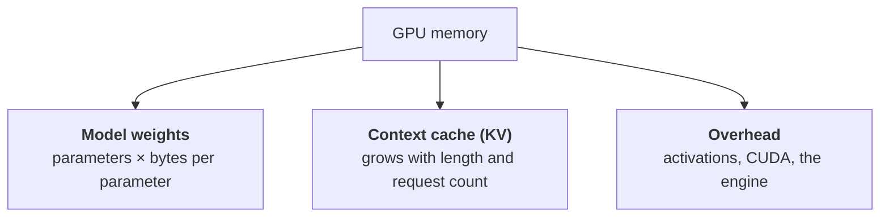
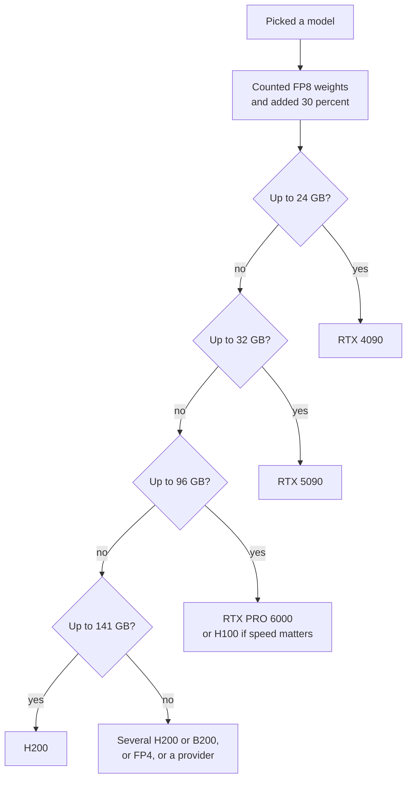

:::tldr
First the model has to fit: weights plus context cache plus headroom. Weights are easy to count: the number of parameters times the size of one parameter (2 bytes in BF16, 1 in FP8, half a byte in FP4). Generation speed is limited by memory speed: every new token requires reading all the active weights. So of two GPUs with the same memory, the one with higher bandwidth is faster, and MoE models with few active parameters generate several times faster than dense models of the same size.
:::

## Two stages of generation

A model's answer is made of two stages, and they have different bottlenecks.

**Prefill.** The model reads your whole request: the system prompt, the history, the documents. All the request's tokens are processed at once in large matrix multiplications. Here the GPU is limited by compute. This stage decides how long you wait for the first token.

**Decode.** The model generates the answer one token at a time. For each token it has to read all the model's active weights from memory, and do very little arithmetic with them. The GPU spends most of its time waiting for memory. This stage decides how fast the text flows.

In chats and agents most of the time goes to decode, so the key GPU property for inference is **memory bandwidth**, not the teraflops in marketing tables.

## How much memory you need

GPU memory splits into three parts.

### Weights

Multiply the number of parameters by the size of one parameter in the chosen format:

| Format | Bytes per parameter | 27B model | 120B model |
|---|---|---|---|
| BF16 (original) | 2 | 54 GB | 240 GB |
| FP8 | 1 | 27 GB | 120 GB |
| FP4 / INT4 | about 0.5 | about 15 GB | about 65 GB |

For MoE (Mixture of Experts) models you count the **total** number of parameters, not the active ones. A 35B-parameter model where 3B work on each token still has to sit in memory in full.

### Context cache

For every token in the context the model stores attention keys and values on every layer. This is the KV cache, and it grows linearly with context length and with the number of concurrent requests. For classic attention the size per token is:

> KV per token = 2 × layers × KV heads × head size × bytes per value

All these numbers are in the model's `config.json` on Hugging Face (`num_hidden_layers`, `num_key_value_heads`, `head_dim`). For a typical dense 30B model with 64 layers, 8 KV heads of 128 and a BF16 cache this comes to 256 KB per token. One 32-thousand-token request takes 8 GB, and ten of them in parallel take 80 GB, more than the weights themselves.

The good news is that modern models fight this. Compressed attention (MLA in DeepSeek and Kimi), a sliding window on some layers (Gemma), and hybrids with linear attention (Qwen3.5 onwards, Nemotron) shrink the cache several times over. So the formula above is an upper bound. The engine shows the exact figure at startup: vLLM logs how many cache tokens fit in memory.

The cache can also be stored in FP8. That doubles the number of tokens that fit in the same memory with almost no loss of quality.

### Rule of thumb

Take the size of the weights in the chosen format and add 20 to 50 percent. Twenty if the context is short and requests are few. Fifty or more if you need long context and many parallel users. If the result does not fit on one GPU, there are three ways out: a smaller format, a bigger GPU or several GPUs.

## What speed to expect

You can estimate the upper bound on generation speed for a single request before launching anything:

> tokens per second (maximum) ≈ memory bandwidth / size of the active weights

A dense 27B model in FP8 weighs 27 GB. An H100 SXM reads memory at 3.35 TB/s, giving a ceiling of about 120 tokens per second for one stream. In practice you get 60 to 80 percent of the ceiling.

A 35B MoE model with 3B active parameters in the same FP8 reads about 3 GB per token, and its ceiling is around a thousand tokens per second. In practice other overheads will cap it, but the difference from a dense model is still several-fold. That is why MoE is so popular for inference: it needs the memory of a big model and runs at the speed of a small one.

With parallel requests the weights are read once for the whole batch, and total throughput grows almost linearly until it hits compute or runs out of cache memory. That is why, in [part one](/blog/inference-concept/), GPU utilisation changed the token price so dramatically.

## Weight formats and GPU generations

Models are usually published in BF16, with compressed versions alongside. Not every format works equally well on every GPU.

| Format | Hardware support | When to use it |
|---|---|---|
| BF16 | everywhere from Ampere (A100, RTX 30xx) | when memory allows and you want the quality reference |
| FP8 | Ada (RTX 40xx, L40S), Hopper (H100, H200), Blackwell | the main format for server inference: the quality loss is barely visible |
| NVFP4, MXFP4 | Blackwell (B200, B300, RTX 50xx, RTX PRO 6000); gpt-oss's MXFP4 also runs on Hopper | when you need to fit a big model; on Blackwell it is also faster |
| AWQ, GPTQ (INT4) | any NVIDIA GPU via optimised kernels | older and consumer GPUs without FP8 |
| GGUF | llama.cpp and Ollama, including CPU and Mac | local use and small servers, not for heavy load |

FP8 will also run on an A100, but without hardware support: the weights are stored in FP8 and save memory, while the arithmetic is done in BF16. It works, but don't expect H100 speeds.

The practical takeaway: if the GPU supports FP8, take the authors' FP8 version of the model. It has been checked for quality and is half the size of the original.

## GPUs you can actually rent

Prices are approximate: RunPod's list price per GPU per hour in early November 2026. On Vast.ai the same cards are often cheaper; more on that in part four.

| GPU | Memory | Bandwidth | FP8 / FP4 | Price per hour | Good for |
|---|---|---|---|---|---|
| RTX 4090 | 24 GB | 1.0 TB/s | yes / no | about 0.9 dollars | models up to 14B in FP8, up to 32B in INT4, images |
| RTX 5090 | 32 GB | 1.8 TB/s | yes / yes | about 1.2 dollars | models up to 27B in FP8 with short context, images and video |
| L40S | 48 GB | 0.86 TB/s | yes / no | about 1.1 dollars | lots of memory for little money, but slow memory |
| RTX PRO 6000 | 96 GB | 1.8 TB/s | yes / yes | about 2.5 dollars | best price per gigabyte; models up to 70B in FP8, MoE up to 120B in FP4 |
| A100 80 GB | 80 GB | 2.0 TB/s | no / no | about 1.8 dollars | cheap, but no FP8; fine for BF16 and INT4 |
| H100 | 80 GB | 3.35 TB/s | yes / no | about 3 to 4 dollars | the standard for server inference |
| H200 | 141 GB | 4.8 TB/s | yes / no | about 5.3 dollars | big models and long context on one card |
| B200 | 180 GB | 8 TB/s | yes / yes | about 8 dollars | fastest generation, large MoE in FP4 |
| B300 | 288 GB | 8 TB/s | yes / yes | about 9 dollars | even more memory per card |

AMD has the MI300X (192 GB, 5.3 TB/s) and newer cards. vLLM and SGLang support them, but few are available to rent on RunPod and Vast.ai, and there are fewer ready-made images and optimisations for them. If you don't want to deal with compatibility, start with NVIDIA.

## Several GPUs

If a model does not fit on one GPU, it is split across several. The most common method is tensor parallelism: each layer is cut into pieces and the GPUs exchange results at every step. That needs a fast link between them.

- In H100, H200 and B200 servers the cards are joined by NVLink, and eight cards work almost like one big one.
- Consumer cards and the RTX PRO 6000 are linked over PCIe. Two cards work fine; four already lose noticeably on communication.

Hence the rule: **one big GPU beats two small ones.** Two RTX 5090s add up to 64 GB, but one 96 GB RTX PRO 6000 is simpler, faster on long context and barely more expensive.

The largest open models only live on eight-GPU servers. For example, the weights of DeepSeek V4.1 Flash take about 510 GB, and Kimi K3 more than one and a half terabytes. Such a server costs 40 to 70 dollars an hour, and this is the case where a per-token provider almost always wins.

## Choosing in five minutes

Two adjustments to the diagram. If response speed for a single user matters, go one step up in memory bandwidth: an H100 instead of an RTX PRO 6000. If throughput for many users matters, be more generous with cache memory: the more memory is left after the weights, the more requests the GPU handles at once.

## What's next

We can now estimate which GPU a model needs. In the next part we choose the model itself: which open models are worth running now for different tasks and budgets, and which engine to serve them with: vLLM, SGLang, llama.cpp or Ollama.
